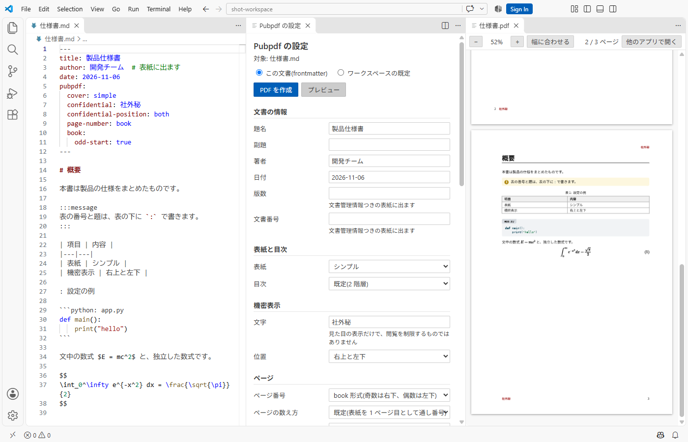

# Pubpdf

Markdown の原稿から、Quarto と Typst で PDF を作る VS Code 拡張機能です。Quarto や Typst の設定ファイルを書く必要はありません。



このリポジトリは配布用で、ソースコードは置いていません。拡張機能は [Releases](https://github.com/ctenopoma/Pubpdf/releases/latest) からダウンロードできます。

## できること

- 1つの md から1つの PDF を作る
- 複数の md を1冊にまとめる
- 表紙、機密表示、目次、ページ番号を設定で切り替える
- 文字の大きさ、行間、余白、用紙の種類と向き、見出しと図表の番号の形式を設定で変える
- frontmatter に書いた履歴を、バージョン履歴のページにする(列の順と見出し、手書き用の空の行も指定できる)。表紙に承認欄と押印欄、二重の枠を付ける
- 設計書の形の表を組む(セルの結合と網掛け、2 段の見出し、セルの中の改行と箇条書き、HTML の表)。短い表は中身の幅に合わせられる
- 見出しの番号を「1. → 1.1 → (1) → ①」のような形にし、図表の番号を節ごと(表 1.1-1)に振る
- 章を奇数ページから始め、綴じ代を取る(両面印刷や製本の前提)
- 表、コード(ファイルの参照、大きさに合わせた縮小、1 ページに入らないコードの付録への移動)、数式、定理、Mermaid の図(ほかの図と同じ配色にそろえる)、注意書きの囲みを組む
- ディレクトリ構造、グラフ、工程表、ビット配置、層構造、波形、作業分解、画面の模式図、JSON と YAML、ネットワーク、ユースケース、スイムレーンの業務フロー、FTA、帳票と画面の方眼、ER、画面遷移の図を描く(文字を検索でき、ブラウザは不要)
- テンプレート用の記入の指示の囲みを書き、仕上げるときにまとめて消す
- IPA の設計書の様式に沿った記入例(samples)と空のテンプレート(templates)を使う
- 参考文献を引用し、文献の一覧、図と表の一覧、付録を組む。脚注を参考文献の一覧にまとめ、一覧を置く位置も決められる。`[^1,2]` で脚注をまとめて引ける
- 本文を段組みにし、ヘッダとフッタに文字と罫線を入れ、透かしと表紙のロゴを付ける
- テーマの色、表の体裁、コードの配色を選ぶ。文中のコードに薄い灰色の角丸の背景を付け、差分(diff)の行に色を付ける
- Qiita や Zenn、GitHub 向けに書いた原稿をそのまま組む(画像と図の幅、画像の題、HTML のタグ、`<kbd>`、絵文字、数式、生の URL、共有フォルダのパス)
- PDF の文書情報を指定し、PDF/A と PDF/UA で出力する
- PDF にしおりを付ける(見出しから自動で作ります)
- フォントを指定し、OS に入れていないフォントも読み込む
- VS Code の中で作成、プレビュー、設定の変更をする。編集中の内容をそのまま組み直すライブプレビューも使える(表示は作る PDF と同じ。編集中の箇所を追い、ダブルクリックで原稿のその行へ移る)
- 書いている間に文章を点検する(和文と英数字の間の空白、全角の英数字、英単語のつづり、です・ます調とである調の混在、ら抜き言葉など)。直せるものはまとめて直す
- 編集中のパイプ表を見やすく表示する(試験的。行の塗り分け、列を揃える表示、行の終わりの Enter で行を足す)
- 前に描いた Mermaid の図を再利用して、2 回目からの組版を速くする

組版に必要な変換は中間コピーに対して行うので、PDF を何度作っても原稿は変わりません。原稿を書き換えるのは、設定パネルと雛形の挿入で frontmatter を編集するときだけです。

## 必要なもの

| ソフト | 用途 | 補足 |
|---|---|---|
| [Quarto](https://quarto.org/) 1.10.18 以上 | 組版 | |
| VS Code 1.90 以上 | 拡張機能 | |
| 日本語フォント | 本文 | Windows なら標準のフォントで動きます |
| Edge か Chrome | Mermaid の図 | 図を使わなければ不要です |

## インストール

1. [最新の Release](https://github.com/ctenopoma/Pubpdf/releases/latest) から `.vsix` ファイルをダウンロードします。
2. ダウンロードしたフォルダのターミナルで、次のコマンドを実行します。版が違うときは、ファイル名を読み替えてください。拡張機能のビューの「...」メニューから「VSIX からのインストール」を選んでも入れられます。

   ```bash
   code --install-extension pubpdf-1.7.3.vsix
   ```

3. VS Code のウィンドウを再読み込みします。
4. コマンドパレット(`Ctrl+Shift+P`)で `Pubpdf: 環境を確認` を実行し、Quarto とフォントの状態を確かめます。

新しい版に更新するときも、同じ手順で入れて、ウィンドウを再読み込みします。

## 使い方

1. Markdown の文書を開きます。
2. エディタ右上の PDF のボタンを押します。コマンドパレットの `Pubpdf: PDF を作成` や、エクスプローラーの右クリックからも実行できます。
3. `Pubpdf: PDF をプレビュー` で、VS Code の中で確認できます。

原稿から PDF を作るときに Quarto と Typst を実行するので、信頼したワークスペースでだけ動きます。

Git で管理している原稿では、`.gitignore` に `.pubpdf/` の行を足しておきます。中間ファイルの置き場所で、消しても問題ありません。置き場所は VS Code の設定 `pubpdf.buildDirectory` で選べます。既定はワークスペースのフォルダの直下で、`global` にするとプロジェクトのフォルダには作りません。

## 設定

設定は、Markdown のタブの右上にある歯車のボタンか、コマンドパレットの `Pubpdf: 設定パネルを開く` で変更します。原稿の先頭に YAML で書くこともできます。

```yaml
---
title: 製品仕様書
author: 開発チーム
history:                       # 表紙の次にバージョン履歴の表を入れる
  - version: 1.0
    date: 2026-11-06
    changes: 初版
pubpdf:
  cover: simple
  toc: 2
  confidential: 社外秘
  confidential-position: both  # none / top-right / bottom-left / both
  page-number: book            # book / right / center / total / none
  font-size: 11                # 本文の文字の大きさ(pt)
  numbering: chapter           # none / chapter(第1章、1.1) / decimal(1、1.1)
  page-count: continuous       # continuous(表紙を 1 として通し番号) / roman
---
```

このほか、段組み、ヘッダとフッタの文字、透かし、表紙のロゴ、テーマの色、表の体裁、コードの配色、PDF/A と PDF/UA も設定できます。

設定の優先順位は、frontmatter、ワークスペースの設定、ユーザーの設定、既定値の順です。

## マニュアル

原稿の書き方、設定の一覧、合本の作り方、困ったときの対処は、[使い方マニュアル(PDF)](https://github.com/ctenopoma/Pubpdf/releases/latest/download/manual.pdf)を参照してください。

## ライセンス

Pubpdf は無償で使えます(業務での使用を含みます)。再配布、改変、リバースエンジニアリングはできません。入手は [Releases](https://github.com/ctenopoma/Pubpdf/releases) からに限ります。Pubpdf で作った PDF は作った人のもので、使い道に制限はありません。詳しくは [LICENSE.md](LICENSE.md) を、同梱している第三者のソフトウェアは [THIRD-PARTY-NOTICES.md](THIRD-PARTY-NOTICES.md) を参照してください。
