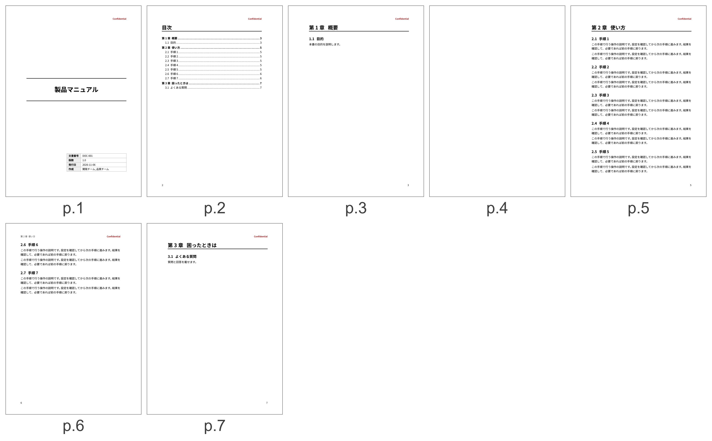

# 本として組む

両面印刷や製本を前提にした組み方と、複数の md を1冊にまとめる方法を説明します。

## 奇数ページ始まり {#sec-odd-start}

本では、章を右ページ(奇数ページ)から始めるのが普通です。`odd-start` をオンにすると、章の手前の偶数ページが余るときだけ、白紙を1枚入れます。

```yaml
pubpdf:
  book:
    odd-start: true
```

@fig-book-pages は、表紙と目次のある本の例です。表紙の次の p.2 が目次で、p.4 が自動で入った白紙です。第2章は p.5 から p.6 まで続き、偶数ページで終わるので、第3章の前に白紙は入りません。

{#fig-book-pages}

オンにしたときの動作は、次のとおりです。

- 本文の開始と各章を奇数ページから始めます。
- 表紙の次には白紙を入れず、次のページからバージョン履歴か目次を始めます。目次が奇数ページで終わるときは、本文の前に白紙が入ります。バージョン履歴と目次の間には白紙を入れません。
- 白紙には、ヘッダ、ページ番号、機密表示を出しません。白紙も1ページとして数えます。
- 奇数かどうかは、紙の上の順番で決めます。ページの番号も紙の上の順番と同じなので、番号と左右はずれません。`page-count: roman` でも、本文の番号は奇数ページで1から始まるので、ずれません。

バージョン履歴も目次もなく表紙があるときは、表紙の次のページ(p.2)から最初の章を始めます。このときだけ最初の章は偶数ページから始まります。2つ目以降の章は奇数ページから始まります。

オフにすると白紙を入れません。

## 綴じ代

綴じる側の余白を広げます。単位は mm で、既定は 8 です。奇数ページ始まりのときだけ効きます。

```yaml
pubpdf:
  book:
    odd-start: true
    gutter: 10
```

奇数ページは左の余白、偶数ページは右の余白が広くなります。ページ番号の既定は book 形式で、綴じない側に出ます。

## 複数の md を1冊にする(合本)

親となる md を1つ作り、frontmatter の `chapters` に章のファイルを順に並べます。これを合本と呼びます。

```yaml
---
title: 製品マニュアル
author: 開発チーム
pubpdf:
  cover: formal
  numbering: chapter
  chapters:
    - 01-intro.md
    - 02-design.md
    - appendix/03-faq.md
---
```

親の md を開いて PDF を作ります。VS Code では、親の md が同じワークスペースのフォルダにあれば、章の md を開いた状態で実行しても本全体を組みます。ファイルだけを開いたときや、親の md がワークスペースの外にあるときは、その章だけを組みます。

合本では、奇数ページ始まりが既定でオンになります。

### 親 md の本文

親 md に本文があれば、序文として最初の章の前に入れます。序文には章番号が付きません。見出しがなければ「序文」を補います。本文がなければ序文は作らず、最初の章から始まります。

### 付録

`appendices` に並べたファイルは、章の後に付録として組みます。

```yaml
pubpdf:
  numbering: chapter
  chapters:
    - 01-intro.md
  appendices:
    - appendix-a.md
    - appendix-b.md
```

見出しは「付録 A」「A.1」、図と表は「図 A-1」、式は「(A-1)」の形になります。`@sec-名前` で参照すると「付録 A」と出ます。見出しに番号のない文書(`numbering: none`)では、付録の章だけに「付録 A」を付けます。節には番号を付けず、図と表は通し番号のままです。

単一の md で付録を作るときは、最初の付録の章の見出しに `{.appendix}` を書きます。そこから後の章が付録になります。H1 が1つだけの文書では `##` の見出しが章なので、`##` の見出しに書きます。

```markdown
# 用語集 {.appendix}
```

文献の一覧は、付録の後に出します。

### 章 md に書くこと

書名や設定は親 md を正とします。章の md で使われるのは、章題の決定に関わる部分だけです。

| 章の md の内容 | 章題 |
|---|---|
| H1 がある | H1 |
| frontmatter の `title` だけがある | `title` |
| 両方ある | H1。警告を出します |
| どちらもない | ファイル名。警告を出します |

章の md に `pubpdf:` を書いても無視し、警告を出します。`chapters` に指定できるのは、拡張子が `.md`、`.markdown`、`.qmd` のファイルだけです。

原稿のフォルダの外のファイルを指定すると、そのまま取り込んで警告を出します。受け取った原稿を組むときは、意図しない文書が PDF に入っていないかを、この警告で確かめてください。同じファイルを2回指定すると、最初の指定だけを使って警告を出します。

### 章をまたぐリンク

相対パスで別の章を指せば、PDF の中のリンクになります。書き方は[原稿の書き方](06-writing.md#リンク)を参照してください。

### 画像

章ごとに別のフォルダに置いた画像も、その章の md からの相対パスのまま表示されます。
