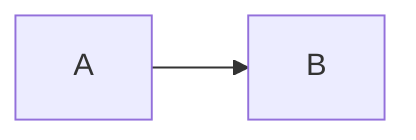
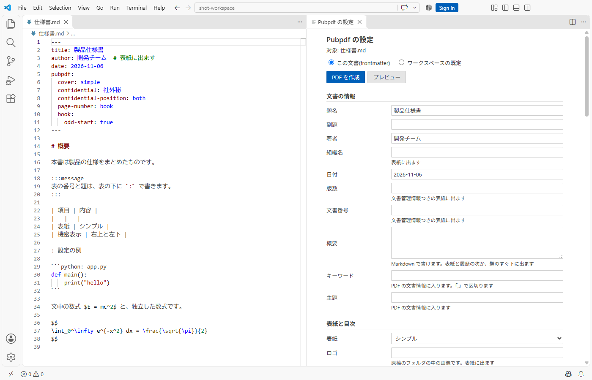
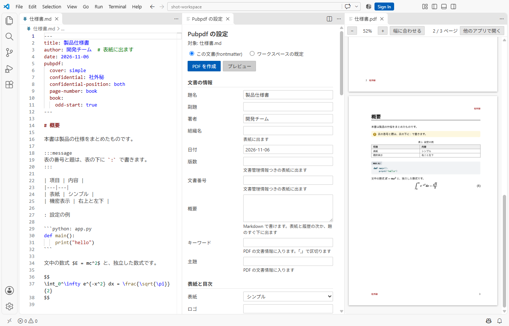

# 原稿の書き方

本文は通常の Markdown で書けます。この章では、書き方と組み上がりを並べて示します。

## 段落と強調

段落の途中で改行しても、日本語の間に余計な空白は入りません。**太字**、`インラインコード`、脚注[^footnote]が使えます。

[^footnote]: 脚注はページの下に出ます。

```markdown
**太字**、`インラインコード`、脚注[^1]が使えます。

[^1]: 脚注はページの下に出ます。
```

`*斜体*` の記法も書けますが、斜体の字形がないフォントでは見た目が変わりません。日本語の強調には太字を使ってください。

## 文字を右や中央に寄せる

`::: {.right}` の囲みの中は右に、`::: {.center}` の囲みの中は中央に寄せます。中には Markdown をそのまま書けます。`:::right`、`:::center` と短く書くこともできます。

```markdown
::: {.right}
2026年11月7日\
**開発チーム**
:::

::: {.center}
以上
:::
```

::: {.right}
2026年11月7日\
**開発チーム**
:::

::: {.center}
以上
:::

行の途中で改行するときは、行末に `\` を書きます。段落を分けると、段落ごとに寄せます。

- 寄せるのは段落の単位です。文の一部だけを寄せることはできません。
- 囲みの中の図も一緒に寄ります。コードの行は左のまま、独立した式は中央のままです。表の中の文字は、表の列の揃え方に従います。
- リスト、引用、他の囲みの中にも書けます。

## 段組み {#sec-columns}

`::: {.columns}` の囲みの中を 2 段に組みます。`count` で段数を指定できます。文書全体の段組みは [`columns` の設定](04-settings.md)です。

```markdown
::: {.columns}
ここに書いた文章は、左右の段に分かれて流れます。

段の長さは揃います。
:::

::: {.columns count=3}
3 段に組みます。段数は 2 から 4 までです。
:::
```

文章だけのときは、段の長さを揃えます。図、表、コード、囲みなど途中で分けられないものを含むときは、中身が隠れないよう段の高さに余裕を取るので、右の段が短くなることがあります。残りのページに入らないときは、残りが少なければ次のページへ送り、十分あれば段の長さを揃えずにページをまたいで流します。その場合、最後のページの段は左から順に埋まります。段の幅が 30mm より狭くなるときは、段数を減らします。

左右の幅を指定して並べるときは、`.column` の囲みを並べます。幅を書かない列は、残りの幅を等分します。

```markdown
::: {.columns}
::: {.column width="30%"}
左の列です。
:::

::: {.column width="70%"}
右の列です。
:::
:::
```

- `.column` の囲みと他の内容を混ぜると、警告を出して `.column` の幅を使いません。
- 中で改ページと横向きはできません。警告を出して無視します。
- 中の見出しは目次に載りません。

## 文字の修飾

| 書き方 | 組み上がり |
|---|---|
| `~~取り消し~~` | ~~取り消し~~ |
| `H~2~O` | H~2~O |
| `x^2^` | x^2^ |
| `[下線]{.underline}` | [下線]{.underline} |
| `[蛍光ペン]{.mark}` | [蛍光ペン]{.mark} |

: 文字の修飾の書き方

## リスト

- 箇条書きは `-` で書きます。
  - 字下げすると入れ子になります。

1. 番号付きのリストは `1.` で書きます。
2. 番号は自動で振られます。

- [x] チェック付きのリストは `- [x]` で書きます。
- [ ] 未完了の項目は `- [ ]` で書きます。

用語と説明の組は、次の行を `: ` で始めます。

```markdown
用語
: 用語の説明です。
```

用語
: 用語の説明です。

## 表

Markdown の表をそのまま書けます。列の幅は内容の量に合わせて自動で配分します。

表の直後か直前に `: ` で始まる行を書くと、表の題になり、番号が自動で振られます。番号の振り方は、[設定](04-settings.md)の `figure-numbering` で選べます。

```markdown
| 項目 | 説明 |
|---|---|
| 表紙 | 3種類から選べます |

: 表の題
```

| 項目 | 説明 |
|---|---|
| 表紙 | 3種類から選べます |

: 表の題

本文から参照するときは、題の行に `{#tbl-名前}` を付けます。`@tbl-名前` と書くと番号に置き換わります(例: @tbl-sample)。

```markdown
: 参照する表の題 {#tbl-sample}

@tbl-sample を参照してください。
```

| 項目 | 説明 |
|---|---|
| 機密表示 | 位置を4通りから選べます |

: 参照する表の題 {#tbl-sample}

題のない表には番号が付きません。長い表はページをまたぎ、次のページで見出し行を再び表示します。

セルを結合するときは、罫線を文字で描く書き方(グリッド表)を使います。縦の罫線の位置を揃えてください。全角の文字は半角2文字分として数えます。

```markdown
+------+-------+
| 結合したセル |
+======+=======+
| a    | b     |
+------+-------+
| 結合したセル |
+------+-------+

: セルを結合した表
```

+------+-------+
| 結合したセル |
+======+=======+
| a    | b     |
+------+-------+
| 結合したセル |
+------+-------+

: セルを結合した表

## コード {#sec-code}

コードブロックは、言語名を付けると色分けされます。長い行は折り返します。区切りのない長い文字列(URL やハッシュ値など)も途中で折り返します。

言語名の後に `:` とファイル名を続けると、ファイル名を左上に出します(Qiita や Zenn と同じ書き方です)。`:` の後の空白はなくても構いません。

````markdown
```python: app.py
def add(a, b):
    # 合字にしないので、== や >= は入力したとおりに印刷されます
    assert a >= 0 and b >= 0
    return a + b
```
````

```python: app.py
def add(a, b):
    # 合字にしないので、== や >= は入力したとおりに印刷されます
    assert a >= 0 and b >= 0
    return a + b
```

言語名がなければ、色分けせずにファイル名だけを出します(```` ```:memo.txt ````)。Quarto の書き方の ```` ```{.python filename="app.py"} ```` も同じ結果になります。

`code-line-numbers="true"` を付けると、行番号を出します。`startFrom` で最初の番号を指定できます。

````markdown
```{.python code-line-numbers="true" startFrom="11"}
def add(a, b):
    return a + b
```
````

```{.python code-line-numbers="true" startFrom="11"}
def add(a, b):
    return a + b
```

すべてのコードに行番号を付けるには、設定の `code-line-numbers: true` を使います。このとき、特定のコードだけ外すには `code-line-numbers="false"` を付けます。

コードに題と番号を付けて参照するときは、`{#lst-名前}` の囲みに入れます。

````markdown
::: {#lst-sample}
```python
print("hello")
```

コードの題
:::

@lst-sample を参照してください。
````

::: {#lst-sample}
```python
print("hello")
```

コードの題
:::

@lst-sample を参照してください。

## 数式 {#sec-math}

文中の数式は `$E = mc^2$` のように書くと、$E = mc^2$ と組まれます。日本語に直接続けても、自動で少し間を空けます。独立した数式は `$$` で囲みます。独立した数式には、自動で番号が入ります。`{#eq-名前}` を付けると、`@eq-名前` で参照できます。

```markdown
$$
\int_0^1 x^2 \, dx = \frac{1}{3}
$$ {#eq-sample}
```

$$
\int_0^1 x^2 \, dx = \frac{1}{3}
$$ {#eq-sample}

@eq-sample のように参照できます。番号を入れない式には `\notag` か `\nonumber` を書きます。

```markdown
$$
a^2 + b^2 = c^2 \notag
$$
```

$$
a^2 + b^2 = c^2 \notag
$$

ラベルのある式だけに番号を入れるときは、設定の `equation-numbering: labeled` を使います。

`\tag{...}` を使うと、番号を手で指定できます。この番号は `@eq-名前` では参照できず、`{#eq-名前}` を付けても無視します。自動の番号も進みません。

```markdown
$$
\sum_{i=1}^{n} x_i = \frac{1}{n} \left( \sum_{i=1}^{n} y_i \right)^2 \tag{A.1}
$$
```

$$
\sum_{i=1}^{n} x_i = \frac{1}{n} \left( \sum_{i=1}^{n} y_i \right)^2 \tag{A.1}
$$

行列、場合分け、複数行の揃えも書けます。

$$
A = \begin{pmatrix} 1 & 2 \\ 3 & 4 \end{pmatrix}, \quad
\det A = \begin{vmatrix} 1 & 2 \\ 3 & 4 \end{vmatrix} = -2, \quad
f(x) = \begin{cases} x^2 & (x \ge 0) \\ -x & (x < 0) \end{cases}
$$

$$
\begin{aligned}
(x + 1)^2 &= x^2 + 2x + 1 \\
          &= x(x + 2) + 1
\end{aligned}
$$

複数行の式には、全体で番号が1つ入ります。一部の行にだけ `\notag` を書いても番号は残り、全部の行に書くと消えます。

数式は LaTeX の記法で書き、組版のときに変換します。変換できない命令があると、その数式は LaTeX のまま出て、警告が出ます。数式のフォントは[設定](04-settings.md#sec-fonts)で変更できます。

## 定理と証明

定理や定義には、`{#thm-名前}` のように種類を表す接頭辞の囲みを使います。番号が自動で入り、`@thm-名前` で参照できます。囲みの先頭の見出しは、定理の名前になります。

```markdown
::: {#thm-pythagoras}
## 三平方の定理
直角三角形では $a^2 + b^2 = c^2$ です。
:::

@thm-pythagoras を参照してください。

::: {.proof}
証明の本文です。
:::
```

::: {#thm-pythagoras}
## 三平方の定理
直角三角形では $a^2 + b^2 = c^2$ です。
:::

@thm-pythagoras を参照してください。

::: {.proof}
証明の本文です。
:::

| 接頭辞 | 種類 |
|---|---|
| `thm-` | 定理 |
| `lem-` | 補題 |
| `cor-` | 系 |
| `prp-` | 命題 |
| `def-` | 定義 |
| `exm-` | 例 |
| `exr-` | 練習 |

: 定理の種類

## 囲み(Qiita と Zenn の記法)

Qiita と Zenn の `:::` の記法で、色の付いた囲みを書けます。

```markdown
:::message
Zenn の記法です。:::note info などの Qiita の記法も書けます。
:::

:::details 詳しい説明の題
題を付けた囲みです。
:::
```

:::message
`:::message` は黄色の囲みです。
:::

:::info
`:::info` と `:::note info` は青の囲みです。`:::note` だけでも同じです。
:::

:::note warn
`:::note warn` と `:::warning` はオレンジの囲みです。
:::

:::message alert
`:::message alert`、`:::note alert`、`:::alert` は赤の囲みです。
:::

:::tip
`:::tip` は緑の囲みです。
:::

:::details 詳しい説明の題
`:::details 題` は灰色の囲みです。PDF では折りたたまず、中身を常に表示します。
:::

`:::info 題` のように種類の後に文字を書くと、題になります。囲みの中にリスト、コード、別の囲みも書けます。別の囲みを入れるときは、外側のコロンの数を増やします。

## 注意書きの囲み(callout)

題の付いた枠には、Quarto の callout を使います。種類は `note`、`warning`、`important`、`tip`、`caution` の5つです。

```markdown
::: {.callout-warning}
保存してから実行してください。
:::

::: {.callout-tip title="タイトルも付けられます"}
既定の「ヒント」の代わりに、この題が出ます。
:::
```

::: {.callout-warning}
保存してから実行してください。
:::

::: {.callout-tip title="タイトルも付けられます"}
既定の「ヒント」の代わりに、この題が出ます。
:::

callout は Quarto の記法です。GitHub のプレビューでは枠にならず、文字のまま見えます。

## Mermaid の図

GitHub と同じ書き方で図を描けます。図は本文の幅とページの高さに収まるように縮小します。小さい図は拡大しません。

````markdown

````


キャプションと番号を付けるときは、図の先頭に `%%|` の行を足します。

````markdown

````

## 画像

画像は、原稿からの相対パスで指定します。`{#fig-名前}` を付けると本文から参照でき、`width` で幅を指定できます。

```markdown
{#fig-photo width=60%}
```

キャプションか `{#fig-名前}` があれば番号が付きます。どちらもない画像には番号が付きません。HTML の `` は PDF に出力されないので、Markdown の記法で書いてください。

題のある図は中央に、題のない画像は左に置きます。位置を指定するときは `fig-align` を `left`、`center`、`right` にします。題も一緒に寄ります。横に並べた図と Mermaid の図には効きません。

```markdown
{width=40% fig-align="left"}
```

図を横に並べるときは、`layout-ncol` に列の数を書いた囲みに入れます。囲みの最後の段落が、全体の題になります。全体と個々の図の両方を参照できます。

```markdown
::: {#fig-pair layout-ncol=2}
{#fig-pair-panel}

{#fig-pair-preview}

VS Code の画面
:::

@fig-pair の @fig-pair-panel が設定パネルです。
```

::: {#fig-pair layout-ncol=2}
{#fig-pair-panel}

{#fig-pair-preview}

VS Code の画面
:::

@fig-pair の @fig-pair-panel が設定パネルです。

## 改ページと横向きのページ {#sec-landscape}

改ページしたい場所に、次のいずれかを1行で書きます。

```markdown


\newpage
```

`\pagebreak` と `\clearpage` も同じです。文の途中やコードブロックの中では改ページしません。続けて書いても白紙にはなりません。章は新しいページから始まるので、章のファイルの先頭に書いても何も起きません。引用、囲み、リストの中では改ページできないので、警告を出して無視します。

幅の広い表などは、`.landscape` の囲みに入れると、その部分だけ横向きのページになります。囲みの前後で改ページします。引用、囲み、リストの中では、警告を出して縦のまま組みます。文書全体を横向きにする設定は `orientation` です。

```markdown
::: {.landscape}
横向きのページに置く内容です。
:::
```

## Typst を直接書く

設定や Markdown の記法で足りないときは、Typst の記法を直接書けます。

````markdown
```{=typst}
#text(fill: red)[この文字は赤になります。]
```
````

```{=typst}
#text(fill: red)[この文字は赤になります。]
```

Typst の記法の誤りがあると、組版がエラーで止まります。

`#image("図.png")` のように直接書いた画像のファイルは、中間フォルダへ複製されません。Markdown の本文からも `` で参照してください。

## 文献の引用 {#sec-citations}

文献は BibTeX の形式(`.bib`)のファイルに書きます。設定の `bibliography` にファイルを指定し、本文に `[@キー]` と書くと引用になります。

```text
@book{knuth1984,
  title = {The TeXbook},
  author = {Knuth, Donald E.},
  year = {1984},
  publisher = {Addison-Wesley},
}
```

```markdown
組版の教科書 [@knuth1984] によると、次のとおりです。

ページを示します [@knuth1984, p. 10]。複数も書けます [@knuth1984; @yamada2020]。
```

- 文献の一覧は、見出し「参考文献」を付けて、文書の最後に自動で出ます。載るのは引用した文献だけです。
- 合本では、どの章からでも引用できます。文献のファイルは親 md に指定します。
- ファイルは原稿のフォルダの中の `.bib` だけを指定できます。受け取った原稿が他のファイルを読まないようにするためです。
- ファイルにない文献を `[@キー]` と書くと、文字のまま出して警告します。`[@a; @b]` の片方だけがないときは、ある方は引用になります。
- 引用が1つもなければ、文献の一覧は出ません。
- エントリは `@book{...}` のように波括弧で書きます。`@book(...)` の丸括弧は使えません。
- `fig-`、`tbl-`、`eq-`、`sec-` などで始まるキーは、図や表への参照と区別できないので使わないでください。
- ページの出し方は書式によって違います。`[@knuth1984, p. 10]` のページは、IEEE では出ますが、SIST 02 では出ません。
- 括弧のない `@knuth1984` は「著者名 (年)」の形になります。年を出さない MLA では `Knuth ()` になるので、`[@knuth1984]` と書いてください。

## 文書の値を本文に差し込む

`` と書くと、frontmatter の値に置き換わります。版数や題を本文に何度も書くときに、書き直しの漏れを防げます。

```markdown
この文書の版は  です。
```

使えるキーは `title`、`subtitle`、`author`、`date`、`version`、`doc-number` です。合本の章では親 md の値を使います。

- 値は書かれたとおりの文字で出します。Markdown としては読みません。
- コードの中では置き換えません。
- 使える場所は本文です。囲みの題(`:::info 題`)の中では置き換えません。
- 他のキーを書くと文字のまま出して警告します。値が frontmatter にないときは空にして警告します。

## リンク {#sec-links}

| 書き方 | リンク先 |
|---|---|
| `[文字](#見出し)` | 同じファイルの見出し。日本語の見出しもそのまま書けます |
| `[文字](02-design.md)` | 別の章の先頭 |
| `[文字](02-design.md#見出し)` | 別の章の見出し |
| `[文字](URL)` | Web ページ |
| `<https://example.com/>` | Web ページ。URL をそのまま表示します |

: リンクの書き方 {#tbl-links}

同じ題の見出しが複数あるときは、GitHub と同じく2つ目を `#見出し-1` で指せます。

文書に含まれない md や、見つからない見出しへのリンクは、警告を出して文字だけにします。md 以外のファイルへのリンク(`data.csv` など)はそのまま残るので、PDF を別の場所へ移すと開けなくなります。URL を `https://...` とだけ書いた場合はリンクにならず、文字として出ます。

## 見出しへの参照

見出しに `{#sec-名前}` を付けると、本文から参照できます。`numbering` が `chapter` か `decimal` なら番号で出ます(例: 節 5.1)。章は「第1章」、付録の章は「付録 A」と出ます。`numbering: none` や番号のない見出し(`{.unnumbered}`)では、見出しの題が出ます。

```markdown
## 奇数ページ始まり {#sec-odd-start}

詳しくは @sec-odd-start を参照してください。
```

## 書くときの注意

@ で始まる語
: 相互参照と、文献のファイルにあるキー以外は、ただの文字として出ます。@someone のように書いても問題ありません。ただし `fig-` `tbl-` `eq-` `sec-` `lst-` `tip-` `def-` などの接頭辞で始まる語は、相互参照と見なされます。

コードセル
: ` ```{python} ` のように書いても実行しません。普通のコードブロックとして載せます。

ショートコード
: `` のような Quarto のショートコードは展開せず、文字のまま出します。例外は、1行で書いた `` と、`` です。受け取った原稿が環境変数を読めないようにするためで、Quarto にも動作に必要な環境変数だけを渡します。

存在しない参照
: `@fig-` などの参照先がないと、本文に `?@fig-名前` と太字で出て、警告も出ます。
