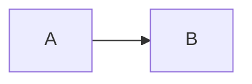

# 原稿の書き方

本文は通常の Markdown で書けます。この章では、書き方と組み上がりを並べて示します。

## 段落と強調

段落の途中で改行しても、日本語の間に余計な空白は入りません。**太字**、`インラインコード`、脚注[^footnote]が使えます。

[^footnote]: 脚注はページの下に出ます。

```markdown
**太字**、`インラインコード`、脚注[^1]が使えます。

[^1]: 脚注はページの下に出ます。
```

`*斜体*` の記法も書けますが、斜体の字形がないフォントでは見た目が変わりません。日本語の強調には太字を使ってください。

## 文字を右や中央に寄せる

`::: {.right}` の囲みの中は右に、`::: {.center}` の囲みの中は中央に寄せます。中には Markdown をそのまま書けます。`:::right`、`:::center` と短く書くこともできます。

```markdown
::: {.right}
2026年11月7日\
**開発チーム**
:::

::: {.center}
以上
:::
```

::: {.right}
2026年11月7日\
**開発チーム**
:::

::: {.center}
以上
:::

行の途中で改行するときは、行末に `\` を書きます。段落を分けると、段落ごとに寄せます。

- 寄せるのは段落の単位です。文の一部だけを寄せることはできません。
- 囲みの中の図も一緒に寄ります。コードの行は左のまま、独立した式は中央のままです。表の中の文字は、表の列の揃え方に従います。
- リスト、引用、他の囲みの中にも書けます。

## 段組み {#sec-columns}

`::: {.columns}` の囲みの中を 2 段に組みます。`count` で段数を指定できます。文書全体の段組みは [`columns` の設定](04-settings.md)です。

```markdown
::: {.columns}
ここに書いた文章は、左右の段に分かれて流れます。

段の長さは揃います。
:::

::: {.columns count=3}
3 段に組みます。段数は 2 から 4 までです。
:::
```

文章だけのときは、段の長さを揃えます。図、表、コード、囲みなど途中で分けられないものを含むときは、中身が隠れないよう段の高さに余裕を取るので、右の段が短くなることがあります。残りのページに入らないときは、残りが少なければ次のページへ送り、十分あれば段の長さを揃えずにページをまたいで流します。その場合、最後のページの段は左から順に埋まります。段の幅が 30mm より狭くなるときは、段数を減らします。

左右の幅を指定して並べるときは、`.column` の囲みを並べます。幅を書かない列は、残りの幅を等分します。

```markdown
::: {.columns}
::: {.column width="30%"}
左の列です。
:::

::: {.column width="70%"}
右の列です。
:::
:::
```

- `.column` の囲みと他の内容を混ぜると、警告を出して `.column` の幅を使いません。
- 中で改ページと横向きはできません。警告を出して無視します。
- 中の見出しは目次に載りません。

## 文字の修飾

| 書き方 | 組み上がり |
|---|---|
| `~~取り消し~~` | ~~取り消し~~ |
| `H~2~O` | H~2~O |
| `x^2^` | x^2^ |
| `[下線]{.underline}` | [下線]{.underline} |
| `[蛍光ペン]{.mark}` | [蛍光ペン]{.mark} |

: 文字の修飾の書き方

## リスト

- 箇条書きは `-` で書きます。
  - 字下げすると入れ子になります。

1. 番号付きのリストは `1.` で書きます。
2. 番号は自動で振られます。

- [x] チェック付きのリストは `- [x]` で書きます。
- [ ] 未完了の項目は `- [ ]` で書きます。

用語と説明の組は、次の行を `: ` で始めます。

```markdown
用語
: 用語の説明です。
```

用語
: 用語の説明です。

## 表

Markdown の表をそのまま書けます。列の幅は内容の量に合わせて自動で配分します。幅を決めたいときは、表の題に `tbl-colwidths` で列の幅の比を書きます(例: `: 題 {#tbl-名前 tbl-colwidths="[20,30,50]"}`)。ただし、折り返せない英数字(`No.`、日付、ID など)が収まる幅より狭くはしません。セルの左右の余白があるので、`No.` の列は 4 と書いても 8% ほどになります。グリッド表の罫線の長さは、幅の指定には使いません。

全部のセルが空の行も、文字のある行と同じ高さで組みます。記入用の空の行に使えます。

表の直後か直前に `: ` で始まる行を書くと、表の題になり、番号が自動で振られます。番号の振り方は、[設定](04-settings.md)の `figure-numbering` で選べます。

```markdown
| 項目 | 説明 |
|---|---|
| 表紙 | 3種類から選べます |

: 表の題
```

| 項目 | 説明 |
|---|---|
| 表紙 | 3種類から選べます |

: 表の題

本文から参照するときは、題の行に `{#tbl-名前}` を付けます。`@tbl-名前` と書くと番号に置き換わります(例: @tbl-sample)。

```markdown
: 参照する表の題 {#tbl-sample}

@tbl-sample を参照してください。
```

| 項目 | 説明 |
|---|---|
| 機密表示 | 位置を4通りから選べます |

: 参照する表の題 {#tbl-sample}

題のない表には番号が付きません。長い表はページをまたぎ、次のページで見出し行を再び表示します。

セルを結合するときは、罫線を文字で描く書き方(グリッド表)を使います。縦の罫線の位置を揃えてください。全角の文字は半角2文字分として数えます。

```markdown
+------+-------+
| 結合したセル |
+======+=======+
| a    | b     |
+------+-------+
| 結合したセル |
+------+-------+

: セルを結合した表
```

+------+-------+
| 結合したセル |
+======+=======+
| a    | b     |
+------+-------+
| 結合したセル |
+------+-------+

: セルを結合した表

見出しの行は、太字にして色を付けます。グリッド表で `+===+` の行を書かなければ、見出しのない表になり、1 行目も普通のセルとして組みます。見出しが 2 段以上でも、すべての段に同じ体裁が付きます。

グリッド表では、全角の文字を 2 文字分として罫線を揃えます。`○`、`×`、`→`、`℃`、`①` などの記号は、エディタによって 1 文字分にも 2 文字分にも見えます。どちらで揃えても、縦線を罫線の位置に合わせて読みます。合わせられない行があると、警告を出します。

列の多い表は、表の題に `.small`(85%)か `.x-small`(75%)を書くと、その表の文字を小さくできます。列の幅の配分も、小さい文字に合わせます。

```markdown
: 画面入出力項目一覧 {#tbl-items .small}
```

### セルの網掛けと改行

セルの中身全体を `[文字]{.shade}` と書くと、そのセルに網掛けをします。帳票の形の表で、項目名の列や区切りの行に使います。`fill="#ccccff"` で色を指定できます。

```markdown
+------------------+--------------------+
| [PU ID]{.shade}  | PU-0101            |
+------------------+--------------------+
| [処理内容]{.shade}                    |
+---------------------------------------+
| 温度を読む\                           |
| PV を更新する                         |
+---------------------------------------+
```

+------------------+--------------------+
| [PU ID]{.shade}  | PU-0101            |
+------------------+--------------------+
| [処理内容]{.shade}                    |
+---------------------------------------+
| 温度を読む\                           |
| PV を更新する                         |
+---------------------------------------+

: 帳票の形の表 {#tbl-form}

セルの中で改行するときは、`<br>` を書きます。グリッド表では、行の末尾の `\` でも改行できます。`<br>` は本文の段落でも使えます。

```markdown
| 項目 | 備考 |
|---|---|
| 郵便番号 | 会社の郵便番号<br>記述形式: 999-9999 |
```

### HTML の表

`<table>` で書いた HTML の表も、表として組みます。`rowspan` と `colspan` のセル結合、`<br>` の改行、`<b>` の太字、`style="background-color: #ccccff"` のセルの色が使えます。`<th>` だけの先頭の行は、見出しの行になります。本文の行の `<th>` は、行の見出しとして太字と網掛けになります。Markdown の表と同じく、直前か直後の `: 題 {#tbl-名前}` の行が表の題になり、`tbl-colwidths` で列の幅も指定できます。

```markdown
<table>
<tr><th rowspan="2">機能</th><th colspan="2">エンティティ</th></tr>
<tr><th>顧客</th><th>受注</th></tr>
<tr><td>顧客の登録</td><td>C</td><td></td></tr>
<tr><td>受注の登録</td><td>R</td><td>C</td></tr>
</table>

: CRUD 表 {#tbl-crud}
```

<table>
<tr><th rowspan="2">機能</th><th colspan="2">エンティティ</th></tr>
<tr><th>顧客</th><th>受注</th></tr>
<tr><td>顧客の登録</td><td>C</td><td></td></tr>
<tr><td>受注の登録</td><td>R</td><td>C</td></tr>
</table>

: HTML で書いた表 {#tbl-html}

- 表の中の `` の画像は出しません。警告を出して取り除きます。
- 引用やリストの中の HTML の表は、表になりません。

## コード {#sec-code}

コードブロックは、言語名を付けると色分けされます。長い行は折り返します。区切りのない長い文字列(URL やハッシュ値など)も途中で折り返します。

言語名の後に `:` とファイル名を続けると、ファイル名を左上に出します(Qiita や Zenn と同じ書き方です)。`:` の後の空白はなくても構いません。

````markdown
```python: app.py
def add(a, b):
    # 合字にしないので、== や >= は入力したとおりに印刷されます
    assert a >= 0 and b >= 0
    return a + b
```
````

```python: app.py
def add(a, b):
    # 合字にしないので、== や >= は入力したとおりに印刷されます
    assert a >= 0 and b >= 0
    return a + b
```

言語名がなければ、色分けせずにファイル名だけを出します(```` ```:memo.txt ````)。Quarto の書き方の ```` ```{.python filename="app.py"} ```` も同じ結果になります。

`code-line-numbers="true"` を付けると、行番号を出します。`startFrom` で最初の番号を指定できます。

````markdown
```{.python code-line-numbers="true" startFrom="11"}
def add(a, b):
    return a + b
```
````

```{.python code-line-numbers="true" startFrom="11"}
def add(a, b):
    return a + b
```

すべてのコードに行番号を付けるには、設定の `code-line-numbers: true` を使います。このとき、特定のコードだけ外すには `code-line-numbers="false"` を付けます。

コードに題と番号を付けて参照するときは、`{#lst-名前}` の囲みに入れます。

````markdown
::: {#lst-sample}
```python
print("hello")
```

コードの題
:::

@lst-sample を参照してください。
````

::: {#lst-sample}
```python
print("hello")
```

コードの題
:::

@lst-sample を参照してください。

## 数式 {#sec-math}

文中の数式は `$E = mc^2$` のように書くと、$E = mc^2$ と組まれます。日本語に直接続けても、自動で少し間を空けます。独立した数式は `$$` で囲みます。独立した数式には、自動で番号が入ります。`{#eq-名前}` を付けると、`@eq-名前` で参照できます。

```markdown
$$
\int_0^1 x^2 \, dx = \frac{1}{3}
$$ {#eq-sample}
```

$$
\int_0^1 x^2 \, dx = \frac{1}{3}
$$ {#eq-sample}

@eq-sample のように参照できます。番号を入れない式には `\notag` か `\nonumber` を書きます。

```markdown
$$
a^2 + b^2 = c^2 \notag
$$
```

$$
a^2 + b^2 = c^2 \notag
$$

ラベルのある式だけに番号を入れるときは、設定の `equation-numbering: labeled` を使います。

`\tag{...}` を使うと、番号を手で指定できます。この番号は `@eq-名前` では参照できず、`{#eq-名前}` を付けても無視します。自動の番号も進みません。

```markdown
$$
\sum_{i=1}^{n} x_i = \frac{1}{n} \left( \sum_{i=1}^{n} y_i \right)^2 \tag{A.1}
$$
```

$$
\sum_{i=1}^{n} x_i = \frac{1}{n} \left( \sum_{i=1}^{n} y_i \right)^2 \tag{A.1}
$$

行列、場合分け、複数行の揃えも書けます。

$$
A = \begin{pmatrix} 1 & 2 \\ 3 & 4 \end{pmatrix}, \quad
\det A = \begin{vmatrix} 1 & 2 \\ 3 & 4 \end{vmatrix} = -2, \quad
f(x) = \begin{cases} x^2 & (x \ge 0) \\ -x & (x < 0) \end{cases}
$$

$$
\begin{aligned}
(x + 1)^2 &= x^2 + 2x + 1 \\
          &= x(x + 2) + 1
\end{aligned}
$$

複数行の式には、全体で番号が1つ入ります。一部の行にだけ `\notag` を書いても番号は残り、全部の行に書くと消えます。

数式は LaTeX の記法で書き、組版のときに変換します。変換できない命令があると、その数式は LaTeX のまま出て、警告が出ます。数式のフォントは[設定](04-settings.md#sec-fonts)で変更できます。

## 定理と証明

定理や定義には、`{#thm-名前}` のように種類を表す接頭辞の囲みを使います。番号が自動で入り、`@thm-名前` で参照できます。囲みの先頭の見出しは、定理の名前になります。

```markdown
::: {#thm-pythagoras}
## 三平方の定理
直角三角形では $a^2 + b^2 = c^2$ です。
:::

@thm-pythagoras を参照してください。

::: {.proof}
証明の本文です。
:::
```

::: {#thm-pythagoras}
## 三平方の定理
直角三角形では $a^2 + b^2 = c^2$ です。
:::

@thm-pythagoras を参照してください。

::: {.proof}
証明の本文です。
:::

| 接頭辞 | 種類 |
|---|---|
| `thm-` | 定理 |
| `lem-` | 補題 |
| `cor-` | 系 |
| `prp-` | 命題 |
| `def-` | 定義 |
| `exm-` | 例 |
| `exr-` | 練習 |

: 定理の種類

## 囲み(Qiita と Zenn の記法)

Qiita と Zenn の `:::` の記法で、色の付いた囲みを書けます。

```markdown
:::message
Zenn の記法です。:::note info などの Qiita の記法も書けます。
:::

:::details 詳しい説明の題
題を付けた囲みです。
:::
```

:::message
`:::message` は黄色の囲みです。
:::

:::info
`:::info` と `:::note info` は青の囲みです。`:::note` だけでも同じです。
:::

:::note warn
`:::note warn` と `:::warning` はオレンジの囲みです。
:::

:::message alert
`:::message alert`、`:::note alert`、`:::alert` は赤の囲みです。
:::

:::tip
`:::tip` は緑の囲みです。
:::

:::details 詳しい説明の題
`:::details 題` は灰色の囲みです。PDF では折りたたまず、中身を常に表示します。
:::

`:::info 題` のように種類の後に文字を書くと、題になります。囲みの中にリスト、コード、別の囲みも書けます。別の囲みを入れるときは、外側のコロンの数を増やします。

## 記入の指示の囲み

テンプレートの書き方の説明は、`::: {.guide}` の囲みに書きます。青い破線の囲みで出ます。テンプレートから書いた文書を仕上げるときは、設定の `guides: false` で組むと、記入の指示をまとめて消せます。

```markdown
::: {.guide}
＊ 本書の目的と、対象の範囲を書く。
:::
```

::: {.guide}
＊ 本書の目的と、対象の範囲を書く。
:::

## 注意書きの囲み(callout)

題の付いた枠には、Quarto の callout を使います。種類は `note`、`warning`、`important`、`tip`、`caution` の5つです。

```markdown
::: {.callout-warning}
保存してから実行してください。
:::

::: {.callout-tip title="タイトルも付けられます"}
既定の「ヒント」の代わりに、この題が出ます。
:::
```

::: {.callout-warning}
保存してから実行してください。
:::

::: {.callout-tip title="タイトルも付けられます"}
既定の「ヒント」の代わりに、この題が出ます。
:::

callout は Quarto の記法です。GitHub のプレビューでは枠にならず、文字のまま見えます。

## Mermaid の図

GitHub と同じ書き方で図を描けます。図は本文の幅とページの高さに収まるように縮小します。小さい図は拡大しません。

````markdown

````


キャプションと番号を付けるときは、図の先頭に `%%|` の行を足します。`fig-cap` だけでも番号が付きます。`label` も書くと `@fig-名前` で参照できます。

````markdown

````

図は元の大きさで描き、本文の幅に収まるように縮めます。図の中に Mermaid の設定(`%%{init: ...}%%` の行)を書いたときは、Pubpdf の設定に重ねて、書いた値を使います。

図の色と線は、Pubpdf が描く図(@sec-figures)にそろえます。

- 箱は淡い青で、枠は灰色です。判断の菱形は淡い黄色、`subgraph` の枠は淡い灰色にします。
- 文字は本文と同じ日本語のフォントで、線の文字は白地に置きます。
- flowchart の線は、角を少し丸めた折れ線にします。

線を Mermaid の既定の曲線に戻すときは `%%{init: {"flowchart": {"curve": "basis"}}}%%` と書きます。木の形の画面遷移図のように、線を縦と横だけで引きたいときは `"stepAfter"` が向いています。ただし線どうしが重なりやすくなります。`style` や `classDef` で付けた色は、そのまま使います。

Mermaid の見た目のままにするときは、`%%{init: {"theme": "default"}}%%` のように theme を選びます。theme を選んだ図には、Pubpdf の色とフォントを付けません。図の先頭の `---` の中に `theme:` を書いたときも同じです。

`subgraph` の題は折り返さず、1 行で描きます。題が枠の中の図形の並びより長いと、枠が題に合わせて広がり、隣の枠や図形と重なることがあります。そのときは題を短くしてください。題を `<br>` で 2 行にすると、2 行目が枠の中の図形と重なります。

## Mermaid にない図 {#sec-figures}

コードブロックの言語を次の名前にすると、図になります。Typst が本文と同じフォントで描くので、文字を検索でき、ブラウザも要りません。

| 言語 | 図 |
|---|---|
| `tree` | ディレクトリ構造 |
| `chart` | 棒、折れ線、円グラフ |
| `schedule` | 工程表 |
| `bits` | ビット配置 |
| `layers` | 層構造 |
| `timing` | 信号の波形 |
| `wbs` | 作業分解、組織図 |
| `wireframe` | 画面の模式図 |
| `data` | JSON と YAML の図 |
| `network` | ネットワーク図 |
| `usecase` | ユースケース図 |
| `swimlane` | 業務フロー(スイムレーン) |
| `fta` | 故障の木(FTA) |
| `grid` | 帳票と画面の方眼 |
| `er` | ER 図 |
| `screenflow` | 画面遷移図 |

: 図の種類

どの図も、先頭の行で番号と題を付けられます。書き方は Mermaid と同じです。

```text
%%| label: fig-名前
%%| fig-cap: 図の題
```

- `fig-cap` を書くと「図 1: 題」と出て、図の一覧に載ります。`label` も書くと `@fig-名前` で参照できます。
- 題のある図は 1 ページに収まる大きさに縮めます。題のない図はページをまたぎます。
- 読めない内容は、該当する行を警告で示して、コードブロックのまま出します。

### ディレクトリ構造

字下げか、`tree` コマンドの出力をそのまま書きます。`#` の前後に空白を入れて書いた文字は、右の列の説明になります。末尾が `/` の名前と、下に項目のある名前は太字になります。

````markdown
```tree
project/
  src/               # ソースコード
    main.py          # 入口
  README.md
```
````

```tree
project/
  src/               # ソースコード
    main.py          # 入口
  README.md
```

### グラフ

Markdown の表から作ります。1 列目が項目で、2 列目からが値です。先頭の行で種類を指定します。

| キー | 内容 |
|---|---|
| `type` | `bar`(棒、既定)、`line`(折れ線)、`pie`(円)。円は 2 列目だけを使います |
| `lines` | 棒グラフの中で折れ線にする列の名前 |
| `unit` | 単位 |

: グラフの指定

````markdown
```chart
unit: 万円
lines: 費用
| 月 | 売上 | 費用 |
|---|---|---|
| 4月 | 120 | 90 |
| 5月 | 135 | 95 |
```
````

```chart
unit: 万円
lines: 費用
| 月 | 売上 | 費用 |
|---|---|---|
| 4月 | 120 | 90 |
| 5月 | 135 | 95 |
```

### 工程表

「作業の名前: 期間」の行を並べます。`:` のない行はグループの見出しです。名前の先頭に `◆` を書くと、期間の終わりに節目の印を出します。組んだ日の線は入らないので、同じ原稿からは同じ図ができます。

期間の書き方は 2 通りです。

- `columns: 4月, 5月, 6月` で列を指定して、`4月-5月` や `6月` と書く
- `2026-04-01 ~ 2026-05-15` や `2026-04 ~ 2026-06` と日付で書く。列は月ごと、3 年を超えると年ごとになります

````markdown
```schedule
columns: 4月, 5月, 6月, 7月
設計
基本設計: 4月-5月
開発
実装: 5月-7月
◆ リリース: 7月
```
````

```schedule
columns: 4月, 5月, 6月, 7月
設計
基本設計: 4月-5月
開発
実装: 5月-7月
◆ リリース: 7月
```

### ビット配置

「ビット数 名前」の行を左から順に並べます。`0-3: 名前` のように番号の範囲でも書けます(混ぜられません)。名前のない項目や名前が `-` の項目は、色のない予約の欄になります。`width` は 1 行のビット数で、既定は 16 です。`msb: true` にすると、左を大きい番号にします。

````markdown
```bits
width: 16
4 版
4 長さ
8 種別
16 チェックサム
```
````

```bits
width: 16
4 版
4 長さ
8 種別
16 チェックサム
```

### 層構造

1 行が 1 層です。`|` で区切ると横に並びます。`*2` のように書くと、その幅の割合になります。

````markdown
```layers
画面
業務処理 *2 | 認証
データベース | 外部 API | ファイル
```
````

```layers
画面
業務処理 *2 | 認証
データベース | 外部 API | ファイル
```

### 信号の波形

「信号の名前: 波形」の行を並べます。波形の 1 文字が 1 区間です。`=` の値は、波形の後ろに `,` で区切って書きます。

| 文字 | 意味 |
|---|---|
| `0`、`1` | 低、高 |
| `p`、`n` | クロック。`p` は立ち上がりから、`n` は立ち下がりから |
| `x` | 不定 |
| `z` | ハイインピーダンス |
| `=` | 値のある区間 |
| `.` | 前の続き。クロックでは次の周期 |

: 波形の文字

````markdown
```timing
clk: p.......
req: 0.1...0.
data: x..=.=.x A, B
```
````

```timing
clk: p.......
req: 0.1...0.
data: x..=.=.x A, B
```

### 作業分解と組織図

字下げで階層を書きます。1 段目が横に並び、その下は字下げして縦に並びます。一番上の項目が 1 つなら、それを全体の上に置きます。

````markdown
```wbs
プロジェクト
  設計
    基本設計
    詳細設計
  開発
    実装
```
````

```wbs
プロジェクト
  設計
    基本設計
    詳細設計
  開発
    実装
```

### 画面の模式図

1 行が 1 段で、`|` で区切ると横に並びます。

| 書き方 | 部品 |
|---|---|
| 最初の行の `# 題` | 画面の題の帯 |
| 2 行目以降の `# 文字` | 太字の見出し |
| `[文字]` | ボタン |
| `"文字"` | 入力欄 |
| `^文字^` | 選択欄 |
| `[ ] 文字`、`[x] 文字` | チェックボックス |
| `( ) 文字`、`(x) 文字` | ラジオボタン |
| `--` | 区切り線 |

: 画面の部品

````markdown
```wireframe
# ログイン
利用者名 | "名前を入力"
区分 | ^一般^
---
[x] ログインを保持
[ログイン] | [取り消し]
```
````

```wireframe
# ログイン
利用者名 | "名前を入力"
区分 | ^一般^
---
[x] ログインを保持
[ログイン] | [取り消し]
```

### JSON と YAML の図

JSON か YAML をそのまま書きます。入れ子は箱の中の箱になります。

````markdown
```data
name: 製品A
tags: [新規, 重要]
owner:
  team: 開発
  members: 3
```
````

```data
name: 製品A
tags: [新規, 重要]
owner:
  team: 開発
  members: 3
```

### ネットワーク図

字下げしない行がネットワークで、字下げした行がそのネットワークにつながる機器です。行の最後の `10.0.0.0/24` や `.1` はアドレスとして読みます。同じ名前の機器は 1 つにまとめ、複数のネットワークにつなぎます。

````markdown
```network
network dmz 192.168.0.0/24
  web01 .1
  web02 .2
network 社内 10.0.0.0/24
  web01 .11
  db01 .21
```
````

```network
network dmz 192.168.0.0/24
  web01 .1
  web02 .2
network 社内 10.0.0.0/24
  web01 .11
  db01 .21
```

### ユースケース図

「利用者: 機能, 機能」の行を並べます。機能は `,` か `、` で区切るので、機能の名前に `、` を使うときは `・` などに置き換えてください。左に利用者、右に機能を並べて、直線で結びます。同じ名前の機能は 1 つにまとめます。`system` で枠の題を書けます。線の配置を工夫しないので、線が交差することがあります。

````markdown
```usecase
system: 通販システム
利用者: 注文する, 履歴を見る
管理者: 商品を登録する, 履歴を見る
```
````

```usecase
system: 通販システム
利用者: 注文する, 履歴を見る
管理者: 商品を登録する, 履歴を見る
```

ユースケースどうしの関係は、`include: 機能 -> 機能` と `extend: 機能 -> 機能` の行で書きます。破線の矢印と «include»、«extend» の文字で結びます。矢印は、include では含む機能から含まれる機能へ、extend では拡張する機能から拡張される機能へ向けて書きます。`,` で区切ると、まとめて書けます。利用者とつながる機能を左の列に、関係だけでつながる機能を右の列に置きます(3 列まで)。

````markdown
```usecase
system: 通販システム
利用者: 注文する, 履歴を見る
include: 注文する, 履歴を見る -> ログインする
extend: クーポンを使う -> 注文する
```
````

```usecase
system: 通販システム
利用者: 注文する, 履歴を見る
include: 注文する, 履歴を見る -> ログインする
extend: クーポンを使う -> 注文する
```

### 業務フロー(スイムレーン)

「レーン: 記号」の行を、処理の順に上から書きます。レーンが列になり、記号はつながる元の記号より下の段に置きます。ほかのレーンへ渡す記号は、間のレーンが空いていれば同じ段に並べて横の矢印でつなぎ、つながりのない記号どうし(「はい」と「いいえ」の先など)も、レーンが違えば同じ段に並べます。

| 書き方 | 記号 |
|---|---|
| `文字` | 処理(角丸の箱) |
| `◇ 文字` | 判断(菱形) |
| `●`、`● 文字` | 開始 |
| `◎`、`◎ 文字` | 終了 |
| `[書類] 文字` | 帳票、書類 |
| `[データ] 文字` | データの保管(円柱) |

: スイムレーンの記号

- 記号は、次の行の記号へ矢印でつながります。終了からはつながりません。
- `-> 行き先` を書くと、次の行ではなく行き先へつなぎます。行き先は、ほかの行の文字と同じに書きます。`,` で区切ると複数につなぎ、`はい: 行き先` のように書くと線に文字を付けます。前の行の処理を書くと、戻る矢印になります。`->` の代わりに `→` も使えます。
- `->` だけを書くと、どこへもつなぎません。
- 同じ文字の記号が複数あるときは、その行より後で最も近いものにつなぎます。
- `lanes` でレーンの並びを書けます。書かないと、出てきた順に並びます。
- 判断の文字が長くレーンが細いときは、菱形をレーンの幅まで広げ、文字を少し小さくします。「はい」「いいえ」が菱形の横に入らなければ、隣のレーンへ出た線の上か、菱形の斜めの辺の上に置きます。

````markdown
```swimlane
lanes: 顧客, 受注係, 倉庫
顧客: ●
顧客: 注文する
顧客: [書類] 注文書
受注係: ◇ 在庫はあるか -> はい: 出荷する, いいえ: 欠品を連絡する
倉庫: 出荷する
倉庫: ◎
受注係: 欠品を連絡する -> 注文する
```
````

```swimlane
lanes: 顧客, 受注係, 倉庫
顧客: ●
顧客: 注文する
顧客: [書類] 注文書
受注係: ◇ 在庫はあるか -> はい: 出荷する, いいえ: 欠品を連絡する
倉庫: 出荷する
倉庫: ◎
受注係: 欠品を連絡する -> 注文する
```

### 故障の木(FTA)

字下げで木を書きます。一番上の行が頂上の事象です。下に事象のある事象は長方形になり、先頭に `AND` か `OR` を書くと、その下にゲートを描きます(下に事象のある事象には、どちらかが要ります)。下に事象のない事象は基本の事象で、円になります。先頭に `◇` を書くと、それ以上展開しない事象(菱形)になります。

````markdown
```fta
OR 装置が停止する
  AND 電源が落ちる
    主電源の故障
    予備電源の故障
  ◇ 原因不明の停止
```
````

```fta
OR 装置が停止する
  AND 電源が落ちる
    主電源の故障
    予備電源の故障
  ◇ 原因不明の停止
```

事象の名前の中の `<br>` は改行になります。`AND`、`OR`、`◇` で始まる名前を文字のまま書くときは、`\OR 回路の誤配線` のように先頭に `\` を付けます。

基本の事象が多くて横に並べると幅に入らないときは、基本の事象だけを下に持つゲートの下に、事象を縦に並べます(円や菱形の右に名前の箱を置きます)。縦に並べられない形の木は、事象の名前を箱に入れ、その下に小さな円や菱形を付けた形にして幅を詰めます。

### 帳票と画面の方眼

「行, 桁: 文字」の行で、方眼の上に項目を置きます。行と桁は 1 から数え、全角の文字は 2 桁、半角の文字は 1 桁です。`3, 12-21` のように桁の範囲を書くと、その範囲に入れ、入らない文字は次の行へ折り返します。行の範囲は `5-8, 2-39` のように書きます。桁の範囲を書かないと、文字の幅だけの範囲になります。

| 書き方 | 内容 |
|---|---|
| `columns`、`rows` | 方眼の桁と行の数。書かないと項目の範囲から決めます |
| 先頭の `①`、`(12)` | 項目番号。項目の左か上の空いた桁に置きます |
| 末尾の `{枠}` | 枠線 |
| `{網掛け}` | 網掛け |
| `{下線}` | 下線 |
| `{太字}` | 太字 |
| `{右}`、`{中央}` | 右寄せ、中央寄せ。中央は上下にも寄せます |

: 方眼の書き方

`{枠 網掛け}` のように並べて書けます。文字のない枠は `6-7, 3-38: {枠}` のように範囲を書きます。項目の一覧(番号、名前、桁数など)は、表で本文に書いてください。

````markdown
```grid
columns: 40
rows: 7
① 1, 17: 請 求 書 {太字}
② 3, 3: 請求番号
③ 3, 13-22: XXXXXXXXXX {下線}
④ 5, 3-38: 品名 {網掛け 枠}
⑤ 6-7, 3-38: {枠}
```
````

```grid
columns: 40
rows: 7
① 1, 17: 請 求 書 {太字}
② 3, 3: 請求番号
③ 3, 13-22: XXXXXXXXXX {下線}
④ 5, 3-38: 品名 {網掛け 枠}
⑤ 6-7, 3-38: {枠}
```

### ER 図

Mermaid の `erDiagram` と同じ書き方で、関係の行と、属性を並べる `{ }` を書きます。言語の名前を `mermaid` から `er` に変えるだけでも描けます(`erDiagram` と `direction` の行は読み飛ばします)。箱は IE 記法で、名前の下に主キーの属性を、線で区切ってほかの属性を並べます。

- 関係は `A ||--o{ B : 関係の名前` の形で書きます。記号の左が A の側、右が B の側の多重度で、`||` は 1、`|o` と `o|` は 0 か 1、`}|` と `|{` は 1 以上、`}o` と `o{` は 0 以上です。線の端に、縦線、丸、鳥の足で描きます。`--` は実線(依存する関係)、`..` は破線(依存しない関係)です。関係の名前が `""` なら、線に名前を付けません。
- 属性は `A {` と `}` の間に、1 行に 1 つ書きます。後ろに `PK`、`FK`、`UK` を付けられ、`PK, FK` のように並べられます。`PK` の属性は区切りの線の上に並び、`FK` と `UK` は名前の後ろに小さく出ます。名前の前に型を書くと(`string 得意先コード`)、右に小さく出ます。後ろの `"説明"` は図に描きません。
- `受注 ORDER_HEADER {` のように、エンティティ名の後に空白で区切ってテーブル名を書くと、名前の下に出ます(Mermaid にはない書き方です)。
- `|` で始まり `|` で終わる行を並べると、箱をその段と列に置きます。空のセルの所はあけておきます。置き場所に書かなかった箱は、つながる箱の近くに置きます。置き場所の行がなければ、多重度が「1」の側の箱を上の段に置きます(`direction LR` なら左の列)。
- 線は、箱の間の溝を縦と横に通ります。隣どうしの箱はまっすぐ結ぶので、関係のある箱を隣に置くと読みやすくなります。

````markdown
```er
| 得意先 | 受注 | 受注明細 |
|        |      | 製品     |
得意先 ||--o{ 受注 : 発注
受注 ||--|{ 受注明細 : 含む
製品 ||--o{ 受注明細 : 注文
受注 ORDER_HEADER {
  受注番号 PK
  得意先コード FK
  受注日
}
受注明細 ORDER_DETAIL {
  受注番号 PK, FK
  明細番号 PK
  製品コード FK
  数量
}
```
````

```er
| 得意先 | 受注 | 受注明細 |
|        |      | 製品     |
得意先 ||--o{ 受注 : 発注
受注 ||--|{ 受注明細 : 含む
製品 ||--o{ 受注明細 : 注文
受注 ORDER_HEADER {
  受注番号 PK
  得意先コード FK
  受注日
}
受注明細 ORDER_DETAIL {
  受注番号 PK, FK
  明細番号 PK
  製品コード FK
  数量
}
```

### 画面遷移図

「画面 -> 操作: 画面」の行で遷移を書きます。画面は「ID 名前」の形で書き、最初の空白までを ID とみなします。名前はどこか 1 か所に書けばよく、2 回目からは ID だけで書けます。画面は窓の形で描き、上の帯に ID を、下に名前を出します。

| 書き方 | 内容 |
|---|---|
| `A -> 操作: B` | A から B への遷移。矢印に操作を付けます。`操作:` を省くと、文字のない矢印になります |
| `A -> B, C` | 複数の画面へつなぎます。`A, B -> C` のように元も並べられます |
| `A ..> B` | 破線の矢印 |
| `画面: ID 名前` | 画面。書かなくても、出てきた ID は画面になります |
| `小画面: ID 名前` | 別ウィンドウの小画面。破線の枠で描きます |
| `帳票: ID 名前` | 帳票。文書の形で描き、帳票への矢印は破線にします |
| `共通: ID 名前` | どの画面からも移る画面(エラーなど)。黄色で描きます |
| `外部: ID 名前` | ほかのシステム。灰色の箱で描きます |

: 画面遷移図の書き方

- `,` で区切ると、まとめて書けます。名前に `、` を使えるよう、`、` では区切りません。
- `|` で始まり `|` で終わる行を並べると、画面をその段と列に置きます(ER 図と同じ書き方です)。空のセルの所はあけておきます。置き場所に書かなかった画面は、つながる画面の隣に置きます。
- 置き場所の行がなければ、矢印の入ってこない画面を一番上の段にし、遷移をたどった深さの段に並べます(1 段に 5 つまで)。
- 線は、画面の間の通り道を縦と横に通ります。同じ画面から出る線は根元を 1 本にまとめて枝分かれさせ、行き来する 2 本の線は並べて引きます。
- 同じ 2 つの画面の間に操作を 2 回書くと、1 本の矢印に `、` で並べます。

````markdown
```screenflow
| SC-01 ログイン |                | SC-90 エラー   |
| SC-02 メニュー |                |                |
| SC-03 注文入力 | SC-04 商品検索 | SC-05 注文履歴 |
| RP-01 注文書   |                |                |
小画面: SC-04
帳票: RP-01
共通: SC-90
SC-01 -> ログイン: SC-02
SC-02 -> 注文: SC-03, 履歴: SC-05
SC-03 -> 検索: SC-04
SC-04 -> 選択: SC-03
SC-03 -> 確定: RP-01
```
````

```screenflow
| SC-01 ログイン |                | SC-90 エラー   |
| SC-02 メニュー |                |                |
| SC-03 注文入力 | SC-04 商品検索 | SC-05 注文履歴 |
| RP-01 注文書   |                |                |
小画面: SC-04
帳票: RP-01
共通: SC-90
SC-01 -> ログイン: SC-02
SC-02 -> 注文: SC-03, 履歴: SC-05
SC-03 -> 検索: SC-04
SC-04 -> 選択: SC-03
SC-03 -> 確定: RP-01
```

## 画像

画像は、原稿からの相対パスで指定します。`{#fig-名前}` を付けると本文から参照でき、`width` で幅を指定できます。

```markdown
{#fig-photo width=60%}
```

キャプションか `{#fig-名前}` があれば番号が付きます。どちらもない画像には番号が付きません。HTML の `` は PDF に出力されないので、Markdown の記法で書いてください。

`https://` などの URL と、`//サーバ/共有` のようなネットワーク上の画像は読み込みません。受け取った原稿を組むだけで外部へ通信しないようにするためです。画像の場所には、読み込まなかったことを示す灰色の枠が入り、キャプションと番号は残ります。画像を使うときは、原稿のフォルダに保存して相対パスで書いてください。

題のある図は中央に、題のない画像は左に置きます。位置を指定するときは `fig-align` を `left`、`center`、`right` にします。題も一緒に寄ります。横に並べた図と Mermaid の図には効きません。

```markdown
{width=40% fig-align="left"}
```

図を横に並べるときは、`layout-ncol` に列の数を書いた囲みに入れます。囲みの最後の段落が、全体の題になります。全体と個々の図の両方を参照できます。

```markdown
::: {#fig-pair layout-ncol=2}
{#fig-pair-panel}

{#fig-pair-preview}

VS Code の画面
:::

@fig-pair の @fig-pair-panel が設定パネルです。
```

::: {#fig-pair layout-ncol=2}
{#fig-pair-panel}

{#fig-pair-preview}

VS Code の画面
:::

@fig-pair の @fig-pair-panel が設定パネルです。

## 改ページと横向きのページ {#sec-landscape}

改ページしたい場所に、次のいずれかを1行で書きます。

```markdown


\newpage
```

`\pagebreak` と `\clearpage` も同じです。文の途中やコードブロックの中では改ページしません。続けて書いても白紙にはなりません。章は新しいページから始まるので、章のファイルの先頭に書いても何も起きません。引用、囲み、リストの中では改ページできないので、警告を出して無視します。

幅の広い表などは、`.landscape` の囲みに入れると、その部分だけ横向きのページになります。囲みの前後で改ページします。囲みの直前の見出しは、横向きのページへ移します(縦のページに見出しだけが残らないように)。囲みの中の表は、横向きのページの幅で列を配分します。引用、囲み、リストの中では、警告を出して縦のまま組みます。文書全体を横向きにする設定は `orientation` です。

```markdown
::: {.landscape}
横向きのページに置く内容です。
:::
```

## Typst を直接書く

設定や Markdown の記法で足りないときは、Typst の記法を直接書けます。

````markdown
```{=typst}
#text(fill: red)[この文字は赤になります。]
```
````

```{=typst}
#text(fill: red)[この文字は赤になります。]
```

Typst の記法の誤りがあると、組版がエラーで止まります。

`#image("図.png")` のように直接書いた画像のファイルは、中間フォルダへ複製されません。Markdown の本文からも `` で参照してください。

## 文献の引用 {#sec-citations}

文献は BibTeX の形式(`.bib`)のファイルに書きます。設定の `bibliography` にファイルを指定し、本文に `[@キー]` と書くと引用になります。

```text
@book{knuth1984,
  title = {The TeXbook},
  author = {Knuth, Donald E.},
  year = {1984},
  publisher = {Addison-Wesley},
}
```

```markdown
組版の教科書 [@knuth1984] によると、次のとおりです。

ページを示します [@knuth1984, p. 10]。複数も書けます [@knuth1984; @yamada2020]。
```

- 文献の一覧は、見出し「参考文献」を付けて、文書の最後に自動で出ます。載るのは引用した文献だけです。
- 合本では、どの章からでも引用できます。文献のファイルは親 md に指定します。
- ファイルは原稿のフォルダの中の `.bib` だけを指定できます。受け取った原稿が他のファイルを読まないようにするためです。
- ファイルにない文献を `[@キー]` と書くと、文字のまま出して警告します。`[@a; @b]` の片方だけがないときは、ある方は引用になります。
- 引用が1つもなければ、文献の一覧は出ません。
- エントリは `@book{...}` のように波括弧で書きます。`@book(...)` の丸括弧は使えません。
- `fig-`、`tbl-`、`eq-`、`sec-` などで始まるキーは、図や表への参照と区別できないので使わないでください。
- ページの出し方は書式によって違います。`[@knuth1984, p. 10]` のページは、IEEE では出ますが、SIST 02 では出ません。
- 括弧のない `@knuth1984` は「著者名 (年)」の形になります。年を出さない MLA では `Knuth ()` になるので、`[@knuth1984]` と書いてください。

## 文書の値を本文に差し込む

`` と書くと、frontmatter の値に置き換わります。版数や題を本文に何度も書くときに、書き直しの漏れを防げます。

```markdown
この文書の版は  です。
```

使えるキーは `title`、`subtitle`、`author`、`date`、`version`、`doc-number` です。合本の章では親 md の値を使います。

- 値は書かれたとおりの文字で出します。Markdown としては読みません。
- コードの中では置き換えません。
- 使える場所は本文です。囲みの題(`:::info 題`)の中では置き換えません。
- 他のキーを書くと文字のまま出して警告します。値が frontmatter にないときは空にして警告します。

## リンク {#sec-links}

| 書き方 | リンク先 |
|---|---|
| `[文字](#見出し)` | 同じファイルの見出し。日本語の見出しもそのまま書けます |
| `[文字](02-design.md)` | 別の章の先頭 |
| `[文字](02-design.md#見出し)` | 別の章の見出し |
| `[文字](URL)` | Web ページ |
| `<https://example.com/>` | Web ページ。URL をそのまま表示します |

: リンクの書き方 {#tbl-links}

同じ題の見出しが複数あるときは、GitHub と同じく2つ目を `#見出し-1` で指せます。

文書に含まれない md や、見つからない見出しへのリンクは、警告を出して文字だけにします。md 以外のファイルへのリンク(`data.csv` など)はそのまま残るので、PDF を別の場所へ移すと開けなくなります。URL を `https://...` とだけ書いた場合はリンクにならず、文字として出ます。

## 見出しへの参照

見出しに `{#sec-名前}` を付けると、本文から参照できます。`numbering` が `chapter` か `decimal` なら番号で出ます(例: 節 5.1)。章は「第1章」、付録の章は「付録 A」と出ます。`numbering: none` や番号のない見出し(`{.unnumbered}`)では、見出しの題が出ます。

```markdown
## 奇数ページ始まり {#sec-odd-start}

詳しくは @sec-odd-start を参照してください。
```

## 書くときの注意

@ で始まる語
: 相互参照と、文献のファイルにあるキー以外は、ただの文字として出ます。@someone のように書いても問題ありません。ただし `fig-` `tbl-` `eq-` `sec-` `lst-` `tip-` `def-` などの接頭辞で始まる語は、相互参照と見なされます。

コードセル
: ` ```{python} ` のように書いても実行しません。普通のコードブロックとして載せます。

ショートコード
: `` のような Quarto のショートコードは展開せず、文字のまま出します。例外は、1行で書いた `` と、`` です。受け取った原稿が環境変数を読めないようにするためで、Quarto にも動作に必要な環境変数だけを渡します。

存在しない参照
: `@fig-` などの参照先がないと、本文に `?@fig-名前` と太字で出て、警告も出ます。
