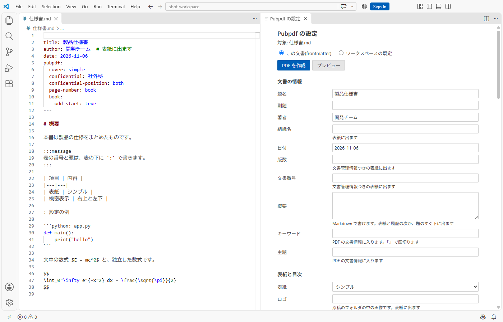
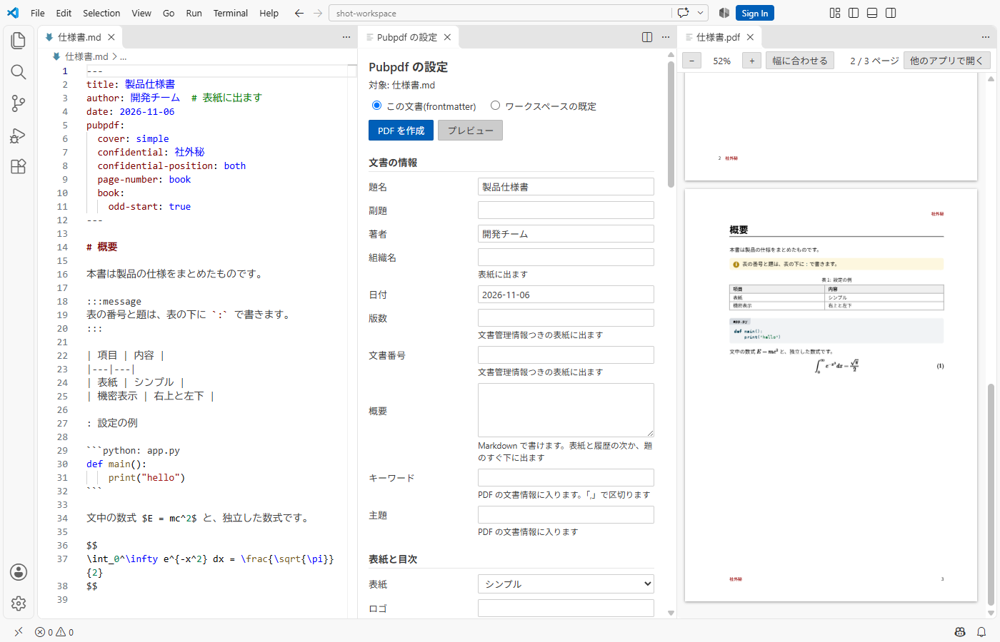

# VS Code での操作

## コマンド

エディタ右上のボタン、エクスプローラーの右クリック、コマンドパレットから実行します。

| コマンド | 内容 | 場所 |
|---|---|---|
| `Pubpdf: PDF を作成` | PDF を作ります | ボタン、右クリック、コマンドパレット |
| `Pubpdf: PDF をプレビュー` | VS Code の中で PDF を表示します。原稿の md が PDF より新しければ作り直します | ボタン、右クリック、コマンドパレット |
| `Pubpdf: 設定パネルを開く` | 設定パネルを開きます | ボタン、コマンドパレット |
| `Pubpdf: frontmatter の雛形を挿入` | 原稿の先頭に frontmatter を入れます | コマンドパレット |
| `Pubpdf: 環境を確認` | Quarto、フォント、ブラウザの状態を一覧で示します | コマンドパレット |

: 拡張機能のコマンド

## PDF を作る

- 実行中は通知に進捗を表示します。通知の「キャンセル」で止められます。
- 未保存の変更は、保存してから組みます。
- 親の md が同じワークスペースのフォルダにあれば、章の md を開いた状態で実行しても本全体を組みます。本が複数あれば、選択肢を示します。
- 実行中にもう一度実行すると、前の処理を止めて最新の内容で組み直します。
- 設定 `pubpdf.renderOnSave` をオンにすると、保存したときに PDF を作り直します。対象は `pubpdf:` のある原稿と合本の章です。
- PDF を他のアプリで開いていて上書きできないときは、原因を知らせます。
- ワークスペースのフォルダの直下に `.git` があるときは、最初に PDF ができた後に、`.pubpdf/` を `.gitignore` に追加するかを尋ねます。`pubpdf.renderOnSave` で作ったときと、`pubpdf.buildDirectory` が `global` のときは尋ねません。
- 信頼していないワークスペース(制限モード)では、拡張機能は動きません。

## 設定パネル

Markdown のタブの右上にある歯車のボタンか、コマンドパレットの `Pubpdf: 設定パネルを開く` で開きます。ボタンが見当たらないときは、タブの右上の `...` の中を確認してください。

@fig-panel のパネルで、表紙、目次、図と表の一覧、参考文献、機密表示の文字と位置、ページ番号の位置と数え方、用紙の種類と向き、余白、章の前の改ページ、奇数ページ始まり、綴じ代、見出しと図表と式の番号、コードの行番号、文字の大きさ、行間、字下げ、フォントを変更できます。バージョン履歴と付録はパネルにはないので、frontmatter に書きます。文献のファイルは文書ごとの設定なので、パネルの「この文書」でだけ指定できます。

段組み、ヘッダとフッタの文字、透かし、テーマの色、表の体裁、コードの配色、PDF の規格、組織名、キーワード、主題も変更できます。ロゴと文献のファイルは原稿のフォルダの中を指すので、保存先に「この文書」を選んだときだけ変更できます。

{#fig-panel width=100%}

パネルの上で保存先を選びます。

| 保存先 | 書き込む場所 | 効く範囲 |
|---|---|---|
| この文書 | 開いている md の frontmatter | その文書だけ |
| ワークスペースの既定 | ワークスペースの `settings.json` | ワークスペースの文書で、frontmatter に書いていない項目 |

: 設定パネルの保存先

- 「既定」を選ぶと、その項目を frontmatter から消します。括弧の中に、そのときに使われる値を示します。
- frontmatter へ書き戻すときも、コメント、キーの順序、値、本文は変えません。ただし frontmatter 全体を書き直すので、値の後のコメントの前の空白、折り返した文字列の改行、リストの字下げは揃うことがあります。
- 変更は未保存の編集として入るので、取り消せます。PDF を作るときに保存します。
- 章の md を開いているときは、親の md の設定を変更します。
- フォント名の欄には、読み込めるフォントが候補として出ます。

## プレビュー

@fig-preview のように、VS Code の中で PDF を確認できます。PDF を作り直すと、表示している位置を保ったまま更新します。拡大と縮小、幅に合わせる表示ができます。画像や VS Code の設定を変えただけでは、プレビューのコマンドは PDF を作り直しません。`Pubpdf: PDF を作成` を実行してください。

{#fig-preview width=100%}

## エラーと警告

- エラーと警告を問題パネルに出します。章ファイル、画像、リンク、frontmatter の誤りは、選ぶと原稿の該当行へ移動します。
- 組版中のエラーは原稿の行に対応しないので、親の md の先頭に出します。内容は出力パネルの Pubpdf で確認できます。

## 設定のキー

VS Code の設定は、frontmatter に書いていない項目の既定値になります。`font-paths` だけは例外で、frontmatter と VS Code の設定の両方を読み込みます。

| VS Code の設定 | frontmatter のキー |
|---|---|
| `pubpdf.cover` | `cover` |
| `pubpdf.toc` | `toc`(`none`、`1`、`2`、`3`) |
| `pubpdf.listOfFigures` | `list-of-figures`(`on`、`off`) |
| `pubpdf.listOfTables` | `list-of-tables`(`on`、`off`) |
| `pubpdf.citationStyle` | `citation-style` |
| `pubpdf.footnotes` | `footnotes` |
| `pubpdf.footnotesTitle` | `footnotes-title` |
| `pubpdf.confidential.text` | `confidential` |
| `pubpdf.confidential.position` | `confidential-position` |
| `pubpdf.watermark` | `watermark` |
| `pubpdf.header.left`、`pubpdf.header.center`、`pubpdf.header.right` | `header-left`、`header-center`、`header-right` |
| `pubpdf.footer.left`、`pubpdf.footer.center`、`pubpdf.footer.right` | `footer-left`、`footer-center`、`footer-right` |
| `pubpdf.pageNumber` | `page-number`(`auto` は既定に任せます) |
| `pubpdf.pageCount` | `page-count` |
| `pubpdf.paper` | `paper` |
| `pubpdf.orientation` | `orientation` |
| `pubpdf.columns` | `columns` |
| `pubpdf.margin.top`、`pubpdf.margin.bottom` | `margin.top`、`margin.bottom` |
| `pubpdf.margin.inner`、`pubpdf.margin.outer` | `margin.inner`、`margin.outer` |
| `pubpdf.numbering` | `numbering` |
| `pubpdf.figureNumbering` | `figure-numbering`(`auto` は既定に任せます) |
| `pubpdf.equationNumbering` | `equation-numbering` |
| `pubpdf.codeLineNumbers` | `code-line-numbers`(`on`、`off`) |
| `pubpdf.codeDisplay` | `code-display` |
| `pubpdf.codeFitMin` | `code-fit-min` |
| `pubpdf.codeAttach` | `code-attach` |
| `pubpdf.codeAttachNote` | `code-attach-note` |
| `pubpdf.fontSize` | `font-size` |
| `pubpdf.lineSpacing` | `line-spacing` |
| `pubpdf.firstLineIndent` | `first-line-indent`(`on`、`off`) |
| `pubpdf.chapterBreak` | `chapter-break`(`on`、`off`) |
| `pubpdf.oddStart` | `book.odd-start`(`auto`、`on`、`off`) |
| `pubpdf.gutter` | `book.gutter` |
| `pubpdf.accentColor` | `accent-color` |
| `pubpdf.tableStyle` | `table-style` |
| `pubpdf.codeTheme` | `code-theme` |
| `pubpdf.inlineCodeBackground` | `inline-code-background`(`on`、`off`) |
| `pubpdf.tableFit` | `table-fit`(`on`、`off`) |
| `pubpdf.pdfStandard` | `pdf-standard` |
| `pubpdf.font.body` | `font` |
| `pubpdf.font.heading` | `font-heading` |
| `pubpdf.font.code` | `font-code` |
| `pubpdf.font.math` | `font-math` |
| `pubpdf.font.paths` | `font-paths`(相対パスはワークスペースのフォルダが基準です) |

: VS Code の設定と frontmatter の対応

次の設定は VS Code だけのものです。

| 設定 | 内容 |
|---|---|
| `pubpdf.quartoPath` | Quarto の実行ファイルのパス |
| `pubpdf.outputDirectory` | PDF の出力フォルダ。frontmatter の `output` が優先されます |
| `pubpdf.buildDirectory` | 中間ファイル(`.pubpdf`)の置き場所。`workspace`(既定)はワークスペースのフォルダの直下、`document` は原稿と同じフォルダ、`global` は拡張機能の保管場所(プロジェクトのフォルダには作りません) |
| `pubpdf.renderOnSave` | 保存時に PDF を作り直す |

: VS Code だけの設定
