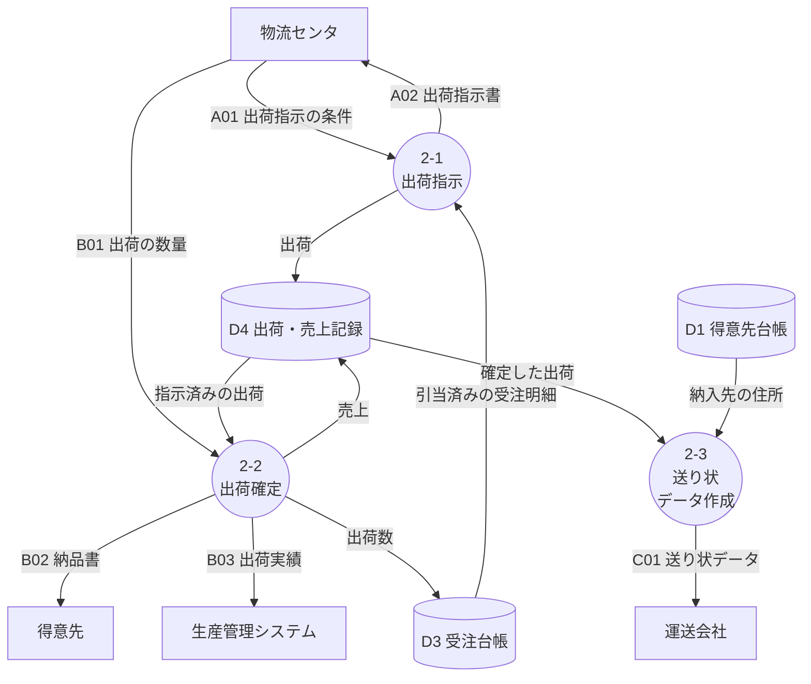
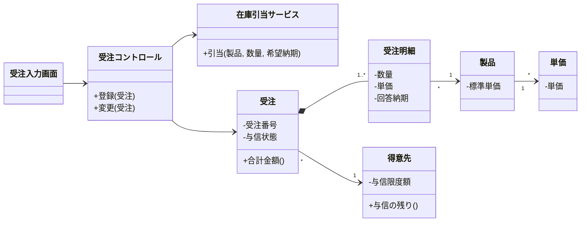
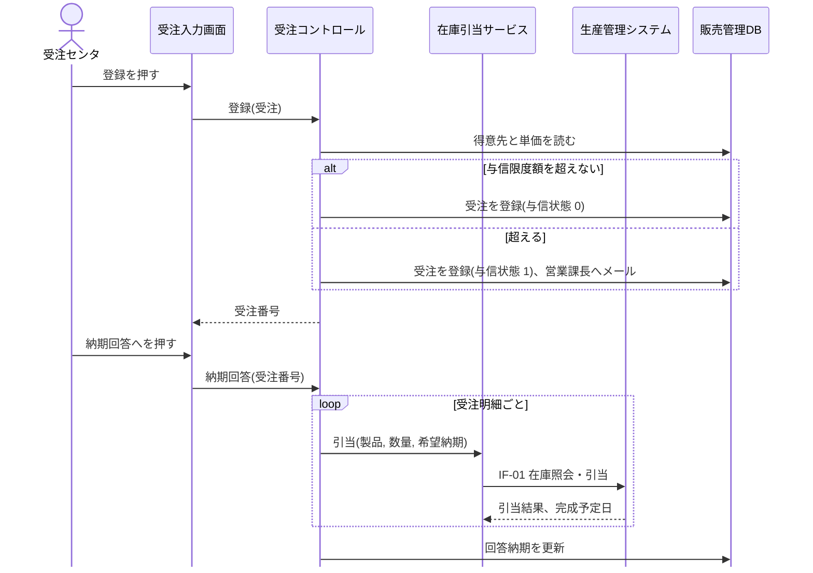
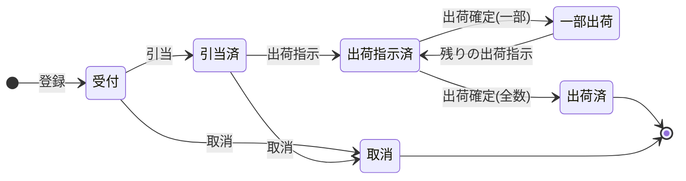
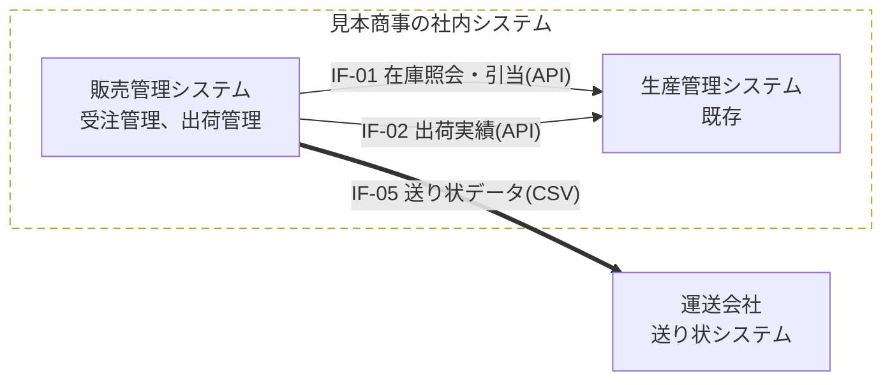
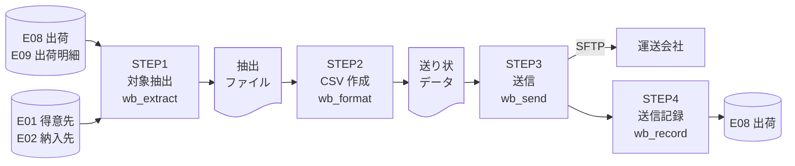

# 概要

## 目的

本書は、見本商事株式会社(以下、見本商事)の販売管理システムの刷新について、受注と出荷のサブシステムの基本設計を定める。要件定義書(MS-RD-001)で合意した機能を、画面、帳票、外部インタフェース、バッチ処理、データの単位に分けて具体的にする。

見本商事の利用部門と見本株式会社(以下、当社)が、システムの外から見える動きを本書で合意し、詳細設計の入力とする。

## 位置づけ

```layers
%%| label: fig-docs
%%| fig-cap: 設計書の位置づけ
MS-RD-001 要件定義書
MS-BD-001 基本設計書(本書) *2 | MS-IT-001 結合テスト仕様書
MS-DD-001 詳細設計書 *2 | MS-UT-001 単体テスト仕様書
プログラム
```

## 対象範囲

要件定義書のサブシステムのうち、受注管理と出荷管理を対象とする。

| サブシステム | 機能 | 本書の対象 |
|---|---|:-:|
| 1 受注管理 | F-101 受注登録、F-102 在庫引当・納期回答、F-103 受注照会・変更 | ○ |
| 2 出荷管理 | F-201 出荷指示、F-202 出荷確定、F-203 送り状データ作成 | ○ |
| 3 請求管理 | F-301〜F-304 | ×(MS-BD-002) |
| 4 管理資料、5 マスタ管理 | F-401、F-501、F-502 | ×(MS-BD-003) |

: 対象範囲 {#tbl-scope}

要件定義書の未決事項 No.1 の EDI は、2026/12/15 に対象外と決まった。本書には含めない。

## 設計の対象と ID

要件定義書の ID は、本書でもそのまま使う。基本設計で新しく決めたものには、@tbl-ids の ID を付ける。

| 対象 | ID の形 | 例 | 決めた文書 |
|---|---|---|---|
| 機能、画面、帳票、インタフェース、エンティティ | F-101、SC-01、RP-01、IF-01、E06 | F-101 受注登録 | 要件定義書 |
| プロセス(DFD) | 機能の番号を「-」で区切る | 2-1 出荷指示(F-201) | 本書 |
| モジュール | 英小文字 3 文字 + _ + 名前 | shp_instruct | 本書 |
| バッチ処理 | BT- + 連番 2 桁 | BT-01 送り状データ作成 | 本書 |
| 画面のアクション | A- + 画面の番号 + 連番 2 桁 | A-01-04 登録 | 本書 |
| 画面(追加) | SC- + 連番 2 桁。10 以降を使う | SC-12 得意先検索 | 本書 |

: ID の体系 {#tbl-ids}

## 参照ドキュメント

| ID | 文書名 | 文書番号 | 発行年月 | 備考 |
|---|---|---|---|---|
| R1 | 要件定義書 | MS-RD-001 | 2026/11 | 第 1.1 版 |
| R2 | 生産管理システム 在庫照会 API 仕様書 | PM-API-002 | 2025/04 | 既存システム |
| R3 | 送り状データ連携仕様 | TR-IF-07 | 2024/10 | 運送会社の文書 |
| R4 | 機能要件の合意形成ガイド、ソフトウェア方式設計書<良い設計例> | — | 2010、2012 | IPA。図表の形の参考 |

: 参照ドキュメント {#tbl-refs}

## 用語と記号

用語は要件定義書の 1.5 に従う。本書で足す用語と、表の中の記号を次に示す。

| 用語・記号 | 意味 |
|---|---|
| IPO | 処理を入力(Input)、処理(Process)、出力(Output)に分けて書く形式 |
| CRUD | データの作成(C)、参照(R)、更新(U)、削除(D) |
| 属性 C、K、N、D | C: 文字(半角)、K: 文字(全角)、N: 数字、D: 日付 |
| ○、△、×、— | ○: 常にする、△: 条件つきでする、×: しない、—: 対象外 |
| ● と下線 | 主キーの項目 |

: 用語と記号 {#tbl-terms}

# サブシステム概要

## ユースケース

利用者が本システムを何のために使うかを @fig-usecase に示す。UC-01〜UC-05 は F-101〜F-103、F-201、F-202 に対応する。F-203 はバッチ処理である(7 章)。

```usecase
%%| label: fig-usecase
%%| fig-cap: ユースケース図
system: 販売管理システム(受注管理、出荷管理)
受注センタ: UC-01 受注を登録する, UC-02 納期を回答する, UC-03 受注を照会・変更する
営業部: UC-03 受注を照会・変更する
物流センタ: UC-04 出荷を指示する, UC-05 出荷を確定する
include: UC-01 受注を登録する -> 与信を確かめる
extend: 得意先を検索する -> UC-01 受注を登録する
include: UC-02 納期を回答する -> 在庫を引き当てる
extend: 与信超過を承認する -> UC-03 受注を照会・変更する
```

«include» は必ず含む処理、«extend» は条件を満たすときだけ加わる処理を表す。得意先の検索(SC-12)は、得意先コードがわからないときだけ行う。与信超過の承認は、与信状態が 1(承認待ち)の受注を営業部が UC-03 で開いたときだけ行う。

## ユースケース記述

UC-01 受注を登録する、を @tbl-uc01 に示す。

+--------------------------+----------------------------------------------------------------------------+
| [ユースケース名]{.shade} | UC-01 受注を登録する(F-101)                                                |
+--------------------------+----------------------------------------------------------------------------+
| [要約]{.shade}           | 注文書の内容を入力し、単価と与信を確かめて受注を登録する                   |
+--------------------------+----------------------------------------------------------------------------+
| [主要アクタ]{.shade}     | 受注センタ                                                                 |
+--------------------------+----------------------------------------------------------------------------+
| [事前条件]{.shade}       | ログインしている。得意先と製品がマスタにある                               |
+--------------------------+----------------------------------------------------------------------------+
| [基本フロー]{.shade}     | 1. 受注センタは、受注入力画面(SC-01)で得意先、納入先、希望納期、明細を入力 |
|                          |    し、「登録」を押す                                                      |
|                          | 2. システムは、入力を確かめ、単価を設定する(BR-04)                         |
|                          | 3. システムは、与信限度額を超えないことを確かめる(BR-03)                   |
|                          | 4. システムは、受注番号を付けて受注を登録し、注文請書(RP-01)を作る         |
|                          | 5. システムは、受注番号を表示する                                          |
+--------------------------+----------------------------------------------------------------------------+
| [代替フロー]{.shade}     | - 2a. 入力に誤りがある: 誤りのある項目に印を付けてメッセージを出す。1 に戻 |
|                          |   る                                                                       |
|                          | - 3a. 与信限度額を超える: 与信状態を 1(承認待ち)として登録し、営業課長にメ |
|                          |   ールで知らせる。注文請書は承認の後に作る                                 |
+--------------------------+----------------------------------------------------------------------------+
| [事後条件]{.shade}       | 受注が与信状態 0(正常)か 1(承認待ち)で登録されている                       |
+--------------------------+----------------------------------------------------------------------------+
| [関連]{.shade}           | 画面 SC-01、SC-12。帳票 RP-01。次は UC-02 納期を回答する                   |
+--------------------------+----------------------------------------------------------------------------+

: ユースケース記述(UC-01) {#tbl-uc01}

## サブシステムフロー

受注を登録して納期を回答するまでの、利用者とシステムの処理の順序を @fig-flow に示す。列は担当(レーン)で、処理の順に上から下へ並べる。ひし形は判断、黒丸は開始、二重丸は終了を表す。

```swimlane
%%| label: fig-flow
%%| fig-cap: 受注登録から納期回答までのサブシステムフロー
lanes: 受注センタ, 本システム, 営業部, 生産管理システム
受注センタ: ●
受注センタ: 注文書を見て受注を入力する [SC-01]
本システム: 入力を確かめ単価を設定する
本システム: ◇ 入力に誤りがある -> はい: 誤りを直す, いいえ: 与信限度額の範囲内
受注センタ: 誤りを直す -> 入力を確かめ単価を設定する
本システム: ◇ 与信限度額の範囲内 -> はい: 受注番号を付けて登録し引き当てる, いいえ: 承認待ちで登録し営業部へ知らせる
本システム: 承認待ちで登録し営業部へ知らせる
営業部: 与信超過を承認する [SC-03]
本システム: 受注番号を付けて登録し引き当てる
生産管理システム: 在庫と完成予定を返す [IF-01]
本システム: 注文請書と納期回答書を作る
受注センタ: 回答納期を確かめて確定する [SC-02]
受注センタ: ◎
```

## データフローダイアグラム

出荷管理(要件定義書の DFD のプロセス 2)を分けたデータフローダイアグラムを @fig-dfd に示す。



図の記号は要件定義書と同じである。円はプロセス、四角は外部、円柱はデータストアを表す。プロセスの番号は機能の番号に対応する(2-1 は F-201)。

## 処理機能記述書

プロセス 2-1 出荷指示の処理を、IPO の形で @tbl-ipo に示す。

+--------------------------+-------------------------------------------------------------------------+
| [プロセス番号]{.shade}   | 2-1(F-201、モジュール shp_instruct)                                     |
+--------------------------+-------------------------------------------------------------------------+
| [プロセス名]{.shade}     | 出荷指示                                                                |
+--------------------------+----------------------------------------------+--------------------------+
| [Input]{.shade}          | [Process]{.shade}                            | [Output]{.shade}         |
+--------------------------+----------------------------------------------+--------------------------+
| A01 出荷指示の条件       | 1. 出荷指示の条件を受け取る                  | —                        |
| (物流センタ、SC-04)      |                                              |                          |
+--------------------------+----------------------------------------------+--------------------------+
| D3 受注台帳              | 2. 出荷する受注明細を抽出し、画面に並べる    | —                        |
| (E06 受注、E07 受注明細) |                                              |                          |
+--------------------------+----------------------------------------------+--------------------------+
| D1 得意先台帳(E02 納入   | 3. 物流センタが選んだ明細から、納入先ごとに  | D4 出荷・売上記録        |
| 先)\                     |    出荷を作る                                | (E08 出荷、E09 出荷明細) |
| D2 製品・単価台帳(E04 製 |                                              |                          |
| 品)                      |                                              |                          |
+--------------------------+----------------------------------------------+--------------------------+
| —                        | 4. 出荷指示書を出力する                      | A02 出荷指示書(RP-03)    |
+--------------------------+----------------------------------------------+--------------------------+
| —                        | 5. 受注明細の状態を「出荷指示済」にする      | D3 受注台帳(E07)         |
+--------------------------+----------------------------------------------+--------------------------+

: 処理機能記述書(2-1 出荷指示) {#tbl-ipo}

補足説明:

1. 出荷指示の条件は、出荷予定日と方面(関東、中部、関西)である。出荷予定日の初期値は当日とする。
2. 抽出する受注明細の条件は次のすべてを満たすものとする(BR-06)。
    - 回答納期が、出荷予定日の 2 営業日後以前
    - 状態が「引当済」か「一部出荷」
    - 受注の与信状態が 0(正常)か 2(承認済み)
3. 同じ納入先で同じ出荷予定日の明細は、1 つの出荷にまとめる。出荷番号は 8.4 の体系で付ける。
4. 出荷指示書は、出荷ごとに 1 枚とし、明細は製品の保管場所の順に並べる。

## データフロー記述書

@fig-dfd のデータフローのうち、A02 の項目を @tbl-df-a02 に示す。A01 は、出荷予定日と方面(1: 関東、2: 中部、3: 関西)の 2 項目である。

+----------------------------------------+--------------------------------------------------------------------------------+
| [データフロー番号]{.shade}             | A02                                                                            |
+----------------------------------------+--------------------------------------------------------------------------------+
| [データフロー名]{.shade}               | 出荷指示書(RP-03)                                                              |
+---------------+------------------------+----------------+----------------+----------------------------------------------+
| [No.]{.shade} | [項目名]{.shade}       | [属性]{.shade} | [桁数]{.shade} | [備考]{.shade}                               |
+---------------+------------------------+----------------+----------------+----------------------------------------------+
| 1             | 出荷番号               | C              | 10             | 記述形式: S999999999                         |
+---------------+------------------------+----------------+----------------+----------------------------------------------+
| 2             | 出荷予定日             | D              | 10             | 記述形式: YYYY/MM/DD                         |
+---------------+------------------------+----------------+----------------+----------------------------------------------+
| 3             | 納入先名               | K              | 40             | 得意先名と納入先名をつなげる                 |
+---------------+------------------------+----------------+----------------+----------------------------------------------+
| 4             | 納入先の住所           | K              | 80             | 都道府県から番地まで                         |
+---------------+------------------------+----------------+----------------+----------------------------------------------+
| 5             | 受注番号               | C              | 9              | 記述形式: J99999999                          |
+---------------+------------------------+----------------+----------------+----------------------------------------------+
| 6             | 明細番号               | N              | 2              | 受注明細の番号                               |
+---------------+------------------------+----------------+----------------+----------------------------------------------+
| 7             | 保管場所               | C              | 6              | 記述形式: X99-99(棟、列、段)                 |
+---------------+------------------------+----------------+----------------+----------------------------------------------+
| 8             | 製品コード             | C              | 6              | 記述形式: X-9999                             |
+---------------+------------------------+----------------+----------------+----------------------------------------------+
| 9             | 製品名                 | K              | 40             |                                              |
+---------------+------------------------+----------------+----------------+----------------------------------------------+
| 10            | 出荷数量               | N              | 7              | 受注数量から出荷済みの数量を引いた数         |
+---------------+------------------------+----------------+----------------+----------------------------------------------+
| 11            | 単位                   | K              | 4              | 台、個、箱など                               |
+---------------+------------------------+----------------+----------------+----------------------------------------------+

: データフロー A02 {#tbl-df-a02}

# サブシステム機能詳細

## 構造図

サブシステムとモジュールの構成を @fig-structure に示す。モジュールの名前は、プログラムの名前の元になる。

```wbs
%%| label: fig-structure
%%| fig-cap: サブシステム構造図
販売管理システム
  受注管理
    ord_entry 受注登録 F-101
    ord_allocate 在庫引当・納期回答 F-102
    ord_inquiry 受注照会・変更 F-103
  出荷管理
    shp_instruct 出荷指示 F-201
    shp_confirm 出荷確定 F-202
    shp_waybill 送り状データ作成 F-203
  共通
    cmn_stock 在庫照会・引当(IF-01)
    cmn_report 帳票の出力
    cmn_auth ログインと権限
```

## クラス一覧

受注登録と在庫引当に関わるクラスを @tbl-classes に示す。境界は画面、制御は処理の手順、実体はデータを受け持つ。

| No. | クラス名 | 種類 | 概要 |
|--:|---|---|---|
| 1 | 受注入力画面 | 境界 | SC-01 の入力を受け取る |
| 2 | 受注コントロール | 制御 | 受注の登録と変更の手順をまとめる |
| 3 | 在庫引当サービス | 制御 | IF-01 を呼び、在庫を照会して引き当てる |
| 4 | 受注 | 実体 | 受注のヘッダ。合計金額を計算する |
| 5 | 受注明細 | 実体 | 製品、数量、単価、回答納期を持つ |
| 6 | 得意先 | 実体 | 与信の残り(限度額 − 売掛金 − 受注残)を計算する |
| 7 | 製品 | 実体 | 標準単価、単位、重量を持つ |
| 8 | 単価 | 実体 | 得意先別の単価。適用開始日ごとに持つ |

: クラス一覧 {#tbl-classes}

## クラス構成図



## シーケンス図

UC-01 受注を登録する、の基本フローと UC-02 の在庫引当を @fig-seq に示す。



## 受注明細の状態遷移

受注明細の状態は 6 つである。@tbl-state に遷移を、@fig-state に図を示す(—: 起きない、×: エラーにする)。

| イベント＼状態 | 受付 | 引当済 | 出荷指示済 | 一部出荷 | 出荷済 |
|---|:-:|:-:|:-:|:-:|:-:|
| 引当(F-102) | 引当済 | — | — | — | — |
| 出荷指示(F-201) | × | 出荷指示済 | — | 出荷指示済 | — |
| 出荷確定、全数(F-202) | — | — | 出荷済 | — | — |
| 出荷確定、一部(F-202) | — | — | 一部出荷 | — | — |
| 取消(F-103) | 取消 | 取消 | × | × | × |

: 受注明細の状態遷移表 {#tbl-state}



# 画面設計

## 画面一覧

| No. | 画面 ID | 画面名 | 分類 | 説明 | 機能 |
|--:|---|---|---|---|---|
| 1 | SC-10 | ログイン | 入力 | 社内ディレクトリの ID とパスワードで認証する | 共通 |
| 2 | SC-11 | メニュー | メニュー | 部門の権限で使える業務だけを並べる | 共通 |
| 3 | SC-01 | 受注入力 | 入力 | 受注の新規の登録。SC-03 から開いたときは変更 | F-101 |
| 4 | SC-12 | 得意先検索 | 小画面 | 得意先を名前かカナで探して選ぶ。別ウィンドウで開く | F-101 |
| 5 | SC-02 | 納期回答 | 入力 | 引当結果を見て、回答納期を確定する | F-102 |
| 6 | SC-03 | 受注照会 | 一覧 | 受注を検索し、変更、取消、与信超過の承認に進む | F-103 |
| 7 | SC-04 | 出荷指示 | 一覧 | 出荷する受注明細を選び、出荷指示書を出力する | F-201 |
| 8 | SC-05 | 出荷確定 | 一覧 | 出荷した数量を入力し、納品書を出力する | F-202 |
| 9 | SC-90 | エラー | 通知 | 処理を続けられないエラーを表示する | 共通 |

: 画面一覧 {#tbl-screens tbl-colwidths="[5,8,14,13,48,12]"}

SC-10 以降は、基本設計で足した画面である。

## 画面遷移図

```screenflow
%%| label: fig-transition
%%| fig-cap: 画面遷移図
|                  |                  | SC-10 ログイン |                  |                |
|                  |                  | SC-11 メニュー |                  | SC-90 エラー   |
| SC-12 得意先検索 | SC-01 受注入力   | SC-03 受注照会 | SC-04 出荷指示   | SC-05 出荷確定 |
| RP-01 注文請書   | SC-02 納期回答   |                | RP-03 出荷指示書 | RP-04 納品書   |
|                  | RP-02 納期回答書 |                |                  |                |
小画面: SC-12
帳票: RP-01, RP-02, RP-03, RP-04
共通: SC-90
SC-10 -> ログイン: SC-11
SC-11 -> SC-01, SC-03, SC-04, SC-05
SC-03 -> 変更: SC-01
SC-01 -> 検索: SC-12
SC-12 -> 選択: SC-01
SC-01 -> 納期回答へ: SC-02
SC-01 -> 登録: RP-01
SC-02 -> 確定: RP-02
SC-04 -> 指示確定: RP-03
SC-05 -> 確定: RP-04
```

図の記号: 実線の矢印は画面の遷移、点線の矢印は帳票の出力、点線の枠は別ウィンドウの小画面、黄色の画面はどの画面からも移る共通の画面を表す。メニューの項目は移る先の画面と同じ名前なので、矢印には書いていない。どの画面からも、処理を続けられないエラーのときは SC-90 に移り、「メニューへ」で SC-11 に戻る。

## 画面レイアウト

```wireframe
%%| label: fig-sc01
%%| fig-cap: 受注入力(SC-01)
# 受注入力(SC-01)
① 受注番号 | J26120015 | ② 受注日 | "2026/12/10"
③ 得意先 | "10000123" | ④ 見本工業(株) | [検索]
⑤ 納入先 | ^0001 本社工場^ | ⑥ 希望納期 | "2026/12/21"
⑦ 客先注文番号 | "PO-55821" | ⑧ 与信状態 | 0: 正常
--
# 明細
No. | ⑨ 製品コード | ⑩ 製品名 | ⑪ 数量 | ⑫ 単価 | ⑬ 金額
1 | "P-1001" | 制御盤 A | "10" | 120,000 | 1,200,000
2 | "P-2003" | 端子台 B | "50" | 3,000 | 150,000
--
⑭ 合計金額 | 1,350,000 | ⑮ 消費税 | 135,000
[登録] | [納期回答へ] | [クリア] | [閉じる]
```

補足説明:

- @fig-sc01 の丸の数字は、4.4 の項目の識別 ID である。
- 新規の登録では、① は空で、登録の後に採番した番号を出す。SC-03 から変更で開いたときは ① に番号を出し、③ は変えられない。
- 4.4 の部品の種類のテキストはテキストボックス、コンボはコンボボックスの略である。
- 明細は 20 行まで入力できる。10 行を超えると、明細の欄だけを縦にスクロールする。
- 画面の見出し、メッセージの位置、ボタンの並びは、画面の共通ルール(見本商事 標準 UI 規約)に従う。

::: {.landscape}

## 画面入出力項目一覧

受注入力(SC-01)の項目を @tbl-sc01-items に示す。

| ID | 表示用のラベル | 部品の種類 | 有効 | 入力 | 必須 | 桁数(表示/入力) | データ型(文字種) | 入力制約 | 初期表示 | 出力仕様 | 補足 |
|:-:|---|---|:-:|:-:|:-:|---|---|---|---|---|---|
| ① | 受注番号 | ラベル | ○ | × | — | 9 / — | 文字列(半角) | — | 空 | — | 登録で採番する |
| ② | 受注日 | テキスト | ○ | ○ | ○ | 10 / 10 | 日付(半角) | 7 日前から当日 | 当日 | YYYY/MM/DD | |
| ③ | 得意先 | テキスト | ○ | △ | ○ | 8 / 8 | 文字列(半角) | E01 にあること | 空 | — | 変更では入力不可 |
| ④ | 得意先名 | ラベル | ○ | × | — | 40 / — | 文字列(全角) | — | ③ から表示 | — | |
| ⑤ | 納入先 | コンボ | △ | ○ | ○ | 30 / — | 文字列(全角) | ③ の納入先 | 0001 | コードと名前 | ③ の入力後に有効 |
| ⑥ | 希望納期 | テキスト | ○ | ○ | — | 10 / 10 | 日付(半角) | 受注日より後 | 空 | YYYY/MM/DD | 空なら標準納期 |
| ⑦ | 客先注文番号 | テキスト | ○ | ○ | — | 20 / 20 | 文字列(半角) | 英数字と記号 | 空 | — | RP-01 に印字する |
| ⑧ | 与信状態 | ラベル | ○ | × | — | 10 / — | 文字列(全角) | — | 空 | コードと名前 | 登録の後に表示 |
| ⑨ | 製品コード | テキスト | ○ | ○ | ○ | 6 / 6 | 文字列(半角) | X-9999、E04 | 空 | — | 1 行目は必須 |
| ⑩ | 製品名 | ラベル | ○ | × | — | 40 / — | 文字列(全角) | — | ⑨ から表示 | — | |
| ⑪ | 数量 | テキスト | △ | ○ | △ | 7 / 7 | 数値(半角) | 1 以上 | 空 | 3 桁区切り | ⑨ があれば必須 |
| ⑫ | 単価 | テキスト | △ | △ | △ | 9 / 9 | 数値(半角) | 0 以上 | BR-04 の単価 | 3 桁区切り | 変更は営業課長だけ |
| ⑬ | 金額 | ラベル | ○ | × | — | 11 / — | 数値(半角) | — | 空 | 3 桁区切り | ⑪ × ⑫ |
| ⑭ | 合計金額 | ラベル | ○ | × | — | 11 / — | 数値(半角) | — | 0 | 3 桁区切り | ⑬ の合計 |
| ⑮ | 消費税 | ラベル | ○ | × | — | 10 / — | 数値(半角) | — | 0 | 3 桁区切り | 円未満は切り捨て |

: 画面入出力項目一覧(SC-01) {#tbl-sc01-items .small tbl-colwidths="[4,9,8,4,4,4,7,10,12,10,11,17]"}

:::

## 画面アクション明細

受注入力(SC-01)のアクションを @tbl-sc01-actions に示す。アクション名の下の括弧は、アクションを起こすイベントである。[クリア] と [閉じる] は、画面の共通ルールに従う。

<table>
<tr><th>ID</th><th>アクション名(イベント名)</th><th>アクションの処理概要</th><th>入力</th><th>アクションの処理詳細</th><th>遷移先、出力</th></tr>
<tr><td>A-01-01</td><td>得意先の検索<br>([検索] の押下)</td><td>得意先を探す小画面を開く</td><td>—</td><td>① SC-12 を別ウィンドウで開く<br>② 選んだ得意先のコードを ③ に入れ、A-01-02 を行う</td><td>SC-12 を開く</td></tr>
<tr><td rowspan="2">A-01-02</td><td rowspan="2">得意先の表示<br>(③ から離れる)</td><td rowspan="2">得意先名と納入先の候補を出す</td><td rowspan="2">E01 得意先、E02 納入先</td><td>① 得意先コードで E01 を読む<br>②-1 あれば ④ に名前を出し、⑤ に E02 の納入先を並べる</td><td>④ 得意先名、⑤ 納入先</td></tr>
<tr><td>②-2 なければ「得意先が見つかりません」と出す</td><td>メッセージの表示</td></tr>
<tr><td>A-01-03</td><td>単価の設定<br>(⑨ から離れる)</td><td>製品名と単価を出す(BR-04)</td><td>E04 製品、E05 単価</td><td>① E04 を読み、⑩ に製品名を出す<br>② E05 に得意先別の単価があればそれを、なければ標準単価を ⑫ に出す</td><td>⑩ 製品名、⑫ 単価、⑬ 金額</td></tr>
<tr><td rowspan="3">A-01-04</td><td rowspan="3">登録<br>([登録] の押下)</td><td rowspan="3">入力を確かめて受注を登録する</td><td>画面のすべての項目</td><td>① 4.4 の入力制約で確かめる。誤りがあれば項目に印を付けて止める</td><td>誤りがあればメッセージ</td></tr>
<tr><td rowspan="2">E01 得意先、E06 受注</td><td>② 売掛金 + 受注残 + ⑭ が与信限度額を超えるか確かめる(BR-03)<br>③-1 超えなければ、与信状態 0 で E06、E07 に登録し、RP-01 を作る</td><td>① 受注番号、⑧ 与信状態、RP-01</td></tr>
<tr><td>③-2 超えれば、与信状態 1 で登録し、営業課長にメールで知らせる</td><td>① 受注番号、⑧ 与信状態、メール</td></tr>
<tr><td>A-01-05</td><td>納期回答へ<br>([納期回答へ] の押下)</td><td>登録した受注の納期回答へ進む</td><td>① 受注番号、⑧ 与信状態</td><td>① 未登録なら「先に登録してください」と出す<br>② 与信状態が 1 なら「承認待ちです」と出す</td><td>SC-02 に移る</td></tr>
</table>

: 画面アクション明細(SC-01) {#tbl-sc01-actions tbl-colwidths="[9,14,15,14,32,16]"}

# 帳票設計

## 帳票一覧

| No. | 帳票 ID | 帳票名 | 分類 | 改ページ条件 | 出力タイミング | 作成方法 | 様式、用紙 | 利用部門 | 機能 |
|--:|---|---|---|---|---|---|---|---|---|
| 1 | RP-01 | 注文請書 | 伝票 | 受注番号 | 随時(登録の後) | オンライン | PDF、A4 縦 | 受注センタ | F-101 |
| 2 | RP-02 | 納期回答書 | 伝票 | 受注番号 | 随時(確定の後) | オンライン | PDF、A4 縦 | 受注センタ | F-102 |
| 3 | RP-03 | 出荷指示書 | 一覧表 | 出荷番号 | 毎日(指示確定の後) | オンライン | 汎用紙、A4 縦 | 物流センタ | F-201 |
| 4 | RP-04 | 納品書・物品受領書 | 伝票 | 出荷番号、10 行 | 毎日(出荷確定の後) | オンライン | 専用紙、3 枚複写 | 物流センタ | F-202 |

: 帳票一覧 {#tbl-reports .small tbl-colwidths="[4,8,13,7,10,12,12,11,12,8]"}

## 帳票レイアウト

納品書・物品受領書(RP-04)の 1 枚目(納品書)のレイアウトを @fig-rp04 に示す。

```grid
%%| label: fig-rp04
%%| fig-cap: 納品書・物品受領書(RP-04)のレイアウト
columns: 70
rows: 22
1, 31: 納　品　書 {太字}
1, 51: No.
① 1, 55: XXXXXXXXXX-99
2, 52: 出荷日
② 2, 59: YYYY/MM/DD
③ 3, 1: 〒999-9999
3, 52: 見本商事株式会社
④ 4, 1: ＮＮＮＮＮＮＮＮＮＮＮＮＮＮＮＮＮＮＮＮ
4, 52: 物流センタ
⑤ 5, 1: ＮＮＮＮＮＮＮＮＮＮＮＮＮＮＮＮＮＮＮＮ
5, 43: 御中
5, 52: TEL 99-9999-9999
6, 1: 客先注文番号
⑥ 6, 14: XXXXXXXXXXXXXXXXXXXX
6, 38: 受注番号
⑦ 6, 48: XXXXXXXXX
8-19, 1-70: {枠}
8, 1-70: {網掛け 枠}
8, 1: No
8, 4: コード
8, 11: 製品名
8, 39: 数量
8, 44: 単位
8, 52: 単価
8, 63: 金額
⑧ 10, 1: Z9
⑨ 10, 4: X-9999
⑩ 10, 11: ＮＮＮＮＮＮＮＮＮＮＮＮ
⑪ 10, 36: ZZZ,ZZ9
⑫ 10, 44: ＮＮ
⑬ 10, 49: ZZZ,ZZ9
⑭ 10, 57: ZZ,ZZZ,ZZ9
21-22, 45-68: {枠}
21, 46: 合計金額
⑮ 21, 56: ZZZ,ZZZ,ZZ9
22, 46: 消費税
⑯ 22, 57: ZZ,ZZZ,ZZ9
```

方眼の 1 桁に半角の 1 文字(全角は 2 桁)を置く。上の数字は桁、左の数字は行の番号、丸の数字は 5.3 の項目の No. である。X は英数字、Ｎ は全角の文字、9 は数字、Z は前のゼロを空白にする数字を表す。明細は 10〜19 行の 10 行で、11 行目からも 10 行目と同じ形で印字する。2 枚目(納品書控)と 3 枚目(物品受領書)は、帳票名と 22 行の受領印の欄だけが違う。

## 帳票項目説明

@fig-rp04 の丸の数字の項目について、位置と元のデータを @tbl-rp04-items に示す。

<table>
<tr><th>No.</th><th>項目名</th><th>位置(行-桁)</th><th>桁数</th><th>フォーマット</th><th>出力編集</th><th>元のデータ(エンティティ.項目)</th></tr>
<tr><td colspan="7" style="background-color: #eeeeee">【ヘッダ部】各葉に印字する</td></tr>
<tr><td>1</td><td>伝票番号</td><td>01-55</td><td>13</td><td>XXXXXXXXXX-99</td><td>出荷番号と葉の番号</td><td>E08 出荷.出荷番号</td></tr>
<tr><td>2</td><td>出荷日</td><td>02-59</td><td>10</td><td>YYYY/MM/DD</td><td>—</td><td>E08 出荷.出荷日</td></tr>
<tr><td>3</td><td>郵便番号</td><td>03-01</td><td>10</td><td>〒999-9999</td><td>—</td><td>E02 納入先.郵便番号</td></tr>
<tr><td>4</td><td>住所</td><td>04-01</td><td>40</td><td>全角 20 文字</td><td>21 文字目から捨てる</td><td>E02 納入先.住所</td></tr>
<tr><td>5</td><td>納入先名</td><td>05-01</td><td>40</td><td>全角 20 文字</td><td>得意先名と納入先名をつなぐ</td><td>E01 得意先、E02 納入先</td></tr>
<tr><td>6</td><td>客先注文番号</td><td>06-14</td><td>20</td><td>X(20)</td><td>—</td><td>E06 受注.客先注文番号</td></tr>
<tr><td>7</td><td>受注番号</td><td>06-48</td><td>9</td><td>J99999999</td><td>—</td><td>E06 受注.受注番号</td></tr>
<tr><td colspan="7" style="background-color: #eeeeee">【明細部】10 行目から 19 行目</td></tr>
<tr><td>8</td><td>No</td><td>10-01</td><td>2</td><td>Z9</td><td>出荷ごとに 1 から数える</td><td>—</td></tr>
<tr><td>9</td><td>製品コード</td><td>10-04</td><td>6</td><td>X-9999</td><td>—</td><td>E09 出荷明細.製品コード</td></tr>
<tr><td>10</td><td>製品名</td><td>10-11</td><td>24</td><td>全角 12 文字</td><td>13 文字目から捨てる</td><td>E04 製品.製品名</td></tr>
<tr><td>11</td><td>数量</td><td>10-36</td><td>7</td><td>ZZZ,ZZ9</td><td>—</td><td>E09 出荷明細.出荷数量</td></tr>
<tr><td>12</td><td>単位</td><td>10-44</td><td>4</td><td>全角 2 文字</td><td>—</td><td>E04 製品.単位</td></tr>
<tr><td>13</td><td>単価</td><td>10-49</td><td>7</td><td>ZZZ,ZZ9</td><td>—</td><td>E07 受注明細.単価</td></tr>
<tr><td>14</td><td>金額</td><td>10-57</td><td>10</td><td>ZZ,ZZZ,ZZ9</td><td>数量 × 単価</td><td>E09 出荷明細.売上金額</td></tr>
<tr><td colspan="7" style="background-color: #eeeeee">【合計部】最後の葉だけに印字する</td></tr>
<tr><td>15</td><td>合計金額</td><td>21-56</td><td>11</td><td>ZZZ,ZZZ,ZZ9</td><td>14 の合計</td><td>—</td></tr>
<tr><td>16</td><td>消費税</td><td>22-57</td><td>10</td><td>ZZ,ZZZ,ZZ9</td><td>15 × 税率。円未満は捨てる</td><td>—</td></tr>
</table>

: 帳票項目説明(RP-04) {#tbl-rp04-items tbl-colwidths="[6,15,9,6,17,22,25]"}

## 帳票編集定義

+----------------------+------------------+--------------------------------------------------------------+
| [ブロック名]{.shade} | [項目名]{.shade} | [処理説明]{.shade}                                           |
+----------------------+------------------+--------------------------------------------------------------+
| [(1) 改ページ条件]{.shade}                                                                             |
+-----------------------------------------+--------------------------------------------------------------+
| 改ページ条件                            | 出荷番号が変わるたびに改ページする。同じ出荷で明細が 10 行を |
|                                         | 超えたら、10 行ごとに改ページする(次の葉)                    |
+-----------------------------------------+--------------------------------------------------------------+
| [(2) ヘッダ/フッタ制御条件]{.shade}                                                                    |
+----------------------+------------------+--------------------------------------------------------------+
| ヘッダ部             | 伝票番号         | 出荷番号の後に、葉の番号を 2 桁で付ける。1 葉目は 01         |
+----------------------+------------------+--------------------------------------------------------------+
| フッタ部             | —                | 特になし。専用紙に印刷済みの社名と受領印の欄を使う           |
+----------------------+------------------+--------------------------------------------------------------+
| [(3) 項目編集]{.shade}                                                                                 |
+----------------------+------------------+--------------------------------------------------------------+
| 明細部               | No               | 葉ごとではなく、出荷ごとに 1 から数える                      |
+----------------------+------------------+--------------------------------------------------------------+
| 明細部               | 金額             | 数量 × 単価。出荷を確定したときの E09 の売上金額を使い、印字 |
|                      |                  | のときに計算し直さない                                       |
+----------------------+------------------+--------------------------------------------------------------+
| 合計部               | 合計金額、消費税 | 出荷の最後の葉だけに印字する。途中の葉の 21、22 行は空白にす |
|                      |                  | る                                                           |
+----------------------+------------------+--------------------------------------------------------------+

: 帳票編集定義(RP-04) {#tbl-rp04-edit}

専用紙の変更は、要件定義書の未決事項 No.2 で検討中である(期限 2026/12/25)。変更が決まったら、本節を改訂する。

# 外部インタフェース設計

## 外部インタフェース一覧

<table>
<tr><th rowspan="2">ID</th><th rowspan="2">インタフェース名</th><th rowspan="2">方向</th><th rowspan="2">相手システム</th><th rowspan="2">既存/新規</th><th colspan="2">接続方式</th><th colspan="2">処理タイミング</th></tr>
<tr><th>受渡し手段</th><th>データ形式</th><th>タイミング</th><th>送受信時間</th></tr>
<tr><td>IF-01</td><td>在庫照会・引当</td><td>送受信</td><td>生産管理システム</td><td>既存</td><td>REST API(同期)</td><td>JSON</td><td>オンライン(即時)</td><td>7:00〜22:00</td></tr>
<tr><td>IF-02</td><td>出荷実績</td><td>送信</td><td>生産管理システム</td><td>既存</td><td>REST API(非同期)</td><td>JSON</td><td>オンライン(出荷確定のたび)</td><td>7:00〜22:00</td></tr>
<tr><td>IF-03</td><td>売上仕訳</td><td>送信</td><td>会計システム</td><td>新規</td><td>ファイル共有</td><td>CSV</td><td>バッチ(日次)</td><td>23:00</td></tr>
<tr><td>IF-04</td><td>入金明細</td><td>受信</td><td>会計システム</td><td>新規</td><td>ファイル共有</td><td>CSV</td><td>バッチ(日次)</td><td>18:00</td></tr>
<tr><td>IF-05</td><td>送り状データ</td><td>送信</td><td>運送会社 送り状システム</td><td>既存</td><td>SFTP</td><td>CSV</td><td>バッチ(1 日 2 回)</td><td>11:00、15:00</td></tr>
</table>

: 外部インタフェース一覧 {#tbl-ifs .small tbl-colwidths="[7,12,7,14,7,13,8,18,14]"}

方向は本システムから見た向きである。本書では IF-01、IF-02、IF-05 を定める。IF-03 と IF-04 は請求管理の基本設計書(MS-BD-002)で定める。

## 外部システム関連図



図の記号: 細い矢印は API の呼び出し、太い矢印はファイルの受け渡し、点線の枠は社内のシステムを表す。

## 外部インタフェース項目説明

IF-05 送り状データの 1 レコード(1 出荷)の項目を @tbl-if05-items に示す。

| No. | 項目名 | 型 | 長さ | 項目説明 | 参照先 |
|--:|---|---|---|---|---|
| 1 | 荷送人コード | 英数字 | 固定 8 | 運送会社が見本商事に付けたコード。固定値 | — |
| 2 | 出荷番号 | 英数字 | 固定 10 | 問い合わせの番号として使う | E08 |
| 3 | 出荷日 | 日付 | 固定 8 | yyyymmdd | E08 |
| 4 | 配達指定日 | 日付 | 固定 8 | yyyymmdd。明細の回答納期の最も早い日 | E07 |
| 5 | 配達時間帯 | 数字 | 固定 2 | 00: 指定なし、01: 午前、02: 14〜16 時、03: 16〜18 時 | E02 |
| 6 | 郵便番号 | 数字 | 固定 7 | 届け先の郵便番号。ハイフンを除く | E02 |
| 7 | 住所 | 文字列 | 可変 80 | 届け先の住所。全角で、都道府県から番地まで | E02 |
| 8 | 届け先名 | 文字列 | 可変 40 | 全角。得意先名と納入先名を空白でつなぐ | E01、E02 |
| 9 | 電話番号 | 英数字 | 可変 13 | 届け先の電話番号。ハイフンを含む | E02 |
| 10 | 個数 | 数字 | 可変 3 | 梱包の数。出荷確定で入力した数 | E08 |
| 11 | 重量 | 数字 | 可変 5.1 | kg。製品の重量と数量を掛けて足した値 | E04、E09 |

: 外部インタフェース項目説明(IF-05) {#tbl-if05-items tbl-colwidths="[5,15,10,10,48,12]"}

長さの「固定 8」は固定長の 8 桁、「可変 5.1」は可変長で整数 5 桁、小数 1 桁を表す。ファイルは文字コード UTF-8、改行 CRLF、見出しの行なしの CSV とする。文字列は `"` で囲む。

## 外部インタフェース処理説明

+--------------------+----------------------+--------------------+------------------------------------------+
| [接続先]{.shade}   | 運送会社 送り状シス  | [送受信]{.shade}   | 送信(本システム → 運送会社)              |
|                    | テム                 |                    |                                          |
+--------------------+----------------------+--------------------+------------------------------------------+
| [データ量]{.shade} | 1 回 200 件まで      | [保存期間]{.shade} | 30 日(送信済みのファイル)                |
+--------------------+----------------------+--------------------+------------------------------------------+
| [事前条件]{.shade}                                                                                        |
+-----------------------------------------------------------------------------------------------------------+
| BT-01 の STEP1、STEP2 で、送り状データのファイルを作ってあること。ファイル名は WB_YYYYMMDD_HHMM.csv とす  |
| る(作った日時)                                                                                            |
+-----------------------------------------------------------------------------------------------------------+
| [本処理]{.shade}                                                                                          |
+-----------------------------------------------------------------------------------------------------------+
| 1. SFTP で運送会社のサーバの /inbox に、名前の末尾を .tmp にして送る                                      |
| 2. 送り終えたら、名前を .csv に変える(運送会社は .csv だけを読む)                                         |
| 3. 送ったファイルを、本システムの /sent に移す                                                            |
+-----------------------------------------------------------------------------------------------------------+
| [終了条件]{.shade}                                                                                        |
+-----------------------------------------------------------------------------------------------------------+
| 名前の変更まで成功したら、送った出荷の送り状送信日時(E08)を更新する                                       |
+-----------------------------------------------------------------------------------------------------------+
| [例外条件]{.shade}                                                                                        |
+-----------------------------------------------------------------------------------------------------------+
| 1. 接続できない、送信に失敗した: 5 分おきに 3 回まで送り直す。それでも失敗したら運用担当にメールで知らせ  |
|    、E08 は更新しない(次の回にまとめて送る)                                                               |
| 2. 運送会社から取込エラーの連絡があった: 物流センタが SC-05 で出荷を確かめ、運用担当が BT-01 を再実行する |
+-----------------------------------------------------------------------------------------------------------+

: 外部インタフェース処理説明(IF-05) {#tbl-if05-process}

# バッチ処理設計

## バッチ処理一覧

| バッチ ID | バッチ処理名 | 処理概要 | 起動方式 | 再処理方式 | データ量 | 機能 |
|---|---|---|---|---|--:|---|
| BT-01 | 送り状データ作成 | 確定した出荷から送り状データを作り、運送会社へ送る(IF-05) | 11:00、15:00 | 未送信の出荷だけを送り直す | 200 件/回 | F-203 |
| BT-02 | 出荷実績再送 | IF-02 の送信に失敗した出荷実績を送り直す | 10 分ごと | そのまま再実行する | 10 件/回 | F-202 |
| BT-03 | 送り状データ削除 | 送信から 30 日を過ぎたファイルを消す(要件定義書 6.4) | 毎日 22:30 | 不要 | 400 件/日 | F-203 |

: バッチ処理一覧 {#tbl-batches .small tbl-colwidths="[10,15,27,11,17,10,10]"}

起動方式はどれもジョブ管理ツールのスケジュールである。夜間のバッチ(22:00〜翌 6:00)とオンラインは重ねない。BT-02 は 7:00〜22:00 だけ動かす。

## バッチ処理フロー

BT-01 送り状データ作成のジョブステップの流れを @fig-bt01 に示す。



## バッチ処理定義


+-------------------------+-----------------------------------------------------------------------+
| [バッチ処理 ID]{.shade} | BT-01 送り状データ作成(F-203)                                         |
+-------------------------+-----------------------------------------------------------------------+
| [処理サイクル]{.shade}  | 毎日 11:00、15:00(日曜、祝日を除く)                                   |
+-------------------------+-----------------------------------------------------------------------+
| [起動方式]{.shade}      | ジョブ管理ツールのスケジュール                                        |
+-------------------------+----------------------------------------------+------------------------+
| [入力情報]{.shade}      | [処理内容]{.shade}                           | [出力情報]{.shade}     |
+-------------------------+----------------------------------------------+------------------------+
| - E08 出荷              | 1. 対象抽出(STEP1): 確定済みで、送り状送信日 | - 送り状データ(WB_*    |
| - E09 出荷明細          |    時が空の出荷を抽出する                    |   .csv)                |
| - E01 得意先            | 2. CSV 作成(STEP2): 6.3 の形式で、1 出荷を 1 | - E08 出荷(送り状送信  |
| - E02 納入先            |    行にする。重量は製品の重量 × 数量の合計と |   日時)                |
| - E04 製品              |    する                                      | - ジョブのログ         |
|                         | 3. 送信(STEP3): 6.4 のとおり送り、結果で分け |                        |
|                         |    る                                        |                        |
|                         |                                              |                        |
|                         | +--------+------------------------+          |                        |
|                         | | 送信の | 処理                   |          |                        |
|                         | | 結果   |                        |          |                        |
|                         | +========+========================+          |                        |
|                         | | 成功し | STEP4 へ進む           |          |                        |
|                         | | た     |                        |          |                        |
|                         | +--------+------------------------+          |                        |
|                         | | 失敗し | 3 回まで再送し、だめな |          |                        |
|                         | | た     | ら異常終了する         |          |                        |
|                         | +--------+------------------------+          |                        |
|                         |                                              |                        |
|                         | 4. 送信記録(STEP4): 送った出荷の送り状送信日 |                        |
|                         |    時を更新する                              |                        |
+-------------------------+----------------------------------------------+------------------------+

: バッチ処理定義(BT-01) {#tbl-bt01}

対象が 0 件のときは、ファイルを作らずに正常終了する。

# DB 論理設計

## ER 図

本書の範囲のエンティティと関係を @fig-er に示す。図には主キー(線の上)と外部キー(FK)だけを示し、ほかの属性は 8.3 に示す。要件定義書の概念 ERD のうち、請求のエンティティ(E10〜E12)は除く。

```er
%%| label: fig-er
%%| fig-cap: ER 図(受注管理、出荷管理)
| 社員   | 受注 | 受注明細 | 製品 |
| 得意先 |      |          | 単価 |
| 納入先 | 出荷 | 出荷明細 |      |
得意先 ||--o{ 納入先 : 持つ
得意先 ||--o{ 単価 : 適用
製品 ||--o{ 単価 : 適用
得意先 ||--o{ 受注 : 発注
社員 ||--o{ 受注 : 担当
受注 ||--|{ 受注明細 : 含む
製品 ||--o{ 受注明細 : 注文
納入先 ||--o{ 出荷 : 届け先
出荷 ||--|{ 出荷明細 : 含む
受注明細 ||--o{ 出荷明細 : 出荷
得意先 CUSTOMER {
  得意先コード PK
}
納入先 DELIVERY_SITE {
  得意先コード PK, FK
  納入先コード PK
}
社員 EMPLOYEE {
  社員コード PK
}
製品 PRODUCT {
  製品コード PK
}
単価 PRICE {
  得意先コード PK, FK
  製品コード PK, FK
  適用開始日 PK
}
受注 ORDER_HEADER {
  受注番号 PK
  得意先コード FK
  納入先コード FK
  担当者コード FK
}
受注明細 ORDER_DETAIL {
  受注番号 PK, FK
  明細番号 PK
  製品コード FK
}
出荷 SHIPMENT_HEADER {
  出荷番号 PK
  得意先コード FK
  納入先コード FK
}
出荷明細 SHIPMENT_DETAIL {
  出荷番号 PK, FK
  明細番号 PK
  受注番号 FK
  受注明細番号 FK
}
```

## エンティティ一覧

| ID | エンティティ名 | テーブル名 | 種別 | 定義 |
|---|---|---|---|---|
| E01 | 得意先 | CUSTOMER | リソース | 製品を買い、代金を支払う取引先 |
| E02 | 納入先 | DELIVERY_SITE | リソース | 製品を届ける先。得意先ごとに複数ある |
| E03 | 社員 | EMPLOYEE | リソース | 受注を担当する社員 |
| E04 | 製品 | PRODUCT | リソース | 販売する製品。標準単価、単位、重量を持つ |
| E05 | 単価 | PRICE | リソース | 得意先別の単価。適用開始日ごとに持つ |
| E06 | 受注 | ORDER_HEADER | イベント | 1 枚の注文書の受注 |
| E07 | 受注明細 | ORDER_DETAIL | イベント | 受注の 1 行。製品と数量と回答納期 |
| E08 | 出荷 | SHIPMENT_HEADER | イベント | 1 つの納入先への 1 回の出荷 |
| E09 | 出荷明細 | SHIPMENT_DETAIL | イベント | 出荷の 1 行。どの受注明細の出荷かを持つ |

: エンティティ一覧 {#tbl-entities tbl-colwidths="[6,12,21,12,49]"}

## エンティティ定義書

E06 受注と E07 受注明細を示す。

+---------------------------------------------+---------------------------------------------------------------------------------------------+
| [エンティティ名]{.shade}                    | E06 受注(ORDER_HEADER)                                                                      |
+---------------------------------------------+---------------------------------------------------------------------------------------------+
| [キー項目]{.shade}                          | 受注番号                                                                                    |
+---------------+-----------------------------+----------------+----------------+----------------+------------------------------------------+
| [No.]{.shade} | [項目名]{.shade}            | [属性]{.shade} | [桁数]{.shade} | [必須]{.shade} | [備考]{.shade}                           |
+---------------+-----------------------------+----------------+----------------+----------------+------------------------------------------+
| 1             | **●[受注番号]{.underline}** | C              | 9              | ○              | 記述形式: J99999999(8.4)                 |
+---------------+-----------------------------+----------------+----------------+----------------+------------------------------------------+
| 2             | 受注日                      | D              | —              | ○              | 注文を受け付けた日                       |
+---------------+-----------------------------+----------------+----------------+----------------+------------------------------------------+
| 3             | 得意先コード                | C              | 8              | ○              | E01 への外部キー                         |
+---------------+-----------------------------+----------------+----------------+----------------+------------------------------------------+
| 4             | 納入先コード                | C              | 4              | ○              | E02 への外部キー(得意先コードと組む)     |
+---------------+-----------------------------+----------------+----------------+----------------+------------------------------------------+
| 5             | 客先注文番号                | C              | 20             | —              | 得意先の注文書の番号                     |
+---------------+-----------------------------+----------------+----------------+----------------+------------------------------------------+
| 6             | 希望納期                    | D              | —              | —              | 空なら標準納期(受注日の 5 営業日後)      |
+---------------+-----------------------------+----------------+----------------+----------------+------------------------------------------+
| 7             | 与信状態                    | C              | 1              | ○              | 0: 正常、1: 承認待ち、2: 承認済み、9: 却 |
|               |                             |                |                |                | 下                                       |
+---------------+-----------------------------+----------------+----------------+----------------+------------------------------------------+
| 8             | 承認者コード                | C              | 6              | —              | 与信超過を承認した営業課長。E03 への外部 |
|               |                             |                |                |                | キー                                     |
+---------------+-----------------------------+----------------+----------------+----------------+------------------------------------------+
| 9             | 担当者コード                | C              | 6              | ○              | 受注を入力した社員。E03 への外部キー     |
+---------------+-----------------------------+----------------+----------------+----------------+------------------------------------------+
| 10            | 合計金額                    | N              | 11             | ○              | 明細の金額の合計(税抜)                   |
+---------------+-----------------------------+----------------+----------------+----------------+------------------------------------------+
| 11            | 登録日時、更新日時          | D              | —              | ○              | 年月日と時刻                             |
+---------------+-----------------------------+----------------+----------------+----------------+------------------------------------------+

: エンティティ定義書(E06 受注) {#tbl-e06 tbl-colwidths="[5,20,6,6,6,57]"}

+---------------------------------------------+---------------------------------------------------------------------------------------------+
| [エンティティ名]{.shade}                    | E07 受注明細(ORDER_DETAIL)                                                                  |
+---------------------------------------------+---------------------------------------------------------------------------------------------+
| [キー項目]{.shade}                          | 受注番号、明細番号                                                                          |
+---------------+-----------------------------+----------------+----------------+----------------+------------------------------------------+
| [No.]{.shade} | [項目名]{.shade}            | [属性]{.shade} | [桁数]{.shade} | [必須]{.shade} | [備考]{.shade}                           |
+---------------+-----------------------------+----------------+----------------+----------------+------------------------------------------+
| 1             | **●[受注番号]{.underline}** | C              | 9              | ○              | E06 への外部キー                         |
+---------------+-----------------------------+----------------+----------------+----------------+------------------------------------------+
| 2             | **●[明細番号]{.underline}** | N              | 2              | ○              | 1〜20                                    |
+---------------+-----------------------------+----------------+----------------+----------------+------------------------------------------+
| 3             | 製品コード                  | C              | 6              | ○              | E04 への外部キー                         |
+---------------+-----------------------------+----------------+----------------+----------------+------------------------------------------+
| 4             | 数量                        | N              | 7              | ○              | 1 以上                                   |
+---------------+-----------------------------+----------------+----------------+----------------+------------------------------------------+
| 5             | 単価                        | N              | 9              | ○              | 登録したときの単価(BR-04)                |
+---------------+-----------------------------+----------------+----------------+----------------+------------------------------------------+
| 6             | 回答納期                    | D              | —              | —              | 納期回答(F-102)で決める。調整中は空      |
+---------------+-----------------------------+----------------+----------------+----------------+------------------------------------------+
| 7             | 明細状態                    | C              | 2              | ○              | 10: 受付、20: 引当済、30: 出荷指示済、   |
|               |                             |                |                |                | 35: 一部出荷、40: 出荷済、90: 取消(3.5)  |
+---------------+-----------------------------+----------------+----------------+----------------+------------------------------------------+
| 8             | 出荷済数量                  | N              | 7              | ○              | 出荷確定のたびに足す。初期値は 0         |
+---------------+-----------------------------+----------------+----------------+----------------+------------------------------------------+

: エンティティ定義書(E07 受注明細) {#tbl-e07 tbl-colwidths="[5,20,6,6,6,57]"}

## コード設計書

| 項目名 | コード体系 | 説明 |
|---|---|---|
| 受注番号 | `J YYMM 9999` | 英字 1 桁 J、受注日の年月 4 桁、月ごとの連番 4 桁。@fig-code-order に桁の配置を示す |
| 出荷番号 | `S YYMMDD 999` | 英字 1 桁 S、出荷予定日 6 桁、日ごとの連番 3 桁 |
| 得意先コード | `99999999` | 数字 8 桁。全社の取引先コード体系に従う(BR-01) |
| 納入先コード | `9999` | 数字 4 桁。得意先ごとの連番。0001 は得意先の本社 |
| 製品コード | `X-9999` | 製品分類の英字 1 桁(P: 制御盤、T: 端子台、C: ケーブル)、ハイフン、連番 4 桁(BR-02) |
| 保管場所 | `X99-99` | 棟の英字 1 桁、列 2 桁、ハイフン、段 2 桁 |

: コード設計書 {#tbl-codes}

```bits
%%| label: fig-code-order
%%| fig-cap: 受注番号の桁の配置
width: 9
1 区分 J
2 年
2 月
4 連番
```

上の数字は、左から数えた桁の位置(0 から)である。

## CRUD 図

機能とエンティティの対応を @tbl-crud に示す。エンティティの名前は @tbl-entities のとおりである。

<table>
<tr><th rowspan="2">機能</th><th colspan="9">エンティティ</th></tr>
<tr><th>E01</th><th>E02</th><th>E03</th><th>E04</th><th>E05</th><th>E06</th><th>E07</th><th>E08</th><th>E09</th></tr>
<tr><td>F-101 受注登録</td><td>R</td><td>R</td><td>R</td><td>R</td><td>R</td><td>C</td><td>C</td><td></td><td></td></tr>
<tr><td>F-102 在庫引当・納期回答</td><td></td><td></td><td></td><td>R</td><td></td><td>R</td><td>U</td><td></td><td></td></tr>
<tr><td>F-103 受注照会・変更</td><td>R</td><td>R</td><td>R</td><td>R</td><td>R</td><td>RU</td><td>CRUD</td><td>R</td><td>R</td></tr>
<tr><td>F-201 出荷指示</td><td>R</td><td>R</td><td></td><td>R</td><td></td><td>R</td><td>RU</td><td>C</td><td>C</td></tr>
<tr><td>F-202 出荷確定</td><td>R</td><td>R</td><td></td><td>R</td><td></td><td>R</td><td>U</td><td>RU</td><td>RU</td></tr>
<tr><td>F-203 送り状データ作成</td><td>R</td><td>R</td><td></td><td>R</td><td></td><td></td><td>R</td><td>RU</td><td>R</td></tr>
<tr><td>BT-02 出荷実績再送</td><td></td><td></td><td></td><td></td><td></td><td></td><td></td><td>RU</td><td>R</td></tr>
</table>

: CRUD 図 {#tbl-crud tbl-colwidths="[20,8,8,8,8,8,8,10,10,10]"}

C: 作成 R: 参照 U: 更新 D: 削除。F-103 の受注明細の D は、出荷指示の前の明細だけである。

