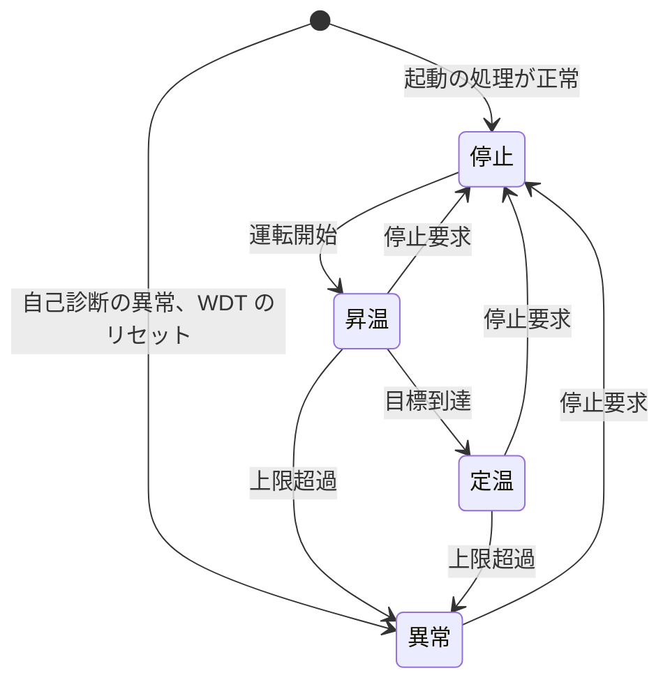
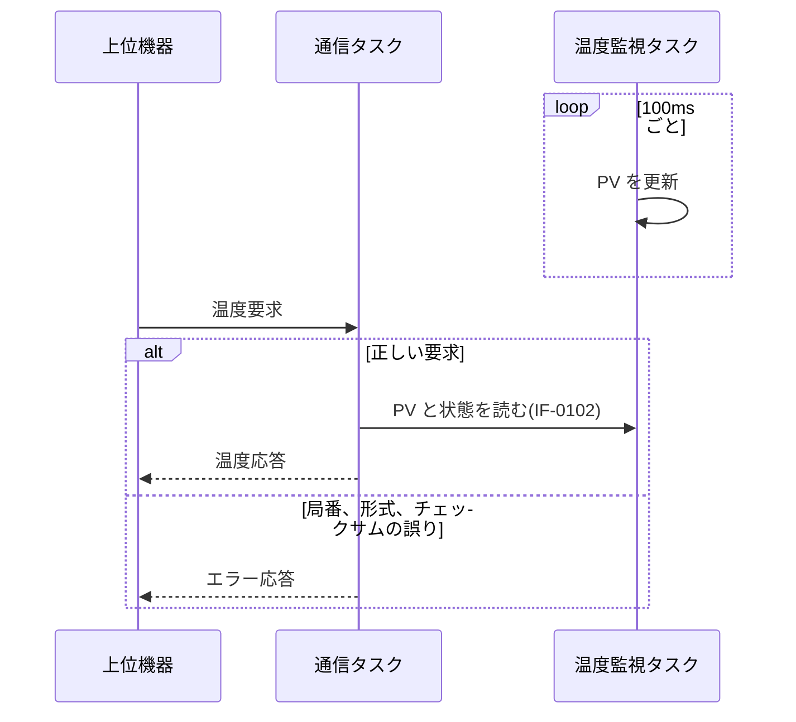
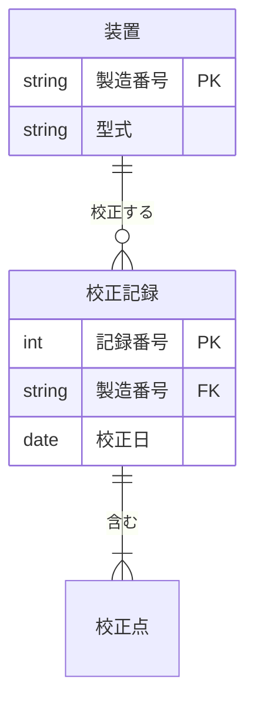

# 概要

## 目的

本書は、恒温槽制御装置 TC-200 の制御ソフトウェアについて、プログラムユニット(以下 PU)の処理とインタフェースを定める。実装者が本書だけで実装と単体テストを進められることを目的とする。

## 位置づけ

本書は、ソフトウェア・アーキテクチャ設計書(SW205)で定めた機能ユニットを、PU に分けて詳細化したものである。

```layers
%%| label: fig-docs
%%| fig-cap: 設計書の位置づけ
SW105 ソフトウェア要求仕様書
SW205 ソフトウェア・アーキテクチャ設計書
SW305 ソフトウェア詳細設計書(本書) *2 | SW401 単体テスト仕様書
ソースコード
```

## 対象読者

制御ソフトウェアの実装者、単体テストの担当者、保守の担当者。

## 記載範囲

温度制御、通信、表示の 3 つの機能ユニットに属する PU を対象とする。ブートローダは対象外とする。

## 参照ドキュメント

| ID | 文書名 | 文書番号 | 発行年月 | 備考 |
|---|---|---|---|---|
| R1 | ソフトウェア要求仕様書 | TC-SW105-001 | 2026/08 | |
| R2 | ソフトウェア・アーキテクチャ設計書 | TC-SW205-001 | 2026/09 | |
| R3 | 温度センサ TS-200 データシート | TS200-DS-03 | 2024/04 | 社外の文書 |

: 参照ドキュメント {#tbl-refs}

## 用語と略語

| ID | 用語・略号 | 正式表記 | 意味 |
|---|---|---|---|
| D1 | PU | Program Unit | タスクまたは関数の単位 |
| D2 | PV | Process Value | 測った温度 |
| D3 | SV | Set Value | 目標の温度 |
| D4 | HCR | Heater Control Register | ヒータ制御レジスタ |

: 用語と略語 {#tbl-terms}

# プログラムユニット構成

## プログラムユニット一覧

| No. | PU ID | PU 名 | 機能の概要 | 機能ユニット |
|--:|---|---|---|---|
| 1 | PU-0101 | 温度監視タスク | 100ms 周期で温度を読み、PV を更新する | FU-01 |
| 2 | PU-0102 | ヒータ制御タスク | PID 演算でヒータの出力を決める | FU-01 |
| 3 | PU-0103 | 起動の処理 | 初期化と自己診断 | FU-01 |
| 4 | PU-0201 | 通信タスク | 上位機器とのコマンドの送受信 | FU-02 |
| 5 | PU-0301 | 表示タスク | 温度と状態を LCD に出す | FU-03 |
| 6 | PU-0302 | キーの周期ハンドラ | 10ms 周期でキーを読む | FU-03 |

: プログラムユニット一覧 {#tbl-pu tbl-colwidths="[7,13,22,44,14]"}

## プログラムユニット構成図

```wbs
%%| label: fig-pu
%%| fig-cap: プログラムユニット構成図
TC-200 制御ソフトウェア
  FU-01 温度制御
    PU-0101 温度監視タスク
    PU-0102 ヒータ制御タスク
    PU-0103 起動の処理
  FU-02 通信
    PU-0201 通信タスク
  FU-03 表示
    PU-0301 表示タスク
    PU-0302 キーの周期ハンドラ
```

# プログラムユニット詳細

## 温度監視タスク(PU-0101)

+------------------+----------------------------------------------------+
| [PU ID]{.shade}  | PU-0101                                            |
+------------------+----------------------------------------------------+
| [PU 名]{.shade}  | 温度監視タスク                                     |
+------------------+----------------------------------------------------+
| [起動]{.shade}   | 100ms 周期(RTOS の周期ハンドラ)                    |
+------------------+----------------------------------------------------+
| [引数]{.shade}   | なし                                               |
+------------------+----------------------------------------------------+
| [戻り値]{.shade} | なし                                               |
+------------------+----------------------------------------------------+
| [処理内容]{.shade}                                                    |
+-----------------------------------------------------------------------+
| 1. A/D 変換の値を読み、温度に換算して補正値を足す                     |
| 2. 直近 8 回の移動平均を求め、PV を更新する                           |
| 3. A/D の値の張り付きで、断線(E01)か短絡(E02)のイベントを送る         |
| 4. PV が上限温度を超えたら、上限超過(E03)のイベントを送る             |
| 5. 出力 0 で 30 秒に 2.0℃ 以上上がったら、固着(E04)のイベントを送る  |
+-----------------------------------------------------------------------+
| [制約事項]{.shade}                                                    |
+-----------------------------------------------------------------------+
| - 1 回の処理を 2ms 以内に終える                                       |
| - PV の更新は割り込みを禁止して行う                                   |
+-----------------------------------------------------------------------+
| [備考]{.shade}                                                        |
+-----------------------------------------------------------------------+
| 異常の判定は 3.2 の状態遷移に従う                                     |
+-----------------------------------------------------------------------+

: PU-0101 の詳細 {#tbl-pu0101}

### 温度の換算

A/D 変換の値 $a$(12 ビット)と補正値 $c$ から、温度 $T$(0.1℃ 単位)を次の式で求める。$a$ の 0〜4,095 が、測定範囲の -20.0〜150.0℃ に当たる。

$$
T = \frac{a \times 1700}{4095} - 200 + c
$$ {#eq-temp}

#### 換算の例外

$a$ が 4,095 に張り付いたときはセンサの断線(E01)、0 に張り付いたときはセンサの短絡(E02)として扱い、@eq-temp で換算しない。4,095 は 150.0℃ に当たり、上限温度(最大 130.0℃)と過昇防止器(145℃)より高い。槽内の温度がそこまで上がる前に、上限超過(E03)と過昇防止器でヒータを止めるので、4,095 への張り付きは断線とみなせる。

## 状態管理

運転の状態は 4 つである。@tbl-state に遷移を、@fig-state に図を示す。表の「-」は、そのイベントを無視することを表す。上限超過の行は、E01〜E04 の異常を見つけたときをまとめて表す。

| イベント＼状態 | 停止 | 昇温 | 定温 | 異常 |
|---|:-:|:-:|:-:|:-:|
| 運転開始 | 昇温 | - | - | - |
| 目標到達 | - | 定温 | - | - |
| 上限超過 | - | 異常 | 異常 | - |
| 停止要求 | - | 停止 | 停止 | 停止 |

: 状態遷移表 {#tbl-state}



## リソース定義

| タスク | 優先度 | スタック(バイト) | 周期 |
|---|--:|--:|---|
| 温度監視タスク | 3 | 512 | 100ms |
| ヒータ制御タスク | 2 | 1,024 | 100ms |
| 通信タスク | 4 | 2,048 | イベント |
| 表示タスク | 5 | 768 | 500ms とキーの操作のとき |
| キーの周期ハンドラ | — | 割り込みと共用 | 10ms |

: タスクの定義 {#tbl-tasks}

## ハードウェア制御

ヒータは、ヒータ制御レジスタ(HCR)で制御する。

```bits
%%| label: fig-hcr
%%| fig-cap: ヒータ制御レジスタ(HCR)
width: 8
msb: true
7-7: EN
6-6: ERR
5-4: MODE
3-0: DUTY
```

## 初期化処理

起動の処理(PU-0103)は、電源の投入から 500ms 以内に、次の順で初期化する。

1. クロックを設定する
2. 周辺装置を初期化する
    a. A/D 変換器
    b. PWM
3. OS を初期化し、タスクを生成する

続けて次の順で自己診断をし、入る状態を決める。電源の投入から操作を受け付けるまでを 2 秒以内とする(SWR-010)。

1. ROM のチェックサム、RAM の読み書き、遮断リレーの入り切り(HCR の ERR)を確かめる。異常があれば E07 で異常の状態に入る
2. リセットの要因のレジスタを読み、WDT によるリセットなら E05 で異常の状態に入る
3. それ以外は停止の状態に入る。SV は 25.0℃ から始める

## 共通定義

```c
#define PV_MAX     1500   /* 測定範囲の上限 150.0℃(A/D の値 4,095) */
#define PV_MIN     (-200) /* 測定範囲の下限 -20.0℃(A/D の値 0) */
#define SV_MAX     1300   /* 目標値と上限温度の上限 130.0℃ */
#define SV_MIN     (-200) /* 目標値の下限 -20.0℃ */
#define CYCLE_MS   100
```

# インタフェース

## 温度の取得



## 温度応答(IF-0201)

+------------------+----------------------------------------------------+
| [IF ID]{.shade}  | IF-0201                                            |
+------------------+----------------------------------------------------+
| [IF 名]{.shade}  | 温度応答                                           |
+------------------+----------------------------------------------------+
| [方向]{.shade}   | 通信タスク → 上位機器                             |
+------------------+----------------------------------------------------+
| [データフォーマット]{.shade}                                          |
+-----------------------------------------------------------------------+

: IF-0201 の概要 {#tbl-if0201}

+--------------+------+-----------------+------------------------------+
| 項目名       | 型   | 桁数            | 内容                         |
|              |      +--------+--------+                              |
|              |      | 整数   | 小数   |                              |
+==============+======+========+========+==============================+
| ヘッダ       | X    | 1      |        | STX(0x02)                    |
+--------------+------+--------+--------+------------------------------+
| 局番         | N    | 1      |        | 1〜8                         |
+--------------+------+--------+--------+------------------------------+
| コマンド     | X    | 2      |        | RT(温度要求と同じ)           |
+--------------+------+--------+--------+------------------------------+
| 温度         | N    | 4      | 1      | 符号つき。単位は ℃\         |
|              |      |        |        | 例: +025.3                   |
+--------------+------+--------+--------+------------------------------+
| 状態         | X    | 1      |        | 0: 停止、1: 昇温\            |
|              |      |        |        | 2: 定温、9: 異常             |
+--------------+------+--------+--------+------------------------------+
| 異常コード   | X    | 3      |        | 異常の状態でだけ付ける\      |
|              |      |        |        | 例: E03                      |
+--------------+------+--------+--------+------------------------------+
| チェックサム | X    | 2      |        | 16 進の 2 文字\              |
|              |      |        |        | 計算は TC-100 と同じ         |
+--------------+------+--------+--------+------------------------------+
| フッタ       | X    | 1      |        | ETX(0x03)                    |
+--------------+------+--------+--------+------------------------------+

: 温度応答のデータフォーマット {#tbl-format}

X: 文字 N: 数字

## コマンドの判定

受け付けるコマンドを、状態ごとに次の表で判定する(○: 受け付ける、×: エラー応答)。表のコマンドは、上から R1 の RN、ST、RT、WS、RV、CA にあたる。

+----------------+------+------+------+------+
| コマンド       | 停止 | 昇温 | 定温 | 異常 |
+================+======+======+======+======+
| 運転開始       | ○   | ×    | ×    | ×    |
+----------------+------+------+------+------+
| 運転停止       | ×    | ○   | ○   | ○   |
+----------------+------+------+------+------+
| 温度要求       | ○   | ○   | ○   | ○   |
+----------------+------+------+------+------+
| 目標の変更     | ○   | ○   | ○   | ×    |
+----------------+------+------+------+------+
| 版数の読み出し | ○   | ○   | ○   | ○   |
+----------------+------+------+------+------+
| 補正値の設定   | ○   | ×    | ×    | ×    |
+----------------+------+------+------+------+

: コマンドの判定表 {#tbl-command}

# メモリ使用量

| 区分 | 使用量(KB) | 容量(KB) | 使用率 |
|---|--:|--:|--:|
| ROM | 182 | 256 | 71% |
| RAM | 41 | 64 | 64% |
| スタック | 6 | 8 | 75% |

: メモリ使用量 {#tbl-memory}

# 保守ツールのデータ

保守ツールは、校正の記録を PC に保存する。

## データモデル



## エンティティ定義

| No. | 項目名 | 属性 | 桁数 | 備考 |
|--:|---|:-:|--:|---|
| 1 | **[製造番号]{.underline}** | C | 10 | 装置の銘板の番号<br>記述形式: TC2-999999 |
| 2 | 型式 | C | 8 | TC-200 など |
| 3 | 校正日 | D | — | 校正した日 |

: 装置のエンティティ {#tbl-entity}

C: 文字(半角) D: 日付

::: {.landscape}

## 機能とデータの対応(CRUD)

<table>
<tr><th rowspan="2">機能</th><th colspan="3">エンティティ</th></tr>
<tr><th>装置</th><th>校正記録</th><th>校正点</th></tr>
<tr><td>装置の登録</td><td>C</td><td></td><td></td></tr>
<tr><td>校正の実施</td><td>R</td><td>C</td><td>C</td></tr>
<tr><td>校正の修正</td><td>R</td><td>U</td><td>CUD</td></tr>
<tr><td>記録の閲覧</td><td>R</td><td>R</td><td>R</td></tr>
</table>

: CRUD 表 {#tbl-crud}

C: 作成 R: 参照 U: 更新 D: 削除

:::
