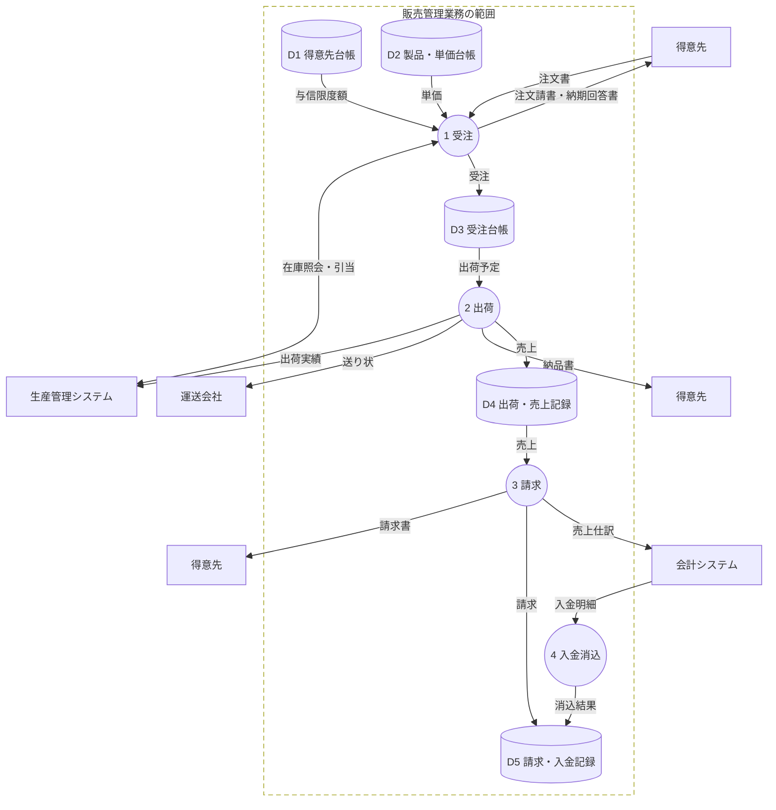
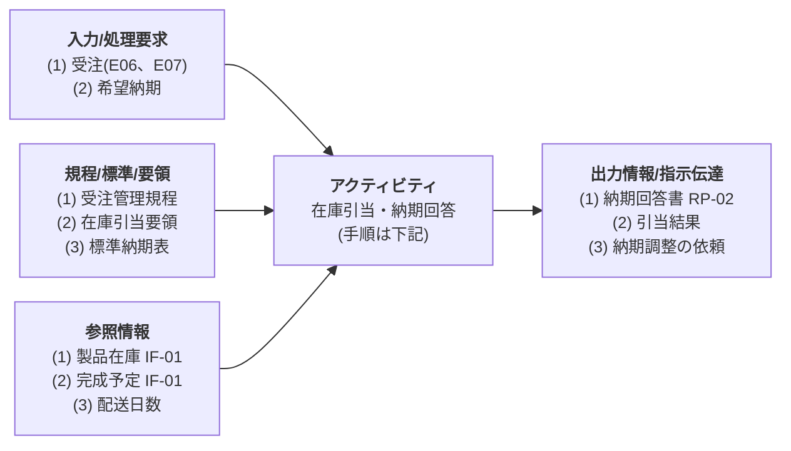
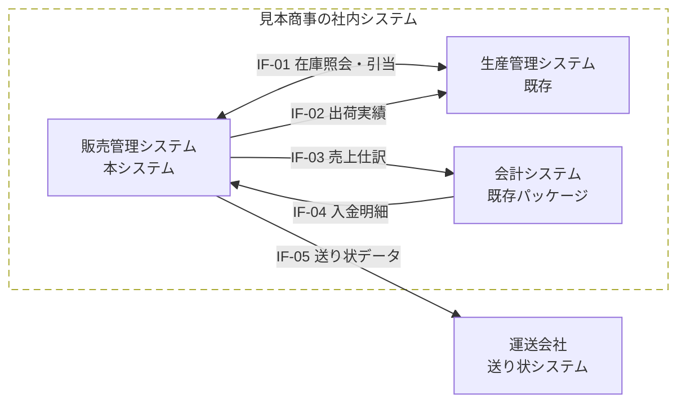

# はじめに

## 本書の目的

本書は、見本商事株式会社(以下、見本商事)の販売管理システムの刷新について、新しいシステム(以下、本システム)に求める機能と品質を定める。見本商事と見本株式会社(以下、当社)が要件に合意し、基本設計の入力とすることを目的とする。

## 対象範囲

| 区分 | 対象 | 対象外 |
|---|---|---|
| 業務 | 受注、出荷、請求、入金消込 | 見積、与信の審査、製品の在庫管理と生産計画 |
| システム | 本システムと、外部システムとのインタフェース | 生産管理システムと会計システムの改修 |
| 組織 | 営業部、受注センタ、物流センタ、経理部 | 工場、購買部 |

: 対象範囲 {#tbl-scope}

## 本書の構成

本書の構成は、IPA の「超上流から攻める IT 化の事例集:要件定義」の成果物の事例に合わせる。@tbl-map に、節と成果物の対応を示す。

| 節 | 成果物 | 決めること |
|---|---|---|
| 3.1 | 機能情報関連図(DFD 第 1 レベル) | 業務の機能と、機能の間の情報の流れ |
| 3.2 | 業務流れ図(業務フロー) | 組織ごとの処理の順序と、手作業とシステムの分担 |
| 3.3 | 業務処理定義書(HIPO) | 個別の業務処理の入力、処理、出力 |
| 3.4 | 業務ルール定義書 | 準拠する規程と、通例と例外の処理の基準 |
| 3.5、3.6 | システム化機能一覧表、システム機能階層図 | システムで実現する機能とその構成 |
| 4.1〜4.3 | 概念 ERD、データ項目定義、データ量一覧表 | 扱うデータとその量 |
| 5.1、5.2 | システム関連図、システム間インタフェース定義書 | 外部システムとのデータのやり取り |
| 5.3〜5.5 | 画面・帳票一覧、画面レイアウト、帳票レイアウト | 利用者とのインタフェース |
| 6.1〜6.4 | 性能目標、運用要件、移行要件、情報保護 | 非機能要件 |

: 節と成果物の対応 {#tbl-map}

本書の ID の体系を @tbl-ids に示す。ID は本書の中でそろえ、基本設計書でも引き継ぐ。

| 対象 | ID の形 | 例 |
|---|---|---|
| 機能 | F- + サブシステムの番号 + 連番 2 桁 | F-101 受注登録 |
| 画面 | SC- + 連番 2 桁 | SC-01 受注入力 |
| 帳票 | RP- + 連番 2 桁 | RP-05 請求書 |
| インタフェース | IF- + 連番 2 桁 | IF-01 在庫照会・引当 |
| エンティティ | E + 連番 2 桁 | E06 受注 |
| 業務ルール | BR- + 連番 2 桁 | BR-03 与信管理 |

: ID の体系 {#tbl-ids}

## 参照ドキュメント

| ID | 文書名 | 文書番号 | 発行年月 | 備考 |
|---|---|---|---|---|
| R1 | 販売管理システム刷新 システム化計画書 | MS-PL-001 | 2026/07 | 見本商事 |
| R2 | 現行業務調査報告書 | MS-AS-001 | 2026/09 | |
| R3 | 与信管理規程、受注管理規程、出荷管理規程、経理規程 | — | — | 見本商事の社内規程 |
| R4 | 超上流から攻める IT 化の事例集:要件定義 | — | — | IPA |

: 参照ドキュメント {#tbl-refs}

## 用語と略語

| 用語 | 意味 |
|---|---|
| 得意先 | 製品を買い、代金を支払う取引先 |
| 納入先 | 製品を届ける先。1 つの得意先に複数ある |
| 引当 | 受注に対して、在庫や生産の予定を割り当てること |
| 締日 | 請求の区切りの日。得意先ごとに 20 日か月末 |
| 消込 | 入金を請求と突き合わせ、未入金の残高を減らすこと |
| 与信限度額 | 得意先ごとに認める、売掛金と受注残の合計の上限 |

: 用語と略語 {#tbl-terms}

# システム化の概要

## 現状の課題

現行業務の調査(R2)で、次の課題を確かめた。

1. 受注は FAX とメールで受け、Excel の受注台帳と現行システムに二重に入力している。入力の誤りと漏れが月に 20 件ほどある。
2. 在庫を工場に電話で問い合わせており、納期の回答に半日から 1 日かかる。
3. 請求書は、経理部が月末の締めの後に手作業で集計して作っている。締めから発行まで 5 営業日かかる。
4. 現行システム(2009 年稼働)のハードウェアの保守が、2027 年 12 月に終わる。

## システム化の目標

| 目標 | 指標 | 現状 | 目標値 |
|---|---|--:|--:|
| 受注の入力を 1 回にする | 入力の誤りと漏れ | 月 20 件 | 月 2 件以下 |
| 納期の回答を早める | 受注から回答まで | 半日〜1 日 | 30 分以内 |
| 請求を早める | 締めから請求書の発行まで | 5 営業日 | 2 営業日 |

: システム化の目標 {#tbl-goals}

## 利用者

| 部門 | 人数 | 主な業務 |
|---|--:|---|
| 営業部 | 30 | 与信超過の承認、納期の調整、実績の確認、マスタの登録 |
| 受注センタ | 8 | 受注の入力、納期の回答 |
| 物流センタ | 12 | 出荷の指示と確定 |
| 経理部 | 5 | 請求、入金消込 |
| 情報システム課 | 3 | 運用、利用者の管理 |

: 利用者 {#tbl-users}

# 機能要件(プロセス)

## 機能情報関連図(DFD)

販売管理業務の機能(プロセス)と、プロセスの間の情報の流れを @fig-dfd に示す。手作業を含む業務の単位で描く。得意先は、図を見やすくするために複数の場所に描く。



図の記号: 円はプロセス、四角は外部(人、組織、システム)、円柱はデータストア、点線の枠は業務の範囲を表す。

| No. | プロセス | 内容 | 主な情報 |
|---|---|---|---|
| 1 | 受注 | 注文を受け付け、在庫を引き当てて納期を回答する | 注文書、注文請書、納期回答書 |
| 2 | 出荷 | 納期に合わせて出荷を指示し、出荷を確定して売上を計上する | 出荷指示書、納品書、送り状 |
| 3 | 請求 | 締日ごとに売上を集計して請求書を発行し、仕訳を会計へ送る | 請求書、売上仕訳 |
| 4 | 入金消込 | 入金を請求と突き合わせ、未入金を管理する | 入金明細 |

: プロセスの説明 {#tbl-process}

## 業務流れ図(業務フロー)

DFD のプロセスを起動する出来事(注文の到着、出荷日、締日)から、一連の業務の流れを示す。列がレーン(組織とシステム)で、処理の順に上から下へ並べる。角の丸い四角は処理、ひし形は判断、下の辺が波の形の四角は帳票、円柱はデータ(エンティティ)、黒丸は開始、二重丸は終了を表す。丸の数字は手順の番号、`[SC-01]` などは使う画面、帳票、インタフェースの ID である。

### 受注業務

受注業務の手順を @tbl-flow-order に、流れを @fig-flow-order に示す。

| No. | レーン | 処理 | 区分 | 入出力 |
|---|---|---|---|---|
| ① | 得意先 | 注文書を FAX かメールで送る | 手作業 | 注文書 |
| ② | 受注センタ | 注文書の内容を入力する | 手作業 | SC-01 |
| ③ | 本システム | 単価を設定し、与信を確かめて受注を登録する | システム | E06 受注、E07 受注明細 |
| ④ | 営業部 | 与信限度額を超える受注を承認する | 手作業 | SC-03 |
| ⑤ | 本システム | 在庫を照会して引き当てる | システム | IF-01 |
| ⑥ | 営業部 | 納期を確保できない受注の納期を得意先と調整する | 手作業 | メール |
| ⑦ | 受注センタ | 回答納期を確かめて確定する | 手作業 | SC-02、RP-01、RP-02 |
| ⑧ | 受注センタ | 注文請書と納期回答書を送る | 手作業 | RP-01、RP-02 |

: 受注業務の手順 {#tbl-flow-order tbl-colwidths="[6,14,48,10,22]"}

```swimlane
%%| label: fig-flow-order
%%| fig-cap: 受注業務の業務フロー
lanes: 得意先, 受注センタ, 営業部, 本システム, 生産管理
得意先: ●
得意先: [書類] ① 注文書
受注センタ: ② 受注入力 [SC-01]
本システム: ③ 単価設定と与信チェック
本システム: [データ] E06 受注
本システム: ◇ 与信超過か -> はい: ④ 承認 [SC-03], いいえ: ⑤ 在庫照会・引当 [IF-01]
営業部: ④ 承認 [SC-03]
本システム: ⑤ 在庫照会・引当 [IF-01]
生産管理: 引当結果を返す
本システム: ◇ 間に合うか -> はい: ⑦ 納期回答 [SC-02], いいえ: ⑥ 納期の調整
営業部: ⑥ 納期の調整
受注センタ: ⑦ 納期回答 [SC-02]
本システム: [書類] 注文請書、納期回答書
受注センタ: ⑧ 書類を送る
得意先: ◎ 注文請書と納期回答書を受け取る
```

### 出荷業務

```swimlane
%%| label: fig-flow-ship
%%| fig-cap: 出荷業務の業務フロー
lanes: 物流センタ, 本システム, 生産管理, 運送会社, 得意先
本システム: ● 納期の 2 営業日前
本システム: ① 出荷する受注明細の抽出
物流センタ: 出荷指示 [SC-04]
本システム: [書類] 出荷指示書 [RP-03]
物流センタ: ② ピッキング・梱包
物流センタ: ③ 出荷確定 [SC-05]
本システム: ④ 売上計上
本システム: [データ] E08 出荷、E09 出荷明細 -> 出荷実績の取込 [IF-02], ⑤ 送り状データ [IF-05]
生産管理: 出荷実績の取込 [IF-02] ->
本システム: ⑤ 送り状データ [IF-05]
運送会社: ⑥ 配送
得意先: [書類] 納品書 [RP-04]
得意先: 受け取って押印する
得意先: [書類] 物品受領書
物流センタ: ◎ 物品受領書を保管する
```

### 請求業務

```swimlane
%%| label: fig-flow-bill
%%| fig-cap: 請求業務の業務フロー
lanes: 得意先, 経理部, 本システム, 会計システム
本システム: ● 締日の夜
本システム: ① 請求締め
本システム: [データ] E10 請求
経理部: ② 請求書発行 [SC-06]
本システム: [書類] 請求書 [RP-05]
経理部: ③ 請求書を送る
得意先: ④ 振込(銀行経由)
会計システム: 入金の記帳
本システム: ⑤ 入金明細の取込 [IF-04]
本システム: ⑥ 自動消込
本システム: ◇ すべて消し込めたか -> はい: E12 入金, いいえ: ⑦ 手動消込 [SC-07]
経理部: ⑦ 手動消込 [SC-07]
本システム: [データ] E12 入金
本システム: ◎
本システム: ● 毎日 23 時
本システム: 売上仕訳の作成 [IF-03]
会計システム: 仕訳の取込
会計システム: ◎
```

毎日の売上仕訳(IF-03)は、締日と関係なく夜間に会計システムへ送る。

## 業務処理定義書(HIPO)

個別の業務処理のうち、判断の多い「在庫引当・納期回答」を HIPO の形で定める。

<table>
<tr><th>ビジネスプロセス名</th><td>受注</td><th>個別業務処理名</th><td>在庫引当・納期回答</td><th>機能</th><td>F-102 納期回答</td></tr>
</table>

: 業務処理の識別 {#tbl-hipo-id}



アクティビティ(処理の手順)は次のとおりとする。

1. 受注明細ごとに希望納期を確かめる。希望納期がなければ、標準納期(受注日の 5 営業日後)とする。
2. 製品在庫があれば引き当て、希望納期を回答納期とする。
3. 在庫が足りなければ、生産計画の完成予定から引き当て、完成予定日に配送日数を足した日を回答納期とする。
4. 回答納期が希望納期より遅いときは、営業部に納期の調整を依頼する。回答納期は「調整中」とする。
5. すべての明細の回答納期が決まったら、納期回答書を作る。

## 業務ルール定義書

### ビジネスルール

準拠する規程と、システム化への反映を @tbl-bizrule に示す。

<table>
<tr><th>分類</th><th>ID</th><th>対象</th><th>ビジネスルール</th><th>システム化への反映</th></tr>
<tr><td rowspan="2">共通</td><td>BR-01</td><td>得意先管理</td><td>全社の取引先コード体系(8 桁)に準拠</td><td>得意先コードの設計</td></tr>
<tr><td>BR-02</td><td>製品管理</td><td>製品分類と製品コード体系に準拠</td><td>製品コードの設計</td></tr>
<tr><td rowspan="3">商流</td><td>BR-03</td><td>与信管理</td><td>与信管理規程に準拠。売掛金と受注残の合計が与信限度額を超えたら、営業課長の承認が要る</td><td>受注登録時の与信チェック(F-101)</td></tr>
<tr><td>BR-04</td><td>単価</td><td>価格決定規程に準拠。得意先別の単価がなければ標準単価</td><td>単価の自動設定(F-101)</td></tr>
<tr><td>BR-05</td><td>在庫引当</td><td>在庫引当要領に準拠。受注日の早い順に引き当てる</td><td>引当の順序と条件(F-102)</td></tr>
<tr><td>物流</td><td>BR-06</td><td>出荷</td><td>出荷管理規程に準拠。納期の 2 営業日前に出荷を指示する</td><td>出荷指示の抽出条件(F-201)</td></tr>
<tr><td rowspan="3">金流</td><td>BR-07</td><td>売上計上</td><td>経理規程に準拠。出荷基準で計上する</td><td>出荷確定時の売上計上(F-202)</td></tr>
<tr><td>BR-08</td><td>請求</td><td>得意先ごとの締日(20 日、月末)で締めて請求する</td><td>請求締めの条件(F-301)</td></tr>
<tr><td>BR-09</td><td>入金消込</td><td>請求の古い順に消し込む。1 回の入金は 1 つの請求に消し込む</td><td>自動消込の条件(F-303)</td></tr>
<tr><td>管理</td><td>BR-10</td><td>機密</td><td>情報セキュリティ規程に準拠</td><td>利用者の権限(6.4)</td></tr>
</table>

: ビジネスルール定義書 {#tbl-bizrule}

### 通例と例外の処理基準

<table>
<tr><th>分類</th><th>業務</th><th>通例ルール処理基準</th><th>例外ルール処理基準</th><th>システム化要求</th></tr>
<tr><td rowspan="3">商流</td><td>受注</td><td>注文書で受注し、BR-04 の単価で登録する</td><td>特別単価での受注</td><td>営業課長の承認で単価を変更できる</td></tr>
<tr><td>与信</td><td>与信限度額の範囲で受注する</td><td>限度額を超える受注</td><td>承認待ちにし、承認まで引当をしない</td></tr>
<tr><td>納期回答</td><td>在庫か完成予定で回答する</td><td>希望納期に間に合わない</td><td>営業部へ調整を依頼する(人が判断)</td></tr>
<tr><td rowspan="2">物流</td><td>出荷</td><td>受注単位で一括して出荷する</td><td>在庫不足による分納</td><td>1 つの受注明細を複数の出荷に分ける</td></tr>
<tr><td>返品</td><td>—</td><td>品質不良による返品</td><td>マイナスの出荷で売上を取り消す</td></tr>
<tr><td rowspan="2">金流</td><td>請求</td><td>締日で月次に請求する</td><td>新規の得意先の前払い</td><td>都度請求を指定できる(F-302)</td></tr>
<tr><td>入金</td><td>請求額どおりに入金される</td><td>過不足のある入金</td><td>差額 1,000 円未満は手数料とし、超えるものは経理課長が判断する</td></tr>
</table>

: 業務ルール定義書(通例と例外) {#tbl-rule tbl-colwidths="[8,10,26,22,34]"}

## システム化機能一覧表

業務フローの業務を、システムの機能に分ける。太字の行は業務フロー、区分のリアルはオンライン処理を表す。機能の説明は、画面と帳票の単位で書く(`[ ]` の行)。

| 業務 | 機能 | 区分 | 機能説明 |
|---|---|---|---|
| **受注業務** | | | |
| 注文の受付 | F-101 受注登録 | リアル | 注文書の内容を登録し、受注番号を付ける。与信を確かめる(BR-03) |
| | | | [SC-01 受注入力] 得意先コードから得意先名と納入先の候補を出す。製品コードから単価を設定する(BR-04)。与信限度額を超えたら承認待ちにする |
| | | | [RP-01 注文請書] 登録の後に PDF で出力する |
| 納期の回答 | F-102 納期回答 | リアル | 生産管理システムに在庫を照会して引き当て(IF-01)、回答納期を決める(BR-05、3.3) |
| | | | [SC-02 納期回答] 明細ごとに引当結果と回答納期を出す。調整中の明細は営業部にメールで知らせる |
| | | | [RP-02 納期回答書] 確定した回答納期を PDF で出力する |
| 受注の管理 | F-103 受注照会 | リアル | [SC-03 受注照会] 受注を検索し、変更と取り消しをする。出荷済みの明細は変更できない。与信超過の承認もここで行う |
| **出荷業務** | | | |
| 出荷の指示 | F-201 出荷指示 | リアル | 納期の 2 営業日前の受注明細を抽出し(BR-06)、出荷指示を作る |
| | | | [SC-04 出荷指示] 抽出した明細を確かめて指示を確定する。[RP-03 出荷指示書] ピッキングの一覧を出力する |
| 出荷の確定 | F-202 出荷確定 | リアル | 出荷した数量を登録し、売上を計上する(BR-07)。出荷実績を生産管理システムへ送る(IF-02) |
| | | | [SC-05 出荷確定] 分納のときは数量を変えて確定する。[RP-04 納品書・物品受領書] 専用紙に印刷する |
| 送り状 | F-203 送り状作成 | バッチ | 確定した出荷から送り状データを作り、運送会社へ送る(IF-05)。1 日 2 回(11 時、15 時) |
| **請求業務** | | | |
| 請求の締め | F-301 請求締め | バッチ | 締日の夜に、前回の締めの翌日から締日までの売上を得意先ごとに集計し、請求を作る(BR-08) |
| 請求書の発行 | F-302 請求書発行 | リアル | [SC-06 請求書発行] 請求を選んで出力する。都度請求も指定できる。[RP-05 請求書] PDF で出力する |
| 入金の消込 | F-303 入金消込 | バッチ | 会計システムの入金明細(IF-04)を取り込み、請求と自動で照合する(BR-09) |
| | | リアル | [SC-07 入金消込] 自動で消し込めなかった入金を、請求を選んで消し込む |
| 会計への連携 | F-304 仕訳連携 | バッチ | 毎日、売上の仕訳データを作り、会計システムへ送る(IF-03) |
| 月次の報告 | F-305 売上月報 | バッチ | 月初の第 1 営業日に、前月の受注と売上を製品別、得意先別に集計する。[RP-06 受注売上月報] PDF で出力する |
| **マスタ管理** | | | |
| 得意先の管理 | F-401 得意先保守 | リアル | [SC-08 得意先マスタ] 得意先、納入先、与信限度額、締日を登録する |
| 製品の管理 | F-402 製品保守 | リアル | [SC-09 製品マスタ] 製品と標準単価を登録する |
| 単価の管理 | F-403 単価保守 | リアル | [SC-10 単価マスタ] 得意先別の単価を、適用開始日を付けて登録する |

: システム化機能一覧表 {#tbl-functions tbl-colwidths="[14,21,9,56]"}

## システム機能階層図

本システムの機能の構成を @fig-hierarchy に示す。第 1 階層はサブシステム、第 2 階層は @tbl-functions の機能である。

```wbs
%%| label: fig-hierarchy
%%| fig-cap: システム機能階層図
販売管理システム
  1 受注管理
    F-101 受注登録
    F-102 納期回答
    F-103 受注照会
  2 出荷管理
    F-201 出荷指示
    F-202 出荷確定
    F-203 送り状作成
  3 請求管理
    F-301 請求締め
    F-302 請求書発行
    F-303 入金消込
    F-304 仕訳連携
    F-305 売上月報
  4 マスタ管理
    F-401 得意先保守
    F-402 製品保守
    F-403 単価保守
```

# 機能要件(データ)

## 概念 ERD

業務フローと DFD のデータストアから、エンティティとその関係を @fig-erd に示す。実装する DBMS は意識しない。属性は @tbl-entities に示す。DFD の列は、3.1 のデータストアである。

```er
%%| label: fig-erd
%%| fig-cap: 概念 ERD
| 社員   | 受注 | 受注明細 | 製品 |
| 得意先 |      |          | 単価 |
| 納入先 | 出荷 | 出荷明細 |      |
| 入金   | 請求 | 請求明細 |      |
  得意先 ||--o{ 納入先 : ""
  得意先 ||--o{ 単価 : ""
  製品 ||--o{ 単価 : ""
  得意先 ||--o{ 受注 : ""
  社員 ||--o{ 受注 : ""
  受注 ||--|{ 受注明細 : ""
  製品 ||--o{ 受注明細 : ""
  納入先 ||--o{ 出荷 : ""
  出荷 ||--|{ 出荷明細 : ""
  受注明細 ||--o{ 出荷明細 : ""
  得意先 ||--o{ 請求 : ""
  請求 ||--|{ 請求明細 : ""
  出荷明細 ||--o| 請求明細 : ""
  請求 ||--o{ 入金 : ""
```

| ID | 名称 | 区分 | 主キー | 主な属性 | DFD |
|---|---|---|---|---|---|
| E01 | 得意先 | リソース | 得意先コード | 得意先名、与信限度額、締日区分、担当者コード | D1 |
| E02 | 納入先 | リソース | 得意先コード、納入先コード | 納入先名、住所、配送日数 | D1 |
| E03 | 社員 | リソース | 社員コード | 氏名、所属 | — |
| E04 | 製品 | リソース | 製品コード | 製品名、単位、標準単価 | D2 |
| E05 | 単価 | リソース | 得意先コード、製品コード、適用開始日 | 単価 | D2 |
| E06 | 受注 | イベント | 受注番号 | 得意先コード、納入先コード、受注日、与信状態 | D3 |
| E07 | 受注明細 | イベント | 受注番号、明細番号 | 製品コード、数量、単価、回答納期 | D3 |
| E08 | 出荷 | イベント | 出荷番号 | 納入先コード、出荷日 | D4 |
| E09 | 出荷明細 | イベント | 出荷番号、明細番号 | 受注番号、受注明細番号、出荷数量、売上金額 | D4 |
| E10 | 請求 | イベント | 請求番号 | 得意先コード、締日、請求金額、入金残高 | D5 |
| E11 | 請求明細 | イベント | 請求番号、明細番号 | 出荷番号、出荷明細番号、金額 | D5 |
| E12 | 入金 | イベント | 入金番号 | 請求番号、入金日、入金額 | D5 |

: エンティティ一覧 {#tbl-entities tbl-colwidths="[9,12,12,25,32,10]"}

## データ項目定義

画面と帳票のデータ項目を定める。@tbl-items に、受注入力(SC-01)の例を示す。

<table>
<tr><th>画面・帳票名</th><td>受注入力(SC-01)</td><th>作成方法</th><td>受注センタが注文書を見て入力する</td></tr>
</table>

: データ項目定義の対象 {#tbl-items-head}

| 番号 | データ項目名 | 説明(データの意味) | 全体桁数 | 表示形式 | 符号・小数部 | 編集 | 注 |
|--:|---|---|--:|---|---|---|---|
| 1 | 受注番号 | J + 年月 4 桁 + 連番 4 桁 | 9 | 英数字 | — | 自動採番 | |
| 2 | 受注日 | 注文を受け付けた日 | 10 | 日付 | — | 当日を表示 | |
| 3 | 得意先コード | 得意先を識別するコード | 8 | 数字 | — | コード検索 | BR-01 |
| 4 | 得意先名 | 得意先の正式な名前 | 40 | 日本語・英数 | — | 表示のみ | |
| 5 | 納入先 | 製品を届ける先 | 4 | 数字 | — | 一覧から選択 | |
| 6 | 客先注文番号 | 得意先の注文書の番号 | 20 | 英数字 | — | | RP-01 に印字 |
| 7 | 希望納期 | 得意先が希望する納期 | 10 | 日付 | — | | 空なら標準納期 |
| 8 | 製品コード | 製品を識別するコード | 6 | 英数字 | — | コード検索 | BR-02 |
| 9 | 製品名 | 製品の名前 | 40 | 日本語・英数 | — | 表示のみ | |
| 10 | 数量 | 受注する数量 | 7 | 数字 | 符号なし整数 | 3 桁区切り | |
| 11 | 単価 | 1 単位の価格(円) | 9 | 数字 | 符号なし整数 | 3 桁区切り | BR-04 で設定 |
| 12 | 金額 | 数量 × 単価 | 11 | 数字 | 符号なし整数 | 3 桁区切り | 自動計算 |
| 13 | 合計金額 | 明細の金額の合計 | 11 | 数字 | 符号なし整数 | 3 桁区切り | 自動計算 |
| 14 | 消費税 | 合計金額 × 税率。円未満は切り捨て | 10 | 数字 | 符号なし整数 | 3 桁区切り | 自動計算 |
| 15 | 与信状態 | 0: 正常、1: 承認待ち、2: 承認済み、9: 却下 | 1 | 数字 | — | 表示のみ | BR-03 |

: データ項目定義(受注入力) {#tbl-items .small tbl-colwidths="[5,14,17,7,14,14,14,15]"}

## データ量一覧表

概念 ERD のすべてのエンティティについて、データ量を見積もる。初期データ件数は移行時の件数、増加率は 2028 年度の想定である。

| テーブル分類 | テーブル名称 | 論理名 | 平均レコード長(Byte) | 初期データ件数(移行時) | 増加率 | 保管期間 |
|---|---|---|--:|--:|--:|---|
| リソース | E01 得意先 | CUSTOMER | 600 | 1,200 件 | 10 件/月 | — |
| | E02 納入先 | DELIVERY_SITE | 400 | 2,500 件 | 20 件/月 | — |
| | E03 社員 | EMPLOYEE | 200 | 150 件 | 2 件/月 | — |
| | E04 製品 | PRODUCT | 500 | 3,000 件 | 30 件/月 | — |
| | E05 単価 | PRICE | 100 | 18,000 件 | 300 件/月 | 改定から 7 年 |
| イベント | E06 受注 | ORDER_HEADER | 400 | 76,000 件 | 2,500 件/月 | 7 年 |
| | E07 受注明細 | ORDER_DETAIL | 300 | 242,000 件 | 8,000 件/月 | 7 年 |
| | E08 出荷 | SHIPMENT_HEADER | 300 | 79,000 件 | 2,600 件/月 | 7 年 |
| | E09 出荷明細 | SHIPMENT_DETAIL | 250 | 240,000 件 | 8,000 件/月 | 7 年 |
| | E10 請求 | BILL_HEADER | 400 | 1,000 件 | 900 件/月 | 10 年 |
| | E11 請求明細 | BILL_DETAIL | 250 | 8,000 件 | 8,000 件/月 | 10 年 |
| | E12 入金 | PAYMENT | 200 | 0 件 | 900 件/月 | 10 年 |

: データ量一覧表 {#tbl-volume .small tbl-colwidths="[10,15,21,12,15,13,14]"}

受注と出荷の初期データは、照会用に移行する過去 3 年分と受注残である(6.3)。請求の初期データは、移行時に入金が済んでいない請求である。

# 機能要件(インタフェース)

## システム関連図

本システムと外部システムとのデータのやり取りを @fig-systems に示す。



## システム間インタフェース定義書

@fig-systems のインタフェースの内容を @tbl-if に、送る側と受ける側を @tbl-if-node に示す。

<table>
<tr><th rowspan="2">ID</th><th rowspan="2">インタフェースの種類</th><th colspan="5">インタフェースの内容</th><th colspan="2">情報保証</th></tr>
<tr><th>主なデータ項目</th><th>サイズ</th><th>手段</th><th>媒体</th><th>頻度</th><th>セキュリティ</th><th>重要度</th></tr>
<tr><td>IF-01</td><td>在庫照会・引当</td><td>製品コード、数量、希望納期、引当結果</td><td>1KB/件</td><td>API(同期)</td><td>社内網</td><td>受注のたび</td><td>II</td><td>A</td></tr>
<tr><td>IF-02</td><td>出荷実績</td><td>出荷番号、製品コード、出荷数量</td><td>1KB/件</td><td>API(非同期)</td><td>社内網</td><td>出荷確定のたび</td><td>II</td><td>A</td></tr>
<tr><td>IF-03</td><td>売上仕訳</td><td>計上日、勘定科目、金額、税額</td><td>300KB/日</td><td>CSV</td><td>ファイル共有</td><td>日次(23 時)</td><td>II</td><td>A</td></tr>
<tr><td>IF-04</td><td>入金明細</td><td>入金日、振込名義、入金額</td><td>50KB/日</td><td>CSV</td><td>ファイル共有</td><td>日次(18 時)</td><td>II</td><td>A</td></tr>
<tr><td>IF-05</td><td>送り状データ</td><td>出荷番号、届け先、個数、配達日</td><td>200KB/回</td><td>CSV</td><td>SFTP</td><td>11 時、15 時</td><td>III</td><td>B</td></tr>
</table>

: システム間インタフェース定義書(内容) {#tbl-if .small}

<table>
<tr><th rowspan="2">ID</th><th colspan="4">データ発生ノード</th><th colspan="4">データ受入ノード</th></tr>
<tr><th>システム名</th><th>システム機能</th><th>サーバ名</th><th>設置場所</th><th>システム名</th><th>システム機能</th><th>サーバ名</th><th>設置場所</th></tr>
<tr><td>IF-01</td><td>販売管理</td><td>F-102 納期回答</td><td>販売 AP</td><td>クラウド</td><td>生産管理</td><td>在庫照会 API</td><td>生産管理</td><td>本社工場</td></tr>
<tr><td>IF-02</td><td>販売管理</td><td>F-202 出荷確定</td><td>販売 AP</td><td>クラウド</td><td>生産管理</td><td>出荷実績取込</td><td>生産管理</td><td>本社工場</td></tr>
<tr><td>IF-03</td><td>販売管理</td><td>F-304 仕訳連携</td><td>販売バッチ</td><td>クラウド</td><td>会計</td><td>仕訳取込</td><td>会計</td><td>本社</td></tr>
<tr><td>IF-04</td><td>会計</td><td>入金明細出力</td><td>会計</td><td>本社</td><td>販売管理</td><td>F-303 入金消込</td><td>販売バッチ</td><td>クラウド</td></tr>
<tr><td>IF-05</td><td>販売管理</td><td>F-203 送り状作成</td><td>販売バッチ</td><td>クラウド</td><td>運送会社</td><td>送り状発行</td><td>運送会社</td><td>社外</td></tr>
</table>

: システム間インタフェース定義書(ノード) {#tbl-if-node .small}

セキュリティレベル II: 社外秘、III: 個人情報を含み社外へ送る。重要度 A: 止まると当日の業務が止まる、B: 翌営業日までに回復すればよい。

## 画面・帳票一覧

| ID | 画面・帳票名 | 目的・利用用途 | 利用者 | タイプ | サイクル | 容量 | 機能 |
|---|---|---|---|---|---|---|---|
| SC-01 | 受注入力 | 注文を登録する | 受注センタ | 画面 | 随時 | 明細 20 行 | F-101 |
| SC-02 | 納期回答 | 回答納期を確定する | 受注センタ | 画面 | 随時 | 明細 20 行 | F-102 |
| SC-03 | 受注照会 | 検索、変更、与信超過の承認 | 受注センタ、営業部 | 画面 | 随時 | 100 件 | F-103 |
| SC-04 | 出荷指示 | 出荷する明細を選ぶ | 物流センタ | 画面 | 毎日 | 300 件 | F-201 |
| SC-05 | 出荷確定 | 出荷した数量を登録する | 物流センタ | 画面 | 毎日 | 300 件 | F-202 |
| SC-06 | 請求書発行 | 請求書を選んで出力する | 経理部 | 画面 | 締日の翌日 | 500 件 | F-302 |
| SC-07 | 入金消込 | 入金を手で消し込む | 経理部 | 画面 | 毎日 | 50 件 | F-303 |
| SC-08 | 得意先マスタ | 得意先と納入先を登録する | 営業部 | 画面 | 随時 | 1 件 | F-401 |
| SC-09 | 製品マスタ | 製品と標準単価を登録する | 営業部 | 画面 | 随時 | 1 件 | F-402 |
| SC-10 | 単価マスタ | 得意先別の単価を登録する | 営業部 | 画面 | 随時 | 1 件 | F-403 |
| RP-01 | 注文請書 | 注文を受けたことを知らせる | 受注センタ | 伝票(PDF) | 随時 | 1 枚 | F-101 |
| RP-02 | 納期回答書 | 回答納期を知らせる | 受注センタ | 伝票(PDF) | 随時 | 1 枚 | F-102 |
| RP-03 | 出荷指示書 | ピッキングと梱包の指示 | 物流センタ | 一覧表 | 毎日 | 15 枚/日 | F-201 |
| RP-04 | 納品書・物品受領書 | 製品に添えて渡す | 物流センタ | 伝票(専用紙) | 毎日 | 1 枚 | F-202 |
| RP-05 | 請求書 | 得意先へ請求する | 経理部 | 伝票(PDF) | 締日の翌日 | 1 枚 | F-302 |
| RP-06 | 受注売上月報 | 受注と売上の実績を報告する | 営業部、経理部 | 一覧表 | 月次 | 12 枚 | F-305 |

: 画面・帳票一覧 {#tbl-io .small tbl-colwidths="[7,13,22,15,11,10,11,11]"}

## 画面レイアウト

受注入力(SC-01)のレイアウトを @fig-sc01 に示す。項目の内容は @tbl-items のとおりである。

```wireframe
%%| label: fig-sc01
%%| fig-cap: 受注入力(SC-01)
# 受注入力(SC-01)
受注番号 | "J26110001" | 受注日 | "2026/11/10"
得意先 | "10000123" | 見本工業株式会社 | [検索]
納入先 | ^0001 本社工場^ | 希望納期 | "2026/11/20"
客先注文番号 | "PO-55821" | 与信状態 | 0: 正常
--
# 明細
No. | 製品コード | 製品名 | 数量 | 単価 | 金額
1 | "P-1001" | 制御盤 A | "10" | 120,000 | 1,200,000
2 | "P-2003" | 端子台 B | "50" | 3,000 | 150,000
--
合計金額 | 1,350,000 | 消費税 | 135,000
[登録] | [納期回答へ] | [クリア] | [閉じる]
```

| ボタン | 動作 | 遷移先 |
|---|---|---|
| 検索 | 得意先を名前で検索する小画面を開く | 得意先検索(小画面) |
| 登録 | 入力を確かめて受注を登録し、注文請書(RP-01)を作る | 同じ画面(受注番号を表示) |
| 納期回答へ | 登録した受注の納期回答へ進む | SC-02 |
| クリア | 入力を消す | 同じ画面 |
| 閉じる | 入力を捨ててメニューに戻る | メニュー |

: 受注入力の操作 {#tbl-sc01-action}

## 帳票レイアウト

受注売上月報(RP-06)のレイアウトを @fig-rp06 に示す。

```grid
%%| label: fig-rp06
%%| fig-cap: 受注売上月報(RP-06)のレイアウト
columns: 80
rows: 10
1, 2: 受注売上月報(2026年10月分) {太字}
1, 49: 帳票ID RP-06
1, 63: 頁 1/12
2, 49: 作成日 2026/11/02
3, 1-80: {網掛け 枠}
3, 2: 製品
3, 9: 製品名
3, 22: 得意先名
3, 39-44: 受注数 {右}
3, 47-56: 受注金額 {右}
3, 58-63: 出荷数 {右}
3, 66-75: 売上金額 {右}
4, 2: P-1001
4, 9: 制御盤 A
4, 22: 見本工業(株)
4, 39-44: 100 {右}
4, 47-56: 12,000,000 {右}
4, 58-63: 80 {右}
4, 66-75: 9,600,000 {右}
5, 22: 東西電機(株)
5, 39-44: 50 {右}
5, 47-56: 6,000,000 {右}
5, 58-63: 50 {右}
5, 66-75: 6,000,000 {右}
6, 22: 南北産業(株)
6, 39-44: 20 {右}
6, 47-56: 2,400,000 {右}
6, 58-63: 20 {右}
6, 66-75: 2,400,000 {右}
7, 1-80: {下線}
7, 24: 製品計
7, 39-44: 170 {右}
7, 47-56: 20,400,000 {右}
7, 58-63: 150 {右}
7, 66-75: 18,000,000 {右}
8, 2: P-2003
8, 9: 端子台 B
8, 22: 見本工業(株)
8, 39-44: 500 {右}
8, 47-56: 1,500,000 {右}
8, 58-63: 500 {右}
8, 66-75: 1,500,000 {右}
9, 1-80: {下線}
9, 24: 製品計
9, 39-44: 500 {右}
9, 47-56: 1,500,000 {右}
9, 58-63: 500 {右}
9, 66-75: 1,500,000 {右}
10, 1-80: {枠}
10, 24: 総合計 {太字}
10, 39-44: 670 {右}
10, 47-56: 21,900,000 {右}
10, 58-63: 650 {右}
10, 66-75: 19,500,000 {右}
```

方眼の 1 桁に半角の 1 文字(全角は 2 桁)を置き、印字する位置を示す。上の数字は桁、左の数字は行の番号である。網掛けは見出しの行、線は区切りを表す。帳票の仕様を @tbl-rp06 に示す。

| 項目 | 仕様 |
|---|---|
| 用紙 | A4 横、1 ページ 40 行 |
| 並び順 | 製品コード、得意先コードの順 |
| 集計 | 製品ごとに製品計、最後に総合計 |
| 改ページ | 40 行を超えたとき。見出し(1〜3 行)を各ページに出す |
| 出力 | PDF をファイルサーバに保存し、営業部と経理部にメールで知らせる |

: 受注売上月報の仕様 {#tbl-rp06}

# 非機能要件

## 性能目標

オンラインの応答時間は、現行システムと同じ程度を目標とする。ピーク時は、月末と締日の前の 9 時〜11 時である。

<table>
<tr><th>接続形態</th><th>処理タイプ(想定データ量)</th><th>ピーク時応答</th><th>平均応答</th><th>最大同時利用者数</th></tr>
<tr><td rowspan="3">本社 LAN</td><td>画面の表示、1 件の照会(10KB)</td><td>2 秒以内</td><td>1 秒以内</td><td rowspan="3">40 人</td></tr>
<tr><td>登録、更新(受注 1 件、明細 20 行まで)</td><td>3 秒以内</td><td>2 秒以内</td></tr>
<tr><td>一覧の検索(100 件)、帳票 1 枚の PDF</td><td>5 秒以内</td><td>3 秒以内</td></tr>
<tr><td rowspan="2">物流センタ(VPN)</td><td>画面の表示、1 件の照会(10KB)</td><td>3 秒以内</td><td>2 秒以内</td><td rowspan="2">12 人</td></tr>
<tr><td>出荷確定(一覧 300 件)</td><td>5 秒以内</td><td>3 秒以内</td></tr>
</table>

: オンラインの性能目標 {#tbl-perf-online}

| 処理 | 対象件数(ピーク) | 処理時間の目標 | 実行時間帯 |
|---|--:|---|---|
| F-301 請求締め | 請求 600 件、売上 6,000 件 | 30 分以内 | 締日の 22 時〜 |
| F-304 仕訳連携 | 売上 600 件 | 10 分以内 | 毎日 23 時〜 |
| F-305 売上月報 | 受注明細 8,000 件 | 15 分以内 | 月初 5 時〜 |
| 夜間のバックアップ | 全データ | 60 分以内 | 毎日 1 時〜 |

: バッチの性能目標 {#tbl-perf-batch}

前提とする業務量は次のとおりである。2025 年度の実績の 1.2 倍を 2028 年度の想定とした。

| 項目 | 2025 年度(実績) | 2028 年度(想定) | 単位 |
|---|--:|--:|---|
| 受注件数 | 25,000 | 30,000 | 件/年 |
| 受注明細件数 | 80,000 | 96,000 | 件/年 |
| 1 日の最大受注件数 | 210 | 250 | 件/日 |
| 得意先数 | 1,150 | 1,300 | 社 |
| 利用者数 | 50 | 58 | 人 |

: 性能の前提となる業務量 {#tbl-perf-base}

## 運用要件

<table>
<tr><th>運用に関する基本方針</th></tr>
<tr><td>受注センタと物流センタの業務時間に合わせて、次のとおり運用する。<br>・オンライン: 月曜〜土曜の 7:00〜22:00。日曜と祝日は止める<br>・夜間バッチ: 22:00〜翌 6:00。オンラインと重ねない<br>・計画停止: 毎月第 3 日曜。OS とミドルウェアの更新に使う<br>・運用は見本商事の情報システム課が行い、障害の対応と保守は当社が受け持つ</td></tr>
</table>

: 運用に関する基本方針 {#tbl-ops-policy}

運用の作業ごとの担当を @tbl-ops に示す。分類の運用管理はアプリケーション運用管理、障害対応はアプリケーション障害対応を表す。

| 分類 | 運用管理項目 | 運用作業内容 | 担当部門 | 支援部門 | 運用スケジュール | 特記事項 |
|---|---|---|---|---|---|---|
| 運用管理 | スケジュール管理 | ジョブ管理ツールでバッチを起動する | 情報システム課 | — | 毎日 22 時 | 自動運用 |
| | 稼働管理 | サーバとジョブを監視し、異常をメールで知らせる | 情報システム課 | 当社(保守) | 常時 | 自動運用 |
| | データ管理 | データベースの全体のバックアップ | 情報システム課 | — | 毎日 1 時 | 7 世代を保管 |
| | | バックアップを別の地域へ複製する | 情報システム課 | — | 毎週日曜 | 自動起動 |
| | マスタ管理 | 得意先と製品の登録を承認する | 営業部 | 情報システム課 | 随時 | — |
| 障害対応 | 障害の受付 | 利用者からの問い合わせを受ける | 情報システム課 | — | 平日 8:30〜17:30 | — |
| | 保守窓口への連絡 | 障害を当社の保守窓口へ連絡する | 情報システム課 | — | 随時 | — |
| | 問題の判別と対応 | 障害の範囲を切り分けて復旧する | 当社(保守) | 情報システム課 | 随時 | 4 時間以内に復旧 |
| | 回復 | 業務の再開を判断し、データを補正する | 各業務部門 | 当社(保守) | 随時 | — |

: 運用要件一覧表 {#tbl-ops .small tbl-colwidths="[8,14,26,15,15,12,10]"}

## 移行要件

<table>
<tr><th>移行に対する基本方針</th></tr>
<tr><td>・現行システムのマスタ、受注残、入金されていない請求、過去 3 年分の受注と出荷の実績を移す<br>・9 月分の請求の締めは現行システムで行い、2027 年 10 月 2 日(土)〜3 日(日)に一斉に切り替える。4 日(月)から本システムで業務を始める<br>・並行稼働はしない。代わりに、移行のリハーサルを 2 回行い、手順と時間を確かめる<br>・切り替えの後 1 か月は、現行システムを照会用に残す</td></tr>
</table>

: 移行に対する基本方針 {#tbl-mig-policy}

| 分類 | 移行対象 | 移行方法 | 確認・検証手順 | 移行体制 | 移行時期 | 障害対応方針 |
|---|---|---|---|---|---|---|
| データ | マスタ | ツールで変換。コードは BR-01、BR-02 に合わせる | 件数と与信限度額の合計を照合 | 当社、営業部 | 1 週間前(差分は当日) | 対応表で原因を調べて直す |
| | 受注残 | ツールで変換 | 件数、金額、製品ごとの数量を照合 | 当社、受注センタ | 当日 | 合わなければ切り替えを中止 |
| | 未入金の請求 | ツールで変換 | 得意先ごとの残高を会計の売掛金と照合 | 当社、経理部 | 当日 | 同上 |
| | 過去 3 年の実績 | ツールで変換(照会用) | 年月ごとの件数と金額を照合 | 当社 | 2 週間前 | 稼働の後に移し直してよい |
| 業務 | 利用者の教育 | 部門ごとの操作の研修 | 研修の後に操作のテスト | 当社、各部門 | 2027 年 9 月 | — |

: 移行要件整理表 {#tbl-migration .small tbl-colwidths="[9,13,18,19,11,13,17]"}

```schedule
%%| label: fig-migration
%%| fig-cap: 移行の日程(2027 年)
columns: 6月, 7月, 8月, 9月, 10月, 11月
準備
移行設計: 6月
移行ツールの開発: 7月-8月
リハーサル
リハーサル 1、2: 8月-9月
利用者の研修: 9月
本番
◆ 切り替え: 10月
稼働後の補正、現行の照会: 10月-11月
```

## 情報保護

機密性の高い情報を、データベースだけでなく紙とファイルも含めて洗い出す。

| No. | 情報資産名 | 特性 | 所有者 | 利用者の範囲 | 保持される形態 | 場所 | 保管期間 | 廃棄方法 |
|--:|---|---|---|---|---|---|---|---|
| 1 | 得意先情報(E01、E02) | 個人情報(担当者の連絡先) | 営業部長 | 全部門 | DB | クラウド | 取引終了から 7 年 | 承認を得て削除 |
| 2 | 単価(E05) | 社外秘(取引条件) | 営業部長 | 営業部、受注センタ | DB | クラウド | 改定から 7 年 | 自動で削除 |
| 3 | 受注と出荷(E06〜E09) | 社外秘 | 受注センタ長 | 営業部、受注センタ、物流センタ | DB | クラウド | 7 年 | 自動で削除 |
| 4 | 請求と入金(E10〜E12) | 社外秘、法定の保存 | 経理課長 | 経理部、営業部(参照) | DB | クラウド | 10 年 | 自動で削除 |
| 5 | 注文書 | 取引の証憑 | 受注センタ長 | 受注センタ | PDF、紙 | ファイルサーバ、書庫 | 7 年 | 削除、紙は溶解 |
| 6 | 送り状データ(IF-05) | 個人情報(納入先の電話番号) | 物流センタ長 | 物流センタ | CSV | クラウド、運送会社 | 30 日 | 自動で削除 |

: 情報保護一覧表 {#tbl-security .small tbl-colwidths="[5,14,12,12,14,9,11,11,12]"}

部門ごとの権限を、3.6 のサブシステムの単位で @tbl-roles に示す(○: 登録と更新、△: 参照のみ、—: 使えない)。

| 機能 | 営業部 | 受注センタ | 物流センタ | 経理部 | 情報システム課 |
|---|:-:|:-:|:-:|:-:|:-:|
| 1 受注管理 | △(承認は ○) | ○ | △ | △ | — |
| 2 出荷管理 | △ | △ | ○ | — | — |
| 3 請求管理 | △ | — | — | ○ | — |
| 3 売上月報 | ○ | ○ | — | ○ | — |
| 4 マスタ管理 | ○ | △ | △ | △ | ○ |

: 部門ごとの権限 {#tbl-roles}

このほか、次の対策をとる。

- 利用者の認証は、見本商事の社内ディレクトリと連携する。パスワードは社内の規程に従う。
- 通信はすべて TLS 1.2 以上で暗号化する。物流センタからは VPN で接続する。
- 登録、更新、帳票の出力の操作の記録を 1 年間保管する。
- 単価は、営業部と受注センタの画面にだけ表示する。
- 運送会社とは、送り状データを配送の完了から 30 日で削除することを契約で定める。

# 未決事項

| No. | 内容 | 決める人 | 期限 |
|--:|---|---|---|
| 1 | EDI(得意先からの電子的な注文)を対象に含めるか | 見本商事 営業部長 | 2026/12/15 |
| 2 | 納品書・物品受領書(RP-04)の専用紙を変えるか | 見本商事 物流センタ長 | 2026/12/25 |
| 3 | 会計システムとの連携(IF-03、IF-04)をファイルから API に変えるか | 見本商事 情報システム課、当社 | 基本設計の終わり |

: 未決事項 {#tbl-open}
