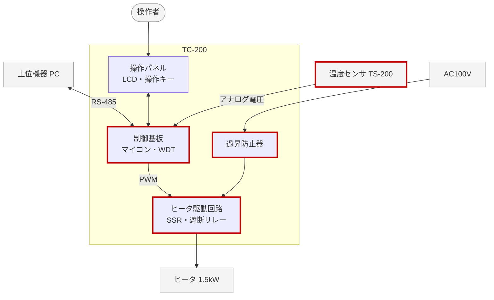

# 概要

## 目的

本書は、恒温槽制御装置 TC-200(以下 TC-200)の安全性に関する要求を定める。想定するシステム障害とハザード解析の結果、安全を保つための要求(安全要求)、安全要求ごとの安全度水準を記す。

## 位置づけ

本書は、製品企画書と製品仕様書をもとに、安全性要求定義(SAP1)で作成した。システム要求仕様書(SY106)と並行して作り、安全要求から導いたシステム要求は SY106 に載せる。本書は、システム・アーキテクチャ設計(SY205)と安全性テスト(SA201)の入力とする。

## 対象ユーザ

システムの設計者、ソフトウェアとハードウェアの設計者、安全性テストの担当者、品質保証の担当者。

## 記載範囲

TC-200 の通常の運転、保守(校正)、電源の投入と遮断を対象とする。輸送、設置、廃棄のときの安全は対象外とし、取扱説明書で扱う。

## 参照ドキュメント

| ID | 文書名 | 文書番号 | 発行年月 | 備考 |
|---|---|---|---|---|
| R1 | 製品企画書 恒温槽 TC-200 | TC-PL-001 | 2026/03 | |
| R2 | 製品仕様書 恒温槽 TC-200 | TC-PS-001 | 2026/04 | |
| R3 | システム要求仕様書 | TC-SY106-001 | 2026/06 | |
| R4 | IEC 61010-1 測定、制御及び研究室用電気機器の安全性 | — | 2010 | 規格 |
| R5 | IEC 61010-2-010 材料の加熱用の研究室用機器の個別要求事項 | — | 2019 | 規格 |
| R6 | IEC 61508 電気・電子・プログラマブル電子安全関連系の機能安全 | — | 2010 | 安全度水準の考え方の参考 |

: 参照ドキュメント {#tbl-refs}

## 定義(用語、略語)

| ID | 用語・略号 | 正式表記 | 意味 |
|---|---|---|---|
| D1 | ハザード | — | 人のけがや物の損害の元になるもの |
| D2 | 安全逸脱状況 | — | システムが安全な状態から外れた状況 |
| D3 | FTA | Fault Tree Analysis | 望ましくない事象の原因を、木の形にたどって分析する方法 |
| D4 | FMEA | Failure Mode and Effects Analysis | 部品の故障の仕方ごとに、影響と対策を表にまとめる方法 |
| D5 | RPN | Risk Priority Number | 影響の大きさ、発生の可能性、検知の難しさを掛けた値 |
| D6 | 安全度水準 | — | 安全要求をどの程度確実に実現するかの段階。本書では 3 段階で定める |
| D7 | 上限温度 | — | これを超えるとヒータを止める温度。目標値 + 5.0℃ と 130.0℃ の低い方 |

: 定義(用語、略語) {#tbl-terms}

# システム構成

## システム全体構成

システム要求仕様書(R3)の 2.1 から引用する。安全に関わる要素を赤い枠で示す。



## システムを構成する主たる要素

システム要求仕様書(R3)の 2.2 から引用し、安全との関わりを加える。

| 構成要素 ID | 構成要素 | 概要 |
|---|---|---|
| E-01 | 制御基板 | 温度の計測、ヒータの制御、表示、通信を行う。**ウォッチドッグタイマ(WDT)でソフトウェアの停止を見つける** |
| E-02 | 温度センサ TS-200 | 槽内の温度を測る。**故障すると制御と監視の両方が働かなくなる** |
| E-03 | ヒータ駆動回路 | SSR でヒータの電力を加減する。**遮断リレーでヒータの電源を切る** |
| E-04 | 操作パネル | LCD と操作キー。異常を操作者に知らせる |
| E-05 | 通信回路 | 上位機器と RS-485 でつなぐ |
| E-06 | 過昇防止器 | **ソフトウェアと独立に、槽が 145℃ を超えるとヒータの電源を切る** |
| E-07 | ヒータ | 槽内を加熱する(1.5kW) |
| E-08 | 冷却ユニット CU-10 | 槽を冷やす。TC-200 からは制御しない |

: システムを構成する主たる要素 {#tbl-elements}

# 想定システム障害リスト

TC-200 が想定する安全逸脱状況と、そのハザード解析の結果を記す。

## 動作環境・動作モードの定義

TC-200 は、屋内の研究室や品質試験室で、周囲温度 5〜35℃、AC100V で使う(R3 の 4.1)。1 日 24 時間の連続運転と、夜間の無人運転を想定する。動作モードを @tbl-modes に示す。

| 動作モード | 内容 | ヒータ | 想定する危険 |
|---|---|---|---|
| 起動 | 電源を入れてから、初期化と自己診断を終えるまで | 切 | 初期化の誤りでヒータが入る |
| 停止 | 運転していない | 切 | — |
| 昇温 | 目標値に向けて加熱する | 入(最大の出力) | 過昇温 |
| 定温 | 目標値に保つ | 入(PID 演算) | 過昇温 |
| 異常 | 異常を見つけて、ヒータを止めている | 切(遮断) | 自動で復帰して、再び加熱する |
| 校正 | 停止の状態で、補正値を設定する | 切 | 誤った補正値による過昇温 |

: 動作モード {#tbl-modes}

想定外の使い方として、次のものも考える。

- 槽に燃えやすい物を入れて加熱する
- 冷却ユニットが故障したまま運転する
- 上位機器のプログラムの誤りで、範囲外の目標値を送る

## 想定システム障害リスト

想定する障害を @tbl-hazards に、評価の基準を @tbl-risk に示す。

| 障害 ID | 想定する障害(安全逸脱状況) | 主な原因 | 発生の可能性 | 影響 | 影響の大きさ | 区分 |
|---|---|---|:-:|---|:-:|:-:|
| HZ-01 | 槽内の過昇温 | SSR の短絡、ソフトウェアの暴走、上限の判定の誤り | 中 | 試料の焼損、槽の発煙や火災 | 重大 | A |
| HZ-02 | 温度を測れない | 温度センサや配線の断線、短絡 | 中 | 制御できずに過昇温になる | 重大 | A |
| HZ-03 | 停電から復帰して、無人で加熱を始める | 電源の瞬断 | 中 | 試料の損傷 | 中 | B |
| HZ-04 | 誤った目標値で運転する | 操作の誤り、上位機器からの誤ったコマンド | 中 | 試料の損傷 | 中 | B |
| HZ-05 | 異常に気づかれない | 表示の見落とし | 中 | 対処が遅れる | 軽微 | C |

: 想定システム障害リスト {#tbl-hazards .small tbl-colwidths="[9,18,25,10,20,10,8]"}

<table>
<tr><th rowspan="2">発生の可能性</th><th colspan="3">影響の大きさ</th></tr>
<tr><th>軽微(運転の中断)</th><th>中(試料や装置の損傷)</th><th>重大(火災、人のけが)</th></tr>
<tr><td style="background-color: #eeeeee"><b>高</b>(年に 1 回以上)</td><td style="background-color: #fff2b3">B</td><td style="background-color: #f8c4c4">A</td><td style="background-color: #f8c4c4">A</td></tr>
<tr><td style="background-color: #eeeeee"><b>中</b>(製品の寿命の間に 1 回ほど)</td><td style="background-color: #d5ecd4">C</td><td style="background-color: #fff2b3">B</td><td style="background-color: #f8c4c4">A</td></tr>
<tr><td style="background-color: #eeeeee"><b>低</b>(ほとんど起きない)</td><td style="background-color: #d5ecd4">C</td><td style="background-color: #d5ecd4">C</td><td style="background-color: #fff2b3">B</td></tr>
</table>

: リスクの評価の基準 {#tbl-risk}

A: 許容できない。設計で必ず下げる B: できるだけ下げる C: 許容できる

## システムハザード解析

区分 A の障害を、FTA と FMEA で解析した。

### FTA

HZ-01 の過昇温が起きる筋道を @fig-fta に示す。過昇温は、ヒータへの電力が止まらず、かつ、過昇防止器も働かないときにだけ起きる。ソフトウェアに頼らない過昇防止器を置くことで、1 つの故障では過昇温にならない。

```fta
%%| label: fig-fta
%%| fig-cap: 槽内の過昇温の FTA
AND 槽内の過昇温(HZ-01)
  OR ヒータへの電力が止まらない
    AND SSR と遮断リレーの両方が切れない
      SSR の短絡
      遮断リレーの溶着
    OR ソフトウェアがヒータを止めない
      センサの異常の見落とし
      上限の判定の誤り
      暴走を WDT が見落とす
  過昇防止器の接点の溶着
```

事象の下の記号は AND と OR のゲート、円はそれ以上分けない基本の事象である。

### FMEA

構成要素の故障の仕方ごとに、影響と対策を @tbl-fmea(次のページ)にまとめる。S は影響の大きさ、O は発生の可能性、D は検知の難しさで、それぞれ 1〜10 で評価する。RPN が 100 以上か S が 10 の行は、対策を必須とする。

::: {.landscape}

| No. | 構成要素 | 故障の仕方 | 故障の影響 | 検知の方法 | S | O | D | RPN | 対策(安全要求) |
|--:|---|---|---|---|--:|--:|--:|--:|---|
| 1 | 温度センサ | 断線 | A/D 値が最大になり、温度を測れない | A/D 値の範囲で判定 | 9 | 4 | 2 | 72 | SAR-002 |
| 2 | 温度センサ | 短絡 | A/D 値が最小になり、温度を測れない | A/D 値の範囲で判定 | 9 | 3 | 2 | 54 | SAR-002 |
| 3 | 温度センサ | 特性のずれ | 実際より低く測り、過昇温になる | 定期の校正 | 7 | 3 | 6 | 126 | SAR-011 |
| 4 | SSR | 短絡 | ヒータが切れず、過昇温になる | 出力 0 での温度の上昇 | 10 | 3 | 3 | 90 | SAR-003 |
| 5 | SSR | 開放 | 加熱できない(安全側の故障) | 昇温の時間切れ | 3 | 3 | 3 | 27 | なし |
| 6 | 遮断リレー | 接点の溶着 | SSR の短絡と重なると電源を切れない | 起動時の動作確認 | 10 | 2 | 4 | 80 | SAR-008 |
| 7 | マイコン | 暴走、停止 | ヒータの出力が固まる | WDT | 10 | 2 | 2 | 40 | SAR-004 |
| 8 | マイコン | ROM、RAM の化け | 誤った制御をする | 起動時の自己診断 | 8 | 2 | 3 | 48 | SAR-008 |
| 9 | 過昇防止器 | 接点の溶着 | 最後の保護が働かない | 年 1 回の点検 | 10 | 1 | 7 | 70 | SAR-011 |
| 10 | 通信回路 | データの化け | 誤った目標値で運転する | チェックサム | 6 | 3 | 2 | 36 | SAR-007 |

: FMEA {#tbl-fmea tbl-colwidths="[5,10,11,22,17,4,4,4,6,17]"}

:::

# システム安全要求リスト

3 章の解析から、システムとシステムの周辺(操作者、保守員)に求める安全要求を @tbl-sar に定める。

| 安全要求 ID | 安全要求名 | 安全要求機能 | 回避動作 | 備考 |
|---|---|---|---|---|
| SAR-001 | 上限温度での停止 | 槽内温度が上限温度を超えたら検知する | ヒータを止め(出力 0、遮断リレー切)、異常の状態に入る | HZ-01 |
| SAR-002 | センサの異常での停止 | 温度センサの断線と短絡を検知する | SAR-001 と同じ | HZ-02 |
| SAR-003 | ヒータの出力の固着の検知 | 出力 0 でも 30 秒で 2.0℃ 以上上がれば、SSR の短絡とみなす | 遮断リレーを切り、異常の状態に入る | HZ-01 |
| SAR-004 | ソフトウェアの暴走の検知 | WDT(1 秒)でマイコンの停止と暴走を検知する | リセットし、ヒータの出力をハードウェアで切る。異常の状態で再起動する | HZ-01 |
| SAR-005 | 停止の状態での起動 | 電源の投入と停電からの復帰で、運転を再開しない | 停止の状態で起動する | HZ-03 |
| SAR-006 | 異常の保持 | 異常の状態を自動では解除しない | 操作者が原因を取り除き、停止の操作で戻す(人間系) | HZ-03 |
| SAR-007 | 不正な設定の拒否 | 範囲外の目標値と、誤ったコマンドを拒否する | エラー応答を返し、状態を変えない | HZ-04 |
| SAR-008 | 起動時の自己診断 | ROM、RAM、遮断リレーの動作を確かめる | 異常があれば、異常の状態で起動する | HZ-01 |
| SAR-009 | 独立した過昇防止 | 145℃ で開く過昇防止器で、ヒータの電源を切る | 操作者が手動で復帰する。ソフトウェアに頼らない | HZ-01 |
| SAR-010 | 異常の通知 | 異常コードを LCD に点滅させ、上位機器に返す | 操作者が取扱説明書に従って対処する(人間系) | HZ-05 |
| SAR-011 | 定期の点検 | 年 1 回、温度の校正と過昇防止器を点検する | 保守員が点検する(人間系) | FMEA 3、9 |

: システム安全要求リスト {#tbl-sar tbl-colwidths="[13,17,29,30,11]"}

安全要求は、@fig-layers のように層を重ねて過昇温を防ぐ。内側の層が働かなくても、外側の層で止める。

```layers
%%| label: fig-layers
%%| fig-cap: 過昇温を防ぐ層
設定の検査 SAR-007 | 起動時の自己診断 SAR-008
ソフトウェアによる監視 SAR-001、SAR-002、SAR-003
WDT による暴走の検知 SAR-004
過昇防止器 SAR-009(ソフトウェアと独立)
操作者と保守員の対処 SAR-006、SAR-010、SAR-011
```

安全要求と、システム要求仕様書(R3)の要求の対応を @tbl-trace に示す。

| 安全要求 ID | 障害 ID | FMEA の No. | システム要求(R3) |
|---|---|---|---|
| SAR-001 | HZ-01 | — | SYR-006 |
| SAR-002 | HZ-02 | 1、2 | SYR-007 |
| SAR-003 | HZ-01 | 4 | SYR-008 |
| SAR-004 | HZ-01 | 7 | SYR-101 |
| SAR-005 | HZ-03 | — | SYR-011 |
| SAR-006 | HZ-03 | — | SYR-012 |
| SAR-007 | HZ-04 | 10 | SYR-017、SYR-141 |
| SAR-008 | HZ-01 | 6、8 | SYR-102 |
| SAR-009 | HZ-01 | 9 | —(ハードウェアの仕様書で定める) |
| SAR-010 | HZ-05 | — | SYR-014 |
| SAR-011 | — | 3、9 | —(取扱説明書で定める) |

: 安全要求とシステム要求の対応 {#tbl-trace}

# システム安全度水準

IEC 61508 の安全度水準(R6)の考え方を参考に、社内の 3 段階で水準を定める(@tbl-levels)。IEC 61508 の認証は取らない。

| 水準 | 求める確かさ | 実現の方法の例 |
|:-:|---|---|
| 3 | 1 つの故障では安全機能を失わない | ソフトウェアに頼らない保護との組み合わせ、二重化、自己診断 |
| 2 | 安全機能の故障を自己診断で見つけられる | すべての条件をテストで確かめる。コーディング規約と静的解析 |
| 1 | 通常の品質管理で作る | 通常のレビューとテスト |

: 安全度水準の段階 {#tbl-levels}

3.2 の区分 A の障害に対する安全要求を水準 3、区分 B を水準 2、区分 C を水準 1 とする。

| 安全要求 ID | 安全要求名 | 安全度水準 | 備考 |
|---|---|:-:|---|
| SAR-001 | 上限温度での停止 | 3 | SAR-009 と組み合わせて、1 つの故障に耐える |
| SAR-002 | センサの異常での停止 | 3 | SAR-009 と組み合わせる |
| SAR-003 | ヒータの出力の固着の検知 | 3 | 遮断リレーと SSR の二重化 |
| SAR-004 | ソフトウェアの暴走の検知 | 3 | WDT はマイコンの内部のクロックと別のクロックで動かす |
| SAR-005 | 停止の状態での起動 | 2 | |
| SAR-006 | 異常の保持 | 2 | |
| SAR-007 | 不正な設定の拒否 | 2 | |
| SAR-008 | 起動時の自己診断 | 3 | 水準 3 の要求の前提となる |
| SAR-009 | 独立した過昇防止 | 3 | ハードウェアだけで実現する |
| SAR-010 | 異常の通知 | 1 | |
| SAR-011 | 定期の点検 | 1 | 取扱説明書で定める |

: システム安全度水準 {#tbl-sil}

# その他

開発の過程で安全性を確かめる仕組みを @tbl-checks に定める。

| No. | 仕組み | 内容 | 時期 |
|--:|---|---|---|
| 1 | 安全要求のレビュー | 本書を内部確認(SA105)と共同レビューで確かめる | 安全性要求定義 |
| 2 | トレーサビリティの管理 | 安全要求を、SY205、ソフトウェア要求仕様書、テスト仕様書の項目まで追う。変更のたびに更新する | すべての工程 |
| 3 | コーディング規約 | 水準 3 と 2 の機能は MISRA C:2012 に従い、静的解析で確かめる | 実装 |
| 4 | 安全性テスト | すべての安全要求を安全性テスト(SA201)で確かめる。故障は模擬して入れる | 安全性テスト |
| 5 | 変更の影響の分析 | 安全に関わる変更は、本書を見直してから行う | 変更管理 |
| 6 | ツールの管理 | コンパイラと静的解析のツールの版を固定し、構成管理する | すべての工程 |

: 安全性を確かめる仕組み {#tbl-checks}

未決定の事項は次のとおりである。

- 過昇防止器の動作温度(145℃)は、槽の材料の耐熱を確かめて 2026/08 に決める
