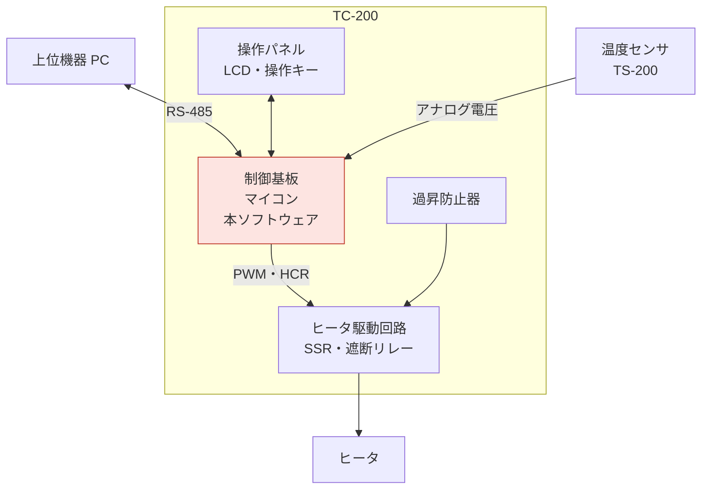
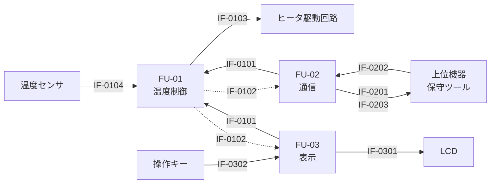
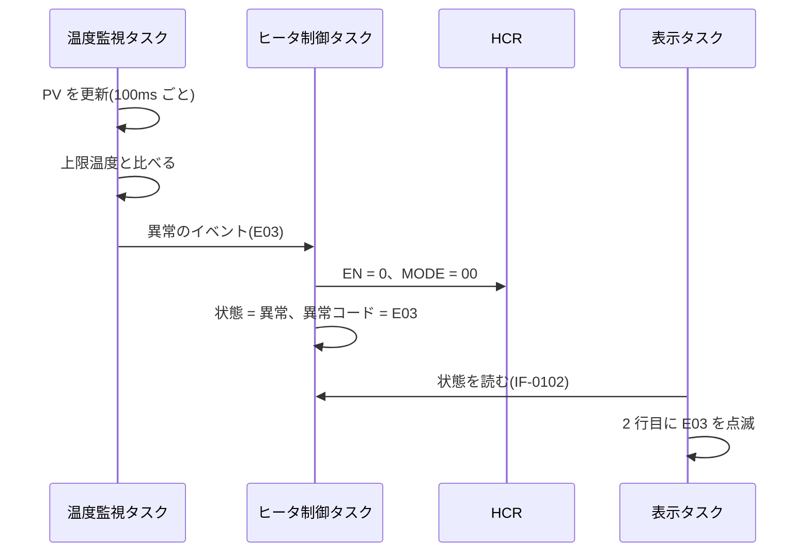

# 概要

## 目的

本書は、ソフトウェア要求仕様書(SW105)の要求を実現するための、恒温槽制御装置 TC-200 の制御ソフトウェア(以下、本ソフトウェア)の構成と制御方式を定める。機能ユニットごとの詳細設計を、本書をもとに担当者へ割り振れることを目的とする。

## 位置づけ

本書は、SW105 の要求を機能ユニットに割り当てたものである。機能ユニットは、ソフトウェア詳細設計書(SW305)でプログラムユニットに分ける。機能ユニットの間のインタフェースは、ソフトウェア結合テストで確かめる。

```layers
%%| label: fig-docs
%%| fig-cap: 本書の位置づけ
SY205 システム・アーキテクチャ設計書
SW105 ソフトウェア要求仕様書
SW205 ソフトウェア・アーキテクチャ設計書(本書) *2 | SW501 ソフトウェア結合テスト仕様書
SW305 ソフトウェア詳細設計書
```

## 対象ユーザ

- ソフトウェア詳細設計の担当者
- ソフトウェア結合テストの担当者
- ハードウェアの設計者(メモリと割り込みの使い方の確認のため)

## 記載範囲

本ソフトウェアの全体を対象とする。ブートローダは対象外とする。TOPPERS/ASP カーネルは、使い方だけを書く。

## 参照ドキュメント

| ID | 文書名 | 文書番号 | 発行年月 | 備考 |
|---|---|---|---|---|
| R1 | ソフトウェア要求仕様書 | TC-SW105-001 | 2026/08 | |
| R2 | システム・アーキテクチャ設計書 | TC-SY205-001 | 2026/08 | 第 1.1 版 |
| R3 | 安全要求仕様書 | TC-SA104-001 | 2026/07 | 第 1.1 版 |
| R4 | 恒温槽 TC-100 通信仕様書 | TC1-IF-002 | 2021/09 | 既存の製品 |

: 参照ドキュメント {#tbl-refs}

## 定義(用語、略語)

| ID | 用語・略号 | 正式表記 | 意味 |
|---|---|---|---|
| D1 | FU | Function Unit | 機能ユニット。詳細設計を割り振る単位 |
| D2 | PU | Program Unit | プログラムユニット。SW305 で定める |
| D3 | IF | Interface | 機能ユニットの間か、外部とのインタフェース。IF-0101 の形の ID を付ける |
| D4 | HAL | Hardware Abstraction Layer | ハードウェアの違いを隠すソフトウェアの層 |
| D5 | PV、SV | Process Value、Set Value | 測った温度と、目標の温度 |
| D6 | HCR | Heater Control Register | ヒータ制御レジスタ |
| D7 | WDT | Watchdog Timer | ソフトウェアの停止を見つけて、マイコンをリセットするタイマ |

: 用語と略語 {#tbl-terms}

# システム構成

## システム全体構成

ソフトウェア要求仕様書(R1)の 2.1 から引用する。本ソフトウェアは制御基板のマイコンで動き、温度センサ、ヒータ駆動回路、操作パネルを制御し、上位機器(PC)と RS-485 で通信する。



## システムを構成する主たるソフトウェア機能(要素)

本ソフトウェアの機能は、R1 の 3 章で定めた 6 つである。

| ID | 機能略称 | 機能名 |
|---|---|---|
| F-01 | CTRL | 温度制御 |
| F-02 | MON | 温度監視 |
| F-03 | OPE | 運転操作 |
| F-04 | DISP | 表示 |
| F-05 | COMM | 通信 |
| F-06 | CAL | 校正 |

: ソフトウェアの機能 {#tbl-func}

本ソフトウェアに関係するハードウェアの仕様を @tbl-hw に、割り込みを @tbl-irq に示す。どちらもシステム・アーキテクチャ設計書(R2)による。

| 項目 | 仕様 |
|---|---|
| マイコン | 32 ビット、80MHz。ROM 256KB(フラッシュ)、RAM 64KB |
| A/D 変換器 | 12 ビット。温度センサに 1 チャネルを使う |
| タイマ | PWM 出力 1 チャネル、周期タイマ 1 チャネル、WDT(1 秒、専用の発振器で動く) |
| 通信 | UART 1 チャネル。RS-485 のトランシーバにつなぐ |
| 表示と操作 | LCD(16 文字 × 2 行、4 ビットのパラレル接続)、キー 4 個(ポート入力) |

: ハードウェアの仕様 {#tbl-hw}

| 割り込み | 要因 | 優先度 | 処理する FU |
|---|---|:-:|---|
| INT-1 | 周期タイマ(1ms) | 1 | OS(時間の管理と周期ハンドラ) |
| INT-2 | A/D 変換の完了 | 2 | FU-01 |
| INT-3 | UART の受信 | 3 | FU-02 |
| INT-4 | UART の送信の完了 | 3 | FU-02 |
| — | WDT の時間切れ | — | 割り込みにせず、ハードウェアでリセットし、遮断リレーを切る |

: 割り込み {#tbl-irq}

# ソフトウェア構成

## ソフトウェア全体構成

本ソフトウェアは、3 つの機能ユニット(FU)と、FU が共通に使う部分(以下、共通部)からなる。共通部は HAL と TOPPERS/ASP カーネルである。FU は、ハードウェアに HAL を通してだけ触れる(R1 の C-09)。

```layers
%%| label: fig-fu
%%| fig-cap: 機能ユニット構成図
FU-01 温度制御 | FU-02 通信 | FU-03 表示
HAL(A/D、PWM と HCR、UART、LCD、キー、WDT、フラッシュ)
TOPPERS/ASP カーネル 1.9.3
マイコン
```

## システムを構成する機能ユニット

R2 の機能ブロックとの対応は、FB-01、FB-02、FB-04、FB-07 が FU-01、FB-06 が FU-02、FB-05 が FU-03 である。

| 機能ユニット ID | 機能ユニット名 | 機能概要 | 関連機能 ID |
|---|---|---|---|
| FU-01 | 温度制御 | 温度を求め、PID 演算でヒータを動かす。運転の状態を管理し、異常を見つけてヒータを止める。起動の処理と自己診断もする | F-01、F-02、F-03 |
| FU-02 | 通信 | 上位機器と保守ツールのコマンドを判定して FU-01 に伝え、応答を返す | F-05、F-06 |
| FU-03 | 表示 | キーを読んで操作を FU-01 に伝え、LCD に温度と状態を出す | F-03、F-04 |

: 機能ユニット {#tbl-fu tbl-colwidths="[12,13,55,20]"}

## 機能ユニット間のインタフェース

機能ユニットの間と外部とのインタフェースを @fig-if と @tbl-if に示す。運転の指示は、すべて IF-0101 で FU-01 に送る。PV、SV、運転の状態は FU-01 だけが書き、FU-02 と FU-03 は読むだけとする。R2 のインタフェースとの対応は、IF-0101 が IF-15 と IF-17、IF-0102 が IF-16、IF-0103 が IF-12 と IF-14 である。



| IF ID | インタフェース名 | 送り手 → 受け手 | 方式 | 内容 |
|---|---|---|---|---|
| IF-0101 | 運転指令 | FU-02、FU-03 → FU-01 | データキュー | 運転開始、停止要求、SV の変更、補正値の変更 |
| IF-0102 | 温度と状態 | FU-01 → FU-02、FU-03 | 共通領域 | PV、SV、運転の状態、異常コード |
| IF-0103 | ヒータの出力 | FU-01 → ヒータ駆動回路 | HCR | EN、MODE、DUTY |
| IF-0104 | 温度の読み取り | 温度センサ → FU-01 | A/D 変換器 | 12 ビットの値 |
| IF-0201 | 温度応答 | FU-02 → 上位機器 | RS-485 | PV と運転の状態。異常の状態では異常コードを続ける。形式は SW305 で定める |
| IF-0202 | コマンド | 上位機器、保守ツール → FU-02 | RS-485 | RN、ST、RT、WS、RV、CA |
| IF-0203 | 正常応答とエラー応答 | FU-02 → 上位機器 | RS-485 | ACK と NAK |
| IF-0301 | 表示 | FU-03 → LCD | HAL | 16 文字 × 2 行の文字 |
| IF-0302 | キー入力 | 操作キー → FU-03 | HAL(ポート入力) | 押されたキー |

: インタフェースの一覧 {#tbl-if .small tbl-colwidths="[11,16,21,14,38]"}

図の実線は呼び出しかメッセージ、破線は共通領域の参照を表す。

# 制御方式

## メモリー構成/レイアウト

メモリの配置を @fig-memmap と @tbl-memmap に示す。HCR などの周辺レジスタの番地は、ハードウェア仕様書による。

```layers
%%| label: fig-memmap
%%| fig-cap: メモリの配置
ROM 252KB(0x0000_0000〜): ベクタ表、プログラム、定数 *5 | 補正値 4KB
RAM: データ 24KB | OS の領域 8KB | スタック 8KB | 予備 24KB
周辺レジスタ(0x4000_0000〜): A/D、PWM、HCR、UART、WDT、ポート
```

| 領域 | 開始番地 | 大きさ | 内容 |
|---|---|--:|---|
| ROM(プログラム) | 0x0000_0000 | 252KB | ベクタ表、プログラム、定数 |
| ROM(補正値) | 0x0003_F000 | 4KB | 補正値の保存域(フラッシュの 1 ブロック) |
| RAM(データ) | 0x2000_0000 | 24KB | 変数、送受信のバッファ、表示の作業領域 |
| RAM(OS) | 0x2000_6000 | 8KB | タスクの管理表、データキュー |
| RAM(スタック) | 0x2000_8000 | 8KB | タスクと割り込みのスタック |
| RAM(予備) | 0x2000_A000 | 24KB | 将来の機能の追加に残す |
| 周辺レジスタ | 0x4000_0000 | — | HCR は 0x4000_2000 |

: メモリの配置 {#tbl-memmap}

メモリの使用量の見積もりを @tbl-mem-est に、ROM の内訳を @fig-rom に示す。どちらも SWR-011 の上限に収まる。

| 区分 | 見積もり(KB) | 容量(KB) | 使用率 | 上限(SWR-011) |
|---|--:|--:|--:|--:|
| ROM | 178 | 256 | 70% | 192KB |
| RAM | 40 | 64 | 63% | 48KB |
| スタック | 6 | 8 | 75% | — |

: メモリの使用量の見積もり {#tbl-mem-est}

```chart
%%| label: fig-rom
%%| fig-cap: ROM の使用量の内訳(見積もり、KB)
type: pie
| 部分 | KB |
|---|---|
| FU-01 温度制御 | 48 |
| C の実行時ライブラリ | 32 |
| FU-02 通信 | 32 |
| TOPPERS/ASP カーネル | 22 |
| HAL | 20 |
| FU-03 表示 | 20 |
| 補正値の保存域 | 4 |
```

## ソフトウェア制御方式

### タスクの構成

本ソフトウェアは、TOPPERS/ASP カーネルの上で 4 つのタスクと 1 つの周期ハンドラとして動く(@tbl-tasks)。優先度は数が小さいほど高い。温度の計測と制御を、通信と表示より優先する。タスクは、SW305 でプログラムユニットになる。

| タスク、ハンドラ | FU | 優先度 | 起動 | スタック(バイト) |
|---|---|--:|---|--:|
| ヒータ制御タスク | FU-01 | 2 | 100ms 周期。温度監視タスクが PV を更新した後に起こす | 1,024 |
| 温度監視タスク | FU-01 | 3 | 100ms 周期 | 512 |
| 通信タスク | FU-02 | 4 | 1 つのフレームを受け終わったとき | 2,048 |
| 表示タスク | FU-03 | 5 | 500ms 周期と、キーの操作のとき | 768 |
| キーの周期ハンドラ | FU-03 | — | 10ms 周期 | 割り込みと共用 |

: タスクの構成 {#tbl-tasks tbl-colwidths="[21,9,9,41,20]"}

100ms の周期の中の処理の順序を @fig-timing に示す。1 目盛りを 10ms とした模式図である。WDT は、周期の処理の最後にヒータ制御タスクがクリアする。

```timing
%%| label: fig-timing
%%| fig-cap: 周期の中の処理の順序(模式図)
キー(10ms): p...................
温度監視: 10000000001000000000
ヒータ制御: 01000000000100000000
WDT のクリア: 00100000000010000000
通信: 00011100000000000000
表示: 00000011100000000000
```

### 運転の状態

運転の状態と遷移は、R1 の 6.3 の状態遷移表に従う。状態ごとの動作を @tbl-state-action に示す。起動は、電源を入れてから停止か異常の状態に入るまでの処理である。

| 状態 | HCR の EN | HCR の MODE | LCD | 受け付けるコマンド | 温度応答の状態 |
|---|:-:|:-:|---|---|:-:|
| 起動 | 0 | 00 | 版数 | なし(応答しない) | — |
| 停止 | 0 | 00 | PV、SV | ST 以外 | 0 |
| 昇温 | 1 | 01 | PV、SV、状態 | RN と CA 以外 | 1 |
| 定温 | 1 | 01 | PV、SV、状態 | RN と CA 以外 | 2 |
| 異常 | 0 | 00 | 異常コードを点滅 | RT、RV、ST | 9 |

: 状態ごとの動作 {#tbl-state-action}

### 上限超過のときの流れ

PV が上限温度を超えたときの流れを @fig-seq-limit に示す。優先度の最も高いヒータ制御タスクが、異常のイベントを受けた周期の中でヒータを止める。



### 起動と異常からの回復

1. 電源を入れると、クロック、周辺装置、OS の順に初期化する(0.5 秒)
2. ROM のチェックサム、RAM の読み書き、遮断リレーの入り切り(HCR の ERR を読む)を確かめる。異常があれば E07 で異常の状態に入る
3. リセットの要因のレジスタを読み、WDT によるリセットなら E05 で異常の状態に入る。それ以外は停止の状態に入る
4. 異常の状態から戻すのは、停止要求だけとする(SWR-005)

### 補正値の保存

補正値の設定(CA)は、停止の状態でだけ受け付ける。FU-02 が範囲を確かめて IF-0101 で FU-01 に送り、FU-01 が補正値を更新してフラッシュの保存域に書く。フラッシュの書き換えは 1 万回まで保証されており、年に数回の校正には足りる(R1 の未決事項 1 を確定した)。

### ソフトウェアの更新

ソフトウェアは、基板の書き込み端子から書き換える。通信のコマンドには書き換えの機能を設けない(R1 の C-10)。

## 性能見積

時間の要求と見積もりを @tbl-perf に示す。処理の時間は、TC-100 の実測に 20% の余裕を足した(R2 の性能見積と同じ前提)。

| 処理 | 要求 | 見積もり(最悪) | 根拠 |
|---|---|---|---|
| 計測と制御の 1 周期 | 10ms 以内(SWR-010) | 4ms | 監視 2ms、PID 演算 1ms、HCR の更新 1ms 未満 |
| 上限超過からヒータの停止まで | 1 秒以内(SWR-003) | 0.2 秒 | 検知に 1 周期、停止に 1 周期 |
| センサの異常からヒータの停止まで | 1 秒以内(SWR-004) | 0.2 秒 | 同上 |
| コマンドの応答を送り始めるまで | 50ms 以内(SWR-010) | 7ms | 上位のタスクの実行 4ms、判定と応答の作成 3ms |
| 電源の投入から操作の受け付けまで | 2 秒以内(SWR-010) | 1.2 秒 | 初期化 0.5 秒、ROM のチェックサム 0.6 秒、遮断リレーの確認 0.1 秒 |
| キーの操作から表示まで | 0.2 秒以内(SWR-008) | 0.05 秒 | キーの確定 30ms、表示の書き換え 20ms |
| 補正値の保存 | — | 60ms | フラッシュの 1 ブロックの消去と書き込み。停止の状態でだけ行う |

: 性能見積 {#tbl-perf}

タスクごとの CPU の負荷を @fig-cpu に示す。最悪は、上位機器がコマンドを続けて送り続けるときで、合計 16.5% であり、余裕がある。

```chart
%%| label: fig-cpu
%%| fig-cap: CPU の負荷の見積もり
unit: %
| 処理 | 平常時 | 最悪時 |
|---|---|---|
| 温度監視 | 1.5 | 2.0 |
| ヒータ制御 | 0.8 | 1.0 |
| 通信 | 0.5 | 11.0 |
| 表示 | 0.4 | 0.8 |
| キーの読み取り | 0.2 | 0.2 |
| OS と割り込み | 1.0 | 1.5 |
```

# 機能ユニット詳細

## 温度制御(FU-01)

+---------------------------+-------------------------------------------------+
| [機能ユニット ID]{.shade} | FU-01                                           |
+---------------------------+-------------------------------------------------+
| [機能ユニット名]{.shade}  | 温度制御                                        |
+---------------------------+-------------------------------------------------+
| [関連機能 ID]{.shade}     | F-01、F-02、F-03                                |
+---------------------------+-------------------------------------------------+
| [動作形態]{.shade}        | 温度監視タスク、ヒータ制御タスク、              |
|                           | 起動の処理(@tbl-tasks)                          |
+---------------------------+-------------------------------------------------+
| [入力]{.shade}            | 温度の読み取り(IF-0104)、運転指令(IF-0101)      |
+---------------------------+-------------------------------------------------+
| [出力]{.shade}            | ヒータの出力(IF-0103)、温度と状態(IF-0102)      |
+---------------------------+-------------------------------------------------+
| [機能]{.shade}                                                              |
+-----------------------------------------------------------------------------+
| 1. 100ms ごとに温度を求めて補正値を足し、直近 8 回の移動平均で PV にする    |
| 2. 上限温度の超過、センサの断線と短絡、出力の固着を判定する                 |
| 3. 運転指令と判定の結果で、運転の状態を変える(4.2)                          |
| 4. 昇温では出力を 15 にし、SV の 2.0℃ 手前から PID 演算で出力を決める      |
| 5. 起動の処理で自己診断をし、周期の最後で WDT をクリアする                  |
+-----------------------------------------------------------------------------+
| [処理方式]{.shade}                                                          |
+-----------------------------------------------------------------------------+
| - PID 演算は TC-100 の方法を使い、0.1℃ 単位の整数で行う(@eq-pid)           |
| - 出力を 0〜15 に丸めて、HCR の DUTY に書く                                 |
| - 異常を見つけた周期の中で、HCR の EN を 0 にする                           |
+-----------------------------------------------------------------------------+
| [共通領域]{.shade}                                                          |
+-----------------------------------------------------------------------------+
| - 温度情報域、設定情報域、状態情報域(6 章)を書く                            |
| - 書くときは割り込みを禁止する                                              |
+-----------------------------------------------------------------------------+

: FU-01 の詳細 {#tbl-fu01}

ヒータの出力 $u_k$ は、$k$ 回目の周期の差 $e_k = \mathrm{SV} - \mathrm{PV}_k$ から次の式で求める。係数 $K_p$、$K_i$、$K_d$ は、TC-100 の値をもとに試作機で調整し、SW305 の共通定義に書く。

$$
u_k = K_p e_k + K_i \sum_{j=0}^{k} e_j + K_d \left( e_k - e_{k-1} \right)
$$ {#eq-pid}

## 通信(FU-02)

+---------------------------+-------------------------------------------------+
| [機能ユニット ID]{.shade} | FU-02                                           |
+---------------------------+-------------------------------------------------+
| [機能ユニット名]{.shade}  | 通信                                            |
+---------------------------+-------------------------------------------------+
| [関連機能 ID]{.shade}     | F-05、F-06                                      |
+---------------------------+-------------------------------------------------+
| [動作形態]{.shade}        | 通信タスク、UART の割り込み(@tbl-tasks)         |
+---------------------------+-------------------------------------------------+
| [入力]{.shade}            | コマンド(IF-0202)、温度と状態(IF-0102)          |
+---------------------------+-------------------------------------------------+
| [出力]{.shade}            | 温度応答(IF-0201)、正常応答とエラー応           |
|                           | 答(IF-0203)、運転指令(IF-0101)                  |
+---------------------------+-------------------------------------------------+
| [機能]{.shade}                                                              |
+-----------------------------------------------------------------------------+
| 1. UART の割り込みで 1 文字ずつ受け、ETX を受けたら通信タスクを起こす       |
| 2. 局番、形式、チェックサムを確かめ、状態ごとにコマンドを判定する(R1 の     |
|    表 6.5-1)                                                                |
| 3. 受け付けたコマンドを運転指令で FU-01 に送り、応答を返す                  |
+-----------------------------------------------------------------------------+
| [処理方式]{.shade}                                                          |
+-----------------------------------------------------------------------------+
| - 9,600bps。TC-100 の通信の処理を、HAL を通すように直して使う               |
| - 文字の間が 50ms を超えたら、受けた文字を捨てて次の STX を待つ             |
| - 送信と受信のバッファは、それぞれ 64 バイトとする                          |
+-----------------------------------------------------------------------------+
| [共通領域]{.shade}                                                          |
+-----------------------------------------------------------------------------+
| - 温度と状態を読むだけで、書かない                                          |
+-----------------------------------------------------------------------------+

: FU-02 の詳細 {#tbl-fu02}

## 表示(FU-03)

+---------------------------+-------------------------------------------------+
| [機能ユニット ID]{.shade} | FU-03                                           |
+---------------------------+-------------------------------------------------+
| [機能ユニット名]{.shade}  | 表示                                            |
+---------------------------+-------------------------------------------------+
| [関連機能 ID]{.shade}     | F-03、F-04                                      |
+---------------------------+-------------------------------------------------+
| [動作形態]{.shade}        | 表示タスク、キーの周期ハンドラ(@tbl-tasks)      |
+---------------------------+-------------------------------------------------+
| [入力]{.shade}            | キー入力(IF-0302)、温度と状態(IF-0102)          |
+---------------------------+-------------------------------------------------+
| [出力]{.shade}            | 表示(IF-0301)、運転指令(IF-0101)                |
+---------------------------+-------------------------------------------------+
| [機能]{.shade}                                                              |
+-----------------------------------------------------------------------------+
| 1. 10ms ごとにキーを読み、3 回同じなら操作として表示タスクを起こす          |
| 2. キーに応じて運転指令を送るか、SV の設定の表示に移る                      |
| 3. 500ms ごとと、キーの操作のときに LCD を書き換える                        |
| 4. 異常の状態では、2 行目に異常コードを 0.5 秒ごとに点滅させる              |
+-----------------------------------------------------------------------------+
| [処理方式]{.shade}                                                          |
+-----------------------------------------------------------------------------+
| - LCD は HAL を通して 4 ビットのパラレルで書く                              |
| - 16 文字 × 2 行の表示の作業領域を RAM に持ち、変わった文字だけを書く      |
+-----------------------------------------------------------------------------+
| [共通領域]{.shade}                                                          |
+-----------------------------------------------------------------------------+
| - 温度と状態を読むだけで、書かない                                          |
+-----------------------------------------------------------------------------+

: FU-03 の詳細 {#tbl-fu03}

# システムで扱うデータ

データの ID は、R2 のシステムで扱うデータと同じである。

| データ ID | データ名 | 概要 | 関連機能ユニット ID |
|---|---|---|---|
| D-01 | PV | -20.0〜150.0℃、0.1℃ 単位の符号付き 16 ビット | FU-01、FU-02、FU-03 |
| D-02 | SV | -20.0〜130.0℃。PV と同じ形式で、初期値は 25.0℃ | FU-01、FU-02、FU-03 |
| D-03 | 上限温度 | SV + 5.0℃ と 130.0℃ の低い方。SV を変えるたびに求める | FU-01 |
| D-04 | 運転の状態 | 0: 停止、1: 昇温、2: 定温、9: 異常 | FU-01、FU-02、FU-03 |
| D-05 | 異常コード | E01〜E07(7 章)。異常でないときは 0 | FU-01、FU-02、FU-03 |
| D-06 | ヒータの出力 | 0〜15 | FU-01 |
| D-07 | 補正値 | -5.0〜+5.0℃、0.1℃ 単位。フラッシュに保存する | FU-01、FU-02 |

: システムで扱うデータ {#tbl-data tbl-colwidths="[9,13,51,27]"}

複数の機能ユニットが使うデータの更新と参照を @tbl-data-access に示す。SV と補正値の変更も運転指令で FU-01 に頼み、FU-01 だけが書く。

<table>
<tr><th rowspan="2">データ</th><th colspan="3">機能ユニット</th><th rowspan="2">排他の方法</th></tr>
<tr><th>FU-01</th><th>FU-02</th><th>FU-03</th></tr>
<tr><td>D-01 PV</td><td align="center">W</td><td align="center">R</td><td align="center">R</td><td rowspan="4">FU-01 が書くときに割り込みを禁止する。読む側も割り込みを禁止して一度に読む</td></tr>
<tr><td>D-02 SV</td><td align="center">W</td><td align="center">R</td><td align="center">R</td></tr>
<tr><td>D-04 運転の状態</td><td align="center">W</td><td align="center">R</td><td align="center">R</td></tr>
<tr><td>D-05 異常コード</td><td align="center">W</td><td align="center">R</td><td align="center">R</td></tr>
<tr><td>D-07 補正値</td><td align="center">W</td><td></td><td></td><td>FU-02 は運転指令で変更を頼む</td></tr>
</table>

: 共通データの更新と参照 {#tbl-data-access tbl-colwidths="[18,10,10,10,52]"}

W: 更新 R: 参照

# 例外一覧

| 例外コード | 例外内容 | 対処方法 | 備考 |
|---|---|---|---|
| E01 | 温度センサの断線 | ヒータを止め、異常の状態にする | FU-01。SWR-004 |
| E02 | 温度センサの短絡 | E01 と同じ | FU-01。SWR-004 |
| E03 | 上限温度の超過 | E01 と同じ | FU-01。SWR-003 |
| E04 | ヒータの出力の固着 | 遮断リレーを切り、異常の状態にする | FU-01。SWR-003 |
| E05 | WDT によるリセット | 異常の状態で始める | 起動の処理。SWR-005 |
| E06 | 通信の誤り | エラー応答(NAK)を返す。LCD には出さない | FU-02。SWR-007 |
| E07 | 起動時の自己診断の異常 | 異常の状態で始める | 起動の処理。SWR-005 |
| X1 | 受信のバッファのあふれ | 受けた文字を捨て、次の STX から受け直す | FU-02 |
| X2 | データキューのあふれ | 運転指令を捨て、エラー応答を返す | FU-02、FU-03 |
| X3 | フラッシュの書き込みの失敗 | 補正値を前の値に戻し、エラー応答を返す | FU-01 |

: 例外一覧 {#tbl-exceptions}

E で始まるコードは利用者に知らせる異常で、R2 の例外一覧と同じである。X で始まるコードは、本ソフトウェアの中で処理する例外である。

# その他

## ソフトウェア要求との対応

R1 のソフトウェア要求を、どの機能ユニットで実現するかを @tbl-trace に示す。

<table>
<tr><th rowspan="2">要求 ID</th><th rowspan="2">要求</th><th colspan="3">機能ユニット</th><th rowspan="2">共通部</th><th rowspan="2">設計した節</th></tr>
<tr><th>FU-01</th><th>FU-02</th><th>FU-03</th></tr>
<tr><td>SWR-001</td><td>温度の計測</td><td align="center">○</td><td></td><td></td><td></td><td>5.1</td></tr>
<tr><td>SWR-002</td><td>温度の制御</td><td align="center">○</td><td></td><td></td><td></td><td>5.1</td></tr>
<tr><td>SWR-003</td><td>上限超過の保護</td><td align="center">○</td><td></td><td></td><td></td><td>4.2(3)、5.1</td></tr>
<tr><td>SWR-004</td><td>センサの異常の検出</td><td align="center">○</td><td></td><td align="center">○</td><td></td><td>5.1、5.3</td></tr>
<tr><td>SWR-005</td><td>運転の状態の管理</td><td align="center">○</td><td></td><td></td><td align="center">○</td><td>4.2(2)、4.2(4)</td></tr>
<tr><td>SWR-006</td><td>コマンドの受け付け</td><td align="center">○</td><td align="center">○</td><td></td><td></td><td>4.2(5)、5.2</td></tr>
<tr><td>SWR-007</td><td>通信の異常の処理</td><td></td><td align="center">○</td><td></td><td></td><td>5.2、7</td></tr>
<tr><td>SWR-008</td><td>表示</td><td></td><td></td><td align="center">○</td><td></td><td>5.3</td></tr>
<tr><td>SWR-009</td><td>操作キー</td><td align="center">○</td><td></td><td align="center">○</td><td></td><td>5.3</td></tr>
<tr><td>SWR-010</td><td>応答時間</td><td align="center">○</td><td align="center">○</td><td align="center">○</td><td align="center">○</td><td>4.3</td></tr>
<tr><td>SWR-011</td><td>メモリ使用量</td><td align="center">○</td><td align="center">○</td><td align="center">○</td><td align="center">○</td><td>4.1</td></tr>
<tr><td>SWR-012</td><td>連続運転</td><td align="center">○</td><td align="center">○</td><td align="center">○</td><td align="center">○</td><td>4.2(1)</td></tr>
<tr><td>C-09</td><td>HAL への分離</td><td></td><td></td><td></td><td align="center">○</td><td>3.1</td></tr>
</table>

: ソフトウェア要求と機能ユニットの対応 {#tbl-trace tbl-colwidths="[12,22,9,9,9,9,30]"}

## 決めたことと残したこと

- R1 の未決事項 1(補正値を保つ場所)は、フラッシュの保存域に決めた(4.2)
- R1 の未決事項 2(HCR の ERR)は、本版では起動の自己診断でだけ見る。運転中に見るかは次の版で見直す
- PID の係数は、試作機での調整の後、SW305 で決める
