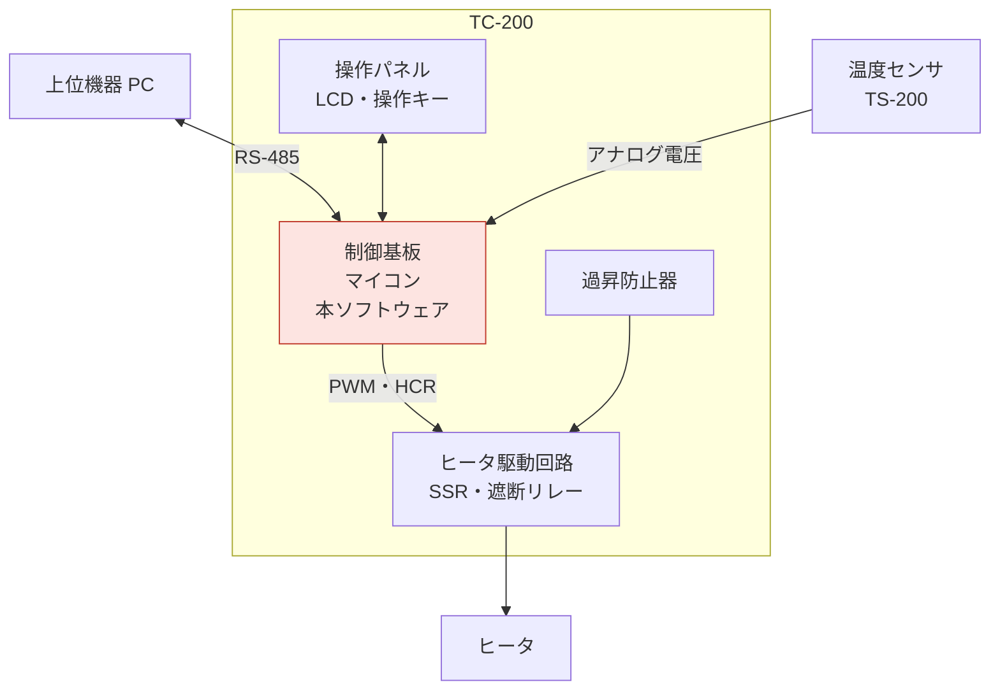
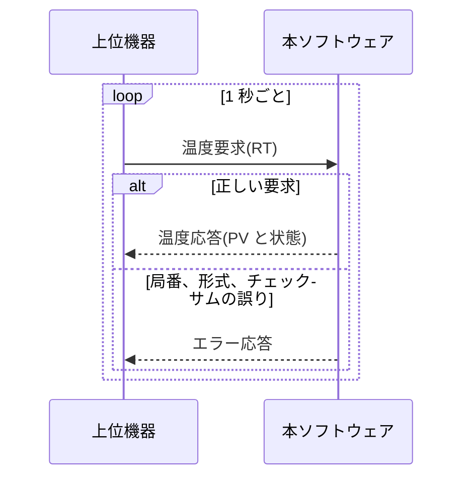
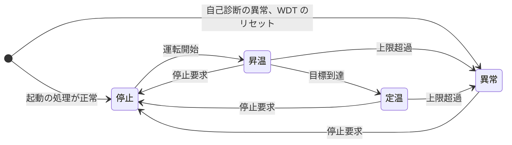

# 概要

## 目的

本書は、恒温槽制御装置 TC-200 の制御ソフトウェア(以下、本ソフトウェア)に求める機能、インタフェース、性能と品質を定める。設計者が本書をもとにソフトウェア・アーキテクチャを設計し、テストの担当者が本書からソフトウェア総合テストの項目を作れることを目的とする。

## 位置づけ

本書は、システム要求仕様書(SY106)、システム・アーキテクチャ設計書(SY205)、安全要求仕様書(SA104)の要求のうち、ソフトウェアで実現するものを取り出して詳しくしたものである。本書の要求は、ソフトウェア・アーキテクチャ設計書(SW205)で設計し、ソフトウェア総合テスト仕様書(SW601)で確かめる。

```layers
%%| label: fig-docs
%%| fig-cap: 本書の位置づけ
SY106 システム要求仕様書 *2 | SA104 安全要求仕様書
SY205 システム・アーキテクチャ設計書
SW105 ソフトウェア要求仕様書(本書) *2 | SW601 ソフトウェア総合テスト仕様書
SW205 ソフトウェア・アーキテクチャ設計書
```

## 対象ユーザ

- ソフトウェア・アーキテクチャの設計者
- ソフトウェア総合テストの担当者
- システムとハードウェアの設計者(要求の確認のため)

## 記載範囲

TC-200 の制御基板のマイコンで動く制御ソフトウェアを対象とする。次のものは対象外とする。

- ブートローダ
- 上位機器(PC)のアプリケーションと保守ツール。どちらも本書の 7.3 の通信の仕様に従う

## 参照ドキュメント

| ID | 文書名 | 文書番号 | 発行年月 | 備考 |
|---|---|---|---|---|
| R1 | システム要求仕様書 | TC-SY106-001 | 2026/06 | 第 1.1 版 |
| R2 | システム・アーキテクチャ設計書 | TC-SY205-001 | 2026/08 | 第 1.1 版 |
| R3 | 安全要求仕様書 | TC-SA104-001 | 2026/07 | 第 1.1 版 |
| R4 | 恒温槽 TC-100 通信仕様書 | TC1-IF-002 | 2021/09 | 既存の製品 |
| R5 | 温度センサ TS-200 データシート | TS200-DS-03 | 2024/04 | 社外の文書 |

: 参照ドキュメント {#tbl-refs}

## 定義(用語、略語)

| ID | 用語・略号 | 正式表記 | 意味 |
|---|---|---|---|
| D1 | PV | Process Value | 測った槽内の温度 |
| D2 | SV | Set Value | 目標の温度(目標値) |
| D3 | 上限温度 | — | これを超えるとヒータを止める温度。SV + 5.0℃ と 130.0℃ の低い方 |
| D4 | 補正値 | — | 校正で求めた温度のずれ。測った温度に足す |
| D5 | HCR | Heater Control Register | ヒータ制御レジスタ。遮断リレーと PWM の出力を設定する |
| D6 | 遮断リレー | — | ヒータの電源を切るリレー。HCR の EN で入り切りする |
| D7 | WDT | Watchdog Timer | ソフトウェアの停止を見つけて、マイコンをリセットするタイマ |
| D8 | SWR | Software Requirement | 本書で定めるソフトウェア要求。SWR-001 の形の ID を付ける |

: 用語と略語 {#tbl-terms}

# システム構成

本章は、システム・アーキテクチャ設計書(R2)から転記した。

## システム全体構成

TC-200 は、制御基板、温度センサ、ヒータ駆動回路、操作パネル、過昇防止器からなる。上位機器(PC)とは RS-485 でつなぐ。本ソフトウェアは制御基板のマイコンで動き、これらの機器を制御する。過昇防止器は、ソフトウェアと関係なくヒータの電源を切る。



## システムを構成する主たる要素

| 構成要素 ID | 構成要素 | 概要 |
|---|---|---|
| E-01 | 制御基板 | マイコン(32 ビット、80MHz、ROM 256KB、RAM 64KB)を載せる。本ソフトウェアが動く |
| E-02 | 温度センサ TS-200 | 槽内の温度を測る。制御基板の A/D 変換器(12 ビット)で読む |
| E-03 | ヒータ駆動回路 | PWM で SSR を入り切りし、ヒータの電力を加減する。遮断リレーでヒータの電源を切る |
| E-04 | 操作パネル | LCD(16 文字 × 2 行)と操作キー 4 個 |
| E-05 | 通信回路 | 上位機器と RS-485 でつなぐ |
| E-06 | 過昇防止器 | 槽が 145℃ を超えるとヒータの電源を切る。手動で復帰する |
| E-07 | ヒータ | 槽内を加熱する(1.5kW) |
| E-08 | 冷却ユニット CU-10 | 槽を冷やす既存品。TC-200 からは制御しない |

: システムを構成する主たる要素 {#tbl-elements}

# 機能概要

システムの機能(R1 の 3 章)のうち、本ソフトウェアが受け持つ部分を @tbl-func に示す。機能 ID は R1 と同じである。要求の詳細は 6 章に書く。

| 機能 ID | 機能 | 本ソフトウェアが受け持つこと | 関連ユースケース |
|---|---|---|---|
| F-01 | 温度制御 | PID 演算でヒータの出力を決め、運転の状態を管理する | UC-01、UC-02 |
| F-02 | 温度監視 | 100ms ごとに温度を求め、上限温度の超過、センサの異常、ヒータの出力の固着を見つけて止める | UC-01、UC-05 |
| F-03 | 運転操作 | 操作キーを読み、運転の開始と停止、目標値の設定を受け付ける | UC-01〜UC-03、UC-05 |
| F-04 | 表示 | LCD に温度、目標値、運転の状態、異常コードを出す | UC-01〜UC-03、UC-05 |
| F-05 | 通信 | 上位機器からのコマンドを判定し、応答を返す | UC-01〜UC-04 |
| F-06 | 校正 | 保守ツールから補正値を受け取り、温度の計算に使う | UC-06 |

: ソフトウェアの機能 {#tbl-func}

# 制約条件

## ハードウェアなどを含めたシステム全体の構成と制約

| ID | 区分 | 制約 | 出典 |
|---|---|---|---|
| C-01 | ハードウェア | マイコンは ROM 256KB(フラッシュ)、RAM 64KB で、使用率は 75% 以下とする | R1 SYR-124 |
| C-02 | ハードウェア | 温度は A/D 変換器(12 ビット)で読む。0〜4,095 が -20.0〜150.0℃ に当たる。上限温度(最大 130.0℃)を超えた温度も測れる | R5 |
| C-03 | ハードウェア | ヒータは HCR で制御する。PWM の周期は 1 秒、出力は 16 段階 | R2 |
| C-04 | ハードウェア | WDT は 1 秒で、専用の発振器で動く。時間切れではハードウェアがリセットし、遮断リレーを切る | R2 |
| C-05 | ハードウェア | LCD は 16 文字 × 2 行。キー 4 個はポートから読む(割り込みはない) | R2 |
| C-06 | 安全 | 安全要求仕様書(R3)の安全要求を満たす | R3 |
| C-07 | 互換性 | 上位機器とのコマンドは TC-100 と互換にする | R4 |
| C-08 | 再利用 | 温度の換算と PID 演算の方法は TC-100 のものを使う。PID の自動調整は入れない | R1 |
| C-09 | 移植性 | ハードウェアに依存する処理は HAL に分け、後継機のマイコンに移せるようにする | R1 SYR-132 |
| C-10 | 保守 | ソフトウェアの書き換えは、基板の書き込み端子から行う | R2 |

: 制約条件 {#tbl-constraints tbl-colwidths="[8,14,63,15]"}

## ソフトウェアプラットフォーム

| 種類 | 名称 | バージョン |
|---|---|---|
| 利用する OS | TOPPERS/ASP カーネル | 1.9.3 |
| 利用するミドルウェア | なし | — |
| 開発言語 | C 言語(C99) | — |

: ソフトウェアプラットフォーム {#tbl-platform}

# ユースケースとユースケース・シナリオ

本ソフトウェアを使うのは、上位機器、装置の前で操作する操作者、校正をする保守員である。ユースケースは R1 の 5 章と同じである(@fig-usecase、@tbl-usecase)。

```usecase
%%| label: fig-usecase
%%| fig-cap: ユースケース図
system: TC-200 制御ソフトウェア
上位機器: UC-01 運転を開始する, UC-02 目標値を変える, UC-03 運転を停止する, UC-04 温度を監視する
操作者: UC-01 運転を開始する, UC-02 目標値を変える, UC-03 運転を停止する, UC-05 異常を解除する
保守員: UC-06 温度を校正する
```

| ユースケース ID | ユースケース名 | 概要 |
|---|---|---|
| UC-01 | 運転を開始する | 運転を始め、槽内を SV まで温めて保つ |
| UC-02 | 目標値を変える | キーかコマンドで SV を変える |
| UC-03 | 運転を停止する | 運転をやめ、ヒータを止める |
| UC-04 | 温度を監視する | 上位機器が 1 秒ごとに PV と運転の状態を読む |
| UC-05 | 異常を解除する | 異常の原因を取り除いた後、停止の状態に戻す |
| UC-06 | 温度を校正する | 保守員が基準の温度計と比べて、補正値を設定する |

: ユースケース {#tbl-usecase}

## UC-01 運転を開始する

前提: 停止の状態で、SV が設定されている。

| No. | 操作者 | 本ソフトウェア |
|--:|---|---|
| 1 | [運転/停止] キーを押す | |
| 2 | | 状態を昇温にし、遮断リレーを入れてヒータの出力を最大にする。LCD に「昇温」と出す |
| 3 | | PV が SV の 2.0℃ 手前に来たら、PID 演算に切り替える |
| 4 | | PV が SV ±0.5℃ に入ったら、状態を定温にする。LCD に「定温」と出す |
| 5 | LCD で定温になったことを確かめる | 100ms ごとに PID 演算をして、PV を SV ±0.5℃ に保つ |

: UC-01 のシナリオ {#tbl-uc01}

代わりの流れは次のとおりである。

- 2a. PV が上限温度を超えたか、センサの異常を見つけたときは、ヒータを止めて異常の状態にする(UC-05 へ)

## UC-04 温度を監視する

上位機器は、1 秒ごとに温度要求(RT)を送り、PV と運転の状態を読む。流れを @fig-uc04 に示す。



## UC-05 異常を解除する

1. 本ソフトウェアは、ヒータを止めて異常の状態にし、LCD の 2 行目に異常コードを点滅させる
2. 操作者は、取扱説明書で異常コードを調べ、原因を取り除く
3. 操作者が [運転/停止] キーを押すか、上位機器が運転停止(ST)を送る
4. 本ソフトウェアは、状態を停止にして異常コードを消す。原因が残っているときは、すぐに異常の状態に戻る

# 機能詳細

機能ごとに要求を示す。要求の ID は SWR- で始め、細目には SWR-002-1 のように枝番を付ける。優先度は必須、高、中の 3 段階で、太字の行に書く。上位の要求の欄には、もとにしたシステム要求(SYR-)と安全要求(SAR-)の ID を書く。

## 温度制御(F-01)

| 要求 ID | 要求の内容 | 優先度 | 上位の要求 |
|---|---|:-:|---|
| **SWR-002** | **温度の制御** | 必須 | |
| SWR-002-1 | SV は -20.0〜130.0℃ の範囲で、0.1℃ 単位とする | | SYR-001 |
| SWR-002-2 | 昇温の状態では出力を最大(15)にし、PV が SV の 2.0℃ 手前に来たら PID 演算に切り替える | | SYR-003 |
| SWR-002-3 | 100ms ごとに PID 演算で出力(0〜15)を決め、HCR の DUTY に書く | | SYR-121 |
| SWR-002-4 | PV が SV ±0.5℃ に入ったら定温に移り、定温では PV を SV ±0.5℃ に保つ | | SYR-002、004 |

: 温度制御の要求 {#tbl-swr-f01 tbl-colwidths="[13,54,9,24]"}

## 温度監視(F-02)

A/D 変換の値 $a$(12 ビット)と補正値 $c$ から、温度 $T$(0.1℃ 単位)を次の式で求める。$a$ の 0〜4,095 が -20.0〜150.0℃ に当たる(C-02)。

$$
T = \frac{a \times 1700}{4095} - 200 + c
$$ {#eq-temp}

| 要求 ID | 要求の内容 | 優先度 | 上位の要求 |
|---|---|:-:|---|
| **SWR-001** | **温度の計測** | 必須 | |
| SWR-001-1 | 100ms ごとに A/D 変換の値を読み、@eq-temp で温度を求める | | SYR-005、018 |
| SWR-001-2 | 直近 8 回の移動平均を PV とする | | SYR-005 |
| SWR-001-3 | 温度は 0.1℃ 単位の整数で扱う | | SYR-005 |
| **SWR-003** | **上限超過の保護** | 必須 | |
| SWR-003-1 | PV が上限温度を超えたら、HCR の EN を 0 にしてヒータを止め、異常(E03)の状態にする | | SYR-006、SAR-001 |
| SWR-003-2 | 上限超過を見つけてからヒータを止めるまでを 1 秒以内とする | | SYR-006 |
| SWR-003-3 | 出力が 0 なのに 30 秒のうちに 2.0℃ 以上上がったら、出力の固着として遮断リレーを切り、異常(E04)の状態にする | | SYR-008、SAR-003 |
| **SWR-004** | **センサの異常の検出** | 必須 | |
| SWR-004-1 | A/D 変換の値が 4,095 に張り付いたら断線(E01)、0 に張り付いたら短絡(E02)とする | | SYR-007、SAR-002 |
| SWR-004-2 | 見つけてから 1 秒以内に、SWR-003 と同じくヒータを止めて異常の状態にする | | SYR-007 |

: 温度監視の要求 {#tbl-swr-f02 tbl-colwidths="[13,54,9,24]"}

## 運転操作(F-03)

本ソフトウェアの運転の状態は、停止、昇温、定温、異常の 4 つである。電源を入れると、初期化と自己診断(起動の処理)をしてから停止か異常の状態に入る。状態とイベントによる遷移を @tbl-state と @fig-state に示す。表の「-」は、そのイベントを無視することを表す。上限超過の行は、E01〜E04 の異常を見つけたときをまとめて表す。

| イベント＼状態 | 停止 | 昇温 | 定温 | 異常 |
|---|:-:|:-:|:-:|:-:|
| 運転開始 | 昇温 | - | - | - |
| 目標到達 | - | 定温 | - | - |
| 上限超過 | - | 異常 | 異常 | - |
| 停止要求 | - | 停止 | 停止 | 停止 |

: 状態遷移表 {#tbl-state}



| 要求 ID | 要求の内容 | 優先度 | 上位の要求 |
|---|---|:-:|---|
| **SWR-005** | **運転の状態の管理** | 必須 | |
| SWR-005-1 | 状態は @tbl-state に従って変える | | SYR-004、009 |
| SWR-005-2 | 電源を入れたときと停電から復帰したときは、運転を再開せず停止の状態で始める | | SYR-011、SAR-005 |
| SWR-005-3 | 起動の処理で ROM のチェックサム、RAM の読み書き、遮断リレーの入り切りを確かめ、異常があれば異常(E07)の状態で始める | | SYR-102、SAR-008 |
| SWR-005-4 | 100ms の周期の最後で WDT をクリアする。WDT でリセットされたときは、異常(E05)の状態で始める | | SYR-101、SAR-004 |
| SWR-005-5 | 異常の状態は自動では解除せず、停止要求でだけ停止に戻す | | SYR-012、SAR-006 |
| **SWR-009** | **操作キー** | 必須 | |
| SWR-009-1 | [運転/停止] キーで、停止の状態では運転開始、昇温、定温、異常の状態では停止要求とする | | SYR-009 |
| SWR-009-2 | [設定] キーの後、[▲] [▼] で SV を 0.1℃ ずつ変え、もう一度 [設定] キーで確定する | | SYR-010 |
| SWR-009-3 | [▲] [▼] を押し続けると続けて変わり、範囲の端で止まる | | SYR-001、010 |
| SWR-009-4 | キーは 10ms ごとに読み、3 回同じならキーの操作とする | | SYR-111 |

: 運転操作の要求 {#tbl-swr-f03 tbl-colwidths="[13,54,9,24]"}

## 表示(F-04)

LCD に出す内容を @tbl-lcd に、定温の状態の表示を @fig-panel に示す。

| 状態 | 1 行目 | 2 行目 |
|---|---|---|
| 起動 | TC-200 と版数 | (空白) |
| 停止 | PV と「停止」 | SV |
| 昇温、定温 | PV と「昇温」か「定温」 | SV |
| 異常 | PV と「異常」 | 異常コード(E01〜E05、E07)を 0.5 秒ごとに点滅 |

: LCD の表示 {#tbl-lcd}

```wireframe
%%| label: fig-panel
%%| fig-cap: 操作パネル(定温の状態の表示)
# TC-200 操作パネル
"PV  100.1℃  定温"
"SV  100.0℃"
--
[運転/停止] | [設定] | [▲] | [▼]
```

| 要求 ID | 要求の内容 | 優先度 | 上位の要求 |
|---|---|:-:|---|
| **SWR-008** | **表示** | 必須 | |
| SWR-008-1 | @tbl-lcd の内容を LCD に出し、500ms ごとに書き換える | | SYR-013 |
| SWR-008-2 | 異常の状態では、2 行目に異常コードを 0.5 秒ごとに点滅させる | | SYR-014、SAR-010 |
| SWR-008-3 | キーの操作を受けたら、0.2 秒以内に表示を書き換える | | SYR-111 |
| SWR-008-4 | センサの異常(E01、E02)のときは、PV を「----」と出す | | SYR-007 |
| SWR-008-5 | 起動の処理の間は、ソフトウェアの版数を出す | | SYR-131 |

: 表示の要求 {#tbl-swr-f04 tbl-colwidths="[13,54,9,24]"}

## 通信(F-05)と校正(F-06)

上位機器と保守ツールのコマンドの判定を @tbl-command に示す(○: 受け付ける、×: エラー応答)。コマンドの形式は 7.3 に書く。

| コマンド | 内容 | 停止 | 昇温 | 定温 | 異常 |
|---|---|:-:|:-:|:-:|:-:|
| RN | 運転開始 | ○ | × | × | × |
| ST | 運転停止 | × | ○ | ○ | ○ |
| RT | 温度要求 | ○ | ○ | ○ | ○ |
| WS | 目標の変更 | ○ | ○ | ○ | × |
| RV | 版数の読み出し | ○ | ○ | ○ | ○ |
| CA | 補正値の設定(保守ツール) | ○ | × | × | × |

: コマンドの判定表 {#tbl-command}

| 要求 ID | 要求の内容 | 優先度 | 上位の要求 |
|---|---|:-:|---|
| **SWR-006** | **コマンドの受け付け** | 必須 | |
| SWR-006-1 | @tbl-command の 6 つのコマンドを、状態ごとに判定して実行する | | SYR-015、142 |
| SWR-006-2 | 温度要求(RT)には、PV と運転の状態(0: 停止、1: 昇温、2: 定温、9: 異常)を返す。異常の状態では異常コードも返す | | SYR-015、SAR-010 |
| SWR-006-3 | 範囲の外の SV(WS)と補正値(CA)は受け付けない。補正値の範囲は -5.0〜+5.0℃ とする | | SYR-017、018 |
| SWR-006-4 | 補正値は、電源を切っても保つ | | SYR-018 |
| SWR-006-5 | 版数の読み出し(RV)には、ソフトウェアの版数を返す | | SYR-131 |
| SWR-006-6 | RN、ST、WS は、キーの操作と同じ処理で行う | | SYR-015 |
| SWR-006-7 | コマンドと応答の形式は TC-100 と同じにする(7.3) | | SYR-016 |
| **SWR-007** | **通信の異常の処理** | 必須 | |
| SWR-007-1 | 局番、形式、チェックサムを確かめ、誤りがあれば実行せずにエラー応答を返す(E06。LCD には出さない) | | SYR-141、SAR-007 |
| SWR-007-2 | フレームの途中で 50ms を超えて文字が来なかったら、受けた文字を捨てて次の STX を待つ | | SYR-017 |
| SWR-007-3 | 通信の誤りが続いても、温度の制御と監視を止めない | | SYR-103 |

: 通信と校正の要求 {#tbl-swr-f05 tbl-colwidths="[13,54,9,24]"}

# インタフェース詳細

## 外部インタフェースの一覧

IF の ID は R1 の外部インタフェースと同じである。

| IF ID | 相手 | 方式 | 本ソフトウェアがすること |
|---|---|---|---|
| IF-01 | 上位機器(PC) | RS-485 | コマンドを受け、応答を返す(7.3) |
| IF-02 | 温度センサ TS-200 | A/D 変換器(12 ビット) | 100ms ごとに変換を始め、完了の割り込みで値を読む |
| IF-03 | ヒータ駆動回路 | HCR(@fig-hcr) | 遮断リレーの入り切り、PWM の出力を書く |
| IF-04 | 操作パネル | 4 ビットのパラレルとポート入力 | LCD に文字を書き、キーを読む |
| IF-05 | 保守ツール(PC) | RS-485(IF-01 と同じ回線) | 補正値の設定(CA)を受ける |

: 外部インタフェース {#tbl-if tbl-colwidths="[9,17,26,48]"}

## ヒータ制御レジスタ(HCR)

```bits
%%| label: fig-hcr
%%| fig-cap: ヒータ制御レジスタ(HCR)
width: 8
msb: true
7-7: EN
6-6: ERR
5-4: MODE
3-0: DUTY
```

| ビット | 名前 | 意味 |
|---|---|---|
| 7 | EN | 遮断リレー。1: 入、0: 切。WDT の時間切れでは、ハードウェアが 0 にする |
| 6 | ERR | 遮断リレーの異常。接点の状態が EN と合わないと 1 になる(読み出しのみ) |
| 5-4 | MODE | 00: 停止、01: PWM、10: 全出力(試験用)、11: 予約 |
| 3-0 | DUTY | PWM の出力。0〜15。出力 n のとき、1 秒のうち n/15 の時間だけ SSR を入れる |

: HCR のビット {#tbl-hcr}

## 上位機器との通信

通信の仕様は、TC-100 と同じである(R4)。

| 項目 | 仕様 |
|---|---|
| 規格 | RS-485(2 線式、半二重) |
| 速度 | 9,600bps |
| データの形式 | 8 ビット、パリティなし、ストップビット 1 |
| 接続 | 上位機器 1 台に TC-200 を 8 台までつなぐ(局番 1〜8) |
| フレーム | ASCII 文字。STX、局番、コマンド、データ、チェックサム、ETX の順 |
| 手順 | 上位機器が要求を送り、本ソフトウェアが応答を返す |
| 温度応答 | 温度(符号つき、0.1℃ 単位。例 +025.3)と運転の状態(1 文字)。異常の状態では異常コードを続ける |
| エラー応答 | NAK |

: 通信の仕様 {#tbl-serial}

各コマンドのデータの形式は R4 による。

# 性能・品質等非機能要求詳細

## 信頼性に関する要求

| 要求 ID | 要求の内容 | 優先度 | 上位の要求 |
|---|---|:-:|---|
| **SWR-012** | **連続運転** | 高 | |
| SWR-012-1 | 1,000 時間の連続運転で、ソフトウェアの不具合で止まらない | | SYR-103 |
| SWR-012-2 | 動的なメモリの確保をしない。時間を数える変数は、あふれても正しく動くようにする | | SYR-103 |

: 信頼性の要求 {#tbl-swr-rel tbl-colwidths="[13,54,9,24]"}

異常の検出と停止は SWR-003〜005、WDT と自己診断は SWR-005 で定めた。

## 使用性に関する要求

キーの応答(0.2 秒以内)は SWR-008、キーの操作は SWR-009 で定めた。LCD の文字の大きさ(SYR-112)はハードウェアで実現するので、ソフトウェアの要求はない。

## 効率性に関する要求

| 要求 ID | 要求の内容 | 優先度 | 上位の要求 |
|---|---|:-:|---|
| **SWR-010** | **応答時間** | 高 | |
| SWR-010-1 | コマンドを受け終わってから 50ms 以内に応答を送り始める(SYR-123 の 100ms から送信の時間を除いた割り当て) | | SYR-123 |
| SWR-010-2 | 温度の計測と制御の 1 周期の処理を 10ms 以内に終える | | SYR-121 |
| SWR-010-3 | 電源を入れてから 2 秒以内に操作を受け付ける | | SYR-122 |
| **SWR-011** | **メモリ使用量** | 中 | |
| SWR-011-1 | ROM は 192KB(75%)以下で使う | | SYR-124 |
| SWR-011-2 | RAM は 48KB(75%)以下で使う | | SYR-124 |

: 効率性の要求 {#tbl-swr-eff tbl-colwidths="[13,54,9,24]"}

## 保守性・移植性に関する要求

ソフトウェアの版数の表示と読み出し(SYR-131)は SWR-006 と SWR-008 で、HAL への分離(SYR-132)は制約条件 C-09 で定めた。

## セキュリティ面に関する要求

コマンドの検査(SYR-141)は SWR-007 で、校正のコマンドを停止の状態に限ること(SYR-142)は SWR-006 で定めた。RS-485 は装置の近くに閉じた配線で、外部のネットワークにつながないので、利用者の認証と暗号化は行わない(R1)。

# その他

## 要求のトレーサビリティ

上位の要求ごとに、対応するソフトウェア要求を @tbl-trace に示す。ハードウェアだけで実現する要求は「—」とした。

| 上位の要求 | 内容(要約) | 対応するソフトウェア要求 |
|---|---|---|
| SYR-001〜004 | 目標値の範囲、定温の精度、昇温、定温への移行 | SWR-002 |
| SYR-005 | 100ms ごとの温度の計測 | SWR-001 |
| SYR-006、008 | 上限温度の超過、出力の固着での停止 | SWR-003 |
| SYR-007 | センサの断線と短絡での停止 | SWR-004 |
| SYR-009、010 | キーの操作 | SWR-009 |
| SYR-011、012 | 停止の状態での起動、異常の保持 | SWR-005 |
| SYR-013、014 | LCD の表示、異常コードの点滅 | SWR-008 |
| SYR-015、016 | 上位機器のコマンド、TC-100 との互換 | SWR-006 |
| SYR-017 | 誤ったコマンドの拒否 | SWR-006、SWR-007 |
| SYR-018 | 補正値の設定 | SWR-001、SWR-006 |
| SYR-101、102 | WDT、起動時の自己診断 | SWR-005 |
| SYR-103 | 1,000 時間の連続運転 | SWR-012 |
| SYR-111 | キーの応答 0.2 秒 | SWR-008 |
| SYR-112 | LCD の文字の大きさ | —(ハードウェア) |
| SYR-121〜123 | 制御の周期、起動時間、通信の応答 | SWR-002、SWR-010 |
| SYR-124 | ROM と RAM の使用率 | SWR-011 |
| SYR-131 | 版数の表示と読み出し | SWR-006、SWR-008 |
| SYR-132 | ハードウェアに依存する処理の分離 | C-09 |
| SYR-141、142 | コマンドの検査、校正の制限 | SWR-006、SWR-007 |
| SAR-001〜003 | 上限温度、センサの異常、出力の固着での停止 | SWR-003、SWR-004 |
| SAR-004〜006、008 | WDT、停止での起動、異常の保持、自己診断 | SWR-005 |
| SAR-007 | 不正な設定の拒否 | SWR-006、SWR-007 |
| SAR-009、011 | 過昇防止器、定期の点検 | —(ハードウェアと人の作業) |
| SAR-010 | 異常の通知 | SWR-006、SWR-008 |

: 上位の要求との対応 {#tbl-trace}

## 未決事項

| No. | 内容 | 期限 | 担当 |
|--:|---|---|---|
| 1 | 補正値を保つ場所(フラッシュの書き換えの回数が足りるか)を、マイコンの資料で確かめる | 2026/09/15 | 佐藤 |
| 2 | HCR の ERR(遮断リレーの異常)を運転中にも見るかを、ハードウェアの評価の後に決める | 2026/09/30 | 鈴木 |

: 未決事項 {#tbl-tbd}
