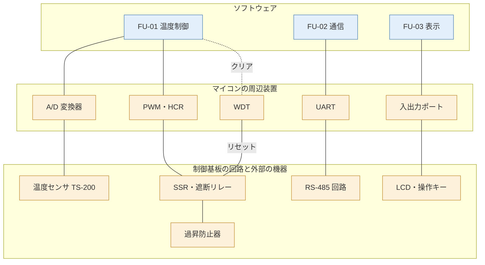
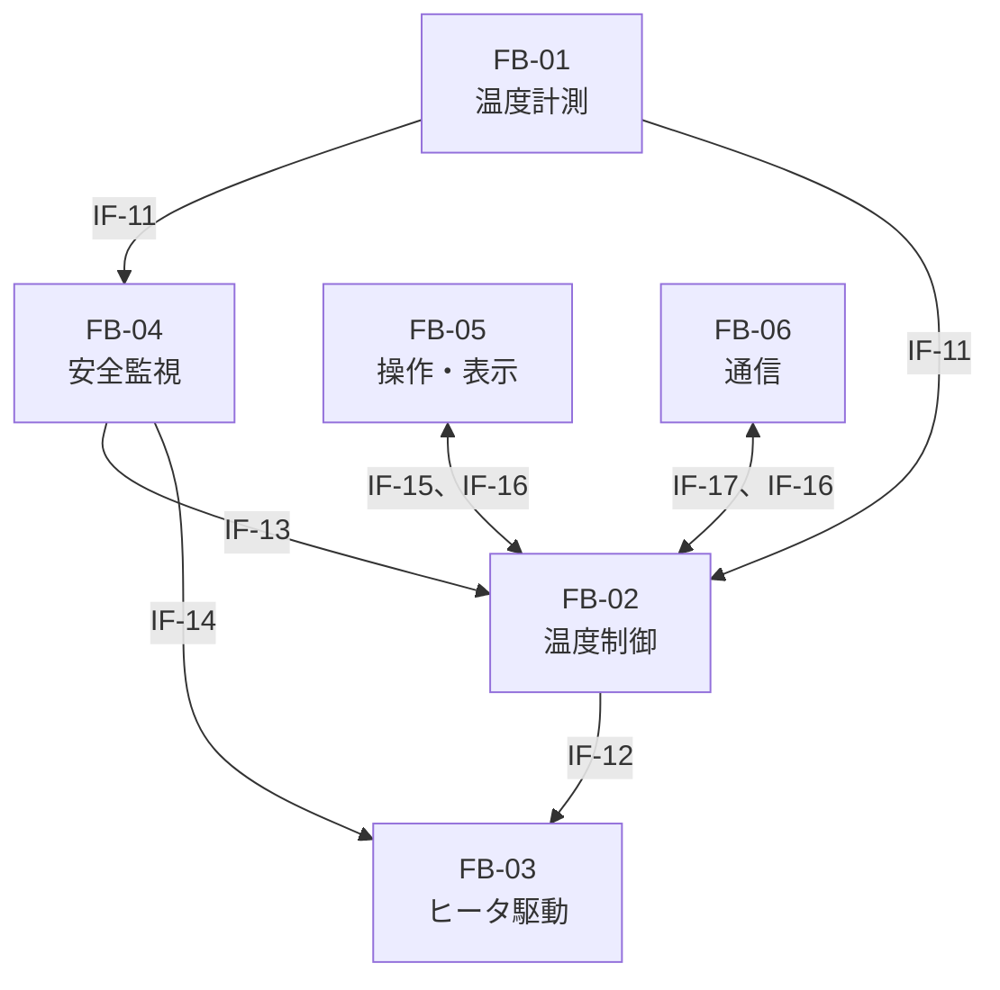
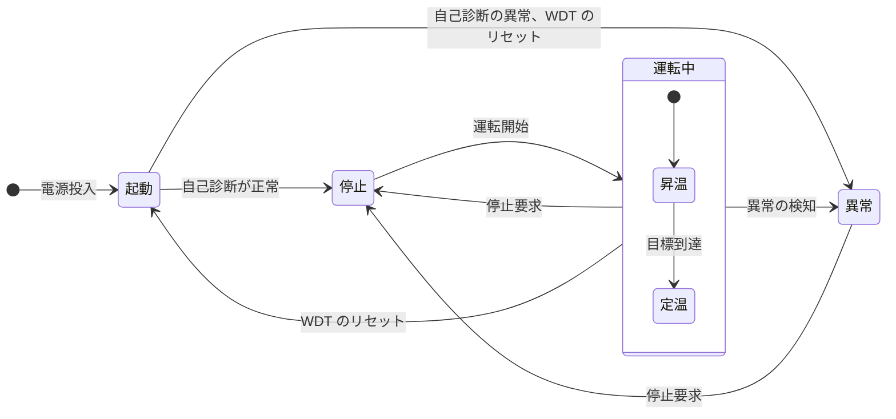
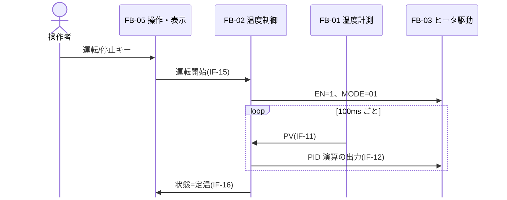
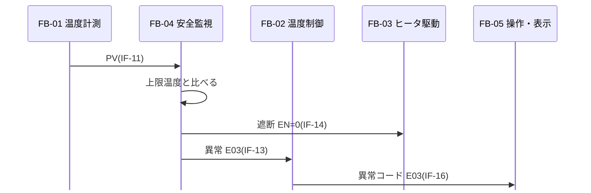

# 概要

## 目的

本書は、恒温槽制御装置 TC-200(以下 TC-200)のシステム要求と安全要求を、どのように実現するかを定める。システムを機能ブロックに分け、ハードウェアとソフトウェアの役割分担、ブロックの間のインタフェース、制御方式を記す。

## 位置づけ

本書は、システム要求仕様書(R1)と安全要求仕様書(R2)をもとに、システム・アーキテクチャ設計(SYP2)で作成した。本書で定めたソフトウェアの役割は、ソフトウェア要求仕様書(SW105)で詳しくする。ハードウェアの役割は、ハードウェア仕様書で詳しくする。

```layers
%%| label: fig-docs
%%| fig-cap: 文書の位置づけ
SY106 システム要求仕様書 | SA104 安全要求仕様書
SY205 システム・アーキテクチャ設計書(本書)
SW105 ソフトウェア要求仕様書 | ハードウェア仕様書
SW205 ソフトウェア・アーキテクチャ設計書 | 回路図
```

## 対象ユーザ

ソフトウェアとハードウェアの設計者、システム結合テストの担当者、安全性テストの担当者。

## 記載範囲

TC-200 の本体の構成、機能ブロック、制御方式、システムで扱うデータ、例外を対象とする。個々の回路とプログラムの設計は対象外とし、ハードウェア仕様書とソフトウェア・アーキテクチャ設計書に記す。

## 参照ドキュメント

| ID | 文書名 | 文書番号 | 発行年月 | 備考 |
|---|---|---|---|---|
| R1 | システム要求仕様書 | TC-SY106-001 | 2026/06 | |
| R2 | 安全要求仕様書 | TC-SA104-001 | 2026/07 | |
| R3 | 恒温槽 TC-100 通信仕様書 | TC1-IF-002 | 2021/09 | 既存の製品 |
| R4 | 温度センサ TS-200 データシート | TS200-DS-03 | 2024/04 | 社外の文書 |

: 参照ドキュメント {#tbl-refs}

## 定義(用語、略語)

| ID | 用語・略号 | 正式表記 | 意味 |
|---|---|---|---|
| D1 | FB | Function Block | 機能ブロック。システムを機能で分けた単位 |
| D2 | FU | Function Unit | 機能ユニット。ソフトウェアを機能で分けた単位(SW105 で定める) |
| D3 | PV、SV | Process Value、Set Value | 測った槽内の温度、目標の温度 |
| D4 | HCR | Heater Control Register | ヒータ制御レジスタ |
| D5 | WDT | Watchdog Timer | ソフトウェアの停止を見つけるタイマ |
| D6 | HAL | Hardware Abstraction Layer | ハードウェアの違いを隠すソフトウェアの層 |

: 定義(用語、略語) {#tbl-terms}

# システム構成

## システム全体構成

TC-200 の構成と、ハードウェアとソフトウェアの役割分担を @fig-system に示す。青がソフトウェア、黄がハードウェアである。温度の計測、ヒータの駆動、過昇の防止はハードウェアが、温度の制御、異常の判定、表示と通信の手順はソフトウェアが受け持つ。過昇防止器と WDT は、ソフトウェアが働かなくてもヒータを止められるように、ハードウェアだけで動かす。



ハードウェアの仕様を @tbl-hw に、割り込みを @tbl-irq に示す。

| 項目 | 仕様 |
|---|---|
| マイコン | 32 ビット、80MHz。ROM 256KB(フラッシュ)、RAM 64KB |
| A/D 変換器 | 12 ビット。温度センサに 1 チャネルを使う |
| タイマ | PWM 出力 1 チャネル、周期タイマ 1 チャネル、WDT(1 秒、専用の発振器で動く) |
| 通信 | UART 1 チャネル。RS-485 のトランシーバにつなぐ |
| 表示と操作 | LCD(16 文字 × 2 行、4 ビットのパラレル接続)、キー 4 個(ポート入力) |
| OS | TOPPERS/ASP カーネル 1.9.3 |

: ハードウェアの仕様 {#tbl-hw}

| 割り込み | 要因 | 優先度 | 処理 |
|---|---|:-:|---|
| INT-1 | 周期タイマ(1ms) | 1 | OS の時間の管理 |
| INT-2 | A/D 変換の完了 | 2 | 温度の値を取り込む |
| INT-3 | UART の受信 | 3 | 1 文字を受信のバッファに入れる |
| INT-4 | UART の送信の完了 | 3 | 次の 1 文字を送る |
| — | WDT の時間切れ | — | 割り込みにせず、ハードウェアでリセットし、遮断リレーを切る |

: 割り込み {#tbl-irq}

ソフトウェアは @fig-sw-layers の層で作る。ハードウェアに依存する処理は HAL に集め、後継機のマイコンに移せるようにする(SYR-132)。

```layers
%%| label: fig-sw-layers
%%| fig-cap: ソフトウェアの層
FU-01 温度制御 | FU-02 通信 | FU-03 表示
HAL(A/D、PWM、UART、LCD、キー、WDT)
TOPPERS/ASP カーネル
マイコン
```

# 機能ブロック概要

## システムを構成する機能ブロック

| 機能ブロック ID | 機能ブロック名 | 機能概要 | 役割分担 | 関連機能 ID |
|---|---|---|---|---|
| FB-01 | 温度計測 | 温度センサの電圧を A/D 変換し、温度に換算する。断線と短絡を判定する | HW: センサ、A/D 変換器<br>SW: 換算、判定 | F-02 |
| FB-02 | 温度制御 | PID 演算でヒータの出力を決め、運転の状態を管理する | SW | F-01、F-03 |
| FB-03 | ヒータ駆動 | PWM で SSR を入り切りする。遮断リレーでヒータの電源を切る | HW(SW は HCR に書く) | F-01 |
| FB-04 | 安全監視 | 上限温度、ヒータの出力の固着、ソフトウェアの暴走を見つけて、ヒータを止める | HW: WDT、過昇防止器<br>SW: 判定 | F-02 |
| FB-05 | 操作・表示 | キーの操作を読み、LCD に温度と状態を出す | HW: LCD、キー<br>SW: 表示の手順 | F-03、F-04 |
| FB-06 | 通信 | 上位機器と保守ツールのコマンドを受けて、応答する | HW: RS-485<br>SW: 手順 | F-05、F-06 |
| FB-07 | 起動 | 電源の投入時に初期化と自己診断をする | SW | — |

: 機能ブロック {#tbl-fb .small tbl-colwidths="[12,13,41,21,13]"}

関連機能 ID は、システム要求仕様書(R1)の 3 章の機能である。機能ブロックとソフトウェアの機能ユニットの対応は、FB-01、FB-02、FB-04、FB-07 が FU-01 温度制御、FB-06 が FU-02 通信、FB-05 が FU-03 表示である。

## 機能ブロック間のインタフェース

機能ブロックの間で受け渡す制御とデータを @fig-fb-if と @tbl-fb-if に示す。



| IF ID | 送り元 | 送り先 | 内容 | 方式 |
|---|---|---|---|---|
| IF-11 | FB-01 | FB-02、FB-04 | 槽内温度(PV)、センサの状態 | 共通領域。100ms ごとに更新する |
| IF-12 | FB-02 | FB-03 | ヒータの出力(0〜15) | HCR に書く |
| IF-13 | FB-04 | FB-02 | 異常のイベント(異常コード) | OS のイベントフラグ |
| IF-14 | FB-04 | FB-03 | 遮断 | HCR の EN を 0 にする。WDT はハードウェアで直接切る |
| IF-15 | FB-05 | FB-02 | キーの操作(運転、停止、目標値) | OS のデータキュー |
| IF-16 | FB-02 | FB-05、FB-06 | 運転の状態、PV、SV、異常コード | 共通領域 |
| IF-17 | FB-06 | FB-02 | コマンド(運転、停止、目標値、補正値) | OS のデータキュー |

: 機能ブロック間のインタフェース {#tbl-fb-if tbl-colwidths="[9,9,15,33,34]"}

# 制御方式

ハードウェアとソフトウェアを合わせたシステム全体の状態を @fig-sys-state に示す。電源を入れると起動の状態で自己診断をし、その結果で停止か異常の状態に入る。WDT でリセットしたときも、異常の状態に入る(E05)。



| 状態 | HCR の EN(遮断リレー) | HCR の MODE | LCD | 通信のコマンド |
|---|:-:|---|---|---|
| 起動 | 0(切) | 00(停止) | 版数 | 応答しない |
| 停止 | 0(切) | 00(停止) | PV、SV | ST 以外 |
| 昇温、定温 | 1(入) | 01(PWM) | PV、SV、状態 | RN と CA 以外 |
| 異常 | 0(切) | 00(停止) | 異常コードを点滅 | RT、RV、ST |

: 状態ごとのハードウェアの設定 {#tbl-state-hw}

## 動作シーケンス

### 運転の開始から定温まで



### 上限温度を超えたとき



100ms の制御周期の中の処理の順序を @fig-timing に示す。1 区間は 10ms である。

```timing
%%| label: fig-timing
%%| fig-cap: 制御周期の中の処理の順序
周期の起動: 10........10
A/D 変換: 010.......01
温度の監視: 0010......00
PID 演算: 00010.....00
HCR の出力: x...=....... 新しい出力
```

## ユースケースと機能ブロックの対応

システム要求仕様書(R1)の 5 章のユースケースと、動く機能ブロックの対応を @tbl-uc-fb に示す。

| ユースケース | FB-01 | FB-02 | FB-03 | FB-04 | FB-05 | FB-06 | FB-07 |
|---|:-:|:-:|:-:|:-:|:-:|:-:|:-:|
| UC-01 運転を開始する | ○ | ○ | ○ | ○ | ○ | | |
| UC-02 目標値を変える | | ○ | | | ○ | ○ | |
| UC-03 運転を停止する | | ○ | ○ | | ○ | ○ | |
| UC-04 温度を監視する | ○ | | | | | ○ | |
| UC-05 異常を解除する | | ○ | | ○ | ○ | | |
| UC-06 温度を校正する | ○ | | | | | ○ | |

: ユースケースと機能ブロックの対応 {#tbl-uc-fb tbl-colwidths="[30,10,10,10,10,10,10,10]"}

## 性能見積

システム要求仕様書(R1)の非機能要求をもとに、時間とリソースを見積もった。

| 要求 | 必要な性能 | 見積り | 根拠 |
|---|---|---|---|
| SYR-006 上限超過での停止 | 1 秒以内 | 最大 0.2 秒 | 検知に 1 周期(100ms)、遮断に 100ms 以内 |
| SYR-121 制御周期 | 100ms | 処理は最大 4ms | 監視 2ms、PID 1ms、HCR の更新 1ms 未満。TC-100 の実測の 1.2 倍 |
| SYR-123 通信の応答 | 100ms 以内 | 最大 45ms | 受信 13 文字で 14ms、処理 5ms、送信 25 文字で 26ms(9,600bps) |
| SYR-111 キーの応答 | 0.2 秒以内 | 最大 0.05 秒 | キーの読み取り 30ms。キーの操作ではすぐに表示を書き換える(20ms) |
| SYR-122 起動時間 | 2 秒以内 | 1.2 秒 | 初期化 0.5 秒、ROM のチェックサム 0.6 秒、遮断リレーの確認 0.1 秒 |
| SYR-003 昇温 | 40 分以内 | 約 31 分 | 75K × 30kJ/K ÷ 1.2kW(ヒータ 1.5kW から冷却と放熱の 0.3kW を引く) |
| SYR-124 ROM と RAM | 75% 以下 | ROM 180KB(70%)<br>RAM 42KB(66%) | ROM は TC-100 の 150KB に自己診断と通信を足す。RAM はスタック 6KB、通信のバッファ 4KB を含む |

: 性能見積 {#tbl-perf tbl-colwidths="[20,15,17,48]"}

昇温の見積りを @fig-heatup に示す。

```chart
%%| label: fig-heatup
%%| fig-cap: 25℃ から 100℃ までの昇温の見積り(横軸は運転開始からの分)
type: line
unit: ℃
| 時間(分) | 槽内温度 | 目標値 |
|---|---|---|
| 0 | 25 | 100 |
| 5 | 37 | 100 |
| 10 | 49 | 100 |
| 15 | 61 | 100 |
| 20 | 73 | 100 |
| 25 | 85 | 100 |
| 30 | 97 | 100 |
| 35 | 100 | 100 |
| 40 | 100 | 100 |
```

# 機能ブロック詳細

## 温度計測(FB-01)

+---------------------------+------------------------------------------------------+
| [機能ブロック ID]{.shade} | FB-01                                                |
+---------------------------+------------------------------------------------------+
| [構成]{.shade}            | 温度センサ TS-200、入力回路、A/D 変換器(HW)\         |
|                           | 温度の換算と判定(SW、FU-01)                          |
+---------------------------+------------------------------------------------------+
| [入力]{.shade}            | センサの電圧 0〜3.3V                                 |
+---------------------------+------------------------------------------------------+
| [出力]{.shade}            | 槽内温度 PV(D-01)、センサの状態(D-05)                |
+---------------------------+------------------------------------------------------+
| [処理方式]{.shade}                                                               |
+----------------------------------------------------------------------------------+
| 1. 100ms ごとに A/D 変換を始め、完了の割り込みで値を読む                         |
| 2. 換算式で温度に直し、補正値(D-07)を足す                                        |
| 3. 直近 8 回の移動平均を PV とする                                               |
| 4. A/D の値が範囲の端(断線と短絡のときの値)に張り付いたら、センサの異常とする    |
+---------------------------+------------------------------------------------------+
| [共通領域]{.shade}        | 温度情報域(8.1)                                      |
+---------------------------+------------------------------------------------------+
| [関連する要求]{.shade}    | SYR-005、SYR-007、SAR-002                            |
+---------------------------+------------------------------------------------------+

: FB-01 の詳細 {#tbl-fb01}

## 温度制御(FB-02)

+---------------------------+------------------------------------------------------+
| [機能ブロック ID]{.shade} | FB-02                                                |
+---------------------------+------------------------------------------------------+
| [構成]{.shade}            | ソフトウェア(FU-01)                                  |
+---------------------------+------------------------------------------------------+
| [入力]{.shade}            | PV(IF-11)、操作とコマンド(IF-15、IF-17)、異常(IF-13) |
+---------------------------+------------------------------------------------------+
| [出力]{.shade}            | ヒータの出力(IF-12)、運転の状態(IF-16)               |
+---------------------------+------------------------------------------------------+
| [処理方式]{.shade}                                                               |
+----------------------------------------------------------------------------------+
| 1. 運転の状態を管理する(@fig-sys-state)                                          |
| 2. 昇温では出力を 15(最大)にし、目標値の 2.0℃ 手前から PID 演算に切り替える     |
| 3. 定温では 100ms ごとに PID 演算で出力(0〜15)を決める                           |
| 4. 目標値の変更は範囲(-20.0〜130.0℃)を確かめてから受け付ける                    |
+---------------------------+------------------------------------------------------+
| [共通領域]{.shade}        | 設定情報域、状態情報域(8.1)                          |
+---------------------------+------------------------------------------------------+
| [関連する要求]{.shade}    | SYR-001〜SYR-004、SYR-009〜SYR-012                   |
+---------------------------+------------------------------------------------------+

: FB-02 の詳細 {#tbl-fb02}

## ヒータ駆動(FB-03)

+---------------------------+-----------------------------------------------------------+
| [機能ブロック ID]{.shade} | FB-03                                                     |
+---------------------------+-----------------------------------------------------------+
| [構成]{.shade}            | PWM、SSR、遮断リレー(HW)                                  |
+---------------------------+-----------------------------------------------------------+
| [入力]{.shade}            | HCR(@fig-hcr)                                             |
+---------------------------+-----------------------------------------------------------+
| [出力]{.shade}            | ヒータの電力                                              |
+---------------------------+-----------------------------------------------------------+
| [処理方式]{.shade}                                                                    |
+---------------------------------------------------------------------------------------+
| - PWM の周期は 1 秒。出力 n のとき、1 秒のうち n/15 の時間だけ SSR を入れる           |
| - EN が 0 のときは遮断リレーを切る。WDT の時間切れでは、ハードウェアが EN を 0 にする |
| - 遮断リレーの接点の状態を読み返し、EN と合わなければ ERR を 1 にする                 |
+---------------------------+-----------------------------------------------------------+
| [関連する要求]{.shade}    | SAR-003、SAR-004                                          |
+---------------------------+-----------------------------------------------------------+

: FB-03 の詳細 {#tbl-fb03}

```bits
%%| label: fig-hcr
%%| fig-cap: ヒータ制御レジスタ(HCR)
width: 8
msb: true
7-7: EN
6-6: ERR
5-4: MODE
3-0: DUTY
```

EN: 遮断リレー(1 で入) ERR: 遮断リレーの異常(読み出しのみ) MODE: 00 停止、01 PWM、10 全出力(試験用)、11 予約 DUTY: 出力 0〜15

## 安全監視(FB-04)

+---------------------------+---------------------------------------------------------------+
| [機能ブロック ID]{.shade} | FB-04                                                         |
+---------------------------+---------------------------------------------------------------+
| [構成]{.shade}            | WDT、過昇防止器(HW)\                                          |
|                           | 上限温度と固着の判定(SW、FU-01)                               |
+---------------------------+---------------------------------------------------------------+
| [入力]{.shade}            | PV(IF-11)、ヒータの出力、HCR の ERR                           |
+---------------------------+---------------------------------------------------------------+
| [出力]{.shade}            | 遮断(IF-14)、異常のイベント(IF-13)                            |
+---------------------------+---------------------------------------------------------------+
| [処理方式]{.shade}                                                                        |
+-------------------------------------------------------------------------------------------+
| 1. PV が上限温度(D-03)を超えたら、遮断して E03 を出す                                     |
| 2. 出力 0 で 30 秒のうちに 2.0℃ 以上上がったら、遮断して E04 を出す                      |
| 3. 100ms の周期の最後で WDT をクリアする。1 秒クリアしないとハードウェアがリセットする    |
| 4. 過昇防止器(145℃)はソフトウェアと関係なく、ヒータの電源を切る                          |
+---------------------------+---------------------------------------------------------------+
| [関連する要求]{.shade}    | SYR-006、SYR-008、SYR-101、SAR-001、SAR-003、SAR-004、SAR-009 |
+---------------------------+---------------------------------------------------------------+

: FB-04 の詳細 {#tbl-fb04}

## 操作・表示(FB-05)

+---------------------------+------------------------------------------------------+
| [機能ブロック ID]{.shade} | FB-05                                                |
+---------------------------+------------------------------------------------------+
| [構成]{.shade}            | LCD、キー(HW)、表示の手順(SW、FU-03)                 |
+---------------------------+------------------------------------------------------+
| [入力]{.shade}            | キーの状態、運転の状態と PV、SV(IF-16)               |
+---------------------------+------------------------------------------------------+
| [出力]{.shade}            | キーの操作(IF-15)、LCD の表示                        |
+---------------------------+------------------------------------------------------+
| [処理方式]{.shade}                                                               |
+----------------------------------------------------------------------------------+
| 1. 10ms ごとにキーを読み、3 回同じならキーの操作とする                           |
| 2. 表示は 500ms ごとに書き換える。キーの操作のときはすぐに書き換える             |
| 3. 異常の状態では、2 行目に異常コードを 0.5 秒ごとに点滅させる                   |
+---------------------------+------------------------------------------------------+
| [関連する要求]{.shade}    | SYR-009、SYR-010、SYR-013、SYR-014、SYR-111          |
+---------------------------+------------------------------------------------------+

: FB-05 の詳細 {#tbl-fb05}

## 通信(FB-06)

+---------------------------+------------------------------------------------------------+
| [機能ブロック ID]{.shade} | FB-06                                                      |
+---------------------------+------------------------------------------------------------+
| [構成]{.shade}            | UART、RS-485 のトランシーバ(HW)、通信の手順(SW、FU-02)     |
+---------------------------+------------------------------------------------------------+
| [入力]{.shade}            | 上位機器と保守ツールのコマンド                             |
+---------------------------+------------------------------------------------------------+
| [出力]{.shade}            | コマンド(IF-17)、応答                                      |
+---------------------------+------------------------------------------------------------+
| [処理方式]{.shade}                                                                     |
+----------------------------------------------------------------------------------------+
| 1. STX から ETX までを 1 つのフレームとして受ける(TC-100 と互換)                       |
| 2. 局番、形式、チェックサムを確かめる。誤りは E06 のエラー応答を返す                   |
| 3. 状態ごとに受け付けるコマンドを判定し(R1 の 8.1)、受け付けないものはエラー応答を返す |
+---------------------------+------------------------------------------------------------+
| [関連する要求]{.shade}    | SYR-015〜SYR-017、SYR-141、SYR-142、SAR-007                |
+---------------------------+------------------------------------------------------------+

: FB-06 の詳細 {#tbl-fb06}

## 起動(FB-07)

電源を入れると、クロック、周辺装置、OS の順に初期化し(0.5 秒)、ROM のチェックサム、RAM の読み書き、遮断リレーの入り切りを確かめる。異常がなければ停止の状態に、異常があれば E07 を出して異常の状態に入る(SYR-102、SAR-008)。目標値は 25.0℃ から始める(SYR-011)。

# システムで扱うデータ

| データ ID | データ名 | 概要 | 関連機能ブロック ID |
|---|---|---|---|
| D-01 | 槽内温度(PV) | -20.0〜150.0℃、0.1℃ 単位の符号付き 16 ビット。100ms ごとに更新する | FB-01(更新)、FB-02、FB-04、FB-05、FB-06 |
| D-02 | 目標値(SV) | -20.0〜130.0℃、0.1℃ 単位の符号付き 16 ビット。初期値は 25.0℃ | FB-02(更新)、FB-05、FB-06 |
| D-03 | 上限温度 | SV + 5.0℃ と 130.0℃ の低い方。SV を変えるたびに求める | FB-02(更新)、FB-04 |
| D-04 | 運転の状態 | 0: 停止、1: 昇温、2: 定温、9: 異常 | FB-02(更新)、FB-05、FB-06 |
| D-05 | 異常コード | E01〜E07(7 章) | FB-01、FB-04(更新)、FB-05、FB-06 |
| D-06 | ヒータの出力 | 0〜15 | FB-02(更新)、FB-03 |
| D-07 | 補正値 | -5.0〜+5.0℃、0.1℃ 単位 | FB-06(更新)、FB-01 |

: システムで扱うデータ {#tbl-data}

温度の測定範囲は -20.0〜150.0℃ とし、A/D 変換器の 0〜4,095 に当てる。上限温度(最大 130.0℃)を超えたことを見つけられるよう、上限温度より広くとり、過昇防止器の 145℃ も含める。温度センサ TS-200 の精度は ±0.3℃ である(R4)。A/D 変換器の分解能は 170℃ ÷ 4,095 ≒ 0.04℃ で、0.1℃ 単位の表示に足りる。

# 例外一覧

| 例外コード | 例外内容 | 対処方法 | 備考 |
|---|---|---|---|
| E01 | 温度センサの断線 | ヒータを止め、異常の状態に入る。センサと配線を点検する | SAR-002 |
| E02 | 温度センサの短絡 | E01 と同じ | SAR-002 |
| E03 | 上限温度の超過 | ヒータを止め、異常の状態に入る。目標値と試料を確かめる | SAR-001 |
| E04 | ヒータの出力の固着 | 遮断リレーを切り、異常の状態に入る。SSR を交換する | SAR-003 |
| E05 | WDT によるリセット | 異常の状態で再起動する。繰り返すときは修理を依頼する | SAR-004 |
| E06 | 通信の誤り | エラー応答を返し、状態は変えない | SAR-007。LCD には出さない |
| E07 | 起動時の自己診断の異常 | 異常の状態で起動する。修理を依頼する | SAR-008 |

: 例外一覧 {#tbl-exceptions}

# その他

## 共通制御情報領域

機能ブロックが共有する情報域を @tbl-common に示す。書き込むブロックを 1 つに限り、読むブロックは割り込みを禁止して一度に読む。

| 名称 | 構成 | 形式 | サイズ | 初期値 | アクセスの制限 |
|---|---|---|--:|---|---|
| 温度情報域 | PV、センサの状態 | int16、uint8 | 3 バイト | 0、正常 | FB-01 だけが書く |
| 設定情報域 | SV、上限温度、補正値 | int16 × 3 | 6 バイト | 25.0℃、30.0℃、0.0℃ | FB-02 だけが書く。FB-05、FB-06 はキューで変更を頼む |
| 状態情報域 | 運転の状態、異常コード | uint8 × 2 | 2 バイト | 停止、なし | FB-02 だけが書く |

: 共通制御情報領域 {#tbl-common tbl-colwidths="[14,17,14,11,15,29]"}

::: {.landscape}

## 要求と機能ブロックの対応

<table>
<tr><th rowspan="2">要求 ID</th><th rowspan="2">要求の概要</th><th colspan="7">機能ブロック</th><th colspan="2">下位の文書</th></tr>
<tr><th>FB-01</th><th>FB-02</th><th>FB-03</th><th>FB-04</th><th>FB-05</th><th>FB-06</th><th>FB-07</th><th>SW105</th><th>ハードウェア</th></tr>
<tr><td>SYR-001</td><td>目標値の範囲</td><td></td><td>○</td><td></td><td></td><td>○</td><td>○</td><td></td><td>FU-01〜03</td><td></td></tr>
<tr><td>SYR-002〜004</td><td>温度の制御</td><td>○</td><td>○</td><td>○</td><td></td><td></td><td></td><td></td><td>FU-01</td><td>ヒータ駆動回路</td></tr>
<tr><td>SYR-005</td><td>計測の周期</td><td>○</td><td></td><td></td><td></td><td></td><td></td><td></td><td>FU-01</td><td>入力回路</td></tr>
<tr><td>SYR-006〜008</td><td>異常での停止</td><td>○</td><td></td><td>○</td><td>○</td><td></td><td></td><td></td><td>FU-01</td><td>遮断リレー</td></tr>
<tr><td>SYR-009、010</td><td>キーの操作</td><td></td><td>○</td><td></td><td></td><td>○</td><td></td><td></td><td>FU-01、FU-03</td><td>操作パネル</td></tr>
<tr><td>SYR-011、012</td><td>起動と異常の保持</td><td></td><td>○</td><td></td><td></td><td></td><td></td><td>○</td><td>FU-01</td><td></td></tr>
<tr><td>SYR-013、014</td><td>LCD の表示</td><td></td><td></td><td></td><td></td><td>○</td><td></td><td></td><td>FU-03</td><td>操作パネル</td></tr>
<tr><td>SYR-015〜017</td><td>通信</td><td></td><td>○</td><td></td><td></td><td></td><td>○</td><td></td><td>FU-02</td><td>通信回路</td></tr>
<tr><td>SYR-018</td><td>補正値</td><td>○</td><td></td><td></td><td></td><td></td><td>○</td><td></td><td>FU-01、FU-02</td><td></td></tr>
<tr><td>SYR-101</td><td>暴走の検知</td><td></td><td></td><td>○</td><td>○</td><td></td><td></td><td></td><td>FU-01</td><td>マイコン</td></tr>
<tr><td>SYR-102</td><td>自己診断</td><td></td><td></td><td></td><td></td><td></td><td></td><td>○</td><td>FU-01</td><td>遮断リレー</td></tr>
<tr><td>SYR-111、121〜123</td><td>応答と周期</td><td>○</td><td>○</td><td></td><td></td><td>○</td><td>○</td><td></td><td>FU-01〜03</td><td></td></tr>
<tr><td>SYR-124、131、132</td><td>リソースと保守</td><td></td><td></td><td></td><td></td><td></td><td></td><td>○</td><td>全体</td><td></td></tr>
<tr><td>SYR-141、142</td><td>コマンドの検査</td><td></td><td></td><td></td><td></td><td></td><td>○</td><td></td><td>FU-02</td><td></td></tr>
<tr><td>SAR-001〜004</td><td>停止と遮断</td><td>○</td><td></td><td>○</td><td>○</td><td></td><td></td><td></td><td>FU-01</td><td>遮断リレー</td></tr>
<tr><td>SAR-005〜008</td><td>起動と拒否など</td><td></td><td>○</td><td></td><td></td><td></td><td>○</td><td>○</td><td>FU-01、FU-02</td><td></td></tr>
<tr><td>SAR-009</td><td>過昇防止器</td><td></td><td></td><td></td><td>○</td><td></td><td></td><td></td><td>—</td><td>過昇防止器</td></tr>
<tr><td>SAR-010</td><td>異常の通知</td><td></td><td></td><td></td><td></td><td>○</td><td>○</td><td></td><td>FU-02、FU-03</td><td></td></tr>
<tr><td>SAR-011</td><td>定期の点検</td><td></td><td></td><td></td><td></td><td></td><td></td><td></td><td>—</td><td>取扱説明書</td></tr>
</table>

: 要求と機能ブロックの対応 {#tbl-trace .small tbl-colwidths="[14,13,6,6,6,6,6,6,6,13,18]"}


:::
