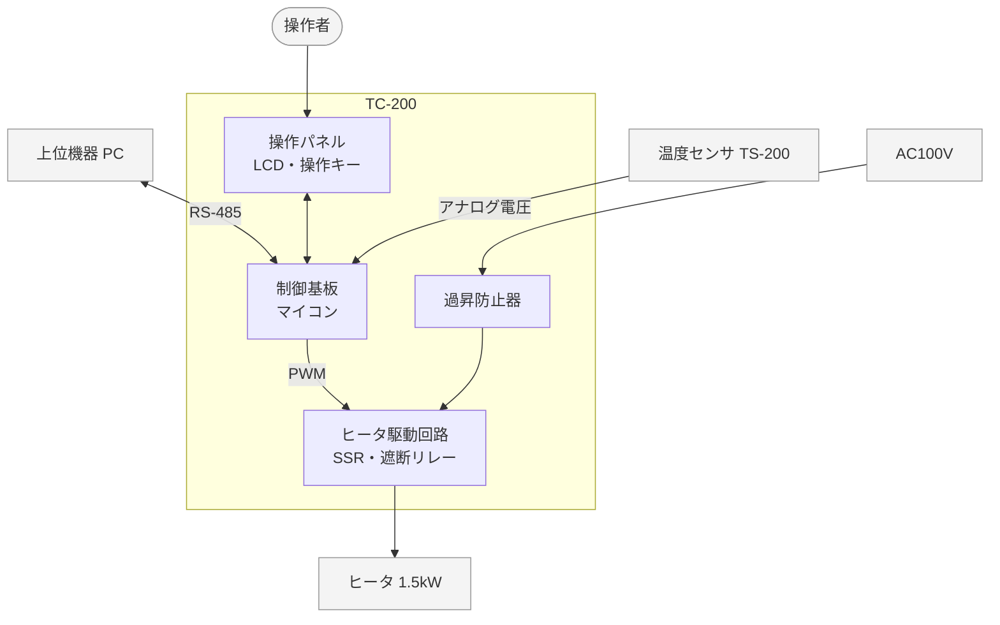
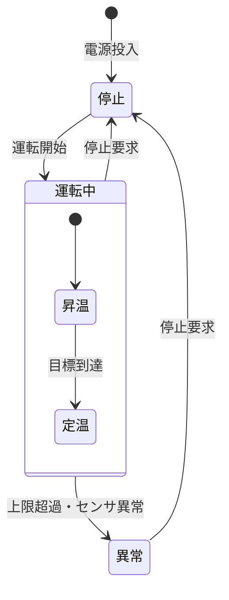

# 概要

## 目的

本書は、恒温槽制御装置 TC-200(以下 TC-200)について、システムとして実現する機能の要求、非機能の要求、制約条件を定める。システム・アーキテクチャ設計と安全性要求定義の入力とする。

## 位置づけ

本書は、製品企画書と製品仕様書をもとに、システム要求定義(SYP1)で作成した。本書の要求は、システム・アーキテクチャ設計書(SY205)でハードウェアとソフトウェアに割り当てる。安全に関する要求は、安全要求仕様書(SA104)と対応を取る。

```layers
%%| label: fig-docs
%%| fig-cap: 文書の位置づけ
製品企画書 | 製品仕様書
SY106 システム要求仕様書(本書) *2 | SA104 安全要求仕様書
SY205 システム・アーキテクチャ設計書
SW105 ソフトウェア要求仕様書 | ハードウェア仕様書
```

## 対象ユーザ

システムの設計者、ソフトウェアとハードウェアの設計者、システムテストと安全性テストの担当者、製品企画の担当者。

## 記載範囲

TC-200 の本体(制御基板、温度センサ、ヒータ駆動回路、操作パネル、過昇防止器)と、上位機器との通信を対象とする。槽の本体、冷却ユニット、上位機器のアプリケーションは対象外とし、前提の条件としてだけ記す。

## 参照ドキュメント

| ID | 文書名 | 文書番号 | 発行年月 | 備考 |
|---|---|---|---|---|
| R1 | 製品企画書 恒温槽 TC-200 | TC-PL-001 | 2026/03 | |
| R2 | 製品仕様書 恒温槽 TC-200 | TC-PS-001 | 2026/04 | 要求の出典 |
| R3 | 恒温槽 TC-100 通信仕様書 | TC1-IF-002 | 2021/09 | 既存の製品 |
| R4 | 安全要求仕様書 | TC-SA104-001 | 2026/06 | |
| R5 | 温度センサ TS-200 データシート | TS200-DS-03 | 2024/04 | 社外の文書 |

: 参照ドキュメント {#tbl-refs}

## 定義(用語、略語)

| ID | 用語・略号 | 正式表記 | 意味 |
|---|---|---|---|
| D1 | PV | Process Value | 測った槽内の温度 |
| D2 | SV | Set Value | 目標の温度(目標値) |
| D3 | 上限温度 | — | これを超えるとヒータを止める温度。目標値 + 5.0℃ と 130.0℃ の低い方 |
| D4 | 上位機器 | — | TC-200 を RS-485 で監視し、操作する PC |
| D5 | 保守ツール | — | 保守員が PC で使う校正のためのアプリケーション |
| D6 | SSR | Solid State Relay | ヒータの電力を入り切りする半導体のリレー |
| D7 | 過昇防止器 | — | ソフトウェアと独立に、槽の過熱でヒータの電源を切る温度スイッチ |

: 定義(用語、略語) {#tbl-terms}

# システム構成

## システム全体構成

TC-200 は、槽に取り付けて使う。温度センサで槽内の温度を測り、ヒータの電力を加減して目標値に保つ。槽には既存品の冷却ユニットが付いており、電源を入れると連続して運転する。TC-200 は冷却を制御せず、冷却とヒータの釣り合いで温度を合わせる。このため、室温より低い目標値でも温度を保てる。



灰色の要素は TC-200 の外にある。

## システムを構成する主たる要素

| 構成要素 ID | 構成要素 | 概要 |
|---|---|---|
| E-01 | 制御基板 | マイコン(ROM 256KB、RAM 64KB)を載せ、温度の計測、ヒータの制御、表示、通信を行う |
| E-02 | 温度センサ TS-200 | 槽内の温度を測る。制御基板の A/D 変換器(12 ビット)で読む |
| E-03 | ヒータ駆動回路 | マイコンの PWM 出力で SSR を入り切りし、ヒータの電力を加減する。遮断リレーでヒータの電源を切る |
| E-04 | 操作パネル | LCD(16 文字 × 2 行)と操作キー 4 個 |
| E-05 | 通信回路 | 上位機器と RS-485 でつなぐ |
| E-06 | 過昇防止器 | 槽が 145℃ を超えるとヒータの電源を切る。手動で復帰する |
| E-07 | ヒータ | 槽内を加熱する(1.5kW)。槽に付属する |
| E-08 | 冷却ユニット CU-10 | 槽を冷やす既存品。槽に付属し、TC-200 からは制御しない |

: システムを構成する主たる要素 {#tbl-elements}

# 機能概要

TC-200 がシステムとして実現する機能を @tbl-functions に示す。詳細は 6 章に記す。

| 機能 ID | 機能 | 概要 |
|---|---|---|
| F-01 | 温度制御 | 槽内の温度を目標値に保つ。ヒータの出力を PID 演算で決める |
| F-02 | 温度監視 | 槽内の温度を 100ms ごとに測る。上限温度の超過とセンサの異常を見つけて、ヒータを止める |
| F-03 | 運転操作 | 操作キーで、運転の開始と停止、目標値の設定を行う |
| F-04 | 表示 | 槽内温度、目標値、運転の状態、異常の内容を LCD に出す |
| F-05 | 通信 | 上位機器からの、温度の読み出し、目標値の変更、運転の開始と停止に応える |
| F-06 | 校正 | 保守員が保守ツールから温度の補正値を設定する |

: システムの機能 {#tbl-functions}

運転の状態は、停止、昇温、定温、異常の 4 つである。状態の移り方は 6.1 に示す。

# 制約条件

## ハードウェアなどを含めたシステム全体の構成と制約

| 区分 | 制約 |
|---|---|
| 開発期間 | 2026 年 5 月から 2027 年 2 月まで。2027 年 4 月に出荷を始める |
| 開発コスト | ソフトウェアの開発は 18 人月以内 |
| 製品の寿命 | 10 年。1 日 24 時間の連続運転を想定する |
| 動作環境 | 屋内。周囲温度 5〜35℃、湿度 85%RH 以下(結露しないこと) |
| 電源 | AC100V ±10%、50/60Hz |
| 期待される品質 | 安全性を最も優先する。安全の要求は安全要求仕様書(R4)に定める |
| 既存製品との継続性 | 上位機器とのコマンドは TC-100 と互換にする(R3) |
| 既存システムの再利用 | TC-100 の温度の換算と PID 演算の方法を流用する |
| 準拠する規格 | IEC 61010-1(安全の一般要求)、IEC 61010-2-010(材料の加熱用機器)、IEC 61326-1(EMC) |
| 環境 | RoHS 指令に適合した部品を使う |
| 知的財産 | PID の自動調整(オートチューニング)は他社の特許に触れるおそれがあるため、今回は入れない |

: システム全体の制約 {#tbl-constraints}

```schedule
%%| label: fig-schedule
%%| fig-cap: 開発の日程
システム
システム要求定義: 2026-05-01 ~ 2026-06-30
システム・アーキテクチャ設計: 2026-07-01 ~ 2026-08-15
ソフトウェア
ソフトウェア開発: 2026-08-16 ~ 2026-12-25
評価
システムテスト・安全性テスト: 2027-01-05 ~ 2027-02-26
◆ 出荷判定: 2027-02-26 ~ 2027-02-26
```

## 周辺システム、利用するハードウェアおよびソフトウェア

| 種類 | 名称 | バージョン |
|---|---|---|
| 利用する OS | TOPPERS/ASP カーネル | 1.9.3 |
| 利用するミドルウェア | なし | — |
| マイコン | 32 ビットマイコン MX-32(社内標準品) | — |
| 温度センサ | TS-200 | データシート第 3 版 |
| 上位機器の OS | Windows 11 | 23H2 以降 |
| 保守ツール | TC-Tool | 2.0 |
| 冷却ユニット | CU-10 | — |

: 周辺システムと利用するハードウェア、ソフトウェア {#tbl-platform}

# ユースケースとユースケース・シナリオ

TC-200 を使う人と機器を、操作者、上位機器、保守員の 3 つとする。

```usecase
%%| label: fig-usecase
%%| fig-cap: ユースケース図
system: TC-200
操作者: 異常を解除する, 運転を開始する, 目標値を変える, 運転を停止する
上位機器: 運転を開始する, 目標値を変える, 運転を停止する, 温度を監視する
保守員: 温度を校正する
```

| ユースケース ID | ユースケース名 | 概要 |
|---|---|---|
| UC-01 | 運転を開始する | 操作者か上位機器が運転を始める。槽は目標値まで昇温し、定温に入る |
| UC-02 | 目標値を変える | 操作者がキーで、または上位機器がコマンドで目標値を変える |
| UC-03 | 運転を停止する | 操作者か上位機器が運転を止める。ヒータを切る |
| UC-04 | 温度を監視する | 上位機器が 1 秒ごとに温度と運転の状態を読む |
| UC-05 | 異常を解除する | 異常で止まった装置を、原因を取り除いてから停止の状態に戻す |
| UC-06 | 温度を校正する | 保守員が基準の温度計と比べて、補正値を設定する |

: ユースケース一覧 {#tbl-usecases}

## 運転を開始する(UC-01)

+---------------------------+-------------------------------------------------------------+
| [ユースケース ID]{.shade} | UC-01                                                       |
+---------------------------+-------------------------------------------------------------+
| [アクター]{.shade}        | 操作者                                                      |
+---------------------------+-------------------------------------------------------------+
| [事前条件]{.shade}        | 停止の状態である                                            |
+---------------------------+-------------------------------------------------------------+
| [基本シナリオ]{.shade}                                                                  |
+-----------------------------------------------------------------------------------------+
| 1. 操作者が「設定」キーを押し、「▲」「▼」キーで目標値を合わせ、「設定」キーで確定する |
| 2. システムは目標値を LCD の 2 行目に出す                                               |
| 3. 操作者が「運転/停止」キーを押す                                                      |
| 4. システムは昇温の状態に入り、ヒータの制御を始める                                     |
| 5. 槽内温度が目標値の ±0.5℃ に入ったら、システムは定温の状態に入る                    |
+-----------------------------------------------------------------------------------------+
| [代替シナリオ]{.shade}                                                                  |
+-----------------------------------------------------------------------------------------+
| - 4 で槽内温度が上限温度を超えたら、ヒータを止めて異常の状態に入る(UC-05)               |
| - 1 で目標値が範囲外になる操作は受け付けない                                            |
+---------------------------+-------------------------------------------------------------+
| [事後条件]{.shade}        | 定温の状態で、槽内温度が目標値の ±0.5℃ に保たれる         |
+---------------------------+-------------------------------------------------------------+
| [関連する要求]{.shade}    | SYR-001、SYR-002、SYR-004、SYR-009、SYR-010                 |
+---------------------------+-------------------------------------------------------------+

: UC-01 のシナリオ {#tbl-uc01}

## 異常を解除する(UC-05)

+---------------------------+------------------------------------------------------+
| [ユースケース ID]{.shade} | UC-05                                                |
+---------------------------+------------------------------------------------------+
| [アクター]{.shade}        | 操作者                                               |
+---------------------------+------------------------------------------------------+
| [事前条件]{.shade}        | 異常の状態である。ヒータは止まっている               |
+---------------------------+------------------------------------------------------+
| [基本シナリオ]{.shade}                                                           |
+----------------------------------------------------------------------------------+
| 1. システムは LCD の 2 行目に異常コードを点滅させる                              |
| 2. 操作者は取扱説明書で異常コードを調べ、原因を取り除く                          |
| 3. 操作者が「運転/停止」キーを押す                                               |
| 4. システムは停止の状態に戻り、異常コードを消す                                  |
+----------------------------------------------------------------------------------+
| [代替シナリオ]{.shade}                                                           |
+----------------------------------------------------------------------------------+
| - 4 で原因が残っているとき(センサの断線など)は、すぐに異常の状態に戻る           |
+---------------------------+------------------------------------------------------+
| [事後条件]{.shade}        | 停止の状態である。運転は自動では再開しない           |
+---------------------------+------------------------------------------------------+
| [関連する要求]{.shade}    | SYR-006、SYR-007、SYR-012、SYR-014                   |
+---------------------------+------------------------------------------------------+

: UC-05 のシナリオ {#tbl-uc05}

# 機能詳細

5 章のユースケースを実現する機能を、機能ごとに記す。要求には ID を付け、優先度(高、中、低)と出典を記す。出典の R2 は製品仕様書の項、SAR は安全要求仕様書の要求である。

## 温度制御(F-01)

| 要求 ID | 要求 | 優先度 | 出典 |
|---|---|:-:|---|
| SYR-001 | 目標値を -20.0〜130.0℃ の範囲で、0.1℃ 単位で設定できる | 高 | R2 3.1 |
| SYR-002 | 定温の状態では、槽内温度を目標値の ±0.5℃ 以内に保つ | 高 | R2 3.1 |
| SYR-003 | 空の槽を 25℃ から 100℃ まで 40 分以内に昇温する | 中 | R2 3.2 |
| SYR-004 | 槽内温度が目標値の ±0.5℃ に入ったら、昇温から定温の状態に移る | 高 | R2 3.1 |

: 温度制御の要求 {#tbl-req-f01}

運転の状態の移り方を @fig-state に示す。昇温と定温をまとめて運転中と呼ぶ。



## 温度監視(F-02)

| 要求 ID | 要求 | 優先度 | 出典 |
|---|---|:-:|---|
| SYR-005 | 槽内温度を 100ms ごとに測り、0.1℃ 単位で求める | 高 | R2 3.3 |
| SYR-006 | 槽内温度が上限温度を超えたら、1 秒以内にヒータを止め、異常の状態に入る | 高 | SAR-001 |
| SYR-007 | 温度センサの断線と短絡を見つけたら、1 秒以内にヒータを止め、異常の状態に入る | 高 | SAR-002 |
| SYR-008 | ヒータの出力を止めても温度が上がり続けるときは、ヒータの電源を切り、異常の状態に入る | 高 | SAR-003 |

: 温度監視の要求 {#tbl-req-f02}

## 運転操作(F-03)

| 要求 ID | 要求 | 優先度 | 出典 |
|---|---|:-:|---|
| SYR-009 | 「運転/停止」キーで、運転を開始し、停止できる | 高 | R2 4.1 |
| SYR-010 | 「設定」「▲」「▼」キーで目標値を設定できる | 高 | R2 4.1 |
| SYR-011 | 電源を入れたときと、停電から復帰したときは、停止の状態で起動する | 高 | SAR-005 |
| SYR-012 | 異常の状態は自動では解除せず、停止の操作でだけ停止の状態に戻す | 高 | SAR-006 |

: 運転操作の要求 {#tbl-req-f03}

## 表示(F-04)

| 要求 ID | 要求 | 優先度 | 出典 |
|---|---|:-:|---|
| SYR-013 | LCD の 1 行目に槽内温度と運転の状態を、2 行目に目標値を出す | 高 | R2 4.2 |
| SYR-014 | 異常の状態では、2 行目に異常コードを点滅させて出す | 高 | SAR-010 |

: 表示の要求 {#tbl-req-f04}

操作パネルの配置を @fig-panel に示す。

```wireframe
%%| label: fig-panel
%%| fig-cap: 操作パネル(定温の状態の表示)
# TC-200 操作パネル
"PV  100.1℃  定温"
"SV  100.0℃"
--
[運転/停止] | [設定] | [▲] | [▼]
```

## 通信(F-05)

| 要求 ID | 要求 | 優先度 | 出典 |
|---|---|:-:|---|
| SYR-015 | 上位機器から、温度と状態の読み出し、目標値の変更、運転の開始と停止ができる | 中 | R2 5.1 |
| SYR-016 | コマンドと応答の形式は TC-100 と互換にする | 中 | R3 |
| SYR-017 | 範囲外の目標値、形式の誤ったコマンド、その状態で受け付けないコマンドには、エラー応答を返し、状態を変えない | 高 | SAR-007 |

: 通信の要求 {#tbl-req-f05}

## 校正(F-06)

| 要求 ID | 要求 | 優先度 | 出典 |
|---|---|:-:|---|
| SYR-018 | 保守ツールから温度の補正値(-5.0〜+5.0℃)を設定できる | 低 | R2 6.1 |

: 校正の要求 {#tbl-req-f06}

# 性能・品質等非機能要求詳細

## 信頼性に関する要求

| 要求 ID | 要求 | 優先度 | 出典 |
|---|---|:-:|---|
| SYR-101 | ソフトウェアの停止と暴走をウォッチドッグタイマで 1 秒以内に見つけ、ヒータを止めて異常の状態で再起動する | 高 | SAR-004 |
| SYR-102 | 電源を入れたとき、ROM、RAM、遮断リレーを自己診断し、異常があれば異常の状態で起動する | 高 | SAR-008 |
| SYR-103 | 1,000 時間の連続運転で、ソフトウェアの不具合による停止がない | 中 | R1 |

: 信頼性の要求 {#tbl-req-rel}

異常の処理と、異常の状態からの復帰は次のとおりとする。

1. 異常を見つけたら、ヒータを止め、異常の状態に入る(異常コードは SY205 の例外一覧で定める)
2. 電源を入れたときと、停電から復帰したときは、停止の状態で起動する(SYR-011)。ただし、起動時の自己診断で異常を見つけたときと、ウォッチドッグタイマでリセットしたときは、異常の状態で起動する(SYR-101、SYR-102)
3. 操作者が原因を取り除き、停止の操作をすると、停止の状態に戻る
4. 運転を始めるには、改めて運転開始の操作をする

## 使用性に関する要求

| 要求 ID | 要求 | 優先度 | 出典 |
|---|---|:-:|---|
| SYR-111 | キーを押してから 0.2 秒以内に表示を変える | 中 | R2 4.2 |
| SYR-112 | LCD の文字は、1m 離れて読める大きさ(文字の高さ 5mm 以上)とする | 低 | R2 4.2 |

: 使用性の要求 {#tbl-req-use}

## 効率性に関する要求

| 要求 ID | 要求 | 優先度 | 出典 |
|---|---|:-:|---|
| SYR-121 | 温度の測定と制御の周期は 100ms とする | 高 | R2 3.3 |
| SYR-122 | 電源を入れてから 2 秒以内に操作を受け付ける | 中 | R2 4.1 |
| SYR-123 | 上位機器のコマンドに 100ms 以内に応答する | 中 | R3 |
| SYR-124 | ROM と RAM の使用率を 75% 以下とする(将来の機能追加の余裕) | 中 | R1 |

: 効率性の要求 {#tbl-req-eff}

## 保守性・移植性に関する要求

| 要求 ID | 要求 | 優先度 | 出典 |
|---|---|:-:|---|
| SYR-131 | ソフトウェアの版数を、起動時に LCD に出し、上位機器から読み出せる | 中 | R2 6.2 |
| SYR-132 | ハードウェアに依存する処理を分け、後継機のマイコンに移せるようにする | 低 | R1 |

: 保守性・移植性の要求 {#tbl-req-mnt}

## セキュリティ面に関する要求

| 要求 ID | 要求 | 優先度 | 出典 |
|---|---|:-:|---|
| SYR-141 | 上位機器からのコマンドは、形式とチェックサムを確かめてから実行する | 高 | SAR-007 |
| SYR-142 | 校正のコマンドは、停止の状態でだけ受け付ける | 中 | R2 6.1 |

: セキュリティの要求 {#tbl-req-sec}

RS-485 の配線は装置の近くに閉じたものとし、外部のネットワークにはつながない。この前提で、利用者の認証と暗号化は行わない。

# その他

## 相互運用性

上位機器との通信は、TC-100 と同じ仕様とする。

| 項目 | 仕様 |
|---|---|
| 規格 | RS-485(2 線式、半二重) |
| 通信速度 | 9,600bps |
| データの形式 | 8 ビット、パリティなし、ストップビット 1 |
| 接続 | 上位機器 1 台に TC-200 を 8 台までつなぐ(局番 1〜8) |
| 手順 | 上位機器が要求し、TC-200 が応答する。ASCII 文字で STX から ETX までを 1 つのフレームとする |

: 通信の仕様 {#tbl-comm}

| コマンド | 内容 | 受け付ける状態 |
|---|---|---|
| RT | 温度と状態の読み出し | すべて |
| WS | 目標値の変更 | 停止、昇温、定温 |
| RN | 運転の開始 | 停止 |
| ST | 運転の停止 | 昇温、定温、異常 |
| RV | 版数の読み出し | すべて |
| CA | 補正値の設定(保守ツール) | 停止 |

: コマンドの一覧 {#tbl-commands}

## 外部インタフェース要求

| IF ID | インタフェース | 相手 | 内容 |
|---|---|---|---|
| IF-01 | 上位機器 | PC | RS-485。@tbl-comm による |
| IF-02 | 温度センサ | TS-200 | アナログ電圧 0〜3.3V を A/D 変換器(12 ビット)で読む |
| IF-03 | ヒータ | ヒータ駆動回路 | PWM(周期 1 秒、16 段階)と遮断リレー |
| IF-04 | 操作パネル | 操作者 | LCD(16 文字 × 2 行)と操作キー 4 個 |
| IF-05 | 保守ツール | PC | IF-01 と同じ回線で、校正のコマンドを使う |

: 外部インタフェース {#tbl-ext-if tbl-colwidths="[10,16,17,57]"}

## 未決定の事項

| No. | 事項 | 決める時期 | 担当 |
|--:|---|---|---|
| 1 | 異常のときに LCD のバックライトを赤にするか | 2026/07 | 製品企画 |
| 2 | 上位機器 1 台につなぐ台数を 16 台に増やすか | SY205 の作成時 | システム設計 |

: 未決定の事項 {#tbl-tbd}
