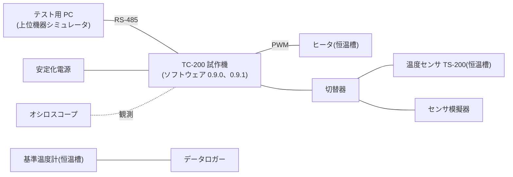

# 概要

## 目的

本書は、恒温槽制御装置 TC-200 の制御ソフトウェア(以下、本ソフトウェア)のソフトウェア総合テストについて、テストの方針、環境、項目を定め(テスト仕様書)、その結果をまとめる(テスト報告書)ものである。

ESPR の作業成果物では、ソフトウェア総合テスト仕様書(SW601)とソフトウェア総合テスト報告書(SW606)にあたる。本書は 2 つを 1 冊にまとめ、文書番号は仕様書の SW601 で管理する。第 1.x 版はテスト仕様書として発行した。第 2.0 版で 4. と 5. に結果を記入し、テスト報告書とした。

## 位置づけ

ソフトウェア総合テストは、すべての機能ユニットを結合したソフトウェアが、ソフトウェア要求仕様書(TC-SW105-001)に書かれた要求を満たしているかを確かめる。ソフトウェア開発の最後の確認にあたる。本書の結果をもとに共同レビューを行い、ソフトウェア開発の完了を判断する。

| テスト | テストの元にする文書 | テストの対象 |
|---|---|---|
| 単体テスト(SW401) | ソフトウェア詳細設計書(TC-SW305-001) | プログラムユニット |
| ソフトウェア結合テスト(SW501) | ソフトウェア・アーキテクチャ設計書(TC-SW205-001) | 機能ユニットの間のインタフェース |
| **ソフトウェア総合テスト(SW601、本書)** | **ソフトウェア要求仕様書(TC-SW105-001)** | **結合を終えたソフトウェア全体** |

: 設計の文書とテストの対応 {#tbl-v}

## 対象ユーザ

テストの担当者、制御ソフトウェアの開発者、品質保証の担当者、共同レビューに出る人(システム開発、ハードウェア開発の担当者)。

## 記載範囲

本ソフトウェアの 0.9.0 と、不具合を直した 0.9.1 の総合テストを対象とする。機能ユニット FU-01 温度制御、FU-02 通信、FU-03 表示をすべて結合し、試作機で動かす。

ブートローダと、製造時の検査に使う機能は対象外とする。ハードウェアを含めた製品としての確認は、システムテスト仕様書で扱う。

## 参照ドキュメント

| ID | 文書名 | 文書番号 | 発行年月 | 備考 |
|---|---|---|---|---|
| R1 | ソフトウェア要求仕様書 | TC-SW105-001 | 2026/08 | テストの元にする要求 |
| R2 | ソフトウェア・アーキテクチャ設計書 | TC-SW205-001 | 2026/09 | |
| R3 | ソフトウェア詳細設計書 | TC-SW305-001 | 2026/11 | 第 1.1 版 |
| R4 | 不具合管理台帳 | TC-SU602-001 | 2026/12 | 4. に抜粋 |
| R5 | TC-100 不具合事例集 | TC1-QA-007 | 2025/03 | 前の機種の不具合 |
| R6 | 温度センサ TS-200 データシート | TS200-DS-03 | 2024/04 | 社外の文書 |

: 参照ドキュメント {#tbl-refs}

## 定義(用語、略語)

| ID | 用語・略号 | 正式表記 | 意味 |
|---|---|---|---|
| D1 | PV | Process Value | 測った温度 |
| D2 | SV | Set Value | 目標の温度 |
| D3 | 試作機 | — | テストする TC-200 の試作 2 号機。2 台を使う |
| D4 | OK、NG、OB、No Check | — | テストの判定。5.3 で定める |
| D5 | 修正確認テスト | — | 不具合を直した版で、直ったことと、ほかに影響がないことを確かめるテスト |
| D6 | バグカーブ | 信頼度成長曲線 | 見つけた不具合の累積の数を、時間に沿って描いたグラフ |

: 用語と略語 {#tbl-terms}

# テスト概要

## テスト方針

1. ソフトウェア要求仕様書のすべての要求(機能の要求 SWR-001〜SWR-009、機能以外の要求 SWR-010〜SWR-012)を、1 つ以上のテスト項目で確かめる。要求とテスト項目の対応は @tbl-scope に示す。
2. 試作機で動かす。上位機器は、テスト用 PC の上位機器シミュレータで代わりをする。
3. 正常系だけでなく、異常系(上限超過、センサの断線、通信の誤り)を重点に確かめる。運転の状態は、ソフトウェア要求仕様書の状態遷移表とコマンドの判定表の、すべての組を確かめる。
4. 前の機種 TC-100 の不具合事例集(R5)から、本ソフトウェアに関係する 3 件を選び、同じ不具合がないことを確かめる。
5. 合否は、テスト項目ごとの期待出力と許容差(5.3)で判定する。温度は基準温度計の値を正とする。
6. 見つけた不具合は不具合管理票(付録 A)に記録する。直した版では、不具合の項目と、影響する範囲の項目をもう一度行う(修正確認テスト)。

| No. | 完了の基準 |
|--:|---|
| 1 | すべてのテスト項目を実施した。実施できない項目は、理由と扱いを合意した |
| 2 | NG の不具合を直し、修正確認テストで OK になった。直さない不具合は、対応の方針を共同レビューで合意した |
| 3 | バグカーブが収束している(最後の 3 日間に新しい不具合がない) |

: テストの完了の基準 {#tbl-exit}

## 開発フェーズおよびテスト期間

| 開発フェーズ | SW<br>バージョン | HW<br>バージョン | 検査<br>開始日 | 検査<br>終了日 | 備考 |
|---|---|---|---|---|---|
| 総合テスト(1 回目) | 0.9.0 | 試作 2 号機<br>(基板 Rev.B) | 2026-11-16 | 2026-11-27 | 全項目を実施 |
| 修正確認テスト | 0.9.1 | 試作 2 号機<br>(基板 Rev.B) | 2026-12-01 | 2026-12-04 | BUG-001〜004 の修正 |

: 開発フェーズとテスト期間 {#tbl-phase}

```schedule
%%| label: fig-schedule
%%| fig-cap: テストの日程
columns: 11/9週, 11/16週, 11/23週, 11/30週, 12/7週
テスト環境の準備: 11/9週
総合テスト(0.9.0): 11/16週-11/23週
72 時間の連続運転: 11/23週
不具合の修正: 11/23週-11/30週
修正確認テスト(0.9.1): 11/30週
◆ 共同レビュー: 12/7週
◆ 報告書の発行: 12/7週
```

## 対象範囲

ソフトウェア要求仕様書の要求ごとに、アーキテクチャ設計書の機能ユニットと、確かめるテスト項目を示す。

| ソフトウェア<br>要求仕様書 | ソフトウェア・<br>アーキテクチャ設計書 | 検査機能 | 検査状況 |
|---|---|---|---|
| SWR-001 温度の計測 | FU-01 温度制御 | 温度の計測<br>(ST-01-01) | 完了 |
| SWR-002 温度の制御 | FU-01 温度制御 | 目標への到達と保持<br>(ST-01-03〜05、ST-04-01〜02) | NG 1 件(BUG-005)。1.0.0 で対応 |
| SWR-003 上限超過の保護 | FU-01 温度制御 | ヒータの停止と異常への遷移<br>(ST-03-01〜02) | 完了 |
| SWR-004 センサの異常の検出 | FU-01 温度制御<br>FU-03 表示 | 断線と短絡の検出<br>(ST-03-03〜05) | 完了。BUG-004 は修正を確認 |
| SWR-005 運転の状態の管理 | FU-01 温度制御 | 状態の遷移、電源投入<br>(ST-01-02、ST-01-06、ST-02-01〜06、ST-06-01) | 完了 |
| SWR-006 コマンドの受け付け | FU-01 温度制御<br>FU-02 通信 | 6 つのコマンドと判定表<br>(ST-01-07、ST-02-01〜04、ST-03-08) | 完了。BUG-002、003 は修正を確認 |
| SWR-007 通信の異常の処理 | FU-02 通信 | チェックサムの誤り、受信のタイムアウト<br>(ST-03-06〜07) | 完了 |
| SWR-008 表示 | FU-03 表示 | 温度と状態の表示<br>(ST-01-08、ST-03-04、ST-06-03) | 完了 |
| SWR-009 操作キー | FU-01 温度制御<br>FU-03 表示 | 目標の設定<br>(ST-01-09、ST-06-02) | 完了 |
| SWR-010 応答時間 | 全体 | 起動の時間、コマンドの応答時間<br>(ST-02-06、ST-04-03) | 完了 |
| SWR-011 メモリ使用量 | 全体 | ROM と RAM の使用率<br>(ST-04-04) | 完了 |
| SWR-012 連続運転 | 全体 | 72 時間の連続運転<br>(ST-05-01) | 0.9.0 で完了。0.9.1 は未実施(ST-07-08) |

: 要求とテスト項目の対応 {#tbl-scope tbl-colwidths="[24,20,34,22]"}

# 評価設備・環境

## システム構成

試作機に上位機器シミュレータ、センサ模擬器、計測器をつなぐ(@fig-env)。センサ模擬器は、上限超過、断線、短絡を作る異常系のテストで、温度センサと切り替えて使う。



## テスト環境・設備

| 設備 | メーカ | 型番 | シリアル番号 | 台数 | 用途 |
|---|---|---|---|--:|---|
| TC-200 試作 2 号機 | 自社 | TC-200-P2 | P2-001、002 | 2 | テストの対象。P2-002 は連続運転用 |
| テスト用 PC | A 社 | PC-1100 | 7Q2K-0193 | 1 | 上位機器シミュレータ 1.3 |
| RS-485 変換器 | B 社 | USB-485I | 21044 | 1 | PC と試作機の接続 |
| センサ模擬器 | 自社 | SIM-TS2 | S-0007 | 1 | 上限超過、断線、短絡を作る |
| 基準温度計 | C 社 | RT-300 | 5520831 | 1 | 槽内の温度の正(2026-06 校正) |
| データロガー | C 社 | LG-80 | 8812004 | 1 | 基準温度計の記録(1 秒ごと) |
| オシロスコープ | D 社 | DS-4024 | DS4A2210 | 1 | PWM と状態の時間の測定 |
| 安定化電源 | E 社 | PS-3010 | 30A1187 | 2 | 試作機の電源、瞬断の試験 |

: テストの設備 {#tbl-equipment tbl-colwidths="[19,8,14,15,7,37]"}

自社: 見本株式会社。A 社〜E 社は、社外の計測器などのメーカである。

::: {.landscape}

# テスト概要・結果概要

テストの分類ごとの項目の数と結果を @tbl-summary に示す。日付は 2026 年である。

| 分類<br>ID | 分類 | テスト<br>項目数 | 検査<br>開始日 | 検査<br>終了日 | 未消化<br>項目数 | 不具合数 | 未対応不具合数 | 備考 |
|---|---|--:|---|---|--:|--:|--:|---|
| C1 | 正常系 | 9 | 11/16 | 11/18 | 0 | 2 | 0 | |
| C2 | 状態遷移 | 6 | 11/18 | 11/19 | 0 | 1 | 0 | |
| C3 | 異常系 | 8 | 11/19 | 11/24 | 0 | 1 | 0 | |
| C4 | 性能 | 4 | 11/24 | 11/25 | 0 | 1 | 1 | BUG-005 は 1.0.0 で対応 |
| C5 | 連続運転 | 1 | 11/24 | 11/27 | 0 | 0 | 0 | 72 時間 |
| C6 | 過去不具合 | 3 | 11/26 | 11/27 | 0 | 0 | 0 | |
| C7 | 修正確認 | 8 | 12/01 | 12/04 | 1 | 0 | 0 | ST-07-08 は未実施 |
| **計** | | **39** | **11/16** | **12/04** | **1** | **5** | **1** | |

: テストの結果の概要 {#tbl-summary tbl-colwidths="[7,12,8,8,8,8,8,12,29]"}

見つけた不具合を、不具合管理台帳(R4)から抜き出して @tbl-ledger に示す。BUG-005 の期限だけは 2027 年である。

<table>
<tr><th rowspan="2">管理No</th><th colspan="3">状況</th><th colspan="4">対応</th><th rowspan="2">検証完了日</th></tr>
<tr><th>標題または概要</th><th>対象機能</th><th>発見日</th><th>優先度</th><th>期限</th><th>状態</th><th>完了日</th></tr>
<tr><td>BUG-001</td><td>昇温中に目標を下げると、新しい目標を超えても定温に移らない</td><td>FU-01</td><td>11/17</td><td>高</td><td>11/30</td><td>完了</td><td>11/27</td><td>12/01</td></tr>
<tr><td>BUG-002</td><td>温度応答で、-10.0℃未満の温度の符号が欠ける</td><td>FU-02</td><td>11/18</td><td>高</td><td>11/30</td><td>完了</td><td>11/25</td><td>12/01</td></tr>
<tr><td>BUG-003</td><td>異常の状態で、目標の変更を受け付けてしまう</td><td>FU-02</td><td>11/19</td><td>中</td><td>11/30</td><td>完了</td><td>11/26</td><td>12/02</td></tr>
<tr><td>BUG-004</td><td>センサの断線のとき、LCD の温度が「----」にならない</td><td>FU-03</td><td>11/24</td><td>中</td><td>11/30</td><td>完了</td><td>11/27</td><td>12/02</td></tr>
<tr><td>BUG-005</td><td>目標 -20.0℃の定温で、偏差が ±0.5℃を超える</td><td>FU-01</td><td>11/25</td><td>中</td><td>2027/01/15</td><td>対応中</td><td></td><td></td></tr>
</table>

: 不具合の一覧(不具合管理台帳の抜粋) {#tbl-ledger tbl-colwidths="[9,33,8,7,7,10,7,8,11]"}

結果の判定は次のとおりである。

- 完了の基準 1: 39 項目のうち 38 項目を実施した。ST-07-08(0.9.1 での連続運転)は、修正が判定と表示の処理に限られ、メモリの使い方を変えていないため行わなかった。1.0.0 の総合テストで行う。この扱いは共同レビュー(2026-12-09)で合意した。
- 完了の基準 2: 不具合 5 件のうち 4 件は 0.9.1 で直し、修正確認テストで OK になった。BUG-005(-20.0℃での精度)は、冷却ユニット(CU-10)の能力と合わせて PID の係数を決める必要があるため、1.0.0 で対応する。共同レビューで合意した。
- 完了の基準 3: 11/26 以降、新しい不具合はない(5.2)。

以上から、本ソフトウェア 0.9.1 は、BUG-005 を除いて要求を満たしていると判断する。

:::

::: {.landscape}

# 添付資料

## テスト項目詳細

テスト項目を @tbl-items に示す。表の上の枠は、IPA のテスト項目詳細の書誌欄にあたる。IPA の様式では分類ごとにシートを分けるが、本書では 1 つの表にまとめ、分類の区切りの行に大分類と中分類を書く。検査結果の記号は 5.3 で定める。

+----------------------------+-------------------------+----------------------------+------------------------+
| [プロジェクト名]{.shade}   | TC-200 制御ソフトウェア | [テストフェーズ]{.shade}   | ソフトウェア総合テスト |
+----------------------------+-------------------------+----------------------------+------------------------+
| [管理No]{.shade}           | TC-SW601-001-A          | [更新日・更新者]{.shade}   | 2026-12-04 佐藤 一郎   |
+----------------------------+-------------------------+----------------------------+------------------------+
| [検査項目(大分類)]{.shade} | C1〜C7(表 5.3-1)        | [検査項目(中分類)]{.shade} | 分類の区切りの行に書く |
+----------------------------+-------------------------+----------------------------+------------------------+

<table>
<tr><th>テスト項目ID</th><th>内容</th><th>環境条件</th><th>入力データ</th><th>(期待)出力</th><th align="center">検査結果</th><th>完了日</th><th>備考</th></tr>
<tr><th colspan="8">C1 正常系 ― 温度の計測と制御、コマンド、表示、操作キー</th></tr>
<tr><td>ST-01-01</td><td>槽内の温度を測り、PV にする</td><td>停止、槽内 25℃で安定</td><td>なし(60 秒待つ)</td><td>温度応答の値が基準温度計と ±0.3℃以内</td><td align="center">○</td><td>11/16</td><td>SWR-001</td></tr>
<tr><td>ST-01-02</td><td>運転開始で昇温に移る</td><td>停止、PV 25.0℃</td><td>運転開始(SV 60.0℃)</td><td>状態が昇温になり、PWM が出る。LCD に「昇温」</td><td align="center">○</td><td>11/16</td><td>SWR-005</td></tr>
<tr><td>ST-01-03</td><td>目標に達したら定温に移る</td><td>ST-01-02 に続けて</td><td>なし</td><td>PV が 59.5℃以上で定温に移る</td><td align="center">○</td><td>11/16</td><td>SWR-002</td></tr>
<tr><td>ST-01-04</td><td>定温で目標を保つ</td><td>定温、SV 60.0℃</td><td>なし(30 分)</td><td>偏差 ±0.5℃以内</td><td align="center">○</td><td>11/17</td><td>SWR-002。最大 ±0.2℃</td></tr>
<tr><td>ST-01-05</td><td>昇温中に目標を下げる</td><td>昇温、SV 60.0℃、PV 40℃</td><td>目標の変更 50.0℃</td><td>49.5℃以上で定温に移る</td><td align="center">×</td><td>11/17</td><td>SWR-002。BUG-001</td></tr>
<tr><td>ST-01-06</td><td>運転停止でヒータを止める</td><td>定温、SV 60.0℃</td><td>運転停止</td><td>停止に移り、100ms 以内に PWM が 0%</td><td align="center">○</td><td>11/17</td><td>SWR-005</td></tr>
<tr><td>ST-01-07</td><td>負の温度の温度要求に応える</td><td>定温、SV -15.0℃</td><td>温度要求</td><td>温度「-015.0」、状態「2」</td><td align="center">×</td><td>11/18</td><td>SWR-006。BUG-002</td></tr>
<tr><td>ST-01-08</td><td>温度と状態を表示する</td><td>昇温</td><td>なし</td><td>LCD の温度が 500ms ごとに変わる。状態の文字が状態と合う</td><td align="center">○</td><td>11/18</td><td>SWR-008</td></tr>
<tr><td>ST-01-09</td><td>操作キーで目標を設定する</td><td>停止、SV 25.0℃</td><td>設定キー、▲キー 3 回、設定キー</td><td>SV が 25.3℃になり、LCD に出る</td><td align="center">○</td><td>11/18</td><td>SWR-009</td></tr>
<tr><th colspan="8">C2 状態遷移 ― 状態遷移表(R1 の表 6.3-1)、コマンドの判定表(R1 の表 6.5-1)</th></tr>
<tr><td>ST-02-01</td><td>停止の状態でのコマンドの判定</td><td>停止</td><td>RN、ST、RT、WS、RV、CA(0.0℃)を 1 つずつ送る。送るたびに状態を戻す</td><td>○ × ○ ○ ○ ○ の判定どおり(× はエラー応答)</td><td align="center">○</td><td>11/18</td><td>SWR-005、006</td></tr>
<tr><td>ST-02-02</td><td>昇温の状態でのコマンドの判定</td><td>昇温</td><td>同上</td><td>× ○ ○ ○ ○ × の判定どおり</td><td align="center">○</td><td>11/18</td><td>SWR-005、006</td></tr>
<tr><td>ST-02-03</td><td>定温の状態でのコマンドの判定</td><td>定温</td><td>同上</td><td>× ○ ○ ○ ○ × の判定どおり</td><td align="center">○</td><td>11/19</td><td>SWR-005、006</td></tr>
<tr><td>ST-02-04</td><td>異常の状態でのコマンドの判定</td><td>異常(上限超過)</td><td>同上</td><td>× ○ ○ × ○ × の判定どおり。温度応答は状態「9」に異常コード「E03」が続く</td><td align="center">×</td><td>11/19</td><td>SWR-005、006。BUG-003</td></tr>
<tr><td>ST-02-05</td><td>異常から停止に戻る</td><td>異常(上限超過)</td><td>運転停止</td><td>停止に移る。PWM は 0% のまま</td><td align="center">○</td><td>11/19</td><td>SWR-005</td></tr>
<tr><td>ST-02-06</td><td>電源を入れたときの状態</td><td>電源断</td><td>電源を入れる</td><td>起動の処理の間は LCD に版数を出し、2 秒以内に停止の状態に入る。LCD に「停止」</td><td align="center">○</td><td>11/19</td><td>SWR-005、010</td></tr>
<tr><th colspan="8">C3 異常系 ― 上限超過、センサの異常、通信の異常、範囲外の入力</th></tr>
<tr><td>ST-03-01</td><td>定温で上限を超えたらヒータを止める</td><td>定温、SV 100.0℃(上限温度 105.0℃)</td><td>センサ模擬器で 105.5℃</td><td>1 秒以内に異常に移り、PWM が 0%。LCD に「異常 E03」</td><td align="center">○</td><td>11/19</td><td>SWR-003。120ms(5.3)</td></tr>
<tr><td>ST-03-02</td><td>昇温中に上限を超えたらヒータを止める</td><td>昇温、SV 128.0℃(上限温度 130.0℃)</td><td>センサ模擬器で 130.5℃</td><td>ST-03-01 と同じ</td><td align="center">○</td><td>11/20</td><td>SWR-003。上限温度が 130.0℃で頭打ちになる場合</td></tr>
<tr><td>ST-03-03</td><td>センサの断線を検出する</td><td>定温、SV 60.0℃</td><td>センサ模擬器で断線(開放)</td><td>異常に移り、PWM が 0%。LCD に「異常 E01」</td><td align="center">○</td><td>11/24</td><td>SWR-004</td></tr>
<tr><td>ST-03-04</td><td>断線のときの温度の表示</td><td>ST-03-03 に続けて</td><td>なし</td><td>LCD の温度が「----」</td><td align="center">×</td><td>11/24</td><td>SWR-004、008。BUG-004</td></tr>
<tr><td>ST-03-05</td><td>センサの短絡(下限より低い値)を検出する</td><td>定温、SV -15.0℃</td><td>センサ模擬器で -21.0℃(A/D の値が 0)</td><td>短絡として異常に移り、PWM が 0%。LCD に「異常 E02」</td><td align="center">○</td><td>11/24</td><td>SWR-004</td></tr>
<tr><td>ST-03-06</td><td>チェックサムの誤ったコマンド</td><td>停止</td><td>チェックサムを 1 つずらした運転開始</td><td>エラー応答(NAK)。状態は停止のまま</td><td align="center">○</td><td>11/20</td><td>SWR-007</td></tr>
<tr><td>ST-03-07</td><td>受信のタイムアウト</td><td>停止</td><td>フレームの途中で 100ms 送信を止め、続けて温度要求</td><td>途中のフレームを捨て、温度要求に応える</td><td align="center">○</td><td>11/20</td><td>SWR-007</td></tr>
<tr><td>ST-03-08</td><td>範囲外の目標</td><td>停止、SV 25.0℃</td><td>目標の変更 135.0℃</td><td>エラー応答。SV は 25.0℃のまま</td><td align="center">○</td><td>11/20</td><td>SWR-006</td></tr>
<tr><th colspan="8">C4 性能 ― 制御の精度、応答時間、メモリ</th></tr>
<tr><td>ST-04-01</td><td>高温の定温の精度</td><td>定温、SV 125.0℃(上限温度 130.0℃)、試作機 P2-001</td><td>なし(60 分)</td><td>偏差 ±0.5℃以内</td><td align="center">○</td><td>11/24</td><td>SWR-002。最大 ±0.3℃</td></tr>
<tr><td>ST-04-02</td><td>低温の定温の精度</td><td>定温、SV -20.0℃、試作機 P2-001</td><td>なし(60 分)</td><td>偏差 ±0.5℃以内</td><td align="center">×</td><td>11/25</td><td>SWR-002。最大 ±0.7℃。BUG-005</td></tr>
<tr><td>ST-04-03</td><td>コマンドの応答時間</td><td>定温</td><td>温度要求を 100 回</td><td>応答まで最大 50ms 以内</td><td align="center">○</td><td>11/25</td><td>SWR-010。最大 18ms</td></tr>
<tr><td>ST-04-04</td><td>メモリの使用率</td><td>0.9.0 のビルド</td><td>リンカのマップファイル</td><td>ROM と RAM が容量の 75% 以下(ROM 192KB、RAM 48KB)</td><td align="center">○</td><td>11/25</td><td>SWR-011。ROM 71%、RAM 64%</td></tr>
<tr><th colspan="8">C5 連続運転 ― 72 時間の運転</th></tr>
<tr><td>ST-05-01</td><td>72 時間の連続運転</td><td>試作機 P2-002。SV を 4 時間ごとに 30.0℃と 100.0℃に切り替える</td><td>1 秒ごとに温度要求</td><td>異常に移らない。応答の欠けがない。RAM の空きが減らない</td><td align="center">○</td><td>11/27</td><td>SWR-012</td></tr>
<tr><th colspan="8">C6 過去不具合 ― TC-100 の不具合事例(R5)</th></tr>
<tr><td>ST-06-01</td><td>電源の瞬断で運転を再開しない(R5 の No.12)</td><td>定温、SV 80.0℃</td><td>電源を 50ms 断つ</td><td>停止の状態で起動し、ヒータは切のまま。SV は初期値の 25.0℃</td><td align="center">○</td><td>11/26</td><td>SWR-005</td></tr>
<tr><td>ST-06-02</td><td>キーの長押しで目標が範囲を超えない(R5 の No.18)</td><td>停止、SV 129.0℃</td><td>設定キーの後、▲キーを 10 秒押し続ける</td><td>SV が 130.0℃で止まる</td><td align="center">○</td><td>11/26</td><td>SWR-009</td></tr>
<tr><td>ST-06-03</td><td>通信が続いても表示が止まらない(R5 の No.25)</td><td>定温</td><td>10ms ごとに温度要求を 10 分</td><td>LCD の更新が止まらない</td><td align="center">○</td><td>11/27</td><td>SWR-008</td></tr>
<tr><th colspan="8">C7 修正確認 ― 0.9.1 での修正の確認と、影響する範囲の再テスト</th></tr>
<tr><td>ST-07-01</td><td>BUG-001 の修正の確認</td><td>0.9.1</td><td>ST-01-05 と同じ</td><td>ST-01-05 と同じ</td><td align="center">○</td><td>12/01</td><td></td></tr>
<tr><td>ST-07-02</td><td>BUG-002 の修正の確認</td><td>0.9.1、SV -20.0℃、-10.0℃、-9.9℃</td><td>温度要求</td><td>符号を含めて 6 文字で応える</td><td align="center">○</td><td>12/01</td><td>境界の値を追加</td></tr>
<tr><td>ST-07-03</td><td>BUG-003 の修正の確認</td><td>0.9.1</td><td>ST-02-04 と同じ</td><td>ST-02-04 と同じ</td><td align="center">○</td><td>12/02</td><td></td></tr>
<tr><td>ST-07-04</td><td>BUG-004 の修正の確認</td><td>0.9.1</td><td>ST-03-04 と同じ</td><td>ST-03-04 と同じ</td><td align="center">○</td><td>12/02</td><td></td></tr>
<tr><td>ST-07-05</td><td>正常系の再テスト</td><td>0.9.1</td><td>ST-01-01〜09 と同じ</td><td>ST-01-01〜09 と同じ</td><td align="center">○</td><td>12/03</td><td>9 項目すべて OK</td></tr>
<tr><td>ST-07-06</td><td>状態遷移の再テスト</td><td>0.9.1</td><td>ST-02-01〜06 と同じ</td><td>ST-02-01〜06 と同じ</td><td align="center">○</td><td>12/03</td><td>6 項目すべて OK</td></tr>
<tr><td>ST-07-07</td><td>異常系の再テスト</td><td>0.9.1</td><td>ST-03-01〜08 と同じ</td><td>ST-03-01〜08 と同じ</td><td align="center">○</td><td>12/04</td><td>8 項目すべて OK</td></tr>
<tr><td>ST-07-08</td><td>連続運転の再テスト</td><td>0.9.1</td><td>ST-05-01 と同じ</td><td>ST-05-01 と同じ</td><td align="center">未</td><td>—</td><td>実施しない。理由は 4. を参照</td></tr>
</table>

: テスト項目詳細 {#tbl-items .small tbl-colwidths="[9,16,15,15,19,7,6,13]"}

:::

## バグカーブ

見つけた不具合の累積の数を @fig-bugcurve に示す。11/26 以降は新しい不具合がなく、累積の発見数は 5 件で収束した。修正確認テストで 4 件の解決を確かめた。残りの 1 件は BUG-005 である。

```chart
%%| label: fig-bugcurve
%%| fig-cap: バグカーブ(信頼度成長曲線)
unit: 件
lines: 累積発見数, 累積解決数
| 日 | 発見数 | 累積発見数 | 累積解決数 |
|---|---|---|---|
| 11/16 | 0 | 0 | 0 |
| 11/17 | 1 | 1 | 0 |
| 11/18 | 1 | 2 | 0 |
| 11/19 | 1 | 3 | 0 |
| 11/20 | 0 | 3 | 0 |
| 11/24 | 1 | 4 | 0 |
| 11/25 | 1 | 5 | 0 |
| 11/26 | 0 | 5 | 0 |
| 11/27 | 0 | 5 | 0 |
| 12/01 | 0 | 5 | 2 |
| 12/02 | 0 | 5 | 4 |
| 12/03 | 0 | 5 | 4 |
| 12/04 | 0 | 5 | 4 |
```

不具合を作り込んだ工程で分けると、@tbl-injected のとおりである。設計の漏れの 2 件は、設計書のレビューの観点に加える。

| 作り込んだ工程 | 件数 | 不具合 |
|---|--:|---|
| システム要求定義 | 1 | BUG-005 |
| ソフトウェア・アーキテクチャ設計 | 1 | BUG-004 |
| ソフトウェア詳細設計 | 1 | BUG-001 |
| 実装 | 2 | BUG-002、BUG-003 |

: 不具合を作り込んだ工程 {#tbl-injected}

## その他

### テスト項目の分類の基準

| 分類 ID | 分類 | 基準 |
|---|---|---|
| C1 | 正常系 | 要求の範囲の中の値で、機能が期待どおりに動くか |
| C2 | 状態遷移 | 状態遷移表とコマンドの判定表の、すべての状態とイベントの組 |
| C3 | 異常系 | 範囲外の値、センサの異常、通信の誤りでの動き |
| C4 | 性能 | 制御の精度、応答時間、メモリの使用率 |
| C5 | 連続運転 | 長い時間の運転で、異常やリソースの減りがないか |
| C6 | 過去不具合 | 前の機種の不具合事例(R5)と同じ不具合がないか |
| C7 | 修正確認 | 直した版での、不具合の修正と影響する範囲の再テスト |

: テスト項目の分類 {#tbl-class}

### テスト結果の判定基準

| 記号 | 判定 | 意味 |
|:-:|---|---|
| ○ | OK | 期待出力のとおりで、許容差の中にある |
| × | NG | 期待出力と違う。不具合管理票を起票する |
| OB | OB | この版では対象外(機能がない、または構成が違う) |
| 未 | No Check | 実施していない。理由を備考に書く |

: 検査結果の記号 {#tbl-judge}

許容差は次のとおりとする。

- 温度: 基準温度計の値に対して ±0.3℃(計測)。定温の偏差は要求の値(±0.5℃)
- 時間: オシロスコープで測る。分解能は 1ms
- 表示: LCD の表示を目で確かめ、写真を残す

### テストの手順

1. 試作機に、テストする版のソフトウェアを書き込み、起動の画面で版を確かめる。
2. テスト項目の環境条件にする。槽内の温度は、基準温度計で安定を確かめてから始める。
3. 入力データを与え、出力を記録する。通信のログと温度のログは、テスト項目 ID の名前で保存する。
4. 検査結果と完了日を記入する。NG のときは、すぐに不具合管理票を起票する。

### テストの証跡

上限超過のテスト(ST-03-01)の波形を @fig-wave に示す。センサの値が上限を超えてから、PWM が止まるまで 120ms であった(要求は 1 秒以内、ソフトウェア・アーキテクチャ設計書の見積りは 0.2 秒)。

```timing
%%| label: fig-wave
%%| fig-cap: 上限超過のときの波形(ST-03-01)
上限超過: 0...1........
状態: =.......=.... 定温, 異常
PWM: p.......0....
```

通信のログ、温度のログ、LCD の写真は、構成管理のサーバの TC-200/test/ST に保存した。

# 不具合管理票 {.appendix}

総合テストで見つけた不具合(@tbl-ledger)は、1 件ごとに不具合管理票(IPA の SU601 の様式)に記録した。本書には、修正を確かめた不具合の例として BUG-001 を、対応を次の版に送った不具合の例として BUG-005 を載せる。BUG-002〜004 の不具合管理票は、構成管理のサーバの TC-200/qa/bug に保存した。

## BUG-001 昇温中に目標を下げると、新しい目標を超えても定温に移らない

<table>
<tr><th colspan="2">プロジェクト名</th><td colspan="4">TC-200 制御ソフトウェア</td><th>管理No</th><td>BUG-001</td></tr>
<tr><th rowspan="8">状<br>況</th><th>発見日</th><td>2026-11-17</td><th>時間</th><td>14:20</td><th>発見者</th><td>佐藤</td><th>対象機能名</th></tr>
<tr><th>表題</th><td colspan="5">昇温中に目標を下げると、新しい目標を超えても定温に移らない</td><td>FU-01 温度制御</td></tr>
<tr><td colspan="6" rowspan="6">［不具合内容］目標を下げても、定温へ移る判定に古い目標を使っている<br>［再現手順］(1) 目標 60.0℃で運転を開始する (2) 槽内が 40℃のとき、目標を 50.0℃に変える (3) 50.0℃を超えても昇温のまま。60.0℃で定温に移る<br>［発生率］5 回中 5 回<br>添付: ■有(温度のログ) □無</td><th>テスト項目ID</th></tr>
<tr><td>ST-01-05</td></tr>
<tr><th>ソフトウェアVer</th></tr>
<tr><td>0.9.0</td></tr>
<tr><th>発見工程</th></tr>
<tr><td>ソフトウェア総合テスト</td></tr>
<tr><th rowspan="4">原<br>因<br>・<br>影<br>響</th><th>調査日</th><td>2026-11-18</td><th>チーム</th><td>制御</td><th>担当</th><td>田中</td><th>主な原因</th></tr>
<tr><th>原因</th><td colspan="5">目標の変更のコマンドで SV は更新するが、定温の判定に使う閾値を更新していない。詳細設計書の PU-0102 の処理に、閾値の更新が書かれていない</td><td>設計の漏れ</td></tr>
<tr><th rowspan="2">影響</th><td colspan="5" rowspan="2">目標を下げると、槽内が新しい目標を最大 10℃超える。上限超過の保護は働くので、安全上の問題はない</td><th>不具合を作り込んだ工程</th></tr>
<tr><td>ソフトウェア詳細設計</td></tr>
<tr><th rowspan="3">対<br>応<br>内<br>容</th><th>検討日</th><td>2026-11-19</td><th>チーム</th><td>制御</td><th>担当</th><td>田中</td><th>見積工数</th></tr>
<tr><th>完了日</th><td>2026-11-27</td><th>チーム</th><td>制御</td><th>担当</th><td>田中</td><td>1.5 人日</td></tr>
<tr><td colspan="7">目標の変更を受けたとき、定温の判定の閾値も更新する。詳細設計書 TC-SW305-001 の PU-0102 を直す(第 1.2 版)。0.9.1 で修正</td></tr>
<tr><th rowspan="2">対<br>応<br>方<br>針</th><th>対応する／しない</th><th>優先度</th><th colspan="2">期限</th><th colspan="3">備考</th></tr>
<tr><td>する</td><td>高</td><td colspan="2">2026-11-30</td><td colspan="3">修正確認 ST-07-01</td></tr>
<tr><th rowspan="2">確<br>認</th><th colspan="2">対応承認</th><th colspan="2">検証完了</th><td colspan="3" rowspan="2"></td></tr>
<tr><td colspan="2">鈴木 2026-11-19</td><td colspan="2">佐藤 2026-12-01</td></tr>
</table>

: BUG-001 の不具合管理票 {#tbl-bug001 .small tbl-colwidths="[5,17,14,9,8,9,10,28]"}



## BUG-005 目標 -20.0℃の定温で、偏差が ±0.5℃を超える

<table>
<tr><th colspan="2">プロジェクト名</th><td colspan="4">TC-200 制御ソフトウェア</td><th>管理No</th><td>BUG-005</td></tr>
<tr><th rowspan="8">状<br>況</th><th>発見日</th><td>2026-11-25</td><th>時間</th><td>16:10</td><th>発見者</th><td>佐藤</td><th>対象機能名</th></tr>
<tr><th>表題</th><td colspan="5">目標 -20.0℃の定温で、偏差が ±0.5℃を超える</td><td>FU-01 温度制御</td></tr>
<tr><td colspan="6" rowspan="6">［不具合内容］-20.0℃の定温を 60 分続けると、偏差が最大 ±0.7℃になる(要求は ±0.5℃以内)。-15.0℃以上では ±0.4℃以内<br>［再現手順］(1) 目標 -20.0℃で運転を開始する (2) 定温に移ってから 60 分、基準温度計の値を記録する<br>［発生率］2 回中 2 回<br>添付: ■有(温度のログ) □無</td><th>テスト項目ID</th></tr>
<tr><td>ST-04-02</td></tr>
<tr><th>ソフトウェアVer</th></tr>
<tr><td>0.9.0</td></tr>
<tr><th>発見工程</th></tr>
<tr><td>ソフトウェア総合テスト</td></tr>
<tr><th rowspan="4">原<br>因<br>・<br>影<br>響</th><th>調査日</th><td>2026-11-27</td><th>チーム</th><td>制御</td><th>担当</th><td>田中</td><th>主な原因</th></tr>
<tr><th>原因</th><td colspan="5">低温ではヒータの出力が小さく、PID の係数が合っていない。冷却ユニット(CU-10)の能力との兼ね合いがあり、ソフトウェアだけでは決められない</td><td>要求の検討不足</td></tr>
<tr><th rowspan="2">影響</th><td colspan="5" rowspan="2">-15.0℃未満の目標で、精度の要求を満たさない。-15.0℃以上は満たす</td><th>不具合を作り込んだ工程</th></tr>
<tr><td>システム要求定義</td></tr>
<tr><th rowspan="3">対<br>応<br>内<br>容</th><th>検討日</th><td>2026-11-27</td><th>チーム</th><td>制御</td><th>担当</th><td>田中</td><th>見積工数</th></tr>
<tr><th>完了日</th><td></td><th>チーム</th><td></td><th>担当</th><td></td><td>3.0 人日</td></tr>
<tr><td colspan="7">1.0.0 で、低温の PID の係数を目標の温度ごとに切り替える。係数は、システム開発の担当と冷却ユニットの能力を確かめてから決める</td></tr>
<tr><th rowspan="2">対<br>応<br>方<br>針</th><th>対応する／しない</th><th>優先度</th><th colspan="2">期限</th><th colspan="3">備考</th></tr>
<tr><td>する</td><td>中</td><td colspan="2">2027-01-15</td><td colspan="3">0.9.1 では直さない。共同レビュー(2026-12-09)で合意</td></tr>
<tr><th rowspan="2">確<br>認</th><th colspan="2">対応承認</th><th colspan="2">検証完了</th><td colspan="3" rowspan="2"></td></tr>
<tr><td colspan="2">山田 2026-12-09</td><td colspan="2"></td></tr>
</table>

: BUG-005 の不具合管理票 {#tbl-bug005 .small tbl-colwidths="[5,17,14,9,8,9,10,28]"}
