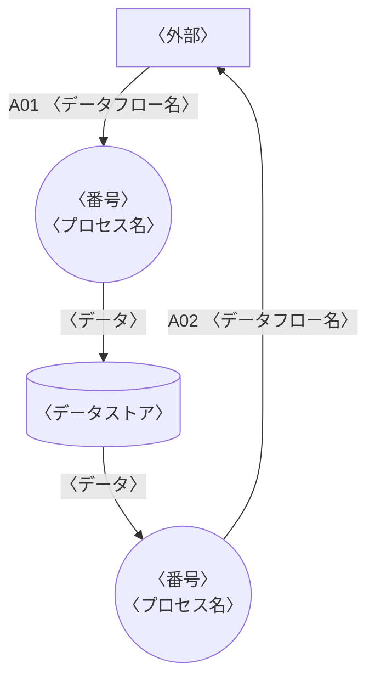
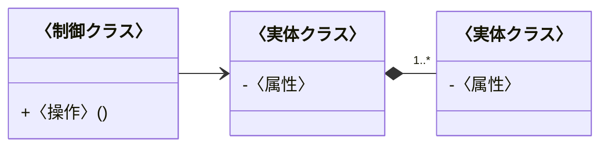
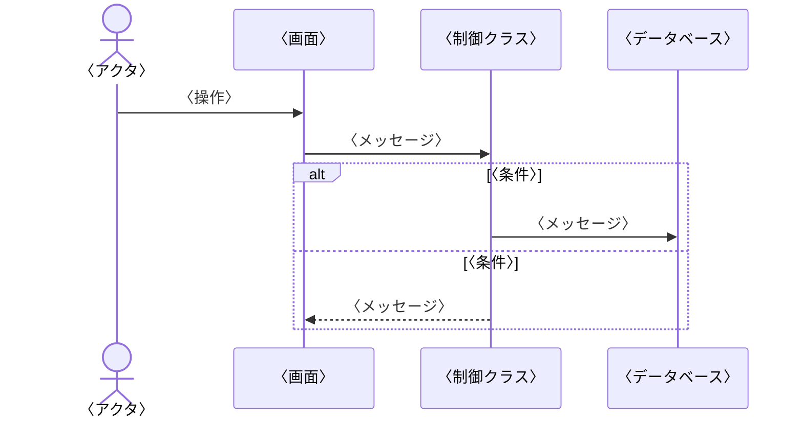
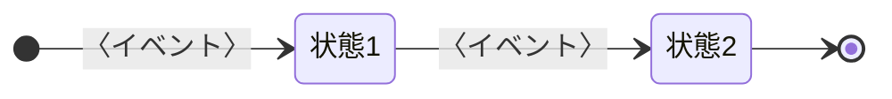
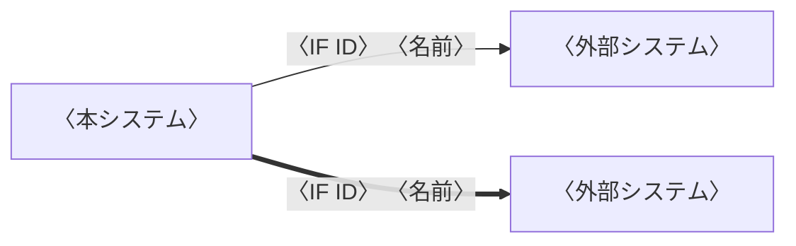
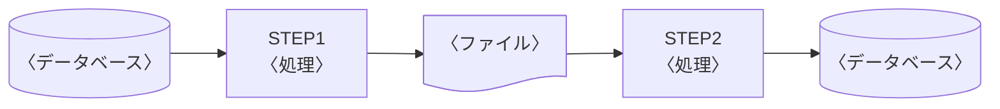

# 概要

::: {.guide}
このテンプレートは、IPA の「ソフトウェア方式設計書<良い設計例>」と「機能要件の合意形成ガイド」の図表の形に合わせた構成である。〈 〉の文字を書き換える。この青い破線の囲みは記入の指示である。仕上げるときは、先頭の設定の `guides` を `false` にすると、すべての囲みが消える。記入例は samples/basic-design.md にある。

Mermaid の図が大きく、文字が 6pt より小さくなると、組むときに警告が出る。そのときは、図を分けるか、向きを変える(`flowchart TB` など)か、横向きのページ(`::: {.landscape}`)に置く。
:::

## 目的

::: {.guide}
本書で設計するシステムとサブシステム、もとにした要件定義書、本書で誰と何を合意するかを書く。
:::

本書は、〈顧客名〉の〈システム名〉について、〈サブシステム名〉の基本設計を定める。要件定義書(〈要件定義書の文書番号〉)で合意した機能を、画面、帳票、外部インタフェース、バッチ処理、データの単位に分けて具体的にする。

## 位置づけ

::: {.guide}
前後の工程の文書と、本書の関係を示す。上の段が前の工程、下の段が後の工程である。
:::

```layers
%%| label: fig-docs
%%| fig-cap: 設計書の位置づけ
〈要件定義書〉
〈基本設計書(本書)〉 *2 | 〈結合テスト仕様書〉
〈詳細設計書〉 *2 | 〈単体テスト仕様書〉
プログラム
```

## 対象範囲

::: {.guide}
要件定義書のサブシステムと機能のうち、本書で設計するものを示す。対象外のものは、設計する文書の番号を書く。
:::

| サブシステム | 機能 | 本書の対象 |
|---|---|:-:|
| 〈サブシステム名〉 | 〈機能 ID と機能名〉 | ○ |
| | | |
| | | |

: 対象範囲 {#tbl-scope}

## 設計の対象と ID

::: {.guide}
要件定義書の ID はそのまま使う。プロセス、モジュール、バッチ処理、画面のアクションなど、基本設計で新しく決める ID の形をここで決める。
:::

| 対象 | ID の形 | 例 | 決めた文書 |
|---|---|---|---|
| 機能、画面、帳票、インタフェース、エンティティ | 〈ID の形〉 | 〈例〉 | 要件定義書 |
| | | | |
| | | | |

: ID の体系 {#tbl-ids}

## 参照ドキュメント

| ID | 文書名 | 文書番号 | 発行年月 | 備考 |
|---|---|---|---|---|
| R1 | 〈要件定義書〉 | 〈文書番号〉 | 〈YYYY/MM〉 | |
| | | | | |
| | | | | |

: 参照ドキュメント {#tbl-refs}

## 用語と記号

::: {.guide}
要件定義書の用語は繰り返さず、本書で足す用語だけを書く。表の中の記号は、使う意味に合わせて直す。
:::

| 用語・記号 | 意味 |
|---|---|
| 属性 C、K、N、D | C: 文字(半角)、K: 文字(全角)、N: 数字、D: 日付 |
| ○、△、×、— | ○: 常にする、△: 条件つきでする、×: しない、—: 対象外 |
| ● と下線 | 主キーの項目 |
| 〈用語〉 | 〈意味〉 |

: 用語と記号 {#tbl-terms}

# サブシステム概要

## ユースケース

::: {.guide}
利用者(アクタ)ごとに、システムを使う目的をユースケースとして並べる。ユースケースには ID を付け、要件定義書の機能 ID との対応を本文に書く。

ユースケースどうしの関係は、`include:` と `extend:` の行で書く。

- `include: 含む機能 -> 含まれる機能` は、必ず含む処理である。`,` で区切ると、複数の機能から同じ機能へまとめて書ける。
- `extend: 拡張する機能 -> 拡張される機能` は、条件を満たすときだけ加わる処理である。
- 関係だけでつながる機能は、図の右の列に並ぶ。線が交差すると読みにくいので、行の順を入れ替えて交差を減らす。
:::

```usecase
%%| label: fig-usecase
%%| fig-cap: ユースケース図
system: 〈システム名〉
〈利用者 1〉: UC-01 〈ユースケース名〉, UC-02 〈ユースケース名〉
〈利用者 2〉: UC-03 〈ユースケース名〉
include: UC-01 〈ユースケース名〉 -> 〈必ず含む処理〉
extend: 〈条件つきで加わる処理〉 -> UC-03 〈ユースケース名〉
```

## ユースケース記述

::: {.guide}
ユースケースごとに 1 つの表を作る。基本フローは「〈アクタ〉は〜する」「システムは〜する」の形で、1 行に 1 つの動作を書く。代替フローは、基本フローの番号に a、b を付けて分かれ目を示す。
:::

+--------------------------+----------------------------------------------------------------------------+
| [ユースケース名]{.shade} | UC-〈番号〉 〈ユースケース名〉(〈機能 ID〉)                                |
+--------------------------+----------------------------------------------------------------------------+
| [要約]{.shade}           | 〈何のために何をするか〉                                                   |
+--------------------------+----------------------------------------------------------------------------+
| [主要アクタ]{.shade}     | 〈アクタ〉                                                                 |
+--------------------------+----------------------------------------------------------------------------+
| [事前条件]{.shade}       | 〈始める前に成り立っていること〉                                           |
+--------------------------+----------------------------------------------------------------------------+
| [基本フロー]{.shade}     | 1. 〈アクタ〉は、〈操作〉する                                              |
|                          | 2. システムは、〈処理〉する                                                |
+--------------------------+----------------------------------------------------------------------------+
| [代替フロー]{.shade}     | - 〈番号〉a. 〈条件〉: 〈処理〉                                            |
+--------------------------+----------------------------------------------------------------------------+
| [事後条件]{.shade}       | 〈終わったときに成り立っていること〉                                       |
+--------------------------+----------------------------------------------------------------------------+
| [関連]{.shade}           | 画面 〈画面 ID〉。帳票 〈帳票 ID〉                                         |
+--------------------------+----------------------------------------------------------------------------+

: ユースケース記述(UC-〈番号〉) {#tbl-uc01}

## サブシステムフロー

::: {.guide}
利用者とシステムの処理の順序を、担当ごとの列(レーン)に分けて、スイムレーン(`swimlane`)で描く。`lanes:` にレーンを左から並べ、「レーン: 記号」の行を処理の順に上から書く。

- 記号を書かない行は処理、`◇` は判断、`●` は開始、`◎` は終了である。
- 行は次の行へ矢印でつながる。判断の行には `-> はい: 行き先, いいえ: 行き先` と書き、条件を線に付ける。行き先は、つなぐ先の行の文字(記号を除く)と同じに書く。前の行の処理を行き先にすると、戻る矢印になる。
- 外部システムとのやり取りには、インタフェース ID を書く。
:::

```swimlane
%%| label: fig-flow
%%| fig-cap: 〈業務名〉のサブシステムフロー
lanes: 〈利用者〉, 本システム, 〈外部システム〉
〈利用者〉: ●
〈利用者〉: 〈作業の始まり〉
本システム: 〈処理〉
本システム: ◇ 〈判断〉 -> はい: 〈処理 2〉, いいえ: 〈やり直す作業〉
〈利用者〉: 〈やり直す作業〉 -> 〈処理〉
本システム: 〈処理 2〉
〈外部システム〉: 〈処理〉 [〈IF ID〉]
〈利用者〉: 〈作業の終わり〉
〈利用者〉: ◎
```

## データフローダイアグラム

::: {.guide}
要件定義書の DFD のプロセスを分けて描く。円はプロセス、四角は外部、円柱はデータストアである。外部とのデータフローには番号(A01 など)を付け、2.6 で項目を定める。
:::



## 処理機能記述書

::: {.guide}
プロセスごとに 1 つの表を作る。Process の列に処理の手順を番号の順に書き、その手順の入力と出力を同じ行の Input と Output に書く。抽出の条件や計算の式は、表の下の補足説明に書く。
:::

+--------------------------+-------------------------------------------------------------------------+
| [プロセス番号]{.shade}   | 〈番号〉(〈機能 ID〉、モジュール 〈モジュール名〉)                      |
+--------------------------+-------------------------------------------------------------------------+
| [プロセス名]{.shade}     | 〈プロセス名〉                                                          |
+--------------------------+----------------------------------------------+--------------------------+
| [Input]{.shade}          | [Process]{.shade}                            | [Output]{.shade}         |
+--------------------------+----------------------------------------------+--------------------------+
| 〈入力〉                 | 1. 〈処理〉                                  | 〈出力〉                 |
+--------------------------+----------------------------------------------+--------------------------+
|                          | 2. 〈処理〉                                  |                          |
+--------------------------+----------------------------------------------+--------------------------+
|                          | 3. 〈処理〉                                  |                          |
+--------------------------+----------------------------------------------+--------------------------+

: 処理機能記述書(〈番号〉 〈プロセス名〉) {#tbl-ipo}

補足説明:

1. 〈抽出の条件、計算の式、並び順など〉

## データフロー記述書

::: {.guide}
2.4 の外部とのデータフローごとに、項目を書く。属性と桁数の書き方は 1.6 に従う。記述形式は 9 を数字、X を英字として書く。
:::

+----------------------------------------+--------------------------------------------------------------------------------+
| [データフロー番号]{.shade}             | 〈番号〉                                                                       |
+----------------------------------------+--------------------------------------------------------------------------------+
| [データフロー名]{.shade}               | 〈データフロー名〉                                                             |
+---------------+------------------------+----------------+----------------+----------------------------------------------+
| [No.]{.shade} | [項目名]{.shade}       | [属性]{.shade} | [桁数]{.shade} | [備考]{.shade}                               |
+---------------+------------------------+----------------+----------------+----------------------------------------------+
| 1             |                        |                |                |                                              |
+---------------+------------------------+----------------+----------------+----------------------------------------------+
| 2             |                        |                |                |                                              |
+---------------+------------------------+----------------+----------------+----------------------------------------------+
| 3             |                        |                |                |                                              |
+---------------+------------------------+----------------+----------------+----------------------------------------------+

: データフロー 〈番号〉 {#tbl-df-a02}

# サブシステム機能詳細

## 構造図

::: {.guide}
サブシステムをモジュールに分けた構成を描く。モジュールの名前と、実現する機能 ID を書く。
:::

```wbs
%%| label: fig-structure
%%| fig-cap: サブシステム構造図
〈システム名〉
  〈サブシステム名〉
    〈モジュール名〉 〈機能名〉 〈機能 ID〉
    〈モジュール名〉 〈機能名〉 〈機能 ID〉
  共通
    〈モジュール名〉 〈機能名〉
```

## クラス一覧

::: {.guide}
クラスの種類は、境界(画面や外部とのやり取り)、制御(処理の手順)、実体(データ)のいずれかを書く。
:::

| No. | クラス名 | 種類 | 概要 |
|--:|---|---|---|
| 1 | | | |
| 2 | | | |
| 3 | | | |

: クラス一覧 {#tbl-classes}

## クラス構成図

::: {.guide}
3.2 のクラスの関係を描く。クラスの名前は英字の ID に日本語の名前を付けて書く(`class Order["受注"]`)。属性と操作は、設計の判断に要るものだけを書く。
:::



## シーケンス図

::: {.guide}
主なユースケースについて、クラスと外部システムの間のメッセージの順序を描く。分岐は alt、繰り返しは loop で囲む。
:::



## 状態遷移

::: {.guide}
状態を持つデータ(受注、出荷など)について、状態とイベントの組み合わせをすべて表に書き、図で全体を示す。表の空欄を残さず、起きない組み合わせは —、エラーにする組み合わせは × と書く。
:::

| イベント＼状態 | 〈状態 1〉 | 〈状態 2〉 | 〈状態 3〉 |
|---|:-:|:-:|:-:|
| 〈イベント〉 | | | |
| 〈イベント〉 | | | |

: 〈データ〉の状態遷移表 {#tbl-state}



# 画面設計

## 画面一覧

::: {.guide}
分類には、入力、一覧、メニュー、小画面、通知など、画面の種類を書く。説明には、利用者、使う目的、特徴的な動作を書く。基本設計で足した画面には、新しい ID を付ける。
:::

| No. | 画面 ID | 画面名 | 分類 | 説明 | 機能 |
|--:|---|---|---|---|---|
| 1 | | | | | |
| 2 | | | | | |
| 3 | | | | | |

: 画面一覧 {#tbl-screens tbl-colwidths="[5,8,14,13,48,12]"}

## 画面遷移図

::: {.guide}
遷移を「画面 -> 操作: 画面」の行で書く。画面は「ID 名前」で書き、2 回目からは ID だけでよい。帳票は `帳票:` の行に書くと、文書の形と点線の矢印になる。別ウィンドウの小画面は `小画面:`、どの画面からも移る画面(エラーなど)は `共通:` の行に書く。置き場所は「| 画面 | 画面 |」の行で決められる。図の記号の意味を図の下に書く。
:::

```screenflow
%%| label: fig-transition
%%| fig-cap: 画面遷移図
帳票: RP-01 〈帳票名〉
SC-01 〈画面名〉 -> 〈操作〉: SC-02 〈画面名〉
SC-02 -> 〈操作〉: SC-03 〈画面名〉
SC-03 -> 〈操作〉: RP-01
```

## 画面レイアウト

::: {.guide}
画面ごとに模式図を描く。項目には丸の数字を付け、4.4 の識別 ID と合わせる。図で表せない動き(スクロール、初期の状態など)は補足説明に書く。
:::

```wireframe
%%| label: fig-sc01
%%| fig-cap: 〈画面名〉(〈画面 ID〉)
# 〈画面名〉(〈画面 ID〉)
① 〈項目〉 | "〈入力〉" | ② 〈項目〉 | ^〈選択〉^
③ 〈項目〉 | "〈入力〉" | [〈ボタン〉]
--
[〈ボタン〉] | [〈ボタン〉]
```

補足説明:

- 〈図で表せない動き〉

::: {.landscape}

## 画面入出力項目一覧

::: {.guide}
4.3 の項目ごとに 1 行を書く。有効、入力、必須は ○、△、×、— で書き、△ の条件は補足に書く。桁数は「表示 / 入力」の形で書く。データ型の括弧には文字種(半角、全角)を書く。
:::

| ID | 表示用のラベル | 部品の種類 | 有効 | 入力 | 必須 | 桁数(表示/入力) | データ型(文字種) | 入力制約 | 初期表示 | 出力仕様 | 補足 |
|:-:|---|---|:-:|:-:|:-:|---|---|---|---|---|---|
| ① | | | | | | | | | | | |
| ② | | | | | | | | | | | |
| ③ | | | | | | | | | | | |

: 画面入出力項目一覧(〈画面 ID〉) {#tbl-sc01-items .small tbl-colwidths="[4,9,8,4,4,4,7,10,12,10,11,17]"}

:::

## 画面アクション明細

::: {.guide}
画面のボタンや項目の操作(イベント)ごとに 1 行を書く。アクション名の下の括弧に、イベントを書く。処理の詳細は ①、② の順に書き、条件で分かれるときは ②-1、②-2 として行を分け、それぞれの遷移先と出力を書く。
:::

<table>
<tr><th>ID</th><th>アクション名(イベント名)</th><th>アクションの処理概要</th><th>入力</th><th>アクションの処理詳細</th><th>遷移先、出力</th></tr>
<tr><td>A-〈番号〉</td><td>〈アクション名〉<br>(〈イベント〉)</td><td></td><td></td><td>①</td><td></td></tr>
<tr><td></td><td></td><td></td><td></td><td></td><td></td></tr>
<tr><td></td><td></td><td></td><td></td><td></td><td></td></tr>
</table>

: 画面アクション明細(〈画面 ID〉) {#tbl-sc01-actions tbl-colwidths="[9,14,15,14,32,16]"}

# 帳票設計

## 帳票一覧

::: {.guide}
分類には、伝票、一覧表、集計表などを書く。様式と用紙には、PDF か紙か、汎用紙か専用紙か、用紙の大きさと向きを書く。
:::

| No. | 帳票 ID | 帳票名 | 分類 | 改ページ条件 | 出力タイミング | 作成方法 | 様式、用紙 | 利用部門 | 機能 |
|--:|---|---|---|---|---|---|---|---|---|
| 1 | | | | | | | | | |
| 2 | | | | | | | | | |
| 3 | | | | | | | | | |

: 帳票一覧 {#tbl-reports .small tbl-colwidths="[4,8,13,7,10,12,12,11,12,8]"}

## 帳票レイアウト

::: {.guide}
印字する位置を、方眼(`grid`)で描く。X は英数字、Ｎ は全角の文字、9 は数字、Z は前のゼロを空白にする数字を表す。

- `columns:` と `rows:` に、方眼の桁と行の数を書く。
- 「行, 桁: 文字」の行で、文字を置く。全角は 2 桁、半角は 1 桁に数える。桁の範囲を `7, 57-66: ZZ,ZZZ,ZZ9 {右}` のように書くと、その範囲の中で寄せる。
- 項目の先頭に ①、② を書くと、方眼に項目の番号が出る。5.3 の No. とそろえる。
- 末尾の `{太字}`、`{網掛け}`、`{枠}`、`{下線}`、`{右}`、`{中央}` で体裁を付ける。`5, 1-70: {網掛け 枠}` のように文字のない範囲も書ける。
:::

〈帳票名〉(〈帳票 ID〉)のレイアウトを @fig-rp04 に示す。

```grid
%%| label: fig-rp04
%%| fig-cap: 〈帳票名〉(〈帳票 ID〉)のレイアウト
columns: 70
rows: 10
1, 29: 帳　票　名 {太字}
1, 51: No.
① 1, 55: XXXXXXXXXX
② 2, 59: YYYY/MM/DD
③ 3, 1: ＮＮＮＮＮＮＮＮＮＮ
5-10, 1-70: {枠}
5, 1-70: {網掛け 枠}
5, 1: 見出し
5, 14: 見出し
5, 57-66: 見出し {右}
④ 7, 1: Z9
⑤ 7, 4: XXXXXX
⑥ 7, 14: ＮＮＮＮＮＮＮＮＮＮ
⑦ 7, 57: ZZ,ZZZ,ZZ9
```

## 帳票項目説明

::: {.guide}
5.2 の項目ごとに、位置(行と桁)、フォーマット、編集の仕方、元のデータを書く。ヘッダ部、明細部、合計部などのブロックごとに、見出しの行で区切る。
:::

<table>
<tr><th>No.</th><th>項目名</th><th>位置(行-桁)</th><th>桁数</th><th>フォーマット</th><th>出力編集</th><th>元のデータ(エンティティ.項目)</th></tr>
<tr><td colspan="7" style="background-color: #eeeeee">【〈ブロック名〉】〈印字する条件〉</td></tr>
<tr><td>1</td><td></td><td></td><td></td><td></td><td></td><td></td></tr>
<tr><td>2</td><td></td><td></td><td></td><td></td><td></td><td></td></tr>
<tr><td colspan="7" style="background-color: #eeeeee">【〈ブロック名〉】〈印字する条件〉</td></tr>
<tr><td>3</td><td></td><td></td><td></td><td></td><td></td><td></td></tr>
</table>

: 帳票項目説明(〈帳票 ID〉) {#tbl-rp04-items tbl-colwidths="[6,15,9,6,17,22,25]"}

## 帳票編集定義

::: {.guide}
改ページの条件、ヘッダとフッタの印字の条件、項目の編集(計算、切り捨て、印字しない条件)を書く。
:::

+----------------------+------------------+--------------------------------------------------------------+
| [ブロック名]{.shade} | [項目名]{.shade} | [処理説明]{.shade}                                           |
+----------------------+------------------+--------------------------------------------------------------+
| [(1) 改ページ条件]{.shade}                                                                             |
+-----------------------------------------+--------------------------------------------------------------+
| 改ページ条件                            | 〈改ページする条件〉                                         |
+-----------------------------------------+--------------------------------------------------------------+
| [(2) ヘッダ/フッタ制御条件]{.shade}                                                                    |
+----------------------+------------------+--------------------------------------------------------------+
| ヘッダ部             | 〈項目名〉       |                                                              |
+----------------------+------------------+--------------------------------------------------------------+
| フッタ部             | 〈項目名〉       |                                                              |
+----------------------+------------------+--------------------------------------------------------------+
| [(3) 項目編集]{.shade}                                                                                 |
+----------------------+------------------+--------------------------------------------------------------+
| 〈ブロック名〉       | 〈項目名〉       |                                                              |
+----------------------+------------------+--------------------------------------------------------------+
| 〈ブロック名〉       | 〈項目名〉       |                                                              |
+----------------------+------------------+--------------------------------------------------------------+

: 帳票編集定義(〈帳票 ID〉) {#tbl-rp04-edit}

# 外部インタフェース設計

## 外部インタフェース一覧

::: {.guide}
方向は、本システムから見て送信、受信、送受信のいずれかを書く。受渡し手段には API、ファイル共有、SFTP などを書く。本書で定めないインタフェースは、定める文書を表の下に書く。
:::

<table>
<tr><th rowspan="2">ID</th><th rowspan="2">インタフェース名</th><th rowspan="2">方向</th><th rowspan="2">相手システム</th><th rowspan="2">既存/新規</th><th colspan="2">接続方式</th><th colspan="2">処理タイミング</th></tr>
<tr><th>受渡し手段</th><th>データ形式</th><th>タイミング</th><th>送受信時間</th></tr>
<tr><td></td><td></td><td></td><td></td><td></td><td></td><td></td><td></td><td></td></tr>
<tr><td></td><td></td><td></td><td></td><td></td><td></td><td></td><td></td><td></td></tr>
<tr><td></td><td></td><td></td><td></td><td></td><td></td><td></td><td></td><td></td></tr>
</table>

: 外部インタフェース一覧 {#tbl-ifs .small tbl-colwidths="[7,12,7,14,7,13,8,18,14]"}

## 外部システム関連図

::: {.guide}
本システムと外部システムを四角で描き、矢印にインタフェース ID と名前を書く。API とファイルなど、受け渡しの違いは線の種類で分け、図の下に記号の意味を書く。
:::



## 外部インタフェース項目説明

::: {.guide}
インタフェースごとに、1 レコードの項目を書く。長さは「固定 8」「可変 5.1」(整数 5 桁、小数 1 桁)の形で書く。ファイルの文字コード、改行、区切りは表の下に書く。
:::

| No. | 項目名 | 型 | 長さ | 項目説明 | 参照先 |
|--:|---|---|---|---|---|
| 1 | | | | | |
| 2 | | | | | |
| 3 | | | | | |

: 外部インタフェース項目説明(〈IF ID〉) {#tbl-if05-items tbl-colwidths="[5,15,10,10,48,12]"}

## 外部インタフェース処理説明

::: {.guide}
事前条件(送る前にそろっていること)、本処理(送受信の手順)、終了条件(成功の判定と記録)、例外条件(失敗したときの扱い)を書く。
:::

+--------------------+----------------------+--------------------+------------------------------------------+
| [接続先]{.shade}   | 〈相手システム〉     | [送受信]{.shade}   | 〈送信、受信〉                           |
+--------------------+----------------------+--------------------+------------------------------------------+
| [データ量]{.shade} | 〈件数〉             | [保存期間]{.shade} | 〈期間〉                                 |
+--------------------+----------------------+--------------------+------------------------------------------+
| [事前条件]{.shade}                                                                                        |
+-----------------------------------------------------------------------------------------------------------+
| 〈送る前にそろっていること〉                                                                              |
+-----------------------------------------------------------------------------------------------------------+
| [本処理]{.shade}                                                                                          |
+-----------------------------------------------------------------------------------------------------------+
| 1. 〈手順〉                                                                                               |
+-----------------------------------------------------------------------------------------------------------+
| [終了条件]{.shade}                                                                                        |
+-----------------------------------------------------------------------------------------------------------+
| 〈成功の判定と記録〉                                                                                      |
+-----------------------------------------------------------------------------------------------------------+
| [例外条件]{.shade}                                                                                        |
+-----------------------------------------------------------------------------------------------------------+
| 1. 〈失敗の条件〉: 〈扱い〉                                                                               |
+-----------------------------------------------------------------------------------------------------------+

: 外部インタフェース処理説明(〈IF ID〉) {#tbl-if05-process}

# バッチ処理設計

## バッチ処理一覧

::: {.guide}
起動方式には、時刻、周期、前の処理の終了などの起動の条件を書く。再処理方式には、失敗したときにやり直す方法を書く。データ量は 1 回か 1 日の件数を書く。
:::

| バッチ ID | バッチ処理名 | 処理概要 | 起動方式 | 再処理方式 | データ量 | 機能 |
|---|---|---|---|---|--:|---|
| | | | | | | |
| | | | | | | |
| | | | | | | |

: バッチ処理一覧 {#tbl-batches .small tbl-colwidths="[10,15,27,11,17,10,10]"}

## バッチ処理フロー

::: {.guide}
バッチ処理のジョブステップの順に、入力と出力のデータを描く。データベースは円柱(`[( )]`)、ファイルは文書の形(`@{ shape: doc }`)で描く。
:::



## バッチ処理定義

::: {.guide}
処理内容には、ジョブステップごとの処理と、起動の条件、事前条件、エラーのときの扱いを書く。突き合わせの結果などで処理が分かれるときは、表を入れ子にして書いてよい。
:::

+-------------------------+-----------------------------------------------------------------------+
| [バッチ処理 ID]{.shade} | 〈バッチ ID〉 〈バッチ処理名〉(〈機能 ID〉)                           |
+-------------------------+-----------------------------------------------------------------------+
| [処理サイクル]{.shade}  | 〈毎日、毎月など〉                                                    |
+-------------------------+-----------------------------------------------------------------------+
| [起動方式]{.shade}      | 〈スケジュール、前の処理の終了など〉                                  |
+-------------------------+----------------------------------------------+------------------------+
| [入力情報]{.shade}      | [処理内容]{.shade}                           | [出力情報]{.shade}     |
+-------------------------+----------------------------------------------+------------------------+
| - 〈入力〉              | 1. 〈STEP1 の処理〉                          | - 〈出力〉             |
|                         | 2. 〈STEP2 の処理〉                          |                        |
+-------------------------+----------------------------------------------+------------------------+

: バッチ処理定義(〈バッチ ID〉) {#tbl-bt01}

# DB 論理設計

## ER 図

::: {.guide}
本書の範囲のエンティティと関係を描く。`|` で区切った行に箱を置く段と列を書き、エンティティ名の後にテーブル名、`{ }` の中に主キー(`PK`)と外部キー(`FK`)を書く。ほかの属性は 8.3 に書く。多重度は `||`(1)、`o|`(0 か 1)、`o{`(0 以上)、`|{`(1 以上)で表す。
:::

```er
%%| label: fig-er
%%| fig-cap: ER 図
| エンティティ1 | エンティティ2 | エンティティ3 |
エンティティ1 ||--o{ エンティティ2 : 〈関係〉
エンティティ2 ||--|{ エンティティ3 : 〈関係〉
エンティティ1 〈TABLE_1〉 {
  〈主キー〉 PK
}
エンティティ2 〈TABLE_2〉 {
  〈主キー〉 PK
  〈外部キー〉 FK
}
エンティティ3 〈TABLE_3〉 {
  〈主キー〉 PK, FK
  〈主キー〉 PK
}
```

## エンティティ一覧

::: {.guide}
種別には、リソース(マスタのように実在するもの)、イベント(業務で発生するもの)、サマリ(集計の結果)のいずれかを書く。
:::

| ID | エンティティ名 | テーブル名 | 種別 | 定義 |
|---|---|---|---|---|
| | | | | |
| | | | | |
| | | | | |

: エンティティ一覧 {#tbl-entities tbl-colwidths="[6,12,21,12,49]"}

## エンティティ定義書

::: {.guide}
エンティティごとに 1 つの表を作る。主キーの項目は「**●[項目名]{.underline}**」と書く。外部キーは備考に参照先を書く。
:::

+-----------------------------------------------+---------------------------------------------------------------------------------------------+
| [エンティティ名]{.shade}                      | 〈ID〉 〈エンティティ名〉(〈テーブル名〉)                                                   |
+-----------------------------------------------+---------------------------------------------------------------------------------------------+
| [キー項目]{.shade}                            | 〈主キーの項目〉                                                                            |
+---------------+-------------------------------+----------------+----------------+----------------+------------------------------------------+
| [No.]{.shade} | [項目名]{.shade}              | [属性]{.shade} | [桁数]{.shade} | [必須]{.shade} | [備考]{.shade}                           |
+---------------+-------------------------------+----------------+----------------+----------------+------------------------------------------+
| 1             | **●[〈項目名〉]{.underline}** |                |                |                |                                          |
+---------------+-------------------------------+----------------+----------------+----------------+------------------------------------------+
| 2             |                               |                |                |                |                                          |
+---------------+-------------------------------+----------------+----------------+----------------+------------------------------------------+
| 3             |                               |                |                |                |                                          |
+---------------+-------------------------------+----------------+----------------+----------------+------------------------------------------+

: エンティティ定義書(〈ID〉 〈エンティティ名〉) {#tbl-e06 tbl-colwidths="[5,20,6,6,6,57]"}

## コード設計書

::: {.guide}
コード体系は、9(数字)、X(英字)、YYMM(年月)などで桁ごとの意味を示し、説明に各部分の意味と採番の仕方を書く。桁の配置を図で示すときは、`bits` の図で桁の数と名前を並べる。
:::

| 項目名 | コード体系 | 説明 |
|---|---|---|
| | | |
| | | |
| | | |

: コード設計書 {#tbl-codes}

```bits
%%| label: fig-code-order
%%| fig-cap: 〈項目名〉の桁の配置
width: 8
2 〈部分〉
2 〈部分〉
4 〈部分〉
```

## CRUD 図

::: {.guide}
行に機能(とバッチ処理)、列にエンティティを並べ、作成(C)、参照(R)、更新(U)、削除(D)を書く。どの機能からも作成されないエンティティや、参照されないエンティティがないかを確かめる。
:::

<table>
<tr><th rowspan="2">機能</th><th colspan="4">エンティティ</th></tr>
<tr><th>〈ID〉</th><th>〈ID〉</th><th>〈ID〉</th><th>〈ID〉</th></tr>
<tr><td>〈機能 ID〉 〈機能名〉</td><td></td><td></td><td></td><td></td></tr>
<tr><td></td><td></td><td></td><td></td><td></td></tr>
<tr><td></td><td></td><td></td><td></td><td></td></tr>
</table>

: CRUD 図 {#tbl-crud tbl-colwidths="[20,8,8,8,8,8,8,10,10,10]"}

C: 作成 R: 参照 U: 更新 D: 削除
