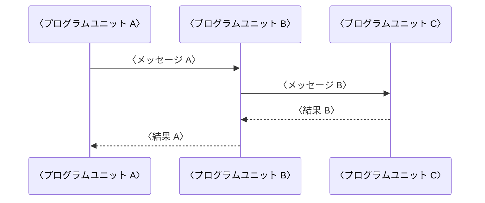

---
# ソフトウェア詳細設計書(ESPR の SW305)のテンプレート
# 〈 〉の仮の文字を書き換える。「記入の指示」の囲みは、仕上げるときに guides: false にすると PDF から消える
title: ソフトウェア詳細設計書
subtitle: 〈製品名〉 〈ソフトウェア名〉
doc-number: 〈文書番号〉
version: "〈版数〉"
date: 〈発行日〉
author: 〈作成者〉
organization: 〈発行部署〉
keywords: [詳細設計, 〈製品名〉]
subject: 〈製品名〉の〈ソフトウェア名〉のプログラムユニットの設計
# 表紙の承認欄。名前と日付を書かなければ空欄になる
approval:
  - role: 承認
  - role: 審査
  - role: 作成
# 改訂履歴は、版を出すたびに次の形で足す(作成者の列はない)。書かなければ、空の行だけの表になる
# history:
#   - version: "〈版数〉"
#     date: 〈日付〉
#     changes: 〈改訂内容〉
#     note: 〈備考〉
pubpdf:
  cover: formal
  cover-frame: true         # 表紙を二重の線で囲む
  approval-stamp: true      # 承認欄に押印の欄を空ける
  # 改訂履歴を IPA の様式(項番、日付、バージョン、改訂内容、備考)にする
  history-title: 改訂履歴
  history-columns: [number, date, "version: バージョン", "changes: 改訂内容", note]
  history-blank-rows: 10    # 手書き用の空の行
  guides: true              # 記入の指示の囲みを出す。書き終えて仕上げるときは false にして消す
  confidential: 〈機密区分〉 # 例: 社外秘。出さないときは false
  page-count: roman         # 目次まではローマ数字、本文は 1 から
  numbering: decimal
  heading-format: ["1.", "1.1", "(1)", "①"]
  figure-numbering: section # 図表の番号を「表 3.1-1」の形にする
  toc: 2
  list-of-figures: true
  list-of-tables: true
  header-left: ""
  header-right: "{title}"
  header-rule: true         # ヘッダの下に線を引く
  footer-left: "{doc-number} 第 {version} 版"
  footer-center: "{page} / {total}"
  footer-right: "{organization}"
  footer-rule: true         # フッタの上に線を引く
---

# 概要

## 目的

::: {.guide}
本書の目的を書く。誰が、本書を何に使うかがわかるようにする。
:::

〈本書の目的〉

## 位置づけ

::: {.guide}
本書と関連する文書(ソフトウェア・アーキテクチャ設計書、単体テスト仕様書など)との関係を書く。
:::

〈本書の位置づけ〉

## 対象ユーザ

::: {.guide}
本書を読む人(実装の担当者、単体テストの担当者、保守の担当者など)を書く。
:::

- 〈対象ユーザ〉

## 記載範囲

::: {.guide}
本書が対象とする機能ユニットとプログラムユニット、対象外とするものを書く。
:::

〈記載範囲〉

## 参照ドキュメント

| ID | 文書名 | 文書番号 | 発行年月 | 備考 |
|---|---|---|---|---|
| 〈R1〉 | 〈文書名〉 | 〈文書番号〉 | 〈YYYY/MM〉 | 〈備考〉 |
| | | | | |
| | | | | |

: 参照ドキュメント {#tbl-refs}

## 定義(用語、略語)

| ID | 用語・略号 | 正式表記 | 意味 |
|---|---|---|---|
| 〈D1〉 | 〈用語・略号〉 | 〈正式表記〉 | 〈意味〉 |
| | | | |
| | | | |

: 用語と略語 {#tbl-terms}

# プログラムユニット機能/構成設計書

## プログラムユニット一覧表

::: {.guide}
すべてのプログラムユニットの名称と機能概要を一覧にする。関連機能ユニット ID は、ソフトウェア・アーキテクチャ設計書で定義した ID を書く。
:::

| プログラムユニット ID | プログラムユニット名 | 機能概要 | 関連機能ユニット ID |
|---|---|---|---|
| 〈PU-XXXX〉 | 〈プログラムユニット名〉 | 〈機能概要〉 | 〈FU-XX〉 |
| | | | |
| | | | |

: プログラムユニット一覧表 {#tbl-pu}

## プログラムユニット構成図

::: {.guide}
プログラムユニットの構成をブロック図などで整理する。プログラムユニットの名称と、プログラムユニットの間の相互関係(起動の方法、インタフェースの概要など)を図に表す。
:::

```wbs
%%| label: fig-pu
%%| fig-cap: プログラムユニット構成図
〈ソフトウェア名〉
  〈FU-XX 機能ユニット名〉
    〈PU-XXXX プログラムユニット名〉
    〈PU-XXXX プログラムユニット名〉
  〈FU-XX 機能ユニット名〉
    〈PU-XXXX プログラムユニット名〉
```

# プログラムユニット設計書

## プログラムユニット詳細処理

::: {.guide}
実装可能なレベルまで詳細化する。プログラムユニットごとに 1 つの表を作る。

- 処理内容: ハードウェアの制御方法、タイミング、エラーの処理、利用する OS のシステムコールや汎用ライブラリの引数の値、高速化が必要な場合はその条件と手法など。不具合を解析するときに使う機能も、プログラムユニットとして処理内容を書く
- 制約事項: 処理時間、割り込みなど
- 備考: 参照する設計書など
:::

+---------------------------------+-------------------------------------------+
| [プログラムユニット ID]{.shade} | 〈PU-XXXX〉                               |
+---------------------------------+-------------------------------------------+
| [プログラムユニット名]{.shade}  | 〈プログラムユニット名〉                  |
+---------------------------------+-------------------------------------------+
| [引数]{.shade}                  | 〈引数の名前、型、意味〉                  |
+---------------------------------+-------------------------------------------+
| [戻り値]{.shade}                | 〈戻り値の型、値とその意味〉              |
+---------------------------------+-------------------------------------------+
| [処理内容]{.shade}                                                          |
+-----------------------------------------------------------------------------+
| 〈処理内容〉                                                                |
| \                                                                           |
| \                                                                           |
| \                                                                           |
| \                                                                           |
| \                                                                           |
| 　                                                                          |
+-----------------------------------------------------------------------------+
| [制約事項]{.shade}                                                          |
+-----------------------------------------------------------------------------+
| 〈処理時間、割り込みなどの制約〉                                            |
| \                                                                           |
| \                                                                           |
| 　                                                                          |
+-----------------------------------------------------------------------------+
| [備考]{.shade}                                                              |
+-----------------------------------------------------------------------------+
| 〈参照する設計書など〉                                                      |
| \                                                                           |
| 　                                                                          |
+-----------------------------------------------------------------------------+

: 〈プログラムユニット名〉の詳細 {#tbl-pu-detail}

## 状態管理

::: {.guide}
状態遷移表などを使って、ソフトウェアの状態と、その状態がイベントを起因として遷移する状態を整理する。表のセルには遷移先の状態の名前を書く。遷移しない組み合わせには「-」を書く。
:::

| イベント＼状態 | 〈状態 A〉 | 〈状態 B〉 | 〈状態 C〉 | 〈状態 D〉 |
|---|:-:|:-:|:-:|:-:|
| 〈イベント A〉 | 〈遷移先〉 |   |   |   |
| 〈イベント B〉 |   |   |   |   |
| 〈イベント C〉 |   |   |   |   |

: 状態遷移表 {#tbl-state}

## リソース定義

::: {.guide}
共通に利用するリソース(メモリ、DB など)について、用途や値などを整理する。リソースの名前、用途、構造、値とその意味、サイズ、取得と解放の時期を書く。
:::

〈リソース定義〉

## ハードウェア制御方法

::: {.guide}
ハードウェアの制御方法(書き込みと読み出しの方法、設定値、アドレスやポートの番号、順序や禁止事項などの制約と留意事項)を整理する。
:::

〈ハードウェア制御方法〉

## システム初期化処理

::: {.guide}
ハードウェアとソフトウェアの初期化の方法(初期値、順序など)を整理する。初期化の順序、ハードウェアの初期値、ベクターアドレスと割り込み、リソースの初期値、OS と汎用ライブラリと外部機器の初期化を書く。
:::

〈システム初期化処理〉

## 共通定義

::: {.guide}
ソフトウェア全体を通して共通に使う値(エラー値、コンパイル条件、リソースのサイズなど)を整理する。
:::

〈共通定義〉

# プログラムユニットインタフェース設計書

## シーケンス図

::: {.guide}
プログラムユニットの間の相互作用を、シーケンス図などで時系列に整理する。縦軸が時間を表し、下に向かって進む。
:::



## インタフェース詳細

::: {.guide}
インタフェースの詳細を、インタフェースごとに 1 つの表に書く。呼び出しの方法(値、意味)、結果(値、意味)、データフォーマット(構造、値、意味、サイズ)、制約事項を書く。
:::

+------------------------------------+----------------------------------------+
| [インタフェース ID]{.shade}        | 〈IF-XXXX〉                            |
+------------------------------------+----------------------------------------+
| [インタフェース名]{.shade}         | 〈インタフェース名〉                   |
+------------------------------------+----------------------------------------+
| [関連機能ユニット ID／\            | 〈関連する機能ユニットの ID〉／〈関連  |
| 関連プログラムユニット ID]{.shade} | するプログラムユニットの ID〉          |
+------------------------------------+----------------------------------------+
| [概要]{.shade}                     | 〈概要〉                               |
+------------------------------------+----------------------------------------+
| [入力]{.shade}                     | 〈入力〉                               |
+------------------------------------+----------------------------------------+
| [出力]{.shade}                     | 〈出力〉                               |
+------------------------------------+----------------------------------------+
| [詳細]{.shade}                                                              |
+-----------------------------------------------------------------------------+
| 〈呼び出しの方法と結果〉                                                    |
| \                                                                           |
| \                                                                           |
| \                                                                           |
| \                                                                           |
| 　                                                                          |
+-----------------------------------------------------------------------------+
| [データフォーマット]{.shade}                                                |
+-----------------------------------------------------------------------------+
| 〈構造、値、意味、サイズ〉                                                  |
| \                                                                           |
| \                                                                           |
| \                                                                           |
| 　                                                                          |
+-----------------------------------------------------------------------------+
| [制約事項]{.shade}                                                          |
+-----------------------------------------------------------------------------+
| 〈制約事項〉                                                                |
| \                                                                           |
| \                                                                           |
| 　                                                                          |
+-----------------------------------------------------------------------------+
| [備考]{.shade}                                                              |
+-----------------------------------------------------------------------------+
| 〈備考〉                                                                    |
| \                                                                           |
| \                                                                           |
| 　                                                                          |
+-----------------------------------------------------------------------------+

: 〈インタフェース名〉の詳細 {#tbl-if-detail}

# メモリ使用量

::: {.guide}
メモリの種別ごとに使用量を書く。使用量を分析できるように、ユニットやリソースごとに書くとよい。ROM は各ユニットの名前と使用量、RAM はリソースの名前と使用量、スタックは各ユニットの名前と使用量を一覧にする。
:::

| メモリ種別 | 使用量 | 関連プログラムユニット ID | 備考 |
|---|--:|---|---|
| ROM | 〈使用量〉 | 〈PU-XXXX〉 | 〈備考〉 |
| RAM | 〈使用量〉 | 〈PU-XXXX〉 | 〈備考〉 |
| スタック | 〈使用量〉 | 〈PU-XXXX〉 | 〈備考〉 |

: メモリ使用量 {#tbl-memory}

# その他

::: {.guide}
その他、特記しておくべき事項があれば書く。
:::

〈その他の事項〉
