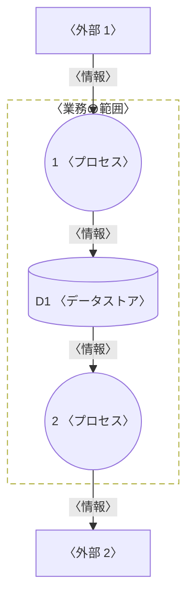
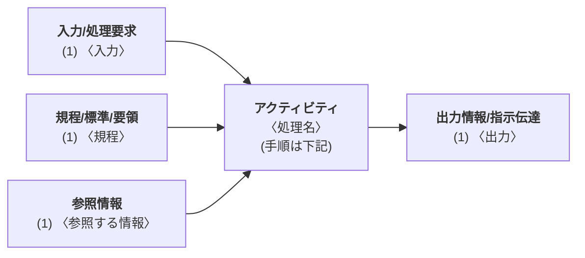
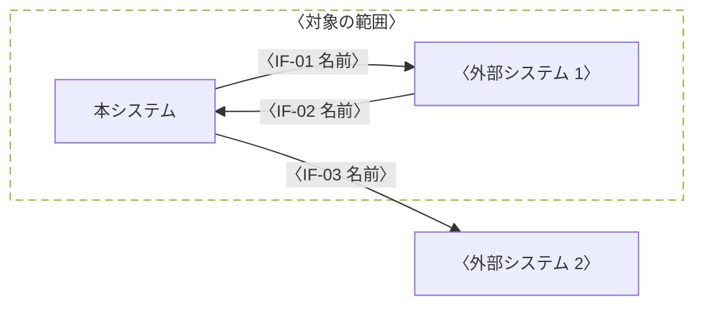

# はじめに

::: {.guide}
このテンプレートは、IPA の「超上流から攻める IT 化の事例集:要件定義」の成果物の事例に合わせた構成である。〈 〉の文字を書き換え、使わない節は「該当なし」と書いて残す。この青い破線の囲みは記入の指示である。仕上げるときは、先頭の設定の `guides` を `false` にすると、すべての囲みが消える。記入例は samples/requirements-definition.md にある。

Mermaid の図が大きく、文字が 6pt より小さくなると、組むときに警告が出る。そのときは、図を分けるか、向きを変える(`flowchart TB` など)か、横向きのページ(`::: {.landscape}`)に置く。
:::

## 本書の目的

本書は、〈発注者〉の〈システム名〉について、新しいシステム(以下、本システム)に求める機能と品質を定める。〈発注者〉と〈受注者〉が要件に合意し、基本設計の入力とすることを目的とする。

## 対象範囲

::: {.guide}
対象と対象外を区分ごとに書く。対象外を書くと、範囲の食い違いを防げる。
:::

| 区分 | 対象 | 対象外 |
|---|---|---|
| 業務 | 〈対象の業務〉 | 〈対象外の業務〉 |
| システム | 〈対象のシステム〉 | 〈対象外のシステム〉 |
| 組織 | 〈対象の組織〉 | 〈対象外の組織〉 |

: 対象範囲 {#tbl-scope}

## 本書の構成

本書の節と成果物の対応を @tbl-map に示す。

| 節 | 成果物 | 決めること |
|---|---|---|
| 3.1 | 機能情報関連図(DFD 第 1 レベル) | 業務の機能と、機能の間の情報の流れ |
| 3.2 | 業務流れ図(業務フロー) | 組織ごとの処理の順序と、手作業とシステムの分担 |
| 3.3 | 業務処理定義書(HIPO) | 個別の業務処理の入力、処理、出力 |
| 3.4 | 業務ルール定義書 | 準拠する規程と、通例と例外の処理の基準 |
| 3.5、3.6 | システム化機能一覧表、システム機能階層図 | システムで実現する機能とその構成 |
| 4.1〜4.3 | 概念 ERD、データ項目定義、データ量一覧表 | 扱うデータとその量 |
| 5.1、5.2 | システム関連図、システム間インタフェース定義書 | 外部システムとのデータのやり取り |
| 5.3〜5.5 | 画面・帳票一覧、画面レイアウト、帳票レイアウト | 利用者とのインタフェース |
| 6.1〜6.4 | 性能目標、運用要件、移行要件、情報保護 | 非機能要件 |

: 節と成果物の対応 {#tbl-map}

::: {.guide}
ID の体系を決めて、本書の中でそろえる。基本設計書でも同じ ID を使う。
:::

| 対象 | ID の形 | 例 |
|---|---|---|
| 機能 | 〈F- + サブシステムの番号 + 連番〉 | 〈F-101 機能名〉 |
| 画面 | 〈SC- + 連番〉 | 〈SC-01 画面名〉 |
| 帳票 | 〈RP- + 連番〉 | 〈RP-01 帳票名〉 |
| インタフェース | 〈IF- + 連番〉 | 〈IF-01 インタフェース名〉 |
| エンティティ | 〈E + 連番〉 | 〈E01 エンティティ名〉 |
| 業務ルール | 〈BR- + 連番〉 | 〈BR-01 対象〉 |

: ID の体系 {#tbl-ids}

## 参照ドキュメント

| ID | 文書名 | 文書番号 | 発行年月 | 備考 |
|---|---|---|---|---|
| R1 | 〈文書名〉 | 〈文書番号〉 | 〈年月〉 | |
| R2 | | | | |
| R3 | | | | |

: 参照ドキュメント {#tbl-refs}

## 用語と略語

| 用語 | 意味 |
|---|---|
| 〈用語〉 | 〈意味〉 |
| | |
| | |

: 用語と略語 {#tbl-terms}

# システム化の概要

## 現状の課題

::: {.guide}
現行業務の調査でわかった課題を、件数や時間などの事実とともに箇条書きにする。
:::

1. 〈課題〉
2. 〈課題〉

## システム化の目標

::: {.guide}
課題ごとに、測れる指標と目標値を書く。性能目標(6.1)と食い違わないようにする。
:::

| 目標 | 指標 | 現状 | 目標値 |
|---|---|--:|--:|
| 〈目標〉 | 〈指標〉 | 〈現状の値〉 | 〈目標値〉 |
| | | | |

: システム化の目標 {#tbl-goals}

## 利用者

| 部門 | 人数 | 主な業務 |
|---|--:|---|
| 〈部門〉 | 〈人数〉 | 〈業務〉 |
| | | |

: 利用者 {#tbl-users}

# 機能要件(プロセス)

## 機能情報関連図(DFD)

::: {.guide}
ファンクション(プロセス)の働きと、ファンクションの間のデータの流れを明確にする。手作業を含む業務の単位で、第 1 レベルを描く。必要なら、プロセスごとに第 2 レベルの図を足す。

- 円がプロセス、四角が外部(人、組織、システム)、円柱がデータストア、点線の枠が業務の範囲である。
- 外部は、線が交差しないよう同じものを複数の場所に描いてよい。
:::



| No. | プロセス | 内容 | 主な情報 |
|---|---|---|---|
| 1 | 〈プロセス〉 | 〈内容〉 | 〈情報〉 |
| 2 | | | |

: プロセスの説明 {#tbl-process}

## 業務流れ図(業務フロー)

::: {.guide}
DFD のプロセスを起動する出来事(外部の出来事、時刻の出来事)を起点に、一連の業務の流れを描く。次を明確にする。

- レーン(組織、役割、情報システム)
- 処理の順序
- 処理の内容(手作業とシステムの処理を区別する)
- 手作業からシステム(エンティティ)への入力と出力

図はスイムレーン(`swimlane`)で描く。`lanes:` にレーンを左から並べ、「レーン: 記号」の行を処理の順に上から書く。各行は次の行へ矢印でつながり、ほかのレーンへ渡す処理は同じ段に横の矢印で並ぶ。

- 記号を書かない行は処理、`◇` は判断、`●` は開始、`◎` は終了、`[書類]` は帳票、`[データ]` はエンティティである。
- 次の行以外へつなぐときは、`-> はい: 行き先, いいえ: 行き先` と書く。行き先は、つなぐ先の行の文字(記号を除く)と同じに書く。`->` だけを書くと、どこへもつながない。
- 手順の番号(①、②)を処理の文字の先頭に書き、表の No. とそろえる。使う画面や IF の ID は `[SC-01]` の形で書く。

表に手順ごとの区分(手作業かシステム)と入出力を書く。業務ごとに節を分ける。
:::

### 〈業務名〉

〈業務名〉の手順を @tbl-flow に、流れを @fig-flow に示す。

| No. | レーン | 処理 | 区分 | 入出力 |
|---|---|---|---|---|
| ① | 〈レーン〉 | 〈処理〉 | 〈手作業かシステム〉 | 〈画面、帳票、データ〉 |
| ② | | | | |
| ③ | | | | |

: 〈業務名〉の手順 {#tbl-flow tbl-colwidths="[6,14,48,10,22]"}

```swimlane
%%| label: fig-flow
%%| fig-cap: 〈業務名〉の業務フロー
lanes: 〈組織 A〉, 〈組織 B〉, 本システム, 〈外部システム〉
〈組織 A〉: ●
〈組織 A〉: [書類] ① 〈帳票〉
〈組織 B〉: ② 〈処理〉 [〈画面 ID〉]
本システム: ③ 〈システムの処理〉
本システム: [データ] 〈エンティティ〉
本システム: ◇ 〈判断の条件〉 -> はい: ④ 〈処理〉, いいえ: ⑤ 〈処理〉 [〈IF の ID〉]
〈組織 B〉: ④ 〈処理〉
本システム: ⑤ 〈処理〉 [〈IF の ID〉]
〈外部システム〉: 〈処理〉
本システム: [書類] 〈帳票〉 [〈帳票 ID〉]
〈組織 A〉: ◎
```

## 業務処理定義書(HIPO)

::: {.guide}
判断や計算の多い個別の業務処理について、入力、処理、出力と、処理の拠り所(規程)と参照する情報を書く。アクティビティ(処理の手順)は図の下に番号付きで書く。
:::

<table>
<tr><th>ビジネスプロセス名</th><td>〈プロセス名〉</td><th>個別業務処理名</th><td>〈処理名〉</td><th>機能</th><td>〈機能 ID〉</td></tr>
</table>

: 業務処理の識別 {#tbl-hipo-id}



アクティビティ(処理の手順)は次のとおりとする。

1. 〈手順〉
2. 〈手順〉

## 業務ルール定義書

### ビジネスルール

::: {.guide}
業務が準拠する規程や標準を、分類(共通、商流、物流、金流、管理など)ごとに書き、システム化にどう反映するかを書く。
:::

| 分類 | ID | 対象 | ビジネスルール | システム化への反映 |
|---|---|---|---|---|
| 〈分類〉 | 〈BR-01〉 | 〈対象〉 | 〈準拠する規程と内容〉 | 〈反映する機能や設計〉 |
| | | | | |
| | | | | |

: ビジネスルール定義書 {#tbl-bizrule}

### 通例と例外の処理基準

::: {.guide}
業務ごとに、通常の処理の基準と、例外の処理の基準を書く。例外をシステムで扱うか、人が判断するかを「システム化要求」に書く。
:::

| 分類 | 業務 | 通例ルール処理基準 | 例外ルール処理基準 | システム化要求 |
|---|---|---|---|---|
| 〈分類〉 | 〈業務〉 | 〈通常の基準〉 | 〈例外の基準〉 | 〈システムでの扱い〉 |
| | | | | |
| | | | | |

: 業務ルール定義書(通例と例外) {#tbl-rule tbl-colwidths="[8,10,26,22,34]"}

## システム化機能一覧表

::: {.guide}
業務フローで検討した業務を、単純な機能まで分解し、システム化するすべての機能を漏れなく書く。機能の説明は、画面と帳票の単位で書く(`[ ]` の行)。区分はリアル(オンライン処理)かバッチ。業務フローの名前は太字の行にする。
:::

| 業務 | 機能 | 区分 | 機能説明 |
|---|---|---|---|
| **〈業務フロー〉** | | | |
| 〈業務〉 | 〈機能 ID と名前〉 | 〈リアル/バッチ〉 | 〈機能の説明〉 |
| | | | [〈画面 ID と名前〉] 〈画面での操作と処理〉 |
| | | | [〈帳票 ID と名前〉] 〈出力の内容〉 |
| | | | |

: システム化機能一覧表 {#tbl-functions tbl-colwidths="[14,21,9,56]"}

## システム機能階層図

::: {.guide}
業務機能を実現するシステムの階層構造を書く。第 1 階層はサブシステム、第 2 階層は機能である。箱の中の文字が折り返すと字間が空くので、機能名は短くする。
:::

```wbs
%%| label: fig-hierarchy
%%| fig-cap: システム機能階層図
〈システム名〉
  1 〈サブシステム〉
    〈機能 ID と名前〉
    〈機能 ID と名前〉
  2 〈サブシステム〉
    〈機能 ID と名前〉
    〈機能 ID と名前〉
  3 〈サブシステム〉
    〈機能 ID と名前〉
```

# 機能要件(データ)

## 概念 ERD

::: {.guide}
業務フローと DFD のデータストアから、エンティティとその関係を描く。正規化し、実装する DBMS は意識しない。関係のラベルは空(`""`)でよい。エンティティの名前に空白を入れない。属性は下の表に書く。`|` で区切った行に、箱を置く段と列を書く。関係のある箱を隣に置くと、線がまっすぐになる。
:::

```er
%%| label: fig-erd
%%| fig-cap: 概念 ERD
| 〈リソース1〉 | 〈イベント〉 | 〈イベントの明細〉 |
| 〈リソース2〉 |              |                    |
  〈リソース1〉 ||--o{ 〈イベント〉 : ""
  〈リソース2〉 ||--o{ 〈イベント〉 : ""
  〈イベント〉 ||--|{ 〈イベントの明細〉 : ""
```

| ID | 名称 | 区分 | 主キー | 主な属性 | DFD |
|---|---|---|---|---|---|
| 〈E01〉 | 〈エンティティ〉 | 〈リソースかイベント〉 | 〈主キー〉 | 〈属性〉 | 〈データストア〉 |
| | | | | | |
| | | | | | |

: エンティティ一覧 {#tbl-entities tbl-colwidths="[9,12,12,25,32,10]"}

## データ項目定義

::: {.guide}
画面と帳票ごとに、データ項目の意味、桁数、表示形式(数字、日付など)、符号・小数部、編集(自動採番、コード検索など)を書く。注には業務ルールの ID などを書く。画面と帳票ごとに表を分ける。
:::

<table>
<tr><th>画面・帳票名</th><td>〈画面・帳票名と ID〉</td><th>作成方法</th><td>〈誰が何を見て入力するか〉</td></tr>
</table>

: データ項目定義の対象 {#tbl-items-head}

| 番号 | データ項目名 | 説明(データの意味) | 全体桁数 | 表示形式 | 符号・小数部 | 編集 | 注 |
|--:|---|---|--:|---|---|---|---|
| 1 | 〈項目名〉 | 〈意味〉 | 〈桁数〉 | 〈形式〉 | 〈符号〉 | 〈編集〉 | 〈注〉 |
| 2 | | | | | | | |
| 3 | | | | | | | |

: データ項目定義(〈画面・帳票名〉) {#tbl-items .small tbl-colwidths="[5,14,17,7,14,14,14,15]"}

## データ量一覧表

::: {.guide}
概念 ERD のすべてのエンティティについて、データ量を見積もる。初期データ件数は移行時の件数を書く。増加率は、性能目標(6.1)の前提の業務量とそろえる。
:::

| テーブル分類 | テーブル名称 | 論理名 | 平均レコード長(Byte) | 初期データ件数(移行時) | 増加率 | 保管期間 |
|---|---|---|--:|--:|--:|---|
| リソース | 〈E01 名称〉 | 〈論理名〉 | 〈バイト数〉 | 〈件数〉 | 〈件/月〉 | 〈期間〉 |
| | | | | | | |
| イベント | 〈E06 名称〉 | 〈論理名〉 | 〈バイト数〉 | 〈件数〉 | 〈件/月〉 | 〈期間〉 |
| | | | | | | |

: データ量一覧表 {#tbl-volume .small tbl-colwidths="[10,15,21,12,15,13,14]"}

# 機能要件(インタフェース)

## システム関連図

::: {.guide}
本システムと外部システムとの間のデータのやり取りを描く。線にはインタフェースの ID と名前を書く。点線の枠は、対象の範囲である。
:::



## システム間インタフェース定義書

::: {.guide}
@fig-systems のインタフェースごとに、内容(データ項目、サイズ、手段、媒体、頻度)と情報保証(セキュリティと重要度)、送る側と受ける側のノードを書く。表の下に、セキュリティと重要度の区分を書く。
:::

<table>
<tr><th rowspan="2">ID</th><th rowspan="2">インタフェースの種類</th><th colspan="5">インタフェースの内容</th><th colspan="2">情報保証</th></tr>
<tr><th>主なデータ項目</th><th>サイズ</th><th>手段</th><th>媒体</th><th>頻度</th><th>セキュリティ</th><th>重要度</th></tr>
<tr><td>〈IF-01〉</td><td>〈種類〉</td><td>〈データ項目〉</td><td>〈サイズ〉</td><td>〈手段〉</td><td>〈媒体〉</td><td>〈頻度〉</td><td>〈レベル〉</td><td>〈重要度〉</td></tr>
<tr><td>　</td><td></td><td></td><td></td><td></td><td></td><td></td><td></td><td></td></tr>
<tr><td>　</td><td></td><td></td><td></td><td></td><td></td><td></td><td></td><td></td></tr>
</table>

: システム間インタフェース定義書(内容) {#tbl-if .small}

<table>
<tr><th rowspan="2">ID</th><th colspan="4">データ発生ノード</th><th colspan="4">データ受入ノード</th></tr>
<tr><th>システム名</th><th>システム機能</th><th>サーバ名</th><th>設置場所</th><th>システム名</th><th>システム機能</th><th>サーバ名</th><th>設置場所</th></tr>
<tr><td>〈IF-01〉</td><td>〈システム〉</td><td>〈機能〉</td><td>〈サーバ〉</td><td>〈場所〉</td><td>〈システム〉</td><td>〈機能〉</td><td>〈サーバ〉</td><td>〈場所〉</td></tr>
<tr><td>　</td><td></td><td></td><td></td><td></td><td></td><td></td><td></td><td></td></tr>
<tr><td>　</td><td></td><td></td><td></td><td></td><td></td><td></td><td></td><td></td></tr>
</table>

: システム間インタフェース定義書(ノード) {#tbl-if-node .small}

セキュリティレベル 〈区分と意味〉。重要度 〈区分と意味〉。

## 画面・帳票一覧

::: {.guide}
すべての画面と帳票を書く。タイプは画面、伝票、一覧表など、サイクルは随時、毎日、月次などを書く。容量は、1 画面の行数、帳票の枚数と 1 枚あたりの件数を書く。機能の列は、システム化機能一覧表(3.5)の機能 ID とそろえる。
:::

| ID | 画面・帳票名 | 目的・利用用途 | 利用者 | タイプ | サイクル | 容量 | 機能 |
|---|---|---|---|---|---|---|---|
| 〈SC-01〉 | 〈画面名〉 | 〈目的〉 | 〈利用者〉 | 画面 | 〈サイクル〉 | 〈行数〉 | 〈機能 ID〉 |
| 〈RP-01〉 | 〈帳票名〉 | 〈目的〉 | 〈利用者〉 | 〈タイプ〉 | 〈サイクル〉 | 〈枚数〉 | 〈機能 ID〉 |
| | | | | | | | |

: 画面・帳票一覧 {#tbl-io .small tbl-colwidths="[7,13,22,15,11,10,11,11]"}

## 画面レイアウト

::: {.guide}
主な画面の模式図と、ボタンの動作を書く。項目の内容はデータ項目定義(4.2)に書く。模式図の書き方: `"文字"` は入力欄、`^文字^` は選択欄、`[文字]` はボタン、`--` は区切り線。
:::

```wireframe
%%| label: fig-screen
%%| fig-cap: 〈画面名〉(〈画面 ID〉)
# 〈画面名〉(〈画面 ID〉)
〈項目名〉 | "〈入力の例〉" | 〈項目名〉 | "〈入力の例〉"
〈項目名〉 | ^〈選択の例〉^ | 〈項目名〉 | 〈表示の例〉
--
# 〈明細の見出し〉
No. | 〈項目名〉 | 〈項目名〉 | 〈項目名〉
1 | "〈入力の例〉" | 〈表示の例〉 | "〈入力の例〉"
--
[〈ボタン〉] | [〈ボタン〉] | [閉じる]
```

| ボタン | 動作 | 遷移先 |
|---|---|---|
| 〈ボタン〉 | 〈動作〉 | 〈遷移先の画面 ID〉 |
| | | |

: 〈画面名〉の操作 {#tbl-screen-action}

## 帳票レイアウト

::: {.guide}
主な帳票の印字の位置を、方眼(`grid`)で書く。帳票の仕様は下の表に書く。X は英数字、Ｎ は全角の文字、9 は数字、Z は前のゼロを空白にする数字を表す。

- `columns:` と `rows:` に、方眼の桁と行の数を書く。
- 「行, 桁: 文字」の行で、文字を置く。全角は 2 桁、半角は 1 桁に数える。桁の範囲を `4, 66-75: 9,600,000 {右}` のように書くと、その範囲の中で寄せる。
- 末尾の `{太字}`、`{網掛け}`、`{枠}`、`{下線}`、`{右}`、`{中央}` で体裁を付ける。`3, 1-80: {網掛け 枠}` のように文字のない範囲も書ける。
- 項目の先頭に ①、② を書くと、項目の番号を方眼に出せる。
:::

〈帳票名〉(〈帳票 ID〉)のレイアウトを @fig-report に示す。

```grid
%%| label: fig-report
%%| fig-cap: 〈帳票名〉(〈帳票 ID〉)のレイアウト
columns: 80
rows: 8
1, 2: 帳票名 {太字}
1, 49: 帳票ID XXXXX
1, 63: 頁 ZZ9/ZZ9
2, 49: 作成日 YYYY/MM/DD
3, 1-80: {網掛け 枠}
3, 2: 見出し
3, 22: 見出し
3, 66-75: 見出し {右}
4, 2: ＮＮＮＮＮＮＮＮ
4, 22: ＮＮＮＮＮＮＮＮ
4, 66-75: ZZ,ZZZ,ZZ9 {右}
8, 1-80: {枠}
8, 22: 合計 {太字}
8, 66-75: ZZ,ZZZ,ZZ9 {右}
```

| 項目 | 仕様 |
|---|---|
| 用紙 | 〈用紙の大きさと向き、1 ページの行数〉 |
| 並び順 | 〈並び順〉 |
| 集計 | 〈小計、合計の単位〉 |
| 改ページ | 〈改ページの条件〉 |
| 出力 | 〈出力の方法と送り先〉 |

: 〈帳票名〉の仕様 {#tbl-report}

# 非機能要件

## 性能目標

::: {.guide}
類似システムとの比較、利用のニーズ、業務上の制約をもとに、性能の目標値を決める。基本設計でインフラを設計するための前提条件(業務量、データ量、利用者数)も書く。オンラインは接続形態と処理のタイプごとに、バッチは処理ごとに書く。
:::

| 接続形態 | 処理タイプ(想定データ量) | ピーク時応答 | 平均応答 | 最大同時利用者数 |
|---|---|---|---|---|
| 〈接続形態〉 | 〈処理タイプ〉 | 〈秒〉 | 〈秒〉 | 〈人数〉 |
| | | | | |

: オンラインの性能目標 {#tbl-perf-online}

| 処理 | 対象件数(ピーク) | 処理時間の目標 | 実行時間帯 |
|---|--:|---|---|
| 〈機能 ID と名前〉 | 〈件数〉 | 〈時間〉 | 〈時間帯〉 |
| | | | |

: バッチの性能目標 {#tbl-perf-batch}

| 項目 | 〈年度〉(実績) | 〈年度〉(想定) | 単位 |
|---|--:|--:|---|
| 〈業務量の項目〉 | 〈実績〉 | 〈想定〉 | 〈単位〉 |
| | | | |

: 性能の前提となる業務量 {#tbl-perf-base}

## 運用要件

::: {.guide}
上の枠に運用の基本方針(稼働の時間、停止できる時間、運用と保守の分担)を書く。自社の標準的な運用と違う部分は、業務の要件として書く。24 時間稼働のときは、プログラムの適用などで止められる時間を書く。下の表には、運用の作業ごとの担当とスケジュールを書く。
:::

<table>
<tr><th>運用に関する基本方針</th></tr>
<tr><td>〈方針〉<br>・〈稼働の時間〉<br>・〈止められる時間〉<br>・〈運用と保守の分担〉</td></tr>
</table>

: 運用に関する基本方針 {#tbl-ops-policy}

| 分類 | 運用管理項目 | 運用作業内容 | 担当部門 | 支援部門 | 運用スケジュール | 特記事項 |
|---|---|---|---|---|---|---|
| 運用管理 | 〈スケジュール管理など〉 | 〈作業内容〉 | 〈部門〉 | 〈部門〉 | 〈いつ〉 | 〈自動運用など〉 |
| | | | | | | |
| 障害対応 | 〈障害の受付など〉 | 〈作業内容〉 | 〈部門〉 | 〈部門〉 | 〈いつ〉 | 〈復旧の目標など〉 |
| | | | | | | |

: 運用要件一覧表 {#tbl-ops .small tbl-colwidths="[8,14,26,15,15,12,10]"}

## 移行要件

::: {.guide}
システムの移行と初期構築の要件を書く。移行ツールを作ってデータを移すのか、人手で作業するのかを明確にする。切り替えの時期(年度末、期末前など)と方法(一斉、順次、並行稼働など)を明確にする。
:::

<table>
<tr><th>移行に対する基本方針</th></tr>
<tr><td>・〈移行する対象〉<br>・〈切り替えの時期と方法〉<br>・〈並行稼働の有無とリハーサル〉</td></tr>
</table>

: 移行に対する基本方針 {#tbl-mig-policy}

| 分類 | 移行対象 | 移行方法 | 確認・検証手順 | 移行体制 | 移行時期 | 障害対応方針 |
|---|---|---|---|---|---|---|
| データ | 〈対象〉 | 〈方法〉 | 〈照合の方法〉 | 〈体制〉 | 〈時期〉 | 〈対応〉 |
| | | | | | | |
| 業務 | 〈教育など〉 | 〈方法〉 | 〈確認の方法〉 | 〈体制〉 | 〈時期〉 | 〈対応〉 |

: 移行要件整理表 {#tbl-migration .small tbl-colwidths="[9,13,18,19,11,13,17]"}

```schedule
%%| label: fig-migration
%%| fig-cap: 移行の日程
columns: 〈1 月目〉, 〈2 月目〉, 〈3 月目〉, 〈4 月目〉
準備
〈移行設計〉: 〈1 月目〉
〈移行ツールの開発〉: 〈2 月目〉-〈3 月目〉
本番
◆ 〈切り替え〉: 〈4 月目〉
```

## 情報保護

::: {.guide}
機密性の高い情報(個人情報、規制のある情報など)を洗い出す。特性には個人情報、社外秘などを、保持される形態にはデータベース、ファイル、紙などを書く。データベースに保存する情報だけでなく、ファイルと紙で保存する情報も洗い出す。部門ごとの権限と、そのほかの対策も書く。
:::

| No. | 情報資産名 | 特性 | 所有者 | 利用者の範囲 | 保持される形態 | 場所 | 保管期間 | 廃棄方法 |
|--:|---|---|---|---|---|---|---|---|
| 1 | 〈情報資産〉 | 〈特性〉 | 〈所有者〉 | 〈部門〉 | 〈形態〉 | 〈場所〉 | 〈期間〉 | 〈方法〉 |
| 2 | | | | | | | | |
| 3 | | | | | | | | |

: 情報保護一覧表 {#tbl-security .small tbl-colwidths="[5,14,12,12,14,9,11,11,12]"}

部門ごとの権限を @tbl-roles に示す(○: 登録と更新、△: 参照のみ、—: 使えない)。

| 機能 | 〈部門〉 | 〈部門〉 | 〈部門〉 |
|---|:-:|:-:|:-:|
| 〈サブシステムと機能 ID〉 | 〈○△—〉 | | |
| | | | |

: 部門ごとの権限 {#tbl-roles}

このほか、次の対策をとる。

- 〈認証〉
- 〈通信の暗号化〉
- 〈操作の記録〉

# 未決事項

::: {.guide}
合意できていない事項を、決める人と期限とともに書く。決まったら本文に反映し、この表から消す。
:::

| No. | 内容 | 決める人 | 期限 |
|--:|---|---|---|
| 1 | 〈内容〉 | 〈決める人〉 | 〈期限〉 |
| 2 | | | |

: 未決事項 {#tbl-open}
