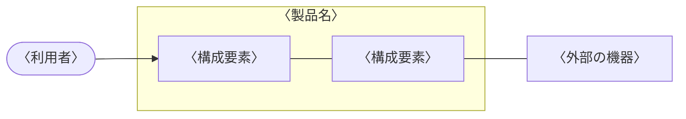

---
# 〈 〉の仮の文字を書き換える。承認欄は、名前と日付を書かなければ空欄(押印欄)になる
title: 安全要求仕様書
subtitle: 〈製品名〉
doc-number: 〈文書番号〉
version: "〈版数〉"
date: 〈発行日〉
author: 〈作成者〉
organization: 〈発行部署〉
keywords: [安全要求, 〈製品名〉]
subject: 〈製品名〉の安全性に関する要求
approval:
  - role: 承認
  - role: 審査
  - role: 作成
# 改訂履歴は、版を出すたびに次の形で足す(作成者の列はない)。書かなければ、空の行だけの表になる
# history:
#   - version: "〈版数〉"
#     date: 〈日付〉
#     changes: 〈改訂内容〉
#     note: 〈備考〉
pubpdf:
  cover: formal
  cover-frame: true         # 表紙を二重の線で囲む
  approval-stamp: true      # 承認欄に押印の欄を空ける
  # 改訂履歴を IPA の様式(項番、日付、バージョン、改訂内容、備考)にする
  history-title: 改訂履歴
  history-columns: [number, date, "version: バージョン", "changes: 改訂内容", note]
  history-blank-rows: 10    # 手書き用の空の行
  guides: true              # 記入の指示の囲みを出す。書き終えて仕上げるときは false にして消す
  confidential: 社外秘
  page-count: roman         # 目次まではローマ数字、本文は 1 から
  numbering: decimal
  heading-format: ["1.", "1.1", "(1)", "①"]
  figure-numbering: section # 図表の番号を「表 3.1-1」の形にする
  toc: 2
  list-of-figures: true
  list-of-tables: true
  header-left: ""
  header-right: "{title}"
  header-rule: true         # ヘッダの下に線を引く
  footer-left: "{doc-number} 第 {version} 版"
  footer-center: "{page} / {total}"
  footer-right: "{organization}"
  footer-rule: true         # フッタの上に線を引く
---

# 概要

::: {.guide}
ドキュメントの目的、位置づけ、記載内容などの本書の概要および参照しているドキュメント名等を記載する。
:::

## 目的

本書は、〈製品名〉の安全性に関する要求を定める。

## 位置づけ

〈本書の入力となった文書と、本書を入力とする文書を書く〉

## 対象ユーザ

〈本書を読む人を書く〉

## 記載範囲

〈本書で扱う範囲と、扱わない範囲を書く〉

## 参照ドキュメント

| ID | 文書名 | 文書番号 | 発行年月 | 備考 |
|---|---|---|---|---|
| 〈ID〉 | 〈文書の名前〉 | 〈文書番号〉 | 〈年/月〉 | 〈備考〉 |
| | | | | |
| | | | | |

: 参照ドキュメント {#tbl-refs}

## 定義(用語、略語)

| ID | 用語・略号 | 正式表記 | 意味 |
|---|---|---|---|
| 〈ID〉 | 〈用語〉 | 〈正式な表記〉 | 〈用語の意味を書く〉 |
| | | | |
| | | | |

: 定義(用語、略語) {#tbl-terms}

# システム構成

## システム全体構成

::: {.guide}
＊ハードウェアとソフトウェアを含むシステム全体構成をブロック図などで整理し、システムの動作環境や外部環境も含めてシステムの位置づけを明確にする(システム要求仕様書から引用)
:::



## システムを構成する主たる要素

::: {.guide}
＊2.1 で整理したシステムの構成要素の概要を一覧表などでまとめる(システム要求仕様書から引用)
:::

| 構成要素 ID | 構成要素 | 概要 |
|---|---|---|
| 〈ID〉 | 〈構成要素の名前〉 | 〈構成要素の概要を書く〉 |
| | | |
| | | |

: システムを構成する主たる要素 {#tbl-elements}

# 想定システム障害リスト

::: {.guide}
＊システムが想定する安全逸脱状況とそのハザード解析結果を整理する
:::

## 動作環境・動作モードの定義

::: {.guide}
＊システムが通常想定している動作環境・動作モードに関する定義を整理する
:::

〈動作環境と動作モードを書く〉

## 想定システム障害リスト

::: {.guide}
＊システムで想定される安全逸脱状況とそれが発生する可能性を障害リストとして整理する
:::

〈障害ごとに、安全逸脱状況、原因、発生の可能性、影響を書く〉

## システムハザード解析

::: {.guide}
＊3.2 で整理したそれぞれの想定システム障害について、FTA、FMEA など利用してシステムハザードを解析しその結果を整理する
:::

```fta
%%| label: fig-fta
%%| fig-cap: 〈障害〉の FTA
OR 〈頂上の事象〉
  AND 〈中間の事象〉
    〈基本の事象〉
    〈基本の事象〉
  〈基本の事象〉
  ◇ 〈展開しない事象〉
```

# システム安全要求リスト

::: {.guide}
＊安全性を実現するためにシステムおよびシステムの周辺(外部システム、ユーザなど)に求められる要件を整理する

- システムが安全逸脱状況に陥った場合の回避動作(システム系、人間系など)
- システムが非正常動作に陥った場合の安全機能に関する要求
    - システムの動作モード(始動、自動、手動、半自動、定常・非定常など)
- システムの故障回避メカニズムに関する要求
:::

| 安全要求 ID | 安全要求名 | 安全要求機能 | 回避動作 | 備考 |
|---|---|---|---|---|
| 〈ID〉 | 〈安全要求名〉 | 〈安全要求の機能を書く〉 | 〈回避の動作を書く〉 | 〈備考〉 |
| | | | | |
| | | | | |

: システム安全要求リスト {#tbl-sar}

# システム安全度水準

::: {.guide}
＊4 で整理した安全機能要求ごとにシステムに求められる安全性の水準(安全度水準)を整理する
:::

| 安全要求 ID | 安全要求名 | 安全度水準 | 備考 |
|---|---|---|---|
| 〈ID〉 | 〈安全要求名〉 | 〈水準〉 | 〈備考〉 |
| | | | |
| | | | |

: システム安全度水準 {#tbl-sil}

# その他

::: {.guide}
＊開発過程での安全性チェックのためのメカニズムを整理する
:::

〈特記事項を書く〉
