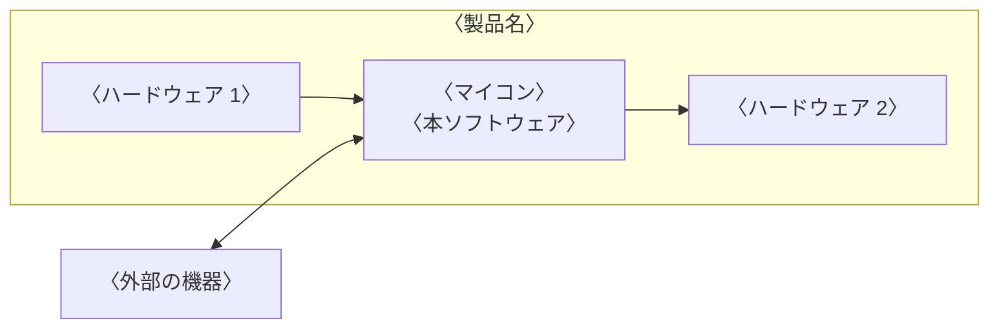

---
# ソフトウェア・アーキテクチャ設計書(ESPR の SW205)のテンプレート
# 〈 〉の仮の文字を書き換える。「記入の指示」の囲みは、仕上げるときに guides: false にすると PDF から消える
title: ソフトウェア・アーキテクチャ設計書
subtitle: 〈製品名〉 〈ソフトウェア名〉
doc-number: 〈文書番号〉
version: "〈版数〉"
date: 〈発行日〉
author: 〈作成者〉
organization: 〈発行部署〉
keywords: [ソフトウェア・アーキテクチャ, 〈製品名〉]
subject: 〈製品名〉の〈ソフトウェア名〉の構成と制御方式
# 表紙の承認欄。名前と日付を書かなければ空欄になる
approval:
  - role: 承認
  - role: 審査
  - role: 作成
# 改訂履歴は、版を出すたびに次の形で足す(作成者の列はない)。書かなければ、空の行だけの表になる
# history:
#   - version: "〈版数〉"
#     date: 〈日付〉
#     changes: 〈改訂内容〉
#     note: 〈備考〉
pubpdf:
  cover: formal
  cover-frame: true         # 表紙を二重の線で囲む
  approval-stamp: true      # 承認欄に押印の欄を空ける
  # 改訂履歴を IPA の様式(項番、日付、バージョン、改訂内容、備考)にする
  history-title: 改訂履歴
  history-columns: [number, date, "version: バージョン", "changes: 改訂内容", note]
  history-blank-rows: 10    # 手書き用の空の行
  guides: true              # 記入の指示の囲みを出す。書き終えて仕上げるときは false にして消す
  confidential: 〈機密区分〉 # 例: 社外秘。出さないときは false
  page-count: roman         # 目次まではローマ数字、本文は 1 から
  numbering: decimal
  heading-format: ["1.", "1.1", "(1)", "①"]
  figure-numbering: section # 図表の番号を「表 3.1-1」の形にする
  toc: 2
  list-of-figures: true
  list-of-tables: true
  header-left: ""
  header-right: "{title}"
  header-rule: true         # ヘッダの下に線を引く
  footer-left: "{doc-number} 第 {version} 版"
  footer-center: "{page} / {total}"
  footer-right: "{organization}"
  footer-rule: true         # フッタの上に線を引く
---

# 概要

## 目的

::: {.guide}
本書の目的を書く。誰が、本書を何に使うかがわかるようにする。
:::

〈本書の目的〉

## 位置づけ

::: {.guide}
本書と関連する文書(ソフトウェア要求仕様書、ソフトウェア詳細設計書など)との関係を書く。
:::

〈本書の位置づけ〉

## 対象ユーザ

::: {.guide}
本書を読む人(詳細設計の担当者、結合テストの担当者など)を書く。
:::

- 〈対象ユーザ〉

## 記載範囲

::: {.guide}
本書が対象とするソフトウェアと、対象外とするものを書く。
:::

〈記載範囲〉

## 参照ドキュメント

| ID | 文書名 | 文書番号 | 発行年月 | 備考 |
|---|---|---|---|---|
| 〈R1〉 | 〈文書名〉 | 〈文書番号〉 | 〈YYYY/MM〉 | 〈備考〉 |
| | | | | |
| | | | | |

: 参照ドキュメント {#tbl-refs}

## 定義(用語、略語)

| ID | 用語・略号 | 正式表記 | 意味 |
|---|---|---|---|
| 〈D1〉 | 〈用語・略号〉 | 〈正式表記〉 | 〈意味〉 |
| | | | |
| | | | |

: 用語と略語 {#tbl-terms}

# システム構成

## システム全体構成

::: {.guide}
ハードウェアとソフトウェアを含むシステム全体の構成をブロック図などで整理し、ソフトウェアの位置づけを明確にする(ソフトウェア要求仕様書から引用する)。システム構成要素の名称と基本機能、ソフトウェアに関係する外部の要素の基本仕様を書く。
:::

〈システム全体構成の説明〉



## システムを構成する主たるソフトウェア機能(要素)

::: {.guide}
ソフトウェアの機能を一覧にする。必要に応じて、MPU の名称、接続する I/O、割り込みのレベルと I/O の対応、メモリの種類とサイズ、通信プロトコル、入出力データの形式、各種の性能、外部媒体の種類と制御方式なども書く。
:::

| ID | 機能略称 | 機能名 |
|---|---|---|
| 〈F-01〉 | 〈機能略称〉 | 〈機能名〉 |
| | | |
| | | |

: ソフトウェアの機能 {#tbl-func}

# ソフトウェア構成

## ソフトウェア全体構成

::: {.guide}
ソフトウェアを構成する機能ユニットをブロック図などで整理し、ソフトウェアの全体構成を明確にする。機能ユニットの名称、基本機能、動作形態(タスクかどうか、タスクの優先度、常駐か非常駐か、共通関数、保守用など)を書く。
:::

〈ソフトウェア全体構成の説明〉

```layers
%%| label: fig-fu
%%| fig-cap: 機能ユニット構成図
〈機能ユニット 1〉 | 〈機能ユニット 2〉 | 〈機能ユニット 3〉
〈OS、ミドルウェア〉
〈デバイスドライバ〉
〈ハードウェア〉
```

## システムを構成する機能ユニット

| 機能ユニット ID | 機能ユニット名 | 機能概要 | 関連機能 ID |
|---|---|---|---|
| 〈FU-01〉 | 〈機能ユニット名〉 | 〈機能概要〉 | 〈F-01〉 |
| | | | |
| | | | |

: 機能ユニット {#tbl-fu}

## 機能ユニット間のインタフェース

::: {.guide}
各機能ユニット間の制御とデータを明確にする。各機能ユニット間の制御とデータを静的に書き、必要に応じて OS、メモリ、外部記憶媒体、ハードウェア機構を併記する。
:::

〈機能ユニット間のインタフェース〉

# 制御方式

## メモリー構成/レイアウト

::: {.guide}
メモリーの構成、種類、サイズ、ソフトウェア領域の構成などを明確にする。システム・アーキテクチャ設計書やハードウェア仕様書から、ROM と RAM の種類、ソフトウェア用の領域、ハードウェアのレジスタ領域の位置とサイズを明確にし、ソフトウェアの領域(コード域、データ域、OS の使用域)をどう使うかを書く。
:::

〈メモリー構成とレイアウト〉

## ソフトウェア制御方式

::: {.guide}
シーケンス図や状態遷移表を使って、システムの振る舞いの中で、ソフトウェアが担う動作を明確にする。必要に応じて、リカバリの方式、性能を実現する並行処理の制御、出荷後のソフトウェアの更新方式、障害調査のデータの取得方式などを書く。
:::

〈ソフトウェア制御方式〉

## 性能見積

::: {.guide}
ハードウェアの特性を考慮しながら、ソフトウェアとして実現しなければならない性能を定量的に見積もるとともに、その実現方法を整理する。必要な性能と時間、対象の条件と処理のシーケンス、各処理の時間の見積もりと根拠を書く。
:::

〈性能見積〉

# 機能ユニット詳細

::: {.guide}
機能ユニットごとに、詳細設計が可能なレベルまで詳細化する。構成、機能、入出力のインタフェース、処理方式、共通領域などを書く。
:::

〈機能ユニットごとの詳細〉

# システムで扱うデータ

::: {.guide}
排他処理が必要な共通データなど、システム全体で共通に扱うデータの使用目的と、更新元と参照元を書く。
:::

| データ ID | データ名 | 概要 | 関連機能ユニット ID |
|---|---|---|---|
| 〈D-01〉 | 〈データ名〉 | 〈概要〉 | 〈FU-01〉 |
| | | | |
| | | | |

: システムで扱うデータ {#tbl-data}

# 例外一覧

::: {.guide}
異常と例外のコード、内容(メッセージ、意味)、対処方法を一覧表にする。
:::

| 例外コード | 例外内容 | 対処方法 | 備考 |
|---|---|---|---|
| 〈例外コード〉 | 〈例外内容〉 | 〈対処方法〉 | 〈備考〉 |
| | | | |
| | | | |

: 例外一覧 {#tbl-exceptions}

# その他

::: {.guide}
ソフトウェア全体を通して、開発グループの全員で共有すべき事柄を書く。例: エラーと異常の情報の一覧、共通の制御情報の領域の詳細(各情報域の名称、構成、形式、サイズ、初期値、アクセスの制限)。
:::

〈その他の事項〉
