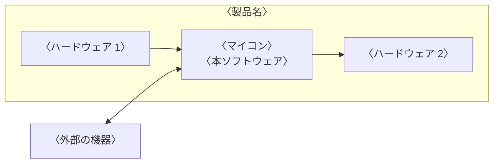

---
# ソフトウェア要求仕様書(ESPR の SW105)のテンプレート
# 〈 〉の仮の文字を書き換える。「記入の指示」の囲みは、仕上げるときに guides: false にすると PDF から消える
title: ソフトウェア要求仕様書
subtitle: 〈製品名〉 〈ソフトウェア名〉
doc-number: 〈文書番号〉
version: "〈版数〉"
date: 〈発行日〉
author: 〈作成者〉
organization: 〈発行部署〉
keywords: [ソフトウェア要求, 〈製品名〉]
subject: 〈製品名〉の〈ソフトウェア名〉に求める機能と品質
# 表紙の承認欄。名前と日付を書かなければ空欄になる
approval:
  - role: 承認
  - role: 審査
  - role: 作成
# 改訂履歴は、版を出すたびに次の形で足す(作成者の列はない)。書かなければ、空の行だけの表になる
# history:
#   - version: "〈版数〉"
#     date: 〈日付〉
#     changes: 〈改訂内容〉
#     note: 〈備考〉
pubpdf:
  cover: formal
  cover-frame: true         # 表紙を二重の線で囲む
  approval-stamp: true      # 承認欄に押印の欄を空ける
  # 改訂履歴を IPA の様式(項番、日付、バージョン、改訂内容、備考)にする
  history-title: 改訂履歴
  history-columns: [number, date, "version: バージョン", "changes: 改訂内容", note]
  history-blank-rows: 10    # 手書き用の空の行
  guides: true              # 記入の指示の囲みを出す。書き終えて仕上げるときは false にして消す
  confidential: 〈機密区分〉 # 例: 社外秘。出さないときは false
  page-count: roman         # 目次まではローマ数字、本文は 1 から
  numbering: decimal
  heading-format: ["1.", "1.1", "(1)", "①"]
  figure-numbering: section # 図表の番号を「表 3.1-1」の形にする
  toc: 2
  list-of-figures: true
  list-of-tables: true
  header-left: ""
  header-right: "{title}"
  header-rule: true         # ヘッダの下に線を引く
  footer-left: "{doc-number} 第 {version} 版"
  footer-center: "{page} / {total}"
  footer-right: "{organization}"
  footer-rule: true         # フッタの上に線を引く
---

# 概要

## 目的

::: {.guide}
本書の目的を書く。誰が、本書を何に使うかがわかるようにする。
:::

〈本書の目的〉

## 位置づけ

::: {.guide}
本書と関連する文書(システム要求仕様書、システム・アーキテクチャ設計書、安全要求仕様書、ソフトウェア・アーキテクチャ設計書など)との関係を書く。
:::

〈本書の位置づけ〉

## 対象ユーザ

::: {.guide}
本書を読む人(設計者、テストの担当者など)を書く。
:::

- 〈対象ユーザ〉

## 記載範囲

::: {.guide}
本書が対象とするソフトウェアと、対象外とするものを書く。
:::

〈記載範囲〉

## 参照ドキュメント

| ID | 文書名 | 文書番号 | 発行年月 | 備考 |
|---|---|---|---|---|
| 〈R1〉 | 〈文書名〉 | 〈文書番号〉 | 〈YYYY/MM〉 | 〈備考〉 |
| | | | | |
| | | | | |

: 参照ドキュメント {#tbl-refs}

## 定義(用語、略語)

| ID | 用語・略号 | 正式表記 | 意味 |
|---|---|---|---|
| 〈D1〉 | 〈用語・略号〉 | 〈正式表記〉 | 〈意味〉 |
| | | | |
| | | | |

: 用語と略語 {#tbl-terms}

# システム構成

::: {.guide}
2.1、2.2 はシステム・アーキテクチャ設計書から転記する。
:::

## システム全体構成

::: {.guide}
ハードウェアとソフトウェアを含むシステム全体の構成をブロック図などで整理し、ソフトウェアの位置づけを明確にする。システム構成要素の名称と基本機能、ソフトウェアに求められる要求仕様を書く。
:::

〈システム全体構成の説明〉

## システムを構成する主たる要素

| 構成要素 ID | 構成要素 | 概要 |
|---|---|---|
| 〈HW-01〉 | 〈構成要素〉 | 〈概要〉 |
| | | |
| | | |

: システムを構成する主たる要素 {#tbl-elements}

# 機能概要

::: {.guide}
システムとして実現・提供する機能のうち、ソフトウェアで実現する機能のリストと概要を、箇条書きで簡潔に整理する。詳細は 6 章に書く。
:::

- 〈機能名〉: 〈機能の概要〉
- 〈機能名〉: 〈機能の概要〉

# 制約条件

## ハードウェアなどを含めたシステム全体の構成と制約

::: {.guide}
ハードウェアの構成とその制約、製品の動作環境、保守の方法、準拠する規約などの制約条件を、漏れなく整理する。
:::

- 〈制約条件〉

## ソフトウェアプラットフォーム

::: {.guide}
利用する OS とミドルウェアの名称とバージョンを書く。それぞれの制約は 4.1 に書く。
:::

| 種類 | 名称 | バージョン |
|---|---|---|
| 利用する OS | 〈OS の名称〉 | 〈バージョン〉 |
| 利用するミドルウェア | 〈ミドルウェアの名称〉 | 〈バージョン〉 |

: ソフトウェアプラットフォーム {#tbl-platform}

# ユースケースとユースケース・シナリオ

::: {.guide}
製品の利用の場面と利用の状況をもとに、ユースケースを洗い出す。システムを構成する機能ブロックごとに、ユーザとソフトウェアとのやりとりを考慮し、時系列にその流れ(ユースケース・シナリオ)を整理する。
:::

| ユースケース ID | ユースケース名 | 概要 |
|---|---|---|
| 〈UC-01〉 | 〈ユースケース名〉 | 〈概要〉 |
| | | |
| | | |

: ユースケース {#tbl-usecase}

〈ユースケース ID〉のシナリオ:

1. 〈ユーザの操作〉
2. 〈ソフトウェアの動作〉

# 機能詳細

::: {.guide}
5 章で整理したユースケースを実現する機能について、機能ごとに詳細を書く。
:::

〈機能ごとの詳細〉

# インタフェース詳細

::: {.guide}
インタフェースの対象ごとに、次のことを書く。

- システムやソフトウェアを構成する要素の間のインタフェース
- ソフトウェアの機能の間のインタフェース
- システムの構成要素の間をつなぐデータなどの仕様
:::

〈インタフェースの詳細〉

# 性能・品質等非機能要求詳細

::: {.guide}
機能で表せない、性能と品質の要求を書く。
:::

## 信頼性に関する要求

::: {.guide}
システムの異常時の処理方式、異常の動作モードからの復帰の手順と方式なども考慮して整理する。
:::

〈信頼性に関する要求〉

## 使用性に関する要求

::: {.guide}
ユーザインタフェースの操作性、レスポンスなども考慮して整理する。ハードウェアで実現する部分との接点も考慮する。
:::

〈使用性に関する要求〉

## 効率性に関する要求

::: {.guide}
- 実装上の制約となるハードウェアの制約(メモリのサイズ、CPU の性能)なども考慮して整理する
- システムで扱うデータのサイズ、更新のタイミングなども考慮して整理する
- 処理速度、起動時間、応答時間などの実行性能を考慮する
:::

〈効率性に関する要求〉

## 保守性・移植性に関する要求

::: {.guide}
各機能の将来の再利用や保守などの可能性についても整理する。リモートメンテナンスなどの保守の方式と、ソフトウェアのユニットの独立性も考慮する。
:::

〈保守性・移植性に関する要求〉

## セキュリティ面に関する要求

::: {.guide}
システムの要求に応じて、セキュリティ(暗号化、ユーザ認証、ウィルス対策など)も考慮して整理する。
:::

〈セキュリティ面に関する要求〉

# その他

::: {.guide}
その他、特記しておくべき事項があれば書く。例: 相互運用性(通信プロトコルなど)、外部インタフェースの要求(連携するソフトウェアとの関数のインタフェース、ユーザインタフェースなど)。
:::

〈その他の事項〉
