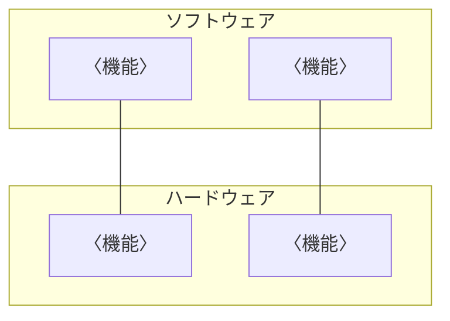
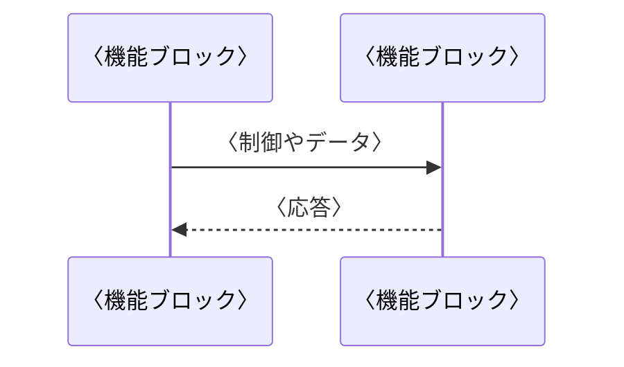

---
# 〈 〉の仮の文字を書き換える。承認欄は、名前と日付を書かなければ空欄(押印欄)になる
title: システム・アーキテクチャ設計書
subtitle: 〈製品名〉
doc-number: 〈文書番号〉
version: "〈版数〉"
date: 〈発行日〉
author: 〈作成者〉
organization: 〈発行部署〉
keywords: [システム・アーキテクチャ, 〈製品名〉]
subject: 〈製品名〉のハードウェアとソフトウェアの構成と制御方式
approval:
  - role: 承認
  - role: 審査
  - role: 作成
# 改訂履歴は、版を出すたびに次の形で足す(作成者の列はない)。書かなければ、空の行だけの表になる
# history:
#   - version: "〈版数〉"
#     date: 〈日付〉
#     changes: 〈改訂内容〉
#     note: 〈備考〉
pubpdf:
  cover: formal
  cover-frame: true         # 表紙を二重の線で囲む
  approval-stamp: true      # 承認欄に押印の欄を空ける
  # 改訂履歴を IPA の様式(項番、日付、バージョン、改訂内容、備考)にする
  history-title: 改訂履歴
  history-columns: [number, date, "version: バージョン", "changes: 改訂内容", note]
  history-blank-rows: 10    # 手書き用の空の行
  guides: true              # 記入の指示の囲みを出す。書き終えて仕上げるときは false にして消す
  confidential: 社外秘
  page-count: roman         # 目次まではローマ数字、本文は 1 から
  numbering: decimal
  heading-format: ["1.", "1.1", "(1)", "①"]
  figure-numbering: section # 図表の番号を「表 3.1-1」の形にする
  toc: 2
  list-of-figures: true
  list-of-tables: true
  header-left: ""
  header-right: "{title}"
  header-rule: true         # ヘッダの下に線を引く
  footer-left: "{doc-number} 第 {version} 版"
  footer-center: "{page} / {total}"
  footer-right: "{organization}"
  footer-rule: true         # フッタの上に線を引く
---

# 概要

::: {.guide}
ドキュメントの目的、位置づけ、記載内容などの本書の概要および参照しているドキュメント名等を記載する。
:::

## 目的

本書は、〈製品名〉のシステム要求を、ハードウェアとソフトウェアでどのように実現するかを定める。

## 位置づけ

〈本書の入力となった文書(システム要求仕様書、安全要求仕様書)と、本書を入力とする文書を書く〉

## 対象ユーザ

〈本書を読む人を書く〉

## 記載範囲

〈本書で扱う範囲と、扱わない範囲を書く〉

## 参照ドキュメント

| ID | 文書名 | 文書番号 | 発行年月 | 備考 |
|---|---|---|---|---|
| 〈ID〉 | 〈文書の名前〉 | 〈文書番号〉 | 〈年/月〉 | 〈備考〉 |
| | | | | |
| | | | | |

: 参照ドキュメント {#tbl-refs}

## 定義(用語、略語)

| ID | 用語・略号 | 正式表記 | 意味 |
|---|---|---|---|
| 〈ID〉 | 〈用語〉 | 〈正式な表記〉 | 〈用語の意味を書く〉 |
| | | | |
| | | | |

: 定義(用語、略語) {#tbl-terms}

# システム構成

## システム全体構成

::: {.guide}
＊システムを構成する機能をハードウェア、ソフトウェアそれぞれの視点から検討し、機能ブロックとして整理する

- ハードウェアとソフトウェアそれぞれの役割分担、位置づけを明確にする
:::

# 機能ブロック概要

## システムを構成する機能ブロック

::: {.guide}
＊2.1 で整理したシステムの機能を一覧表などでまとめる
:::

| 機能ブロック ID | 機能ブロック名 | 機能概要 | 役割分担 | 関連機能 ID |
|---|---|---|---|---|
| 〈ID〉 | 〈機能ブロック名〉 | 〈機能の概要を書く〉 | 〈HW、SW〉 | 〈機能 ID〉 |
| | | | | |
| | | | | |

: 機能ブロック {#tbl-fb}

## 機能ブロック間のインタフェース

::: {.guide}
＊各機能ブロック間の制御、データを明確にする。
:::

〈図か表で書く〉

# 制御方式

## 動作シーケンス

::: {.guide}
＊個々の機能ブロックがどのように連携してシステムの機能サービスを実現していくか、動作シーケンス図などで整理する
:::

## ユースケースと機能ブロックの対応

::: {.guide}
＊システム要求定義で検討したユースケースをもとにして、ユースケースと機能ブロックの対応付けを整理する
:::

〈表で書く〉

## 性能見積

::: {.guide}
＊システム要求定義で検討した非機能要求をもとにして、システムの動作に関する制約時間(例: レスポンスタイム)など、ソフトウェア動作、ハードウェア動作の時間的な側面に関する概算見積りを整理する
:::

〈必要性能、見積り、根拠を書く〉

# 機能ブロック詳細

::: {.guide}
＊機能ブロックごとに機能の入出力インタフェース、処理方式、共通領域などを整理する。
:::

〈機能ブロックごとに節を分けて書く〉

# システムで扱うデータ

::: {.guide}
センサーやアクチュエータなどでやり取りされる共通データ(種類、量、精度など)を整理する。共通データなどシステム全体で共通に扱うデータの使用目的、更新/参照元などを記載する。
:::

| データ ID | データ名 | 概要 | 関連機能ブロック ID |
|---|---|---|---|
| 〈ID〉 | 〈データ名〉 | 〈データの概要を書く〉 | 〈機能ブロック ID〉 |
| | | | |
| | | | |

: システムで扱うデータ {#tbl-data}

# 例外一覧

::: {.guide}
異常/例外時のコード、メッセージ、意味、対策などを一覧表として記載する。
:::

| 例外コード | 例外内容 | 対処方法 | 備考 |
|---|---|---|---|
| 〈コード〉 | 〈例外の内容〉 | 〈対処の方法を書く〉 | 〈備考〉 |
| | | | |
| | | | |

: 例外一覧 {#tbl-exceptions}

# その他

::: {.guide}
システム全体を通して、開発チーム全員で情報共有すべき事柄を記載する。

- 共通制御情報域の詳細(共通領域内の各情報域の名称、構成、形式、サイズ、初期値、アクセス制限など)
:::

〈特記事項を書く〉
