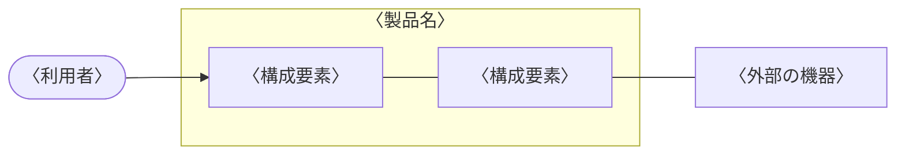

---
# 〈 〉の仮の文字を書き換える。承認欄は、名前と日付を書かなければ空欄(押印欄)になる
title: システム要求仕様書
subtitle: 〈製品名〉
doc-number: 〈文書番号〉
version: "〈版数〉"
date: 〈発行日〉
author: 〈作成者〉
organization: 〈発行部署〉
keywords: [システム要求, 〈製品名〉]
subject: 〈製品名〉がシステムとして実現する要求
approval:
  - role: 承認
  - role: 審査
  - role: 作成
# 改訂履歴は、版を出すたびに次の形で足す(作成者の列はない)。書かなければ、空の行だけの表になる
# history:
#   - version: "〈版数〉"
#     date: 〈日付〉
#     changes: 〈改訂内容〉
#     note: 〈備考〉
pubpdf:
  cover: formal
  cover-frame: true         # 表紙を二重の線で囲む
  approval-stamp: true      # 承認欄に押印の欄を空ける
  # 改訂履歴を IPA の様式(項番、日付、バージョン、改訂内容、備考)にする
  history-title: 改訂履歴
  history-columns: [number, date, "version: バージョン", "changes: 改訂内容", note]
  history-blank-rows: 10    # 手書き用の空の行
  guides: true              # 記入の指示の囲みを出す。書き終えて仕上げるときは false にして消す
  confidential: 社外秘
  page-count: roman         # 目次まではローマ数字、本文は 1 から
  numbering: decimal
  heading-format: ["1.", "1.1", "(1)", "①"]
  figure-numbering: section # 図表の番号を「表 3.1-1」の形にする
  toc: 2
  list-of-figures: true
  list-of-tables: true
  header-left: ""
  header-right: "{title}"
  header-rule: true         # ヘッダの下に線を引く
  footer-left: "{doc-number} 第 {version} 版"
  footer-center: "{page} / {total}"
  footer-right: "{organization}"
  footer-rule: true         # フッタの上に線を引く
---

# 概要

::: {.guide}
ドキュメントの目的、位置づけ、記載内容などの本書の概要および参照しているドキュメント名等を記載する。
:::

## 目的

本書は、〈製品名〉について、システムとして実現する機能の要求、非機能の要求、制約条件を定める。

## 位置づけ

〈本書の入力となった文書と、本書を入力とする文書を書く〉

## 対象ユーザ

〈本書を読む人を書く〉

## 記載範囲

〈本書で扱う範囲と、扱わない範囲を書く〉

## 参照ドキュメント

| ID | 文書名 | 文書番号 | 発行年月 | 備考 |
|---|---|---|---|---|
| 〈ID〉 | 〈文書の名前〉 | 〈文書番号〉 | 〈年/月〉 | 〈備考〉 |
| | | | | |
| | | | | |

: 参照ドキュメント {#tbl-refs}

## 定義(用語、略語)

| ID | 用語・略号 | 正式表記 | 意味 |
|---|---|---|---|
| 〈ID〉 | 〈用語〉 | 〈正式な表記〉 | 〈用語の意味を書く〉 |
| | | | |
| | | | |

: 定義(用語、略語) {#tbl-terms}

# システム構成

## システム全体構成

::: {.guide}
＊ハードウェアとソフトウェアを含むシステム全体構成をブロック図などで整理し、システムの動作環境や外部環境も含めてシステムの位置づけを明確にする
:::

## システムを構成する主たる要素

::: {.guide}
＊2.1 で整理したシステムの構成要素の概要を一覧表などでまとめる
:::

| 構成要素 ID | 構成要素 | 概要 |
|---|---|---|
| 〈ID〉 | 〈構成要素の名前〉 | 〈構成要素の概要を書く〉 |
| | | |
| | | |

: システムを構成する主たる要素 {#tbl-elements}

# 機能概要

::: {.guide}
＊システムとして実現する機能の概要などを簡潔に整理する
:::

〈機能の概要を箇条書きか表で書く。詳細は 6 章に書く〉

# 制約条件

## ハードウェアなどを含めたシステム全体の構成と制約

::: {.guide}
＊製品の動作環境、保守方法、準拠規約などの制約条件を整理する

- 製品開発に割くことのできる期間や開発コスト
- 製品の耐用年数や製品寿命
- 製品に期待される品質(信頼性、安全性、使い勝手など)
- 既存製品仕様との継続性に関する制約
- 既存システムの再利用に関する制約
- セキュリティ、環境問題に関する制約
- システムの利用などに付随する法的な制約、社会慣習面での制約
- 他社などの知的財産権、他社技術などとの関係
:::

〈制約を書く〉

## 周辺システム、利用するハードウェアおよびソフトウェア

::: {.guide}
＊製品を利用する上で前提として利用されるシステム、ハードウェア(周辺システムやハードウェア等)、ソフトウェア(OS、ミドルウェア等)があれば整理する。
:::

| 種類 | 名称 | バージョン |
|---|---|---|
| 利用する OS | 〈名称〉 | 〈版〉 |
| 利用するミドルウェア | | |
| | | |

: 周辺システムと利用するハードウェア、ソフトウェア {#tbl-platform}

# ユースケースとユースケース・シナリオ

::: {.guide}
＊製品の利用シーンや利用コンテキストをもとにしたユースケースとユースケースシナリオを整理する
:::

| ユースケース ID | ユースケース名 | 概要 |
|---|---|---|
| 〈ID〉 | 〈ユースケース名〉 | 〈ユースケースの概要を書く〉 |
| | | |
| | | |

: ユースケース一覧 {#tbl-usecases}

〈ユースケースごとに、アクター、事前条件、基本シナリオ、代替シナリオ、事後条件を書く〉

# 機能詳細

::: {.guide}
＊ユースケースを実現する機能について整理する
:::

〈機能ごとに節を分けて書く〉

# 性能・品質等非機能要求詳細

## 信頼性に関する要求

::: {.guide}
＊システムの異常時の処理なども考慮して整理する

- システムの異常処理方式
- システムの異常動作モードからの復帰手順や復帰方式
:::

〈要求を書く〉

## 使用性に関する要求

::: {.guide}
＊ユーザインタフェースの操作性、レスポンスなども考慮して整理する
:::

〈要求を書く〉

## 効率性に関する要求

::: {.guide}
＊システムの効率性に関する要求を整理する

- システムの実行性能(例: 処理速度、起動時間、応答時間など)
- リアルタイム処理の程度
- リソース効率(例: メモリ容量、データサイズなど)
:::

〈要求を書く〉

## 保守性・移植性に関する要求

::: {.guide}
＊各機能の将来の再利用(システム機能の独立性など)や保守(リモートメンテナンスなど)などの可能性についても整理する
:::

〈要求を書く〉

## セキュリティ面に関する要求

::: {.guide}
＊システムの要求に応じてセキュリティ(暗号化、ユーザ認証、ウィルス対策など)も考慮して整理する
:::

〈要求を書く〉

# その他

::: {.guide}
＊相互運用性(例: 通信プロトコルなど)\
＊外部インタフェース要求(例: 周辺システムとのインタフェース、ユーザインタフェースなど)
:::

〈特記事項を書く〉
