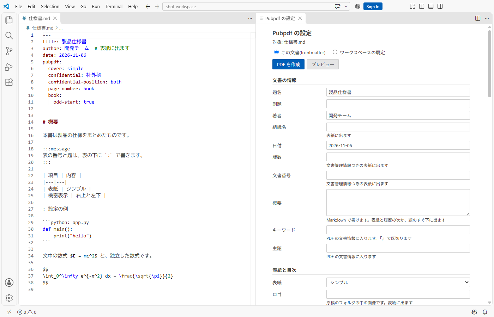
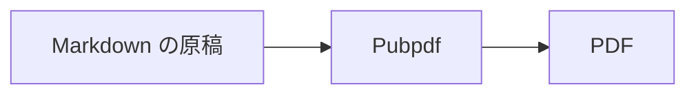

# 本書について

この文書は、Pubpdf でできることの見本です。原稿の `test.md` と、作った PDF を見比べてください。

表紙、バージョン履歴、概要、目次、機密表示、ページ番号は、原稿の先頭の YAML から作っています。`#` を外した行の設定も試してみてください。

YAML の値は本文にも差し込めます。この文書の版は  で、`` と書いています。

ここに載せたのは代表的な機能だけです。フォントの指定、定理、参考文献、付録、複数の md の合本、ヘッダとフッタの文字、透かし、ロゴ、色、PDF の規格などは、使い方マニュアル(`docs/manual/manual.pdf`)を参照してください。YAML の `#` を外すと試せるものもあります。

# 表、図、数式

## 表の題と番号

表の下に `: 題` を書くと、題と番号が付きます。`{#tbl-名前}` を付けると、`@tbl-名前` で参照できます。

| 設定 | 内容 |
|---|---|
| `cover` | 表紙の型 |
| `numbering` | 見出しの番号の形 |
| `page-number` | ページ番号の位置 |

: よく使う設定 {#tbl-settings}

@tbl-settings は、題の行の `{#tbl-settings}` を参照しています。

## 図の番号と寄せ

画像の後ろの `{ }` に、ID、幅、寄せを書けます。

{#fig-panel width=60% fig-align="center"}

@fig-panel のように、図も番号で参照できます。

## Mermaid の図

コードブロックの言語を `mermaid` にすると、図になります。`%%|` の行で番号と題を付けられます。



## 数式

独立した式には、自動で番号が入ります。

$$
a^2 + b^2 = c^2
$$

`{#eq-名前}` を付けると、`@eq-名前` で参照できます。

$$
E = mc^2
$$ {#eq-energy}

@eq-energy のように参照できます。番号を入れない式には `\notag` を書きます。

$$
\int_0^1 x^2 \, dx = \frac{1}{3} \notag
$$

文中の式は $f(x) = x^2$ のように書きます。日本語との間は自動で少し空きます。

# コードと囲み

## ファイル名つきのコード

言語名の後に `: ファイル名` を書くと、左上にファイル名が出ます。

```python: app.py
def greet(name):
    return f"こんにちは、{name} さん"
```

## 行番号つきのコード

`code-line-numbers="true"` を付けると、行番号が出ます。

```{.python code-line-numbers="true"}
for i in range(3):
    print(i)
```

## 色付きの囲み

`:::` の記法で書けます。

:::message
`:::message` は黄色の囲みです。
:::

:::note warn
`:::note warn` はオレンジの囲みです。
:::

:::message alert
`:::message alert` は赤の囲みです。
:::

:::details 詳しい説明の題
`:::details 題` は灰色の囲みです。PDF では中身を常に表示します。
:::

## 文字の寄せ

`::: {.right}` の囲みの中は右に、`::: {.center}` の囲みの中は中央に寄ります。行の途中で改行するときは、行末に `\` を書きます。

::: {.right}
2026年11月7日\
**開発チーム**
:::

::: {.center}
以上
:::

## 段組み

`::: {.columns}` の囲みの中は 2 段に組みます。`count` で段数を変えられ、段の長さは自動で揃います。

::: {.columns}
段組みにした文章は、左の段から右の段へ流れます。長い説明の一部だけを段組みにしたいときに使います。文書全体を段組みにするときは、YAML の `columns` を使います。
:::

`.column` の囲みを並べると、幅を指定して横に並べられます。

::: {.columns}
::: {.column width="30%"}
左の列(30%)
:::

::: {.column width="70%"}
右の列(70%)。説明と図を左右に並べたいときなどに使います。
:::
:::

# ページの制御

## 横向きのページ

幅の広い表などは `.landscape` の囲みに入れると、その部分だけ横向きのページになります。

::: {.landscape}

| 項目 | 4月 | 5月 | 6月 | 7月 | 8月 | 9月 | 10月 | 11月 | 12月 | 1月 | 2月 | 3月 |
|---|---:|---:|---:|---:|---:|---:|---:|---:|---:|---:|---:|---:|
| 売上 | 120 | 135 | 128 | 142 | 150 | 138 | 160 | 155 | 170 | 148 | 152 | 180 |
| 費用 | 90 | 95 | 92 | 101 | 108 | 99 | 112 | 110 | 118 | 104 | 107 | 121 |

: 横向きのページに置いた表

:::

## 改ページ

改ページしたい場所に、`` か `\newpage` を1行で書きます。次の行で改ページします。



このページは、前の行で改ページした後のページです。ページ番号は表紙を1として通しで数えています。
