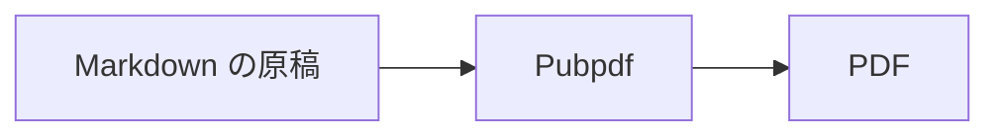
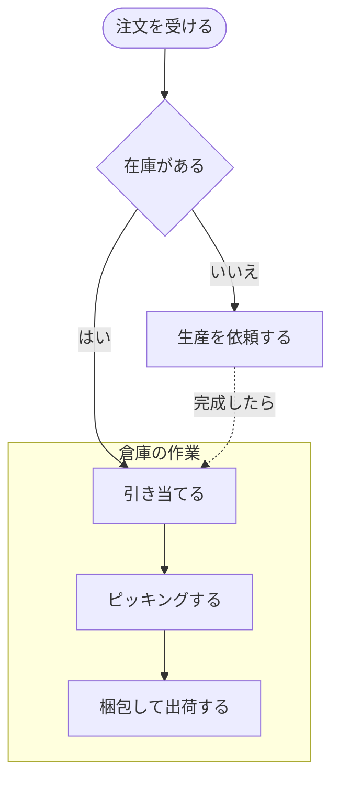
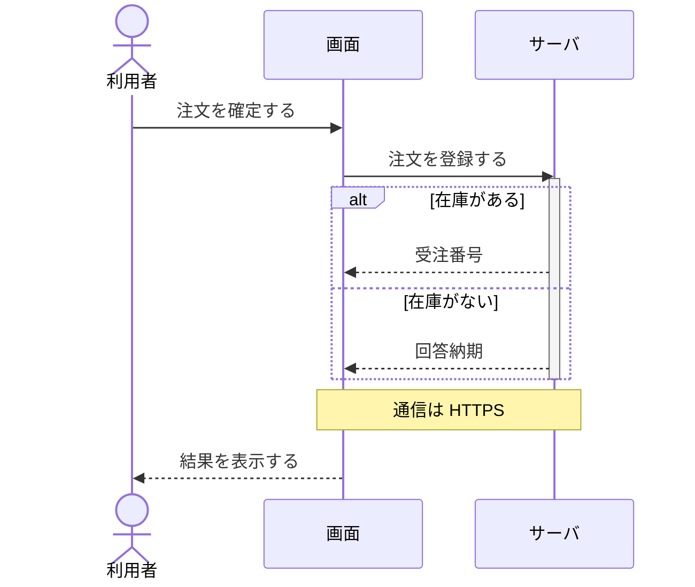
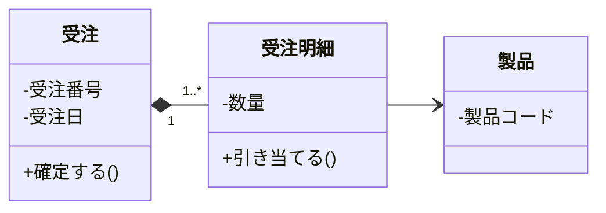
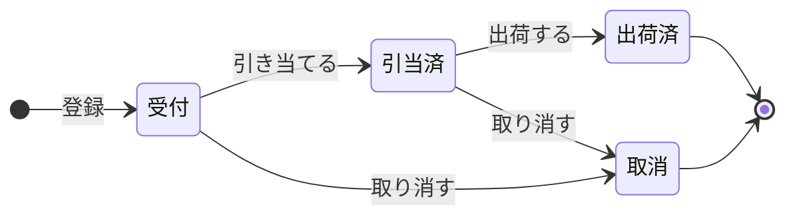
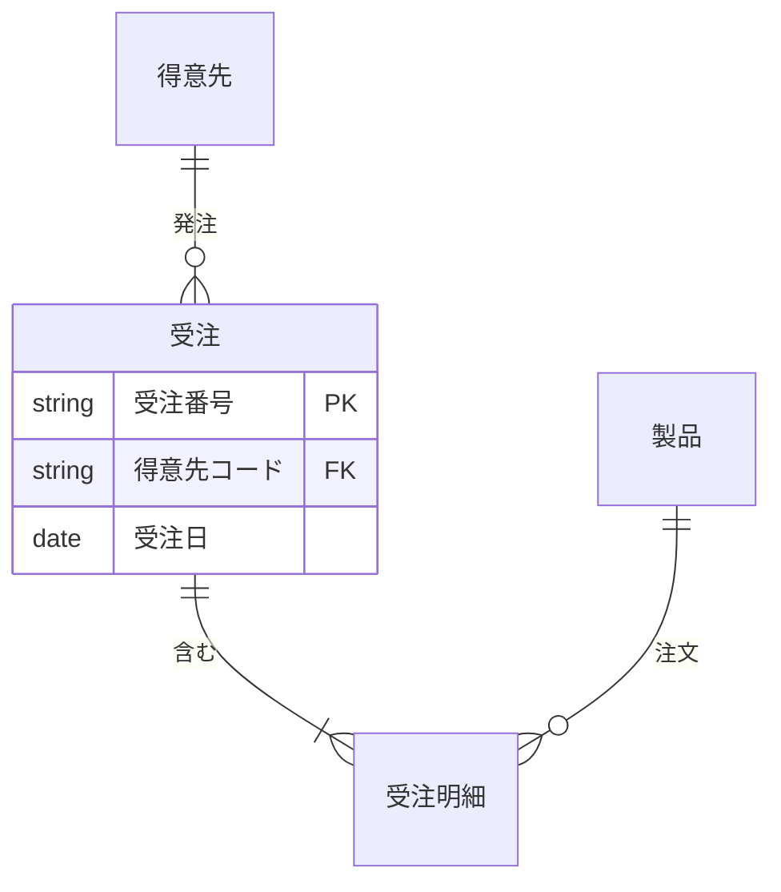

# 本書について

この文書は、Pubpdf でできることの見本です。原稿の `test.md` と、作った PDF を見比べてください。

表紙、バージョン履歴、概要、目次、機密表示、ページ番号は、原稿の先頭の YAML から作っています。`#` を外した行の設定も試してみてください。

YAML の値は本文にも差し込めます。この文書の版は  で、`` と書いています。

ここに載せたのは代表的な機能だけです。フォントの指定、参考文献、付録、複数の md の合本、ヘッダとフッタの文字、透かし、ロゴ、色、PDF の規格などは、使い方マニュアル(`docs/manual/manual.pdf`)を参照してください。YAML の `#` を外すと試せるものもあります。

# 表、図、数式

## 表の題と番号

表の下に `: 題` を書くと、題と番号が付きます。`{#tbl-名前}` を付けると、`@tbl-名前` で参照できます。

| 設定 | 内容 |
|---|---|
| `cover` | 表紙の型 |
| `numbering` | 見出しの番号の形 |
| `page-number` | ページ番号の位置 |

: よく使う設定 {#tbl-settings}

@tbl-settings は、題の行の `{#tbl-settings}` を参照しています。

## 図の番号と寄せ

画像の後ろの `{ }` に、ID、幅、寄せを書けます。

{#fig-panel width=60% fig-align="center"}

@fig-panel のように、図も番号で参照できます。

## Mermaid の図

コードブロックの言語を `mermaid` にすると、図になります。`%%|` の行で番号と題を付けられます。Pubpdf は、Mermaid の図をほかの図と同じ色とフォントで描かせ、flowchart の線を角の丸い折れ線にします。



判断の菱形、subgraph の枠、破線の矢印は @fig-mermaid-flowchart のようになります。











@fig-mermaid-er と同じ書き方で、言語を `er` にすると、Pubpdf が描きます(@fig-er)。

`%%{init: {"theme": "default"}}%%` のように theme を選ぶと、Mermaid の元の見た目になります(@fig-mermaid-default)。


## 数式

独立した式には、自動で番号が入ります。

$$
a^2 + b^2 = c^2
$$

`{#eq-名前}` を付けると、`@eq-名前` で参照できます。

$$
E = mc^2
$$ {#eq-energy}

@eq-energy のように参照できます。番号を入れない式には `\notag` を書きます。

$$
\int_0^1 x^2 \, dx = \frac{1}{3} \notag
$$

文中の式は $f(x) = x^2$ のように書きます。日本語との間は自動で少し空きます。

# コードと囲み

## ファイル名つきのコード

言語名の後に `: ファイル名` を書くと、左上にファイル名が出ます。

```python: app.py
def greet(name):
    return f"こんにちは、{name} さん"
```

## 行番号つきのコード

`code-line-numbers="true"` を付けると、行番号が出ます。

```{.python code-line-numbers="true"}
for i in range(3):
    print(i)
```

## 色付きの囲み

`:::` の記法で書けます。

:::message
`:::message` は黄色の囲みです。
:::

:::note warn
`:::note warn` はオレンジの囲みです。
:::

:::message alert
`:::message alert` は赤の囲みです。
:::

:::details 詳しい説明の題
`:::details 題` は灰色の囲みです。PDF では中身を常に表示します。
:::

## 文字の寄せ

`::: {.right}` の囲みの中は右に、`::: {.center}` の囲みの中は中央に寄ります。行の途中で改行するときは、行末に `\` を書きます。

::: {.right}
2026年11月7日\
**開発チーム**
:::

::: {.center}
以上
:::

## 段組み

`::: {.columns}` の囲みの中は 2 段に組みます。`count` で段数を変えられ、段の長さは自動で揃います。

::: {.columns}
段組みにした文章は、左の段から右の段へ流れます。長い説明の一部だけを段組みにしたいときに使います。文書全体を段組みにするときは、YAML の `columns` を使います。
:::

`.column` の囲みを並べると、幅を指定して横に並べられます。

::: {.columns}
::: {.column width="30%"}
左の列(30%)
:::

::: {.column width="70%"}
右の列(70%)。説明と図を左右に並べたいときなどに使います。
:::
:::

# Markdown を拡張した記法

通常の Markdown にはない記法のうち、代表的なものです。

## 文字の修飾

| 書き方 | 組み上がり |
|---|---|
| `~~取り消し~~` | ~~取り消し~~ |
| `H~2~O` | H~2~O |
| `x^2^` | x^2^ |
| `[下線]{.underline}` | [下線]{.underline} |
| `[蛍光ペン]{.mark}` | [蛍光ペン]{.mark} |

: 文字の修飾

## 脚注とチェックリスト

文の途中に `^[脚注の文]` と書くと、ページの下に脚注が出ます^[これが脚注の文です。]。

行の先頭に `- [x]` か `- [ ]` と書くと、チェックリストになります。

- [x] 終わった作業
- [ ] まだの作業

## 注意書きの囲み

`:::message` のほかに、Quarto の書き方もあります。`callout-note`、`callout-tip`、`callout-warning`、`callout-important`、`callout-caution` の 5 種類です。

::: {.callout-note title="題を書けます"}
`::: {.callout-note title="題"}` の囲みです。
:::

::: {.callout-warning}
`::: {.callout-warning}` の囲みです。
:::

## 定理と証明

`{#thm-名前}` の囲みに番号が付き、`@thm-名前` で参照できます。定義は `def-`、補題は `lem-`、例は `exm-` で始めます。

::: {#thm-pythagoras}
## 三平方の定理
直角三角形では $a^2 + b^2 = c^2$ です。
:::

@thm-pythagoras の証明は次のとおりです。

::: {.proof}
`::: {.proof}` の囲みです。
:::

## 図の横並び

`::: {#fig-名前 layout-ncol=2}` の囲みに画像を並べると、横に並びます。最後の行が全体の題です。

::: {#fig-side layout-ncol=2}
{#fig-side-a}

{#fig-side-b}

横に並べた図
:::

@fig-side の全体と、@fig-side-a の個々の図を参照できます。

## 見出しへの参照 {#sec-reference}

見出しの後ろに `{#sec-名前}` と書くと、`@sec-名前` で参照できます。この節は @sec-reference です。番号を付けない見出しには `{.unnumbered}` と書きます。

## 表の網掛けとセルの中の改行

セルの中身を `[文字]{.shade}` と書くと、網掛けになります。`<br>` でセルの中を改行します。

| 項目 | 内容 |
|---|---|
| [PU ID]{.shade} | PU-0101 |
| [処理内容]{.shade} | 温度を読む<br>PV を更新する |

: 網掛けと改行のある表

## HTML の表

`<table>` で書いた表も組めます。`rowspan` と `colspan` でセルを結合できます。

<table>
<tr><th rowspan="2">機能</th><th colspan="2">エンティティ</th></tr>
<tr><th>顧客</th><th>受注</th></tr>
<tr><td>受注の登録</td><td>R</td><td>C</td></tr>
</table>

: HTML で書いた表

## 記入の指示と小さい文字の表

テンプレートの書き方の説明は、`::: {.guide}` の囲みに書きます。設定の `guides: false` で組むと消えます。

::: {.guide}
＊ ここに本書の目的を書く。
:::

表の題に `.small` を書くと、その表の文字が小さくなります。`tbl-colwidths` で列の幅の比も決められます。

| ID | 分類 | 内容 | 期待結果 | 結果 |
|---|---|---|---|---|
| T-01 | 起動 | 電源を入れて起動を確かめる | 3 秒以内に停止の状態になる | ○ |

: 文字を小さくした表 {.small tbl-colwidths="[10,10,40,30,10]"}

## Typst を直接書く

コードブロックの言語を `{=typst}` にすると、Typst の記法を直接書けます。設定や Markdown で足りないときに使います。

```{=typst}
#text(fill: rgb("#0a7d5a"))[Typst で色を付けた文字です。]
```

## そのほかの記法

| 書き方 | 内容 |
|---|---|
| `[@キー]` | 文献の引用。YAML の `bibliography` に `.bib` ファイルを指定します |
| `# 見出し {.appendix}` | 付録にします。「付録 A」と番号が付きます |
| `` | YAML の値を差し込みます |
| `` | 改ページします |
| `::: {.landscape}` | その部分を横向きのページにします |

: そのほかの記法

# Pubpdf が描く図

コードブロックの言語を次の名前にすると、図になります。文字は検索でき、ブラウザも要りません。`%%| label: fig-名前` で参照でき、`%%| fig-cap: 題` で題と番号が付きます。

| 言語 | 図 | 書き方 |
|---|---|---|
| `tree` | ディレクトリ構造 | 字下げか `tree` コマンドの出力 |
| `chart` | 棒、折れ線、円グラフ | Markdown の表 |
| `schedule` | 工程表 | 「作業: 期間」の行 |
| `bits` | ビット配置 | 「ビット数 名前」の行 |
| `layers` | 層構造 | 1 行が 1 層。縦棒で区切る |
| `timing` | 信号の波形 | 「名前: 波形」の行 |
| `wbs` | 作業分解、組織図 | 字下げ |
| `wireframe` | 画面の模式図 | `[ボタン]` や `"入力"` の行 |
| `data` | JSON と YAML の図 | JSON か YAML |
| `network` | ネットワーク図 | ネットワークの行と字下げした機器の行 |
| `usecase` | ユースケース図 | 「利用者: 機能, 機能」の行 |
| `swimlane` | スイムレーンの業務フロー | 「レーン: 記号 文字」の行 |
| `fta` | 故障の木(FTA) | 字下げ。下に事象のある事象は先頭に AND か OR |
| `grid` | 帳票と画面の方眼 | 「行, 桁: 文字」の行 |
| `er` | ER 図 | Mermaid の erDiagram と同じ。置き場所は表の形の行 |
| `screenflow` | 画面遷移図 | 「画面 -> 操作: 画面」の行。置き場所は表の形の行 |

: 図の種類

代表的なものを載せます。残りの書き方は、使い方マニュアルを参照してください。

## ディレクトリ構造

```tree
%%| label: fig-tree
%%| fig-cap: 説明つきのディレクトリ構造
project/
  src/               # ソースコード
    main.py          # 入口
    共通処理.py       # 日本語の名前でも線がずれません
  docs/
    manual.md
  README.md
```

@fig-tree は字下げで書いています。`#` の後ろは右の列の説明になります。

## グラフ

```chart
%%| label: fig-chart
%%| fig-cap: 表から作ったグラフ
unit: 万円
lines: 費用            # 折れ線にする列。type: line、type: pie も書けます
| 月 | 売上 | 費用 |
|---|---|---|
| 4月 | 120 | 90 |
| 5月 | 135 | 95 |
| 6月 | 128 | 92 |
```

## 工程表

```schedule
%%| fig-cap: 組むたびに変わらない工程表
columns: 4月, 5月, 6月, 7月, 8月, 9月
設計
基本設計: 4月-5月
詳細設計: 5月-6月
開発
実装: 6月-8月
結合試験: 8月-9月
◆ リリース: 9月
```

`2026-04-01 ~ 2026-05-15` のように日付でも書けます。行の先頭の `◆` は節目の印です。

## ビット配置

```bits
%%| fig-cap: ヘッダの形式
width: 16
4 版
4 長さ
8 種別
16 チェックサム
```

## 信号の波形

```timing
%%| fig-cap: 読み出しの波形
clk: p.......
req: 0.1...0.
data: x..=.=.x A, B
```

`p` はクロック、`0` と `1` は信号の高さ、`x` は不定、`=` は値、`.` は前の続きです。

## 作業分解

```wbs
%%| fig-cap: 作業分解
プロジェクト
  設計
    基本設計
    詳細設計
  開発
    実装
    単体試験
  試験
    結合試験
```

## 故障の木

```fta
%%| label: fig-fta
%%| fig-cap: 葉の多い故障の木
OR 搬送装置が<br>停止しない
  AND 非常停止が効かない
    非常停止ボタンの接点の溶着
    安全リレーの故障
    \OR 回路の誤配線
  OR 制御が停止を指示しない
    センサの故障
    通信の途絶を検知しない
    プログラムの誤り
    ◇ 保守作業による改変
  OR 駆動が止まらない
    インバータの故障
    ブレーキの摩耗
    電磁接触器の溶着
```

基本の事象が多くて横に入らないので、@fig-fta はゲートの下に縦に並べています。名前の中の `<br>` は改行です。`OR` で始まる名前は、先頭に `\` を付けて書きます。

## ER 図

```er
%%| label: fig-er
%%| fig-cap: ER 図(er)
| 社員   | 受注 | 受注明細 |
| 得意先 |      | 製品     |
社員 ||--o{ 受注 : 担当
得意先 ||--o{ 受注 : 発注
受注 ||--|{ 受注明細 : 含む
製品 ||--o{ 受注明細 : 注文
社員 |o..o{ 得意先 : 営業担当
受注 ORDER_HEADER {
  string 受注番号 PK
  string 得意先コード FK
  string 担当者コード FK
  date 受注日
}
受注明細 ORDER_DETAIL {
  受注番号 PK, FK
  明細番号 PK
  製品コード FK
  数量
}
得意先 CUSTOMER {
  得意先コード PK
  得意先名
}
```

先頭の `|` の行が箱の置き場所です。属性を書かない箱(社員、製品)は小さな箱になります。`..` の関係(営業担当)は破線になります。

## 画面遷移図

```screenflow
%%| label: fig-screenflow
%%| fig-cap: 画面遷移図
| SC-01 ログイン |                | SC-90 エラー   |
| SC-02 メニュー |                |                |
| SC-03 注文入力 | SC-04 商品検索 | SC-05 注文履歴 |
| RP-01 注文書   | EX-01 決済代行 |                |
小画面: SC-04
帳票: RP-01
共通: SC-90
外部: EX-01
SC-01 -> ログイン: SC-02
SC-02 -> 注文: SC-03, 履歴: SC-05
SC-03 -> 検索: SC-04
SC-04 -> 選択: SC-03
SC-03 -> 確定: RP-01
SC-03 ..> 支払い: EX-01
```

画面は窓の形、別ウィンドウの小画面は破線の枠、帳票は文書の形、どの画面からも移るエラーの画面は黄色、ほかのシステムは灰色の箱で描きます。

# ページの制御

## 横向きのページ

幅の広い表などは `.landscape` の囲みに入れると、その部分だけ横向きのページになります。

::: {.landscape}

| 項目 | 4月 | 5月 | 6月 | 7月 | 8月 | 9月 | 10月 | 11月 | 12月 | 1月 | 2月 | 3月 |
|---|---:|---:|---:|---:|---:|---:|---:|---:|---:|---:|---:|---:|
| 売上 | 120 | 135 | 128 | 142 | 150 | 138 | 160 | 155 | 170 | 148 | 152 | 180 |
| 費用 | 90 | 95 | 92 | 101 | 108 | 99 | 112 | 110 | 118 | 104 | 107 | 121 |

: 横向きのページに置いた表

:::

## 改ページ

改ページしたい場所に、`` か `\newpage` を1行で書きます。次の行で改ページします。



このページは、前の行で改ページした後のページです。ページ番号は表紙を1として通しで数えています。
